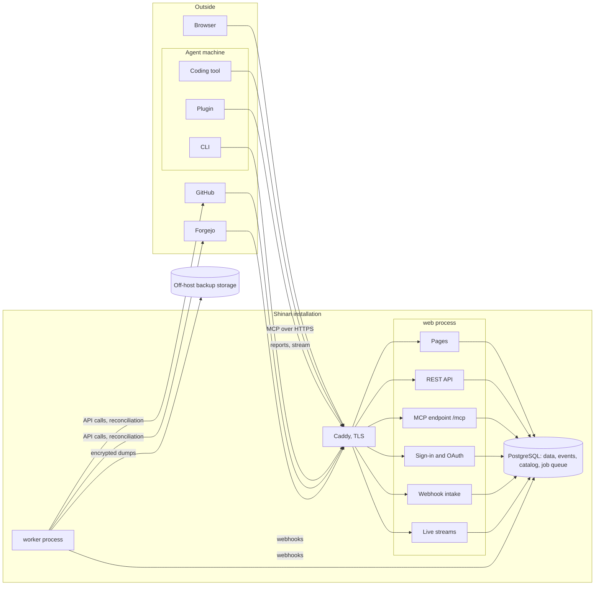

# Architecture and operations

Status: **draft for review** ([issue #11](https://github.com/guneet-xyz/shinan/issues/11)).

This document proposes how Shinan is built and run: the technology stack options
(D-020), the parts of the system and how they talk, where data lives, how the
catalog's Markdown and its agent index stay in sync (D-006), how git host events
come in, how agents and plugins reach Shinan, security for a public app with
sign-in (D-015), deployment on Musashi at `shinan.guneet.dev` (D-016),
self-hosting (D-012), observability, and backups.

It does not specify what the other documents own: catalog schema and conflict
rules, task rules, sign-in method and token rules, git host event lists, MCP
tool lists or screens. It links to them instead (see
[Dependencies](#dependencies-on-other-documents)).

## How to read this document

Every statement is marked:

- **Decided**: follows from an accepted plan decision, which is cited.
- **Proposed**: suggested here, with a reason. The owner confirms or changes it.
  Proposals that change or reinterpret an accepted plan decision or a Musashi
  rule are also listed under
  [Decisions needed from the owner](#decisions-needed-from-the-owner).
- **Open**: not settled; listed under [Open questions](#open-questions).

Terms follow the [domain model and glossary](domain-model.md) (in review in
[PR #14](https://github.com/guneet-xyz/shinan/pull/14), read at `8bb5d65`). In
particular, a **Shinan installation** is one running copy of Shinan; a
**workspace** is a team's container inside it. "Sync" is used only for the
catalog Markdown and its index; keeping up with git hosts is
**reconciliation**.

Sibling drafts read for alignment (all in review, not yet accepted):
[catalog](https://github.com/guneet-xyz/shinan/pull/18) (`08fda4d`),
[tasks and work](https://github.com/guneet-xyz/shinan/pull/20) (`1418e2a`),
[git host integrations](https://github.com/guneet-xyz/shinan/pull/21) (`99e71a2`)
and identity (branch `task/7-identity`). Section numbers cited from them may
change.

External facts were checked against primary sources on **2026-11-16**. Facts
about Musashi and its services come from the `workspace` repository's catalog at
revision `86bba32` and the Musashi infrastructure repository (`infra/musashi`) at
`29a8cba`, both read on 2026-11-16. Nothing was deployed, and no DNS or server
action was taken.

## Summary

| Area | Main proposal |
|---|---|
| Stack (D-020) | Language and framework are chosen separately. Recommended: **TypeScript** with a plain Node.js server and a React single-page app (**option A′**). Alternatives: A, TypeScript with Next.js (the owner's current framework); B, Go; C, Elixir with Phoenix. |
| Shape | One codebase and one container image, run as two processes: `web` (pages, API, MCP endpoint, webhook intake, live streams) and `worker` (background jobs). |
| Storage | PostgreSQL for everything, including the job queue. No Redis, no file storage in the first version. |
| Catalog (D-006) | Every applied catalog revision is a set of Markdown documents; everything else is derived from that text and can be rebuilt. Changes are applied as text edits; the index is built only from stored text, in the same transaction. Where the text is stored (PostgreSQL, or a Git repository only Shinan writes) is an owner decision. |
| Git hosts | Webhooks are verified, stored and acknowledged at once, then processed by the worker. Reconciliation catches anything missed. Both produce the same idempotent events. |
| Agents | A remote MCP endpoint at `/mcp` with OAuth-based authorization, a REST API for the CLI and plugins, and a server-sent event stream that delivers nudges to plugins. All connections go out from the agent's machine over HTTPS. |
| Security | Threat model and controls for a public app holding infrastructure details, including text from strangers reaching agents, and agents leaking what they read. |
| Musashi | A new `shinan` stack following Musashi's existing rules. Every deployment needs the owner's deployment approval. |
| Backups | Nightly encrypted dumps that the server can write but not delete, built into Shinan, as an owner-approved exception to Musashi's no-backup-tooling rule; a restore test before Shinan becomes a source of truth. |

## 1. Requirements that shape the architecture

| Requirement | Source | Effect here |
|---|---|---|
| Catalog Markdown is the source of truth; the agent index is generated from it | D-006 (Decided) | [Section 5](#5-catalog-markdown-and-agent-index-sync) |
| Every fact has a state, source and last-checked time | D-007 (Decided) | Stored in the Markdown; indexed for freshness queries |
| Task status is calculated from linked work | D-005 (Decided) | Recalculated by the worker from events; never typed in |
| Agents connect from outside; no model runs in Shinan | D-008 (Decided) | No GPU, no model keys; Shinan is an ordinary web service |
| GitHub and Forgejo first | D-009 (Decided) | Webhook intake and reconciliation designed for both |
| Self-hostable | D-012 (Decided) | One image plus PostgreSQL; no hosted-only services ([section 11](#11-self-hosting)) |
| MCP and skill, plugins, launcher later | D-014 (Decided) | [Section 8](#8-how-agents-the-mcp-server-and-plugins-reach-shinan) |
| Public internet, sign-in required | D-015 (Decided) | [Section 9](#9-security) |
| Runs on Musashi; every deployment approved by the owner | D-016 (Decided) | [Section 10](#10-deployment-on-musashi) |
| Shinan starts empty; the `workspace` repository stays the source of truth until migration | D-018 (Decided) | Early data loss is survivable; backups must be proven before migration ([section 13](#13-backups-and-restore)) |
| Workspaces and invitations from the start | D-019 (Decided) | Workspace-owned records carry their workspace ([section 3.4](#34-workspace-isolation)) |
| Stack chosen by the owner from options | D-020 (Decided) | [Section 2](#2-technology-stack-options) |

## 2. Technology stack options

### 2.1 What every option shares

These parts are the same whichever stack is chosen (**Proposed**):

- **PostgreSQL** as the only stateful component. Reason: one thing to back up,
  monitor and upgrade; the owner already runs PostgreSQL for mon, Walls,
  Drawspace and easyshell on Musashi; and every candidate job queue below
  stores its jobs in PostgreSQL, so no separate queue server is needed.
- **One container image, two process roles** (`web` and `worker`) from the same
  codebase. Reason: one person maintains it, one artifact is easy to self-host,
  and splitting background work from request handling keeps slow git host calls
  from delaying pages and webhook responses.
- **Server-sent events (SSE)** for live updates to browsers and plugins.
  Reason: one-way server push over ordinary HTTPS is enough (clients send with
  normal requests), and Caddy, Musashi's proxy, flushes `text/event-stream`
  responses immediately without extra settings
  ([Caddy `reverse_proxy` docs](https://caddyserver.com/docs/caddyfile/directives/reverse_proxy),
  checked 2026-11-16).
- **A command-line program (CLI)** distributed as a single file, and an
  **OpenCode plugin** written in TypeScript or JavaScript. The plugin language is
  fixed by OpenCode, which loads `.ts` and `.js` plugin files
  ([OpenCode plugins](https://opencode.ai/docs/plugins/), checked 2026-11-16).
- **Multi-architecture images** (`arm64` and `amd64`). Reason: Musashi is an
  ARM64 machine; most self-hosters will be on `amd64`.
- **Deployment shape on Musashi**: image from `cr.guneet.dev` pinned by digest,
  Compose stack, Obscuro secrets, release-please releases. This is the same for
  every option ([section 10](#10-deployment-on-musashi)).

### 2.2 Two choices, not one

The owner chooses a **language** and then a **framework** within it. Most of
TypeScript's advantages (one language for server, plugin and CLI; a Tier 1 MCP
SDK; shared types) do not depend on Next.js, while most of option A's
drawbacks come from Next.js. Options A and A′ share the language and differ
only in framework.

### 2.3 The options

#### Option A: TypeScript with Next.js

- **Web:** Next.js (React) for pages and HTTP routes, run as a long-lived Node.js
  server (not serverless), as the owner's Walls, Drawspace and Dockyard are.
- **Database access:** Drizzle ORM and migrations (used by Walls and Dockyard).
- **Jobs:** [pg-boss](https://github.com/timgit/pg-boss) (MIT license) or
  [graphile-worker](https://github.com/graphile/worker) (MIT). pg-boss adds
  jobs inside an existing database transaction, has cron scheduling, retries
  with backoff and dead-letter queues, and supports Drizzle (its README, checked
  2026-11-16).
- **Sign-in and OAuth:** [Better Auth](https://www.better-auth.com/docs), which
  Walls already uses, has plugins for passkeys (built on SimpleWebAuthn), an
  OAuth 2.1 provider, an MCP authorization plugin that serves the protected
  resource metadata MCP requires, and the device authorization grant (its docs,
  checked 2026-11-16).
- **MCP:** the official TypeScript SDK, rated Tier 1 by the MCP project
  ([SDK list](https://modelcontextprotocol.io/docs/sdk), checked 2026-11-16).
- **CLI:** TypeScript compiled to a single executable, sharing the API client
  with the plugin.

| For | Against |
|---|---|
| Same framework as three of the owner's deployed apps; patterns and code can be reused. | Next.js changes quickly between major versions and has had serious advisories, for example [CVE-2025-29927](https://github.com/vercel/next.js/security/advisories/GHSA-f82v-jwr5-mffw), an authorization bypass when checks live in middleware (critical, March 2025). |
| One language for server, web, plugin, CLI and MCP; shared API types. | Long-lived streams, the MCP endpoint, webhooks and background workers sit outside Next.js's main model and need a custom server entry point. |
| Mature sign-in and OAuth libraries, already used by Walls. | Server rendering adds complexity that pages behind sign-in do not need. |
| Rich interactive UI (board, live timeline) is straightforward with React. | Largest dependency tree to keep patched. |

#### Option A′: TypeScript without Next.js — recommended

- **Server:** a small Node.js HTTP framework (for example Fastify or Hono)
  serving the REST API, MCP endpoint, webhook intake and SSE streams directly.
- **Pages:** a React single-page app built with Vite and served as static
  files by the same server.
- **Everything else** as option A: Drizzle, pg-boss, Better Auth, the official
  TypeScript MCP SDK, a single-file CLI.

| For | Against |
|---|---|
| Keeps every TypeScript advantage of option A. | Less shared with the owner's Next.js apps: routing, page and build patterns differ. |
| Streams, MCP, webhooks and workers are ordinary code in the server, with no framework model to work around. | No server rendering. Pages behind sign-in need none, but a public "start here" page would. |
| Smaller dependency tree; no framework-level middleware authorization to get wrong. | More assembly at the start (routing, bundling, error pages). |

#### Option B: Go with server-rendered pages

- **Web:** Go standard library HTTP server, HTML templates (for example templ)
  and htmx for interactive parts.
- **Database access:** pgx with sqlc (SQL checked at build time).
- **Jobs:** [River](https://riverqueue.com/docs) (MPL-2.0), PostgreSQL-backed,
  with jobs added in the same transaction as application changes.
- **Sign-in and OAuth:** [go-webauthn](https://github.com/go-webauthn/webauthn)
  for passkeys and [fosite](https://github.com/ory/fosite) as an OAuth 2.0 and
  OpenID Connect framework; MCP-specific parts are partly in the Go SDK's
  `auth` and `oauthex` packages (READMEs, checked 2026-11-16). More is
  assembled by hand than with Better Auth.
- **MCP:** the official Go SDK (Tier 1); v1.7.0 and later support the newest
  MCP revision, 2026-07-28
  ([go-sdk README](https://github.com/modelcontextprotocol/go-sdk), checked
  2026-11-16).
- **CLI:** Go, single static binary (as the owner's Obscuro is).

| For | Against |
|---|---|
| One small static binary; lowest memory and simplest self-hosting. | The OpenCode plugin must still be TypeScript, so two languages. |
| Cross-compiles to ARM64 without emulation. | Rich interactive screens (drag-and-drop board, live timeline) take more work than with React. |
| Very stable language and standard library; few dependencies to patch. | None of the owner's web apps use Go. |
| Good fit for many open streams and webhook bursts. | Sign-in and OAuth server assembled from lower-level libraries. |

#### Option C: Elixir with Phoenix LiveView

- **Web:** Phoenix with LiveView (server-driven live pages).
- **Jobs:** [Oban](https://github.com/oban-bg/oban) (Apache-2.0; paid "Pro"
  extras exist), PostgreSQL-backed.
- **Live presence:** Phoenix.Presence tracks who is connected and broadcasts
  joins and leaves
  ([docs](https://hexdocs.pm/phoenix/Phoenix.Presence.html), checked 2026-11-16).
- **Sign-in:** [Wax](https://github.com/tanguilp/wax) for passkeys; an OAuth
  authorization server would be largely hand-built (not researched further).
- **MCP:** no official Elixir SDK is listed by the MCP project (checked
  2026-11-16).

| For | Against |
|---|---|
| Live updates, presence and timelines are built into the framework. | A new language and runtime for the owner and for most coding agents. |
| Very robust for many long-lived connections. | No official MCP SDK; MCP changes often (see [section 8.1](#81-mcp-server)). |
| Oban is mature and well documented. | Plugin and CLI in other languages: three languages in total. |

### 2.4 Comparison

The ratings below are **judgments** by this document's author from the facts
above, not measurements. Speed with coding agents, memory use and self-hosting
effort in particular have not been measured.

| Criterion | A: TS + Next.js | A′: TS, no Next.js | B: Go | C: Elixir |
|---|---|---|---|---|
| Musashi deployment fit (image, Compose, digest pins, releases) | Same | Same | Same | Same |
| Code and patterns shared with the owner's existing apps | Most | Some (Drizzle, Better Auth) | Little | None |
| Speed of building the first version with coding agents | High | High | Medium | Lower |
| Interactive UI (board, live timeline) | Strong | Strong | Medium | Strong |
| Sign-in, passkeys and OAuth server libraries | Strong | Strong | Medium | Weak |
| Streams, webhooks, MCP and workers as plain code | Awkward | Natural | Natural | Natural |
| Memory and CPU on a shared host | Higher | Medium | Lowest | Low |
| Self-hosting simplicity | Good | Good | Best | Good |
| MCP SDK | Official, Tier 1 | Official, Tier 1 | Official, Tier 1 | None official |
| Languages to maintain (server, plugin, CLI) | 1 | 1 | 2 | 3 |
| Framework churn and patching load | Highest | Medium | Lowest | Low |

### 2.5 Recommendation

**Proposed: TypeScript (language), with option A′ (framework).**

- TypeScript, because it gives one language across server, plugin, CLI and
  MCP, an official Tier 1 MCP SDK, and mature sign-in and OAuth libraries
  already used by the owner's apps.
- A′ over A, because most of Shinan is an API, live streams, an MCP endpoint,
  webhooks and background work, which sit outside Next.js's model, and its
  pages are behind sign-in, so server rendering adds little. A′ also removes
  the framework-middleware class of authorization bug.

Choose **A** if reusing the owner's Next.js patterns matters more than a
smaller, simpler server. Choose **B** if low resource use and the simplest
self-hosting matter more than UI richness and a single language. Option C is
listed for completeness; its live-update strengths do not outweigh a third
language and no official MCP SDK.

Whichever framework is chosen (**Proposed**): keep business logic and
authorization in plain modules that do not import the web framework. Reason:
limits framework churn to the page layer, keeps a later framework change
possible, and avoids middleware-only checks.

The owner's choice becomes a decision record in `docs/decisions/` (owned by the
[decision log](decisions/), issue #13).

## 3. System design

### 3.1 Components

| Component | Role | Status |
|---|---|---|
| Pages | The wiki, task pages, timeline, board and settings for people ([human experience](human-experience.md)). | Proposed |
| REST API | JSON over HTTPS for the CLI, plugins and the pages' own data needs. | Proposed. Reason: one API for every client keeps behavior consistent. |
| MCP endpoint | Agent actions over MCP ([8.1](#81-mcp-server)). | Decided that it exists (D-014); location proposed. |
| Sign-in and OAuth | People's sign-in and the authorization server that issues agent tokens ([8.1](#81-mcp-server)). | Proposed; rules owned by [identity](identity.md) |
| Webhook intake | Receives git host webhooks ([section 6](#6-git-host-intake-webhooks-and-reconciliation)). | Decided that webhooks are used (plan, Integration points). |
| Live streams | SSE streams for browsers (timeline updates) and plugins (nudges). | Proposed (reason in 2.1). |
| Worker | Background jobs ([section 7](#7-background-jobs)). | Proposed |
| PostgreSQL | All data ([section 4](#4-storage)). | Proposed |

**Proposed:** pages, REST API and MCP endpoint all call one shared application
layer, which enforces permissions, applies the rules other documents set (for
example which sources may create nudges) and writes events. Reason: an action
must behave and be credited the same whether a person clicks, an agent calls
MCP or the CLI calls the API, and a rule enforced in one place cannot be
bypassed through another path. This is also where
[attribution](domain-model.md#attribution) is recorded.

### 3.2 Process model

**Proposed:** a "modular monolith". Modules (catalog, tasks, git hosts, agents,
identity, events) live in one codebase with clear boundaries, deployed as one
image and run as `web` and `worker`. A one-shot `migrate` command applies
database migrations before new code starts. Reason: microservices add network
calls, deployments and failure modes that one maintainer and a 2-vCPU host do not
need; module boundaries keep the option of splitting later.

One `web` and one `worker` process are enough for the first version
(**Proposed**). Reason: the expected load is one owner, a handful of agent
sessions and webhook traffic from a few dozen repositories. Both roles can run
more copies later because jobs are claimed safely by the queue and live streams
are fanned out through PostgreSQL `LISTEN`/`NOTIFY`
([PostgreSQL docs](https://www.postgresql.org/docs/current/sql-notify.html)).

### 3.3 Who calls what

| Caller | Endpoint | Credential | Status |
|---|---|---|---|
| Person in a browser | Pages, REST API, live stream | Sign-in session cookie ([identity](identity.md)) | Decided that sign-in is required (D-015); method owned by identity |
| Coding tool (MCP) | `/mcp` | Agent token as `Authorization: Bearer` | Proposed ([8.1](#81-mcp-server)) |
| CLI | REST API | Agent token | Proposed; identity proposes no personal tokens for people in the first version |
| Plugin | REST API and plugin stream | Agent token | Proposed ([8.3](#83-plugins)) |
| GitHub | Webhook intake, one app-level URL | The GitHub App's webhook secret (HMAC signature) | Proposed ([6.1](#61-webhook-intake)) |
| Forgejo | Webhook intake, one URL per Forgejo webhook | That webhook's secret (HMAC signature) | Proposed ([6.1](#61-webhook-intake)) |
| Worker | Git host APIs | GitHub App installation tokens; Forgejo access tokens | Owned by [git hosts](git-hosts.md) and [identity](identity.md) |

### 3.4 Workspace isolation

The glossary lists what belongs to exactly one workspace (members, agents,
tasks, catalog, git host connections, events and more) and what sits outside
any one workspace (the Shinan installation, person, git host account, git
host, repository, work item and coding tool).

- **Proposed:** repositories and work items are stored once per installation,
  outside workspaces, as the glossary and the
  [git hosts](git-hosts.md) draft ("one workspace per repository, at first")
  propose. A workspace reaches them only through the repositories its git host
  connections cover. While a repository can be covered by only one workspace,
  this gives the same isolation as per-workspace copies without duplicating
  rows or API calls. If that limit is later relaxed, the access rule stays
  "covered by one of this workspace's connections". Reason: one model shared
  with the sibling documents.
- **Proposed:** events, including events about work items, belong to the
  workspace whose connection produced them (glossary: events belong to one
  workspace).
- **Proposed:** every workspace-owned table has a `workspace_id` column, and all
  reads and writes go through one data access layer that requires a workspace
  scope; installation-level tables (repositories, work items) are read only
  through a workspace's connection coverage. Reason: one enforcement point is
  easier to review and test than scoping spread across every query.
- **Proposed:** automated tests that create two workspaces and assert nothing
  crosses between them, for every API and MCP action. Reason: a cross-workspace
  leak is the worst plausible bug for an app holding infrastructure details.
- **Open:** whether to add PostgreSQL row-level security
  ([docs](https://www.postgresql.org/docs/current/ddl-rowsecurity.html)) as a
  second barrier. It catches mistakes in the data access layer but makes
  migrations, background jobs and debugging more complex.

### 3.5 Shinan installation

The glossary proposes **Shinan installation** for one running copy of Shinan and
names this document as its owner. **Proposed:** confirm the term, with these
details:

- An installation has one or more **installation operators**: people who run
  it. Being an operator does not make someone a member of any workspace
  ([identity](identity.md) proposes the same). In the app, operators manage
  installation settings and see installation-level health: dead-lettered jobs,
  backup status, and connection health without workspace content. Reason:
  running the software is a different job from owning a team's records.
- Operators with server access can read the database; Shinan cannot protect a
  workspace from its own operator. This is stated plainly, as
  [identity](identity.md) proposes.
- **Installation settings** include: sign-up policy (identity decides the
  options), which private network hosts outgoing requests may reach
  ([9.1](#91-threats-and-controls)), the backup target
  ([section 13](#13-backups-and-restore)) and, later, email settings.
- On `shinan.guneet.dev` the owner is the only installation operator and the
  only workspace owner.

## 4. Storage

### 4.1 PostgreSQL holds everything

**Proposed.** Reason: see [2.1](#21-what-every-option-shares). Search uses
PostgreSQL full-text search
([docs](https://www.postgresql.org/docs/current/textsearch.html)) at first;
reason: catalog and tasks are small text collections, and a separate search
engine would be a second stateful component.

**Considered and not proposed:** SQLite. It would make self-hosting a single
file, but the `web` and `worker` processes write at the same time (webhooks,
jobs, presence reports), which SQLite handles less well, and the owner's
operational practice on Musashi is PostgreSQL.

**Proposed:** no file or blob storage in the first version. Reason: nothing in
the plan needs uploads; catalog pages are text and work items are links.
**Open** until the [human experience](human-experience.md) and
[catalog](catalog.md) documents confirm no uploads are needed.

### 4.2 Kinds of data

| Data | Rebuildable if lost? | Retention | Status |
|---|---|---|---|
| Catalog revisions (the Markdown text) and catalog proposals | No | Forever, except [purge](#44-purge) | Proposed |
| Agent index and all other catalog-derived data | Yes, from the stored Markdown ([5.2](#52-the-invariant)) | Replaced on each revision | Proposed |
| Tasks, comments, progress updates, task decisions, manual states | No | Forever | Proposed |
| Workspaces, people, members, invitations, agents, token hashes | No | Until deleted | Proposed |
| Events (the timeline) | Partly: git host events can be re-read by reconciliation within what each host's API still returns; Shinan and plugin events cannot | Forever, except purge and the security log's retention ([identity](identity.md)) | Proposed |
| Repositories and work items (cached state) | Yes, by reconciliation | Kept while covered | Proposed |
| Raw webhook deliveries | Not needed after processing | 14 days, then deleted | Proposed. Reason: long enough to replay after a bug fix; deleting them follows "link, don't copy" (D-001) and limits private repository content held. |
| Presence | No, but short-lived by nature | Current state plus presence events | Proposed |
| Job queue | Not needed | Completed jobs pruned after 7 days | Proposed. Reason: enough to debug recent failures. |
| GitHub App private key, webhook secrets, Forgejo tokens | No (must be re-entered or regenerated) | Until removed | Proposed; encrypted, see [9.3](#93-secrets-and-credentials) |

### 4.3 Events

**Proposed:** one append-only events table. Rows are never updated or deleted
except by workspace deletion, [purge](#44-purge) or a stated retention period
(the security log, owned by [identity](identity.md)); corrections are new
events, as the glossary proposes. Each event records its origin (Shinan action,
webhook, reconciliation, plugin report, MCP call) and an idempotency key, so the
same git host change arriving by webhook and by reconciliation is stored once.
Reason: the timeline must be trustworthy, and both intake paths must be safe to
repeat.

Derived views, such as task status (D-005) and agent session presence, are
recalculated from events and work items by the worker and stored as ordinary
rows for fast reads (**Proposed**). Reason: recalculating on every page view
would be slow; storing the result as a cache keeps one source while pages stay
fast.

### 4.4 Purge

The glossary asks whether events can be redacted, for example to remove a
secret or honor a deletion request, and names this document and
[identity](identity.md) as owners of the answer. The [catalog](catalog.md)
draft calls the same operation **purge** for catalog revisions. This document
uses **purge** for all of it.

**Proposed:** yes, through one narrow operation that applies to events,
catalog revisions, comments, progress updates and stored raw webhook
deliveries:

- The content is replaced by a marker. The record itself stays, with its time,
  kind, actor and subjects, so the timeline and history keep their shape.
- The purge is itself a new event saying who purged what and why, without the
  removed content.
- Derived data (search text, agent index rows) is rebuilt in the same
  transaction.
- Copies outside the database are reported, not silently assumed clean: older
  backups keep the content until they expire ([13.2](#132-how-backups-run)),
  and a Git export keeps it in its history unless that history is rewritten.
  The purge screen says so.
- **Who may purge (Proposed):** workspace content (catalog, tasks, comments,
  events) only by a workspace owner, matching the catalog draft. Installation
  operators may purge only operational records that belong to no workspace's
  history: raw webhook deliveries, job payloads and logs. Final rights are owned
  by [identity](identity.md).

Reason: "never edited" keeps history trustworthy, but a leaked secret or a
lawful deletion request must still be removable; a visible, attributed purge
keeps both. A secret that reached Shinan must also be rotated at its source;
purging does not make it safe again.

## 5. Catalog Markdown and agent index sync

The catalog is document-first: Markdown with structured fields at the top
(frontmatter) is the source of truth, and the agent index is generated from it
(**Decided**, D-006). This section states how that is kept true and where the
Markdown is stored. The [catalog document](catalog.md) owns the schema, the fact
format, catalog proposals and their operations, conflict rules and the index
format.

### 5.1 Two ideas kept apart

"Git" can mean two different things for the catalog:

- **Git as the editing interface:** people and agents change the catalog by
  committing to a repository or opening PRs. The catalog draft proposes
  instead that every change is a catalog proposal native to Shinan, and that
  outside edits, if ever allowed, enter as catalog proposals. This document
  agrees and does not propose Git as the editing interface (option 5.1b below,
  for completeness).
- **Git as the storage layer:** the text of each catalog revision is kept as
  files in a Git repository that **only Shinan writes**. That is a real
  alternative to storing the text in PostgreSQL (option 5.1c).

### 5.2 The invariant

Whichever storage is chosen, these rules hold (**Proposed**; reason: they are
what D-006 means in a system where changes arrive as operations; the
[catalog](catalog.md) draft is being revised toward the same statement):

1. **The stored Markdown text of each catalog revision is the source of truth.
   Nothing else is authoritative.** Every applied catalog revision is a set of
   Markdown documents. Everything else (the agent index, search text, relation
   lists, freshness queries, the wiki's rendering) is derived from that text and
   can be rebuilt from it.
2. **Operations are applied as text edits.** A catalog proposal is a list of
   operations (catalog draft). Applying one edits the previous revision's
   Markdown text: it changes only the bytes that operation targets (one
   frontmatter field, one fact, one body section) and leaves every other byte
   as it was. Shinan never renders a document anew from stored structured data.
   Reason: if Markdown were rendered from structured rows, the rows would be the
   real source of truth and the Markdown only a view, which would silently
   change D-006.
3. **The index is built only from stored text.** After the edit, the full new
   text is parsed and validated, and the index rows are generated from that
   parse, never from the operations themselves. Reason: an index built from
   operations could record something the text does not say.
4. **One transaction.** Writing the new text, replacing the index rows for that
   entity, running the catalog draft's per-operation conflict check, appending
   the event and queuing follow-up jobs happen in one database transaction. If
   any step fails, nothing is applied. (For option 5.1c, see the table below.)
5. **Round-trip test.** Automated tests, and a daily job on real data, check
   that for every stored document: text → parse → apply no operations → text
   is byte-for-byte unchanged; and text → parse → index equals the stored
   index. Any difference is reported as a metric and to the installation
   operator. Reason: proves rules 2 and 3 hold in practice.
6. **Only the indexer writes the index.** No API, MCP tool or job edits index
   rows directly. Reason: a second write path is how sync breaks.

### 5.3 Where the text is stored

| | **5.1a PostgreSQL revisions** (proposed) | **5.1c Shinan-only Git repository** | **5.1b Git as editing interface** (not proposed) |
|---|---|---|---|
| Source of truth | Markdown text of each revision, stored as immutable rows | Markdown files at each commit of a repository only Shinan writes | Files in a repository people and agents commit to |
| How changes arrive | Native catalog proposals | Native catalog proposals | Commits and PRs, turned into proposals afterwards |
| Index update | Same transaction as the text | After the commit; the index records the commit it was built from | After a push, by fetching and re-parsing |
| Consistency | Text and index cannot disagree | A crash between commit and index leaves the index behind until it catches up from the latest commit; lag is visible to agents (catalog draft) | Index lags pushes; failed fetches leave it stale |
| Backups and restore | One database dump covers everything | Two stores (database and repository) must be backed up and restored to a consistent point | Same as 5.1c, plus a git host |
| Per-entity access and restricted content | Rows can be filtered | Index can be filtered; the repository itself cannot be shared partly | Repository access is all or nothing |
| Plain files | Through the optional Git export ([5.5](#55-git-export-and-import)) | Native | Native |
| Closest to the `workspace` repository's files | Less | More | Most |

**Proposed: 5.1a, PostgreSQL revisions, with an optional one-way Git export.**
Reason: one store and one transaction make the invariant cheap to keep and the
backup simple; 5.1c keeps files but adds a second store, a second backup and a
catch-up path, without changing what people or agents can do, because changes
still arrive as native catalog proposals. The export gives readable files for
anyone who wants them.

Because D-006's reason cites today's file-based `workspace` repository, storing
the text in a database is a **reinterpretation of D-006** and is listed under
[Decisions needed](#decisions-needed-from-the-owner). The catalog draft
recommends the same direction (native proposals with a lossless Markdown
export), so the two documents agree.

### 5.4 How sync works (for 5.1a)

1. **Every change is a new revision.** A revision stores the full Markdown text
   of each entity it changed, its author (actor and attribution), the catalog
   proposal it came from and the revision it was based on. Revisions are never
   changed except by [purge](#44-purge). The "based on" revision is kept for
   history and display only; conflicts are decided per operation by the
   catalog draft's rules, inside the transaction in [5.2](#52-the-invariant).
   **Proposed.** Reason: full history; and revision-level conflicts would make
   two agents rechecking different facts of one entity conflict all the time.
2. **Parser versions and rebuilds.** Each index row records the parser version
   that produced it. When a release changes the parser or schema, the worker
   rebuilds the index from the latest revisions, in batches, and the agent index
   reports that it is behind until done (catalog draft: lag is visible).
   **Proposed.** Reason: schema changes are expected while the catalog design
   settles.
3. **Serving the agent index.** Agents read it through MCP and the API.
   Every answer names the catalog revision it came from (catalog draft), so
   agents and plugins can cache and ask "what changed since revision N".
   **Proposed.** Reason: avoids re-reading the whole catalog on every agent
   session start.
4. **Fact checks.** A recheck that changes only the last-checked time is still a
   text edit and a new revision, because the fact check is part of the Markdown,
   and it is also recorded as an event, as the glossary proposes. **Proposed.**
   Reason: rule 1 of the invariant allows no fact data outside the text.

**Expected volume (estimate, not a measurement).** The `workspace` repository's
catalog today is 36 files, about 124 KB, with 73 commits touching it in its
first 10 days (read 2026-11-16). If each change rewrote two entities of about
4 KB, that is under 25 MB a year of revision text; even ten times more, from
frequent rechecks and the catalog draft's automatic fact checks by Shinan, is
well under a gigabyte a year. **Proposed:** store full text per revision, and
revisit (for example storing differences) only if measured growth requires it.
Reason: full text keeps rebuilds and the round-trip test simple.

### 5.5 Git export and import

- **Export (Proposed, optional per workspace, off by default):** a job writes
  the current Markdown of every entity to a Git repository that a workspace
  owner chooses. Commits are batched (at most one every few minutes, carrying
  the list of revisions and actors included). Reason: readable files and an
  independent copy for disaster recovery ([section 13](#13-backups-and-restore));
  batching keeps frequent rechecks from producing a commit each.
- **Restricted content is excluded** from the export, and the export says
  where something was left out. **Proposed.** Reason: the catalog draft lets
  facts and entities be `restricted`; anyone who can read the export repository
  would otherwise see them. Including restricted content would need a separate
  setting, a private repository and access limited to workspace owners; not
  proposed for the first version.
- **Read-only by design.** The export carries a generated README saying it is
  generated and read-only, and Shinan overwrites the repository's state on each
  export rather than merging. **Proposed.** Reason: people must not edit files
  that will be overwritten; edits belong in catalog proposals.
- **Import (Proposed):** a one-time importer reads a folder of Markdown with
  frontmatter, such as the `workspace` repository's catalog, and creates
  catalog proposals for review. When and how the `workspace` repository moves
  over is owned by the [roadmap](roadmap.md) (D-018).
- **Two-way Git sync: not proposed.** Reason: it makes Git an editing
  interface (5.1b) and a second write path.

## 6. Git host intake: webhooks and reconciliation

The [git host integrations](git-hosts.md) document owns which events matter,
the connection methods (a GitHub App per installation, Forgejo access tokens and
owner-level webhooks in its draft), reconciliation layers and intervals, rate
limits and what is written back. This section owns the machinery.

### 6.1 Webhook intake

**Proposed** pipeline:

1. **Endpoint.** GitHub and Forgejo are routed differently because their
   webhooks are set up differently:
   - **GitHub:** a GitHub App has one webhook URL and one webhook secret for all
     its installations, so Shinan has one URL for the app, such as
     `https://shinan.guneet.dev/hooks/github`. The connection, and so the
     workspace, is known only from the payload's `installation.id`, which is
     read **after** the signature is verified with the app's secret.
   - **Forgejo:** a URL per Forgejo webhook (the git hosts draft proposes one
     owner-level webhook per Forgejo user or organization), such as
     `https://shinan.guneet.dev/hooks/forgejo/<webhook-id>`, each with its own
     secret, belonging to one git host connection.
2. **Verify the signature:** GitHub's `X-Hub-Signature-256` HMAC-SHA256 header
   ([GitHub docs](https://docs.github.com/en/webhooks/using-webhooks/validating-webhook-deliveries))
   and Forgejo's `X-Forgejo-Signature` HMAC-SHA256
   ([Forgejo docs](https://forgejo.org/docs/latest/user/repository/webhooks/)),
   both checked 2026-11-16. Reject unsigned or wrongly signed requests and
   bodies above a size limit, before any parsing.
3. **Route.** For GitHub, find the connection by `installation.id`; deliveries
   for unknown installations are recorded as a health warning and dropped.
4. **Store and acknowledge.** Save the raw delivery with its delivery ID
   (`X-GitHub-Delivery`, `X-Forgejo-Delivery`), skip it if that ID was already
   stored, queue a processing job in the same transaction, and return `202`.
   Reason: GitHub fails a delivery that takes more than 10 seconds and does not
   redeliver automatically
   ([GitHub docs](https://docs.github.com/en/webhooks/using-webhooks/handling-failed-webhook-deliveries));
   Forgejo's default delivery timeout is 5 seconds (`[webhook] DELIVER_TIMEOUT`,
   [config cheat sheet](https://forgejo.org/docs/latest/admin/config-cheat-sheet/)),
   both checked 2026-11-16. Storing first means nothing is lost if processing
   fails.
5. **Process in the worker:** normalize the payload into events and work item
   updates, keyed so that repeats change nothing (idempotent), then queue
   follow-ups such as recalculating task status or creating a task from an
   outside issue (D-003). The handling rules are in the git hosts draft.
6. **Record health:** the time of the last valid delivery and the last signature
   failure per connection, shown as part of the git host connection's health.

### 6.2 Reconciliation

Webhooks can be missed: Shinan may be down, the host may fail to send, or a
delivery may be rejected. GitHub keeps deliveries for redelivery for only 3 days
([GitHub docs](https://docs.github.com/en/webhooks/testing-and-troubleshooting-webhooks/redelivering-webhooks),
checked 2026-11-16).

**Proposed** machinery (the layers and intervals are the git hosts draft's):

- **Scheduled jobs per git host connection,** one per reconciliation layer,
  each with its own stored watermark.
- **Catch-up after downtime.** On start, the worker compares the last webhook
  and last reconciliation times with the current time and queues the
  appropriate layers at once for any connection with a gap. Reason: an approved
  deployment restart should not leave silent gaps.
- **Same output as webhooks.** Reconciliation produces the same normalized
  events with the same idempotency keys, so overlap is harmless.
- **Freshness recorded.** Each work item stores when Shinan last read it, so
  pages can show how fresh linked work is (display owned by
  [human experience](human-experience.md)).
- **Rate limits respected** by a per-connection limiter in the worker that reads
  the host's remaining-quota responses. Reason: reconciliation must never starve
  the API calls that write links back.

### 6.3 Writing back to git hosts

Posting links or comments back to git hosts (what and when is owned by
[git hosts](git-hosts.md) and [tasks](tasks.md)) runs as worker jobs with retries,
never inside a web request (**Proposed**). Reason: git host APIs can be slow or
down, and a person's click or an agent's MCP call should not fail because of it.

## 7. Background jobs

**Proposed:** a PostgreSQL-backed job queue (see [section 2](#2-technology-stack-options)),
with these properties:

- Jobs are added in the same transaction as the change that needs them. Reason:
  no job is lost or run for a change that rolled back.
- Every job is safe to run twice. Reason: at-least-once delivery is what every
  candidate queue offers.
- Retries with backoff, then a dead-letter state visible to the installation
  operator, with a manual "retry" action.
- Scheduled (cron-like) jobs run once across all worker copies.

| Job | Trigger | Owner of the rules |
|---|---|---|
| Process webhook delivery | Webhook stored | [Git hosts](git-hosts.md) |
| Reconciliation layers | Schedule, startup gap, on demand | [Git hosts](git-hosts.md) |
| Recalculate task status | New event on a linked work item or agent session | [Tasks](tasks.md) |
| Create a task from an outside issue | Normalized issue event | [Tasks](tasks.md) |
| Write back to a git host | Task or work link change | [Git hosts](git-hosts.md) |
| Mark silent agent sessions `unresponsive` | Every minute | [Agent integrations](agent-integrations.md) owns the threshold |
| Fan out a nudge | A nudge is created | [Tasks](tasks.md) (when), [agent integrations](agent-integrations.md) (delivery) |
| Rebuild or verify the agent index (round-trip test) | Release, daily | This document ([5.2](#52-the-invariant)) |
| Export catalog to Git | Batched after revisions | This document ([5.5](#55-git-export-and-import)) |
| Automatic fact checks by Shinan, if adopted | Schedule | [Catalog](catalog.md), [git hosts](git-hosts.md) |
| Prune raw webhooks, old jobs, expired security log entries | Daily | This document ([4.2](#42-kinds-of-data)); [identity](identity.md) for the security log |
| Back up the database | Nightly, before deployments | This document ([section 13](#13-backups-and-restore)) |

## 8. How agents, the MCP server and plugins reach Shinan

The [agent integrations](agent-integrations.md) document owns the tools, the
skill, presence and nudge semantics; [identity](identity.md) owns agent
registration, token scopes and lifetimes. This section owns transport, the
authorization protocol and network shape.

**Proposed:** every agent-side component makes **outgoing HTTPS connections** to
the Shinan installation; Shinan never connects into an agent's machine. Reason:
agent machines sit behind NAT, firewalls or tailnets; outgoing-only keeps them
unexposed and works the same for self-hosters.

### 8.1 MCP server

- **Hosted, not installed (Proposed).** Shinan serves MCP at
  `https://shinan.guneet.dev/mcp` using the Streamable HTTP transport. Reason: no
  local program to install or update; every MCP-capable coding tool can connect
  with a URL. The CLI can also act as a local stdio MCP server that forwards to
  the API, for coding tools without remote MCP support.
- **Protocol versions (Proposed).** The current MCP revision is 2026-07-28,
  which removed protocol-level sessions and the separate GET stream from
  Streamable HTTP
  ([spec](https://modelcontextprotocol.io/specification/2026-07-28/basic/transports/streamable-http.md),
  checked 2026-11-16). OpenCode still connects with the older `initialize`
  handshake by default (`protocol: "legacy"`) unless configured otherwise
  ([OpenCode MCP docs](https://opencode.ai/docs/mcp-servers/), checked
  2026-11-16). So Shinan's endpoint supports both the 2026-07-28 revision and
  2025-11-25. Reason: agents must connect with default settings.
- **Statelessness (Proposed).** The endpoint keeps no per-connection state;
  everything an MCP call needs is in the request and the database. Reason: the
  2026-07-28 revision has no protocol sessions, and stateless requests survive
  restarts and multiple `web` copies.
- **Authorization (Proposed).** [Identity](identity.md) proposes that a person
  approves every agent token in the browser, that tokens have a short-lived
  access part and a renewal part, and that a once-shown token is the fallback.
  This document proposes the protocols:
  - Shinan acts as an **OAuth 2.1 authorization server** and the MCP endpoint
    as a protected resource, following the MCP authorization specification:
    protected resource metadata (RFC 9728), authorization code with PKCE,
    refresh tokens bound to the MCP endpoint, and client ID metadata documents
    ([spec](https://modelcontextprotocol.io/specification/2026-07-28/basic/authorization.md),
    checked 2026-11-16). OpenCode supports this for remote servers, including
    client ID metadata documents (OpenCode MCP docs above).
  - The **device authorization grant** (RFC 8628) for the CLI and plugins on
    machines without a browser, as identity's short-code step describes.
  - The **fallback** once-shown token, sent as `Authorization: Bearer`;
    OpenCode supports this with `oauth: false` and a `headers` entry.
  - Reason: identity's browser approval step is exactly the MCP OAuth flow, so
    coding tools that support it need no copied token; acting as an
    authorization server is a larger security surface, which is why a mature
    library matters in [section 2](#2-technology-stack-options).
- **Required checks.** Validate the `Origin` header and check that the
  `MCP-Protocol-Version`, `Mcp-Method` and `Mcp-Name` headers match the request
  body, as the 2026-07-28 transport requires; reject tokens in query strings,
  which the authorization specification forbids.
- **Trust labels on text (Proposed).** Every text field an MCP answer returns
  carries a machine-readable field saying who wrote it (member, agent, outside
  actor, Shinan) and whether it is trusted as an instruction, not only a prose
  label. Reason: agents and plugins can then filter or quote untrusted text
  reliably ([9.1](#91-threats-and-controls)). The field's name and the skill's
  wording are owned by [agent integrations](agent-integrations.md).
- **Linking calls to agent sessions.** OpenCode sends its session ID in
  `_meta["ai.opencode/sessionID"]` on tool calls and documents that it must not
  be used for authentication (OpenCode MCP docs above). Shinan may use such
  values only as a hint to match MCP calls to agent sessions, never as a
  credential (**Proposed**; how it feeds attribution is owned by
  [agent integrations](agent-integrations.md) and [identity](identity.md)).

### 8.2 CLI

**Proposed:** the CLI calls the same REST API with an agent token obtained
through the device authorization grant, stores it as
[agent integrations](agent-integrations.md) and identity decide (the machine's
credential store preferred), and never accepts it as a command-line argument.
Reason: command lines are visible to other processes and end up in shell
history.

### 8.3 Plugins

**Proposed** shape for the OpenCode plugin (and later others):

- **Reports go up as normal requests.** Presence changes (start, busy, idle,
  waiting, end) and heartbeats are POSTed to the REST API. Each report carries
  the agent session ID and a sequence number so out-of-order or repeated reports
  are harmless.
- **Nudges come down a stream.** The plugin keeps one SSE stream open per agent
  session. Nudges and their deliveries are rows in the database; the stream
  only announces them. The plugin acknowledges each delivery with a POST, which
  moves it from `pending` to `delivered` (glossary states). If the stream drops,
  the plugin reconnects with backoff and receives anything still pending.
  Streams drop on network changes and whenever the `web` process or Caddy
  restarts; on Musashi a Caddyfile change only reaches the proxy through a
  restart or recreation (ingress catalog entry), which closes every open
  connection. Reason: at-least-once delivery with acknowledgement survives all
  of these; deduplication by delivery ID prevents doubles.
- **Keep-alives** every 30 seconds on the stream (**Proposed**; reason: keeps
  idle connections open through proxies; the value is a starting point).
- **The stream and heartbeats are presence evidence.** A dropped stream with no
  reconnect feeds the `unresponsive` calculation (threshold owned by
  [agent integrations](agent-integrations.md)).

### 8.4 Network path for the owner's machines

Agents on Daedalus and other machines reach `shinan.guneet.dev` over the public
internet, like browsers. **Proposed:** no tailnet-only path for agents in the
first version. Reason: D-015 already makes the app public, git host webhooks
need a public address anyway, and a second path doubles what must be secured
and tested. [Identity](identity.md) keeps a private-network restriction as a
later option for the owner.

## 9. Security

Shinan holds infrastructure details (machines, services, access routes,
runbooks) and is on the public internet (**Decided**, D-015). Sign-in method,
roles, token rules and access rules are owned by [identity](identity.md). This
section owns the platform controls.

### 9.1 Threats and controls

| Threat | Controls | Status |
|---|---|---|
| A person's account is taken over | Identity's proposals (passkeys, no passwords, invite-only, step-up checks); here: sign-in session cookies `HttpOnly`, `Secure`, `SameSite`; throttling of sign-in and token failures | Platform controls proposed; method owned by identity |
| An agent token is stolen from a machine | Identity's short-lived, hashed, scoped tokens with a recognizable prefix; here: hashes only in storage, tokens never logged, header only | Proposed |
| Forged or replayed webhooks | HMAC signature checked before parsing, unique delivery IDs, secrets per GitHub App and per Forgejo webhook, size limits ([6.1](#61-webhook-intake)) | Proposed |
| One workspace sees another's data | [Section 3.4](#34-workspace-isolation) | Proposed |
| A member sees a private repository's content through a task | Repository visibility stored per repository and applied when work items and events are read | Proposed; the rule is owned by identity (plan question 3) |
| Text written by strangers steers an agent (prompt injection) | Outside issues become tasks automatically (D-003), so text from anyone reaches agents through MCP. Controls: (1) outside text and git host comments never create nudges ([tasks](tasks.md) §5.3 and §11.1), enforced in the shared application layer, not per entry point; (2) machine-readable trust labels on every text field ([8.1](#81-mcp-server)); (3) an agent cannot claim or act on a task in `triage` until a member accepts it; (4) the skill tells agents to treat outside text as data | (1) from tasks; (2) and (3) proposed here, (3) needs [tasks](tasks.md) to adopt it; (4) owned by [agent integrations](agent-integrations.md) |
| An agent is steered into leaking what it can read (exfiltration) | An agent token has its member's rights; for the owner, that is the whole catalog. Injected text could get an agent to read infrastructure details and post them on a public issue with its own git host credentials, outside Shinan's control. Controls: read-only agent tokens where writing is not needed and restricted content excluded from tokens that do not need it (both asked of [identity](identity.md)); bulk reads recorded in the security log (identity); the trust labels above | Partly proposed; mostly an identity and agent integrations dependency. A residual risk while agents share their person's git host account (D-017) |
| The Git export leaks catalog content | Off by default; restricted content excluded; workspace owners choose the target; exports recorded in the security log ([5.5](#55-git-export-and-import)) | Proposed |
| Malicious Markdown or HTML in the wiki (cross-site scripting) | Markdown rendered with raw HTML stripped or sanitized; a strict Content Security Policy | Proposed |
| Shinan tricked into calling internal addresses (server-side request forgery) | Git host addresses are entered by people; outgoing requests to private, loopback and link-local addresses are refused unless the installation operator allows a specific host | Proposed. Reason: on Musashi, private addresses reach other services. |
| Cross-site request forgery | Same-site cookies plus a CSRF token or origin check on every state-changing browser request | Proposed |
| Vulnerable dependencies | Lockfiles; automated dependency update PRs; critical advisories patched within 7 days; images rebuilt on base image updates | Proposed |
| Tampered CLI or plugin on agent machines | Releases publish checksums and build provenance attestations for the CLI and plugin ([11](#11-self-hosting)) | Proposed |
| Container or host compromise spreading | Non-root user, read-only root filesystem, `cap_drop: ALL`, `no-new-privileges`, no Docker socket, no host ports, database on an internal-only network ([10.2](#102-proposed-shinan-stack)) | Proposed |
| Another service on Musashi is compromised | Musashi's `monitoring-agent` and `mon-private-agent` have root-equivalent host access through the Docker socket (owner-approved exceptions in `infra/musashi` `AGENT.md`). If either is compromised, Shinan's secrets and data are exposed. No control inside Shinan prevents this | Residual risk of sharing the host, recorded for the owner |
| Abuse and floods | Per-IP and per-token rate limits; request size limits | Proposed |
| Undetected misuse | Every write is an event credited to an actor; identity's security log | Proposed; log owned by identity |

**Proposed:** a written security checklist covering this table must pass before
the first public deployment, and again before the `workspace` repository's
catalog moves over. Reason: the plan asks for extra attention to security
(D-015), and migration raises the value of the data. The [roadmap](roadmap.md)
owns where these gates sit.

### 9.2 Web hardening

**Proposed** defaults: HTTPS only with HSTS; Content Security Policy without
inline scripts; `frame-ancestors 'none'`; a strict `Referrer-Policy`; no
sensitive data in URLs; uniform, generic error pages (identity asks that
answers not reveal whether something exists); no stack traces to clients.
Nothing is served without sign-in except the sign-in and invitation pages and
the OAuth metadata documents MCP requires. Reason: standard protections for a
public app with sign-in, and identity's section on a public installation.

### 9.3 Secrets and credentials

- **Installation secrets** (database password, session signing key, data
  encryption key, OAuth signing key, backup upload credential) come from
  environment variables or files (`*_FILE` variables). On Musashi they come
  from Obscuro. **Proposed.** Reason: matches Musashi's rule that secrets come
  only from Obscuro, and works for self-hosters with any secret manager.
- **The GitHub App private key, webhook secrets and Forgejo tokens** are
  encrypted in the database with the data encryption key, which carries a key
  ID so it can be rotated. **Proposed.** Reason: a stolen database dump alone
  should not give access to the owner's repositories.
- **Agent tokens** are stored as hashes only.
- **Logs** never contain tokens, cookies, webhook bodies or Authorization
  headers. **Proposed.**
- **People type secrets** (for example a Forgejo token) into Shinan's settings
  pages or at a prompt; agents never handle them. **Proposed.** Reason: follows
  the `workspace` repository's rule that secrets never pass through agents,
  issues or files.

### 9.4 Optional extra sign-in layer

An identity-aware proxy in front of the pages (a second sign-in before the app)
was considered. **Proposed: not in the first version.** Reason: webhooks, MCP
and plugins must bypass it anyway, so it protects only the pages, and it adds a
second account system. Listed for the owner under
[Decisions needed](#decisions-needed-from-the-owner).

## 10. Deployment on Musashi

`shinan.guneet.dev` runs on Musashi, and every deployment needs the owner's
deployment approval (**Decided**, D-016). This section proposes how the stack
fits Musashi's existing rules. It is a plan only: carrying it out needs the
deployment approvals listed in [10.6](#106-what-needs-deployment-approval).

### 10.1 Facts about Musashi that matter

From the `workspace` repository's catalog and `infra/musashi` (read 2026-11-16):

- Azure VM, ARM64, 2 vCPU, 8 GiB RAM, no swap; 32 containers were running on
  2026-11-14.
- Docker data lives on the 128 GiB data disk at `/mnt`; the 30 GiB root disk was
  93% full on 2026-11-13.
- Docker's default address pools are exhausted, so every new Compose network
  needs an explicit subnet; `10.88.10.0/24` to `10.88.13.0/24` are taken.
- Stacks live in `stacks/<name>/` of `infra/musashi`, run with
  `obscuro run -n <name> -- docker compose up -d`. No environment files, no host
  ports, stack-local bind paths only, and one dedicated `caddy-public-<app>`
  proxy bridge per public app, owned by the public Caddy. Private bridges do not
  block outgoing internet access unless a separate egress restriction is
  approved.
- Images come from the owner's registry `cr.guneet.dev` (Dockyard, also on
  Musashi), pinned by digest. mon and easyshell images are pulled anonymously
  from public registry projects; how other stacks authenticate pulls was not
  checked.
- DNS for `guneet.dev` is owned by the Terraform project through a guarded
  workflow; `tools.guneet.dev` and `mon.guneet.dev` are CNAMEs to
  `musashi.guneet.xyz`.
- Fleet backups are paused; the owner retired Musashi's backup tooling, and its
  repository rules say no backup wrappers or backup libraries belong there.
  Some owner-accepted workloads have no off-host backup (for example
  Nextcloud).
- Fleet metrics (Grafana, VictoriaMetrics, an Alloy agent per machine) run on
  Musashi, tailnet-only, with no alerting yet.
- `monitoring-agent` and `mon-private-agent` have owner-approved root-equivalent
  access through the Docker socket.

### 10.2 Proposed `shinan` stack

| Service | Role | Networks |
|---|---|---|
| `shinan-db` | PostgreSQL, data in `./postgres` (stack-local, ignored by Git) | `shinan-backend` |
| `shinan-migrate` | One-shot: runs migrations, then exits | `shinan-backend` |
| `shinan-web` | Pages, API, MCP, OAuth, webhooks, streams | `caddy-public-shinan`, `shinan-backend`, `shinan-egress` |
| `shinan-worker` | Background jobs, reconciliation, backups | `shinan-backend`, `shinan-egress` |

| Network | Created by | Subnet | Outgoing internet | Members |
|---|---|---|---|---|
| `caddy-public-shinan` | Public Caddy stack | Fixed `/24`, chosen at deployment | Docker default | `caddy-public`, `shinan-web` |
| `shinan-backend` | `shinan` stack | Fixed `/24`, chosen at deployment | **None** (`internal: true`) | All four services |
| `shinan-egress` | `shinan` stack | Fixed `/24`, chosen at deployment | Yes | `shinan-web` (sign in with GitHub, OAuth metadata fetches), `shinan-worker` (git host APIs, backup uploads) |

- **Proposed** names follow Musashi's conventions: stack and Obscuro namespace
  `shinan`, proxy bridge `caddy-public-shinan`. Reason: the Musashi rules
  require them.
- **Proposed:** three fixed `/24` subnets from the unused `10.88.0.0/16` range,
  chosen and recorded in the machine entry at deployment time. Reason: the
  default pools are exhausted.
- **Proposed:** `shinan-backend` is internal, so PostgreSQL and the migrate job
  have no internet access; the mon stacks use the same internal-plus-egress
  pattern. This is an egress restriction, which Musashi's rules say needs its
  own approval, so it is listed under
  [Decisions needed](#decisions-needed-from-the-owner). Without that approval,
  every Shinan container has outgoing internet access.
- **Proposed** starting memory limits: web 512 MiB, worker 384 MiB, PostgreSQL
  512 MiB; to be measured during the proof of concept. Reason: Musashi has
  8 GiB, no swap, and many other apps. The numbers are estimates.
- **Proposed:** containers hardened as listed in [9.1](#91-threats-and-controls).
- **Proposed:** the Musashi stack uses the same image and the same reference
  Compose layout that self-hosters get ([section 11](#11-self-hosting)), adapted
  to Musashi's rules. Reason: proves the self-hosting path (D-012) by using it.

### 10.3 DNS and ingress

- **Proposed:** `shinan.guneet.dev` as a CNAME to `musashi.guneet.xyz`, created
  through the Terraform project's guarded DNS workflow, like `tools.guneet.dev`.
  Creating it is a DNS change that needs its own deployment approval.
- **Proposed:** a public Caddy route for `shinan.guneet.dev` to `shinan-web`,
  with certificates from the existing Cloudflare DNS challenge. Adding the
  `caddy-public-shinan` bridge needs one coordinated recreation of the public
  Caddy, which briefly interrupts all public sites on Musashi (as for earlier
  apps).
- **Open:** webhooks from Forgejo, which also runs on Musashi, to
  `shinan.guneet.dev`. Forgejo only allows webhooks to public addresses by
  default (`ALLOWED_HOST_LIST = external`, config cheat sheet above), and
  whether Musashi can reach its own public address through Azure is untested.
  To be tested at deployment (the git hosts draft says the same);
  reconciliation covers the gap meanwhile.

### 10.4 Building and releasing

**Proposed** flow:

1. Work merges to `main` of the private `guneet-xyz/shinan` repository through
   reviewed PRs.
2. GitHub Actions runs tests (with a PostgreSQL service) on every PR.
3. A release (release-please, as mon and Walls use) builds `arm64` and `amd64`
   images on native runners and pushes them to a `shinan` project on
   `cr.guneet.dev`, with build provenance attestations, using a project-scoped
   push key held in GitHub secrets (mon's model). The CLI and plugin are
   released with checksums and attestations. GitHub offers `ubuntu-24.04-arm`
   runners to private repositories, drawing on the account's included minutes
   and then per-minute charges
   ([GitHub docs](https://docs.github.com/en/actions/reference/runners/github-hosted-runners),
   checked 2026-11-16). Reason: native builds avoid slow emulation; the cost
   is unmeasured.
4. A PR to `infra/musashi` pins the new digests and updates the stack README.
   Changing Compose files does not deploy anything on Musashi (its rules).
5. The owner gives deployment approval naming the revision, impact, checks and
   rollback, following the `workspace` repository's approval policy.
6. The deploying agent takes a pre-deployment database backup, runs the stack
   (`migrate`, then `web` and `worker`), checks health and records evidence.

- **Proposed:** the registry project is **private**, so Musashi needs a pull
  credential, a project-scoped read-only key stored in Obscuro (the same model
  as mon's project-scoped push key). Reason: the repository is private (D-011).
  This is new for the Musashi stacks checked (mon and easyshell pull
  anonymously), so it is listed for the owner.

### 10.5 Migrations and rollback

- **Proposed:** migrations are forward-only and backward-compatible for one
  release ("expand, then contract"): add columns or tables first, switch code,
  remove old parts in a later release. Reason: rolling back is then just pinning
  the previous image digests, with no database restore.
- **Proposed:** a migration that cannot be backward-compatible is called out in
  the deployment approval request, with a tested restore as its rollback.

### 10.6 What needs deployment approval

Each item changes a real deployment or a live credential and needs the owner's
approval before it happens (**Decided** for deployments, D-016; the list is
**Proposed**). None of them is done by writing this document.

| Item | Kind |
|---|---|
| First start of the `shinan` stack and every later image change | Deployment |
| DNS record `shinan.guneet.dev` | DNS change through Terraform |
| Public Caddy route and `caddy-public-shinan` bridge (one Caddy recreation) | Deployment |
| `shinan-backend` as an internal network (egress restriction) | Deployment, Musashi rule |
| Obscuro namespace `shinan` and its secrets (the owner types the values) | Credentials |
| Registry project, its push key in GitHub secrets and Musashi's pull key | Credentials |
| Registering the GitHub App and installing it on `guneet-xyz` | Credentials, owned by [git hosts](git-hosts.md) |
| Forgejo token and owner-level webhook | Credentials, owned by [git hosts](git-hosts.md) |
| Metrics scraping by Musashi's monitoring agent | Deployment of the monitoring stack |
| Off-host backup target and its write-only credential | Credentials ([section 13](#13-backups-and-restore)) |
| Email sender, only if a later version sends email: a dedicated SES IAM user per the SES sender onboarding runbook, not the shared `mail` key | Credentials |

## 11. Self-hosting

Shinan is self-hostable by design (**Decided**, D-012). Distribution to others
waits on licensing, which is deferred (D-013); this section makes sure nothing
in the design blocks it.

- **Artifact (Proposed):** one multi-architecture container image plus a
  reference Compose file (PostgreSQL, migrate, web, worker), an operator guide,
  and the CLI and plugin with published checksums and attestations. Reason: the
  smallest thing a self-hoster must understand, and agent machines must be able
  to verify what they run.
- **Requirements (Proposed):** PostgreSQL (supported major versions listed per
  release), an HTTPS reverse proxy of the operator's choice, and a public URL if
  webhooks are wanted.
- **Configuration (Proposed):** environment variables, with `*_FILE` variants
  for secrets. No configuration file is required. Reason: works with Compose,
  Kubernetes, systemd and Obscuro alike.
- **Reconciliation-only mode (Proposed):** an installation that git hosts cannot
  reach still works, with freshness limited to the reconciliation intervals.
  Reason: some self-hosters will run behind a firewall.
- **First start (Proposed):** the first person is created through a one-time
  setup link that the installation prints to its own log on first start, as
  [identity](identity.md) proposes. Reason: only someone with server access can
  claim a fresh installation.
- **GitHub App per installation:** each installation registers its own GitHub
  App through GitHub's manifest flow (git hosts draft).
- **Installation operator:** see [3.5](#35-shinan-installation).
- **No telemetry (Proposed):** a self-hosted installation never contacts the
  Shinan project. Reason: trust; self-hosters choose Shinan partly to keep data
  in.
- **Email:** none in the first version (identity proposes no email sign-in and
  the plan puts notifications later). When added, a generic SMTP setting.
- **Backups:** built in, with an object storage or local-path target
  ([13.2](#132-how-backups-run)).
- **Upgrades (Proposed):** the `migrate` step runs on every upgrade; release
  notes state the minimum version that can be upgraded from directly.

## 12. Observability

**Proposed:**

- **Logs:** structured JSON to standard output, collected by Docker, with a
  request ID on every line and secrets removed ([9.3](#93-secrets-and-credentials)).
- **Health endpoints:** a liveness endpoint (process up) and a readiness
  endpoint (database reachable, migrations at the expected version), both
  served only inside the container network, not through Caddy. Reason: health
  details are not for the public.
- **Metrics:** Prometheus-format metrics on an internal port that is not
  published, scraped by Musashi's existing monitoring agent into
  VictoriaMetrics and shown in Grafana, as Caddy's metrics already are. Key
  metrics: request rates and errors by route type (pages, API, MCP, OAuth,
  webhooks), webhooks received and rejected per connection, time since the last
  webhook and last reconciliation per connection, job queue depth, oldest job
  age, failed and dead-lettered jobs, open plugin streams, agent sessions by
  presence state, round-trip test failures, database size, and last successful
  backup time. Reason: reuses the fleet's monitoring rather than adding another
  system.
- **In-app status:** each git host connection's health (workspace owners) and
  the last successful backup (installation operator). Reason: freshness and
  trust are the product's point (D-007); people should not need Grafana to see
  them.
- **External uptime:** a website tile for `shinan.guneet.dev` on the private mon
  board. Reason: mon already watches the owner's public sites.
- **Alerting: Open.** The fleet has no alerting yet (monitoring catalog entry).
  Until it does, failed backups and stalled reconciliation show in the app and
  in Grafana only.
- **Error tracking:** no third-party error service by default (**Proposed**;
  reason: self-hosting and data privacy). Errors are logs plus metrics.

## 13. Backups and restore

Backups matter more for Shinan than for most apps: once the `workspace`
repository moves over (D-018), Shinan becomes the source of truth for the
catalog and coordination.

### 13.1 What must be backed up

| Item | How | Status |
|---|---|---|
| PostgreSQL database (everything in [4.2](#42-kinds-of-data), including catalog revisions) | Nightly logical dump, compressed and encrypted, sent off Musashi | Proposed |
| Data encryption key and other installation secrets | Held in Obscuro on Musashi; Obscuro's recovery arrangements are owned by the Musashi project. Without the data encryption key, git host credentials in a restored database are unreadable and must be re-entered; nothing else is lost | Proposed; depends on Obscuro recovery |
| Backup decryption key | Held by the owner outside Musashi (for example a password manager); the server holds only the public key | Proposed |
| Catalog as Markdown | Optional Git export ([5.5](#55-git-export-and-import)), an independent readable copy (without restricted content) | Proposed |

### 13.2 How backups run

- **Built into Shinan, as an exception (Proposed, owner decision).** The
  `worker` runs a scheduled job that dumps the database, encrypts the dump with
  a public key (so the server cannot read old backups), uploads it, and records
  the result as an event and a metric. The owner deliberately retired
  Musashi's backup tooling, and Musashi's rules keep backup wrappers and
  libraries out of its repository. A backup feature inside the Shinan
  application is not in that repository, but it is still fleet backup
  machinery running on Musashi, so it is presented as an **explicit exception
  for the owner to approve**, not as a way around the rule's wording. Reasons:
  Shinan will become a source of truth, the alternative (no off-host copy, as
  owner-accepted for Nextcloud) is a poor fit for that, and self-hosters need
  backups too (D-012).
- **The server cannot delete backups (Proposed, requirement for any target).**
  The upload credential can write new objects but not delete or overwrite
  them. Retention is enforced by the storage provider's lifecycle rules, with
  object lock (write-once retention) where the provider supports it. Reason: if
  the server holding the credential could delete backups, whoever compromised
  Musashi could delete every copy.
- **Targets (Proposed):** S3-compatible object storage, or a local path for
  self-hosters without object storage (mounted from another disk or machine;
  the operator is responsible for keeping it off the server). For Musashi, the
  target is an owner decision: proposed default is object storage at a
  provider other than Azure, such as Cloudflare R2 (the owner already uses
  Cloudflare for DNS). Prices and write-only and object-lock support must be
  checked when choosing.
- **Dump tool version (Proposed):** the image includes `pg_dump` for the
  PostgreSQL major version it supports, and the backup job refuses to run, with
  an alert, if the server's major version differs. Reason: `pg_dump` must match
  or be newer than the server; a mismatch must fail loudly, not produce no
  backup silently.
- **Retention (Proposed):** 7 daily, 4 weekly and 6 monthly dumps. Reason: a
  common pattern that covers "I noticed last week" and "it broke months ago"
  at small cost for a text-only database.
- **Before every deployment (Proposed):** an extra dump kept on Musashi's data
  disk until the next successful deployment. Reason: matches the owner's
  practice for Drawspace and Walls rollouts (a restore-tested snapshot before a
  migration).

### 13.3 Restore

- **Proposed:** a restore runbook in the Shinan repository: create a fresh
  stack, restore the dump, supply the data encryption key, run `migrate`, start,
  run the round-trip test, then run reconciliation for every connection to fill
  the gap since the dump.
- **Proposed:** a full restore test into a temporary, local-only installation
  before the `workspace` repository moves over, then every quarter. Reason: an
  untested backup is not a backup; the [roadmap](roadmap.md) owns the gate.
  Restoring production data onto another machine (such as Daedalus) handles
  sensitive data, so where restore tests run is an owner decision.
- **Recovery objectives (Proposed):** at most 24 hours of Shinan-only data lost
  (tasks, comments, catalog changes since the last dump; git host data comes
  back through reconciliation) and service back within one working day. Reason:
  proportionate for one owner; revisit after migration, when continuous
  write-ahead-log archiving could cut the loss window to minutes.

## 14. Environments and testing

- **Local development (Proposed):** the reference Compose file on a developer
  machine, with seeded test workspaces and fake git host webhooks. Running it
  locally is not a deployment.
- **Automated tests (Proposed):** unit tests, database tests against real
  PostgreSQL, the catalog round-trip test ([5.2](#52-the-invariant)),
  workspace-isolation tests ([3.4](#34-workspace-isolation)), webhook signature,
  routing and idempotency tests with recorded payloads, and an MCP conformance
  test against both supported protocol revisions.
- **Staging (Proposed):** no shared staging installation in the first version.
  Reason: any deployed staging environment also needs deployment approval under
  the owner's policy, and the proof of concept is low-risk while the
  `workspace` repository remains the source of truth (D-018). Revisit before
  migration.

## Dependencies on other documents

| Document | What this document needs from it |
|---|---|
| [Domain model and glossary](domain-model.md) | Terms used throughout. This document confirms "Shinan installation" and its operator ([3.5](#35-shinan-installation)) and answers the glossary's open question on event redaction as **purge** ([4.4](#44-purge)); the glossary should link to both and adopt one term. |
| [Catalog](catalog.md) | Schema and operations, applied as text edits ([5.2](#52-the-invariant)); per-operation conflict rules (this document defers to them); agent index format and lag display; restricted content; purge rights; confirmation of no uploads. |
| [Tasks and work](tasks.md) | Status rules run by the worker; nudge sources (outside text never nudges); adopting "agents cannot claim tasks in `triage`" ([9.1](#91-threats-and-controls)). |
| [Identity, agents and permissions](identity.md) | Sign-in methods; agent registration and token lifetimes (protocols proposed in [8.1](#81-mcp-server)); read-only tokens and tokens without restricted content; purge rights; operator role; private repository visibility; security log retention. |
| [Git host integrations](git-hosts.md) | GitHub App and Forgejo connection methods; event lists and handling; reconciliation layers and intervals; rate limits; write-back; one workspace per repository. |
| [Agent integrations](agent-integrations.md) | MCP tools; trust label field names; skill wording on untrusted text; presence reports and the `unresponsive` threshold; nudge delivery; token storage on machines. |
| [Human experience](human-experience.md) | Pages served; how freshness, connection health and backup status are shown; live update needs. |
| [Roadmap and migration](roadmap.md) | Where the security checklist and restore test sit as readiness gates; when the `workspace` repository's catalog is imported. |
| [Decision log](decisions/) | Records for the owner's choices below, including the D-006 interpretation. |

## Open questions

1. **Row-level security.** Add PostgreSQL row-level security as a second
   workspace barrier, or rely on the data access layer and tests?
   ([3.4](#34-workspace-isolation))
2. **Forgejo webhooks on the same host.** Can Forgejo on Musashi deliver to
   `shinan.guneet.dev`? Needs a test after deployment approval.
   ([10.3](#103-dns-and-ingress))
3. **Alerting.** How does the owner learn about a failed backup or stalled
   reconciliation while the fleet has no alerting and Shinan sends no email?
   ([section 12](#12-observability))
4. **Resource use.** Real memory and disk use of the stack on Musashi, and real
   catalog revision growth, measured during the proof of concept.
   ([10.2](#102-proposed-shinan-stack), [5.4](#54-how-sync-works-for-51a))
5. **CI cost.** GitHub Actions minutes for ARM64 builds in a private repository.
   ([10.4](#104-building-and-releasing))
6. **Uploads.** Confirm that no attachments are needed in the first version.
   ([4.1](#41-postgresql-holds-everything))
7. **Retention numbers.** Raw webhooks 14 days, jobs 7 days, backups 7/4/6:
   confirm or change. ([4.2](#42-kinds-of-data), [13.2](#132-how-backups-run))
8. **Public start-here page.** If any page must be readable without sign-in,
   option A′ needs server rendering for it. Identity proposes nothing public
   beyond sign-in. ([2.3](#23-the-options))

## Decisions needed from the owner

| # | Decision | Recommended option | Reason |
|---|---|---|---|
| 1 | Language (D-020) | TypeScript | One language for server, plugin, CLI and MCP; official Tier 1 MCP SDK; mature sign-in and OAuth libraries. |
| 2 | Framework (D-020) | A′: plain Node.js server and React single-page app | Most of Shinan is API, streams, MCP, webhooks and jobs, which sit outside Next.js's model; pages are behind sign-in. |
| 3 | Confirm D-006's interpretation: the stored Markdown text of each revision is the source of truth, applied as text edits, everything else derived | Confirm, storing revisions in PostgreSQL (5.1a) rather than a Shinan-only Git repository (5.1c), with an optional read-only Git export | One store and one transaction keep text and index consistent and backups simple; D-006 cites files, so the move needs a record. |
| 4 | Built-in backups as an exception to Musashi's retired-backup-tooling rule | Approve | Shinan will become a source of truth; self-hosters need backups too. |
| 5 | Off-host backup target | Object storage outside Azure (for example Cloudflare R2), written with a credential that cannot delete | Survives loss of Musashi or the Azure account, and a compromised server cannot erase backups. |
| 6 | Recovery objectives | 24 hours of loss at most, back within one working day; revisit before migration | Proportionate while the `workspace` repository is still the source of truth. |
| 7 | Where restore tests run | A temporary local-only installation on Daedalus | Restoring production data elsewhere handles sensitive data, so the owner chooses the place. |
| 8 | Who may purge | Workspace owners for workspace content; installation operators only for operational records (shared with identity) | Matches the catalog draft and keeps operators out of workspace history. |
| 9 | Registry visibility for Shinan images | Private project with a project-scoped pull key on Musashi | The repository is private (D-011); new compared with the anonymous pulls checked. |
| 10 | `shinan-backend` as an internal network | Approve | The database never needs the internet; Musashi's rules require approval for egress restrictions. |
| 11 | Extra sign-in layer in front of the pages | None in the first version | Webhooks, MCP and plugins must bypass it anyway. |
| 12 | Metrics in the fleet monitoring | Scrape Shinan with Musashi's monitoring agent | Reuses the existing Grafana. |
