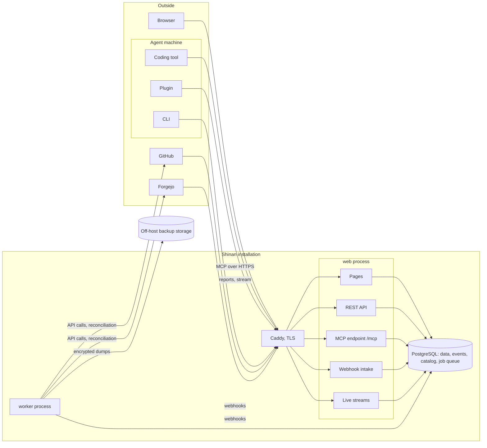

# Architecture and operations

Status: **draft for review** ([issue #11](https://github.com/guneet-xyz/shinan/issues/11)).

This document proposes how Shinan is built and run: the technology stack options
(D-020), the parts of the system and how they talk, where data lives, how the
catalog's Markdown and its agent index stay in sync (D-006), how git host events
come in, how agents and plugins reach Shinan, security for a public app with
sign-in (D-015), deployment on Musashi at `shinan.guneet.dev` (D-016),
self-hosting (D-012), observability, and backups.

It does not specify what the other documents own: catalog schema, task rules,
sign-in method, git host event lists, MCP tool lists or screens. It links to
them instead (see [Dependencies](#dependencies-on-other-documents)).

## How to read this document

Every statement is marked:

- **Decided**: follows from an accepted plan decision, which is cited.
- **Proposed**: suggested here, with a reason. The owner confirms or changes it.
- **Open**: not settled; listed under [Open questions](#open-questions).

Terms follow the [domain model and glossary](domain-model.md) (in review in
[PR #14](https://github.com/guneet-xyz/shinan/pull/14)). In particular, a
**Shinan installation** is one running copy of Shinan; a **workspace** is a
team's container inside it. "Sync" is used only for the catalog Markdown and its
index; keeping up with git hosts is **reconciliation**.

External facts were checked against primary sources on **2026-11-16**. Facts
about Musashi and its services come from the `workspace` repository's catalog at
revision `86bba32` and the Musashi infrastructure repository (`infra/musashi`) at
`29a8cba`, both read on 2026-11-16. Nothing was deployed, and no DNS or server
action was taken.

## Summary

| Area | Main proposal |
|---|---|
| Stack (D-020) | Three options. Recommended: **A, TypeScript** (Next.js, PostgreSQL, Drizzle, a PostgreSQL job queue), the stack of the owner's other apps. Alternatives: B, Go with server-rendered pages; C, Elixir with Phoenix LiveView. |
| Shape | One codebase and one container image, run as two processes: `web` (pages, API, MCP endpoint, webhook intake, live streams) and `worker` (background jobs). |
| Storage | PostgreSQL for everything, including the job queue. No Redis, no file storage in the first version. |
| Catalog sync (D-006) | Markdown documents stored as immutable revisions in PostgreSQL. The agent index is rebuilt from each revision **in the same database transaction**, so they cannot disagree. Optional one-way export to a Git repository. |
| Git hosts | Webhooks are verified, stored and acknowledged at once, then processed by the worker. Reconciliation catches anything missed. Both produce the same idempotent events. |
| Agents | A remote MCP endpoint at `/mcp`, a REST API for the CLI and plugins, and a server-sent event stream that delivers nudges to plugins. All connections go out from the agent's machine over HTTPS. |
| Security | Threat model and controls for a public app holding infrastructure details. Workspace isolation in one data access layer, encrypted git host credentials, hashed agent tokens, untrusted text marked as such for agents. |
| Musashi | A new `shinan` stack following Musashi's existing rules: Obscuro secrets, public Caddy with its own proxy bridge, fixed subnets, images pinned by digest from `cr.guneet.dev`. Every deployment needs the owner's deployment approval. |
| Backups | Nightly encrypted database dumps sent off Musashi, built into Shinan itself, plus a restore test before Shinan becomes a source of truth. |

## 1. Requirements that shape the architecture

| Requirement | Source | Effect here |
|---|---|---|
| Catalog Markdown is the source of truth; the agent index is generated from it | D-006 (Decided) | [Section 5](#5-catalog-markdown-and-agent-index-sync) |
| Every fact has a state, source and last-checked time | D-007 (Decided) | Stored in the Markdown; indexed for freshness queries |
| Task status is derived from linked work | D-005 (Decided) | Status is recalculated by the worker from events; never stored as typed-in text |
| Agents connect from outside; no model runs in Shinan | D-008 (Decided) | No GPU, no model keys; Shinan is an ordinary web service |
| GitHub and Forgejo first | D-009 (Decided) | Webhook intake and reconciliation designed for both; GitLab later |
| Self-hostable | D-012 (Decided) | One image plus PostgreSQL; no hosted-only services ([section 11](#11-self-hosting)) |
| MCP and skill, plugins, launcher later | D-014 (Decided) | [Section 8](#8-how-agents-the-mcp-server-and-plugins-reach-shinan) |
| Public internet, sign-in required | D-015 (Decided) | [Section 9](#9-security) |
| Runs on Musashi; every deployment approved by the owner | D-016 (Decided) | [Section 10](#10-deployment-on-musashi) |
| Shinan starts empty; the `workspace` repository stays the source of truth until migration | D-018 (Decided) | Early data loss is survivable; backups must be proven before migration ([section 13](#13-backups-and-restore)) |
| Workspaces and invitations from the start | D-019 (Decided) | Every workspace-owned record carries its workspace ([section 3.4](#34-workspace-isolation)) |
| Stack chosen by the owner from options | D-020 (Decided) | [Section 2](#2-technology-stack-options) |

## 2. Technology stack options

### 2.1 What every option shares

These parts are the same whichever stack is chosen (**Proposed**):

- **PostgreSQL** as the only stateful component. Reason: one thing to back up,
  monitor and upgrade; the owner already runs PostgreSQL for mon, Walls,
  Drawspace and easyshell on Musashi; and every candidate job queue below
  stores its jobs in PostgreSQL, so no separate queue server is needed.
- **One container image, two process roles** (`web` and `worker`) from the same
  codebase. Reason: one person maintains it, one artifact is easy to self-host,
  and splitting background work from request handling keeps slow git host calls
  from delaying pages and webhook responses.
- **Server-sent events (SSE)** for live updates to browsers and plugins.
  Reason: one-way server push over ordinary HTTPS is enough (clients send with
  normal requests), and Caddy, Musashi's proxy, flushes `text/event-stream`
  responses immediately without extra settings
  ([Caddy `reverse_proxy` docs](https://caddyserver.com/docs/caddyfile/directives/reverse_proxy),
  checked 2026-11-16).
- **A command-line program (CLI)** distributed as a single file, and an
  **OpenCode plugin** written in TypeScript or JavaScript. The plugin language is
  fixed by OpenCode, which loads `.ts` and `.js` plugin files
  ([OpenCode plugins](https://opencode.ai/docs/plugins/), checked 2026-11-16).
- **Multi-architecture images** (`arm64` and `amd64`). Reason: Musashi is an
  ARM64 machine; most self-hosters will be on `amd64`.

### 2.2 The options

#### Option A: TypeScript (Next.js) — recommended

- **Web:** Next.js (React) for pages and HTTP routes, run as a long-lived Node.js
  server (not serverless), as the owner's Walls, Drawspace, Dockyard and mon
  already are.
- **Database access:** Drizzle ORM and migrations (used by Walls, Dockyard and
  mon).
- **Jobs:** [pg-boss](https://github.com/timgit/pg-boss) (MIT license) or
  [graphile-worker](https://github.com/graphile/worker) (MIT). pg-boss adds
  jobs inside an existing database transaction, has cron scheduling, retries
  with backoff and dead-letter queues, and supports Drizzle (its README, checked
  2026-11-16).
- **MCP:** the official TypeScript SDK, rated Tier 1 by the MCP project
  ([SDK list](https://modelcontextprotocol.io/docs/sdk), checked 2026-11-16).
- **CLI:** TypeScript compiled to a single executable, sharing the API client
  with the plugin.

| For | Against |
|---|---|
| The stack of four of the owner's deployed apps: same build, registry, release-please and Musashi stack pattern. | Next.js changes quickly between major versions and has had serious advisories, for example [CVE-2025-29927](https://github.com/vercel/next.js/security/advisories/GHSA-f82v-jwr5-mffw), an authorization bypass when checks live in middleware (critical, March 2025). |
| One language for server, web, plugin, CLI and MCP; shared types for the API. | Higher memory use than Go on a shared 8 GiB host. |
| Official Tier 1 MCP SDK; coding agents write TypeScript well. | Long-lived streams and background workers sit outside Next.js's main model and need a custom entry point for the `worker` role. |
| Rich interactive UI (board, live timeline) is straightforward with React. | Large dependency tree to keep patched. |

Mitigation (**Proposed**): keep business logic in plain TypeScript modules that
do not import Next.js, and do authorization in those modules, never only in
middleware. Reason: limits framework churn to the page layer and avoids the
class of bug in CVE-2025-29927.

#### Option B: Go with server-rendered pages

- **Web:** Go standard library HTTP server, HTML templates (for example templ)
  and htmx for interactive parts.
- **Database access:** pgx with sqlc (SQL checked at build time).
- **Jobs:** [River](https://riverqueue.com/docs) (MPL-2.0), PostgreSQL-backed,
  with jobs added in the same transaction as application changes.
- **MCP:** the official Go SDK (Tier 1); v1.7.0 and later support the newest
  MCP revision, 2026-07-28
  ([go-sdk README](https://github.com/modelcontextprotocol/go-sdk), checked
  2026-11-16).
- **CLI:** Go, single static binary (as the owner's Obscuro is).

| For | Against |
|---|---|
| One small static binary; lowest memory and simplest self-hosting. | The OpenCode plugin must still be TypeScript, so two languages. |
| Cross-compiles to ARM64 without emulation. | Rich interactive screens (drag-and-drop board, live timeline) take more work than with React. |
| Very stable language and standard library; few dependencies to patch. | None of the owner's web apps use Go; no shared code or patterns with them. |
| Good fit for many open streams and webhook bursts. | Fewer ready-made UI components. |

#### Option C: Elixir with Phoenix LiveView

- **Web:** Phoenix with LiveView (server-driven live pages).
- **Jobs:** [Oban](https://github.com/oban-bg/oban) (Apache-2.0; paid "Pro"
  extras exist), PostgreSQL-backed.
- **Live presence:** Phoenix.Presence tracks who is connected and broadcasts
  joins and leaves
  ([docs](https://hexdocs.pm/phoenix/Phoenix.Presence.html), checked 2026-11-16).
- **MCP:** no official Elixir SDK is listed by the MCP project (checked
  2026-11-16); a community library or a hand-written endpoint is needed.

| For | Against |
|---|---|
| Live updates, presence and timelines are built into the framework. | A new language and runtime for the owner and for most coding agents. |
| Very robust for many long-lived connections. | No official MCP SDK; MCP changes often (see [section 8.1](#81-mcp-server)). |
| Oban is mature and well documented. | Plugin and CLI still in other languages: three languages in total. |
| | Smallest pool of examples and libraries of the three. |

### 2.3 Comparison

| Criterion | A: TypeScript | B: Go | C: Elixir |
|---|---|---|---|
| Fit with the owner's existing apps and Musashi patterns | Best | Medium | Low |
| Speed of building the first version with coding agents | Best | Good | Lower |
| Interactive UI (board, live timeline) | Best | Medium | Best |
| Memory and CPU on a shared host | Medium | Best | Good |
| Self-hosting simplicity | Good | Best | Good |
| MCP SDK maturity | Official, Tier 1 | Official, Tier 1 | None official |
| Languages to maintain (server, plugin, CLI) | 1 | 2 | 3 |
| Framework churn and patching load | Highest | Lowest | Low |

### 2.4 Recommendation

**Proposed: Option A (TypeScript).** Reason: it matches the stack, build and
deployment pattern of four apps the owner already runs on Musashi, uses one
language across server, plugin, CLI and MCP, and has an official Tier 1 MCP SDK.
Its main weakness, framework churn and security advisories, is reduced by the
mitigation above and by the patching rules in [section 9](#9-security).

Choose **Option B** instead if low resource use and the simplest self-hosting
matter more than UI richness and shared code with existing apps. Option C is
listed for completeness; its live-update strengths do not outweigh a third
language and no official MCP SDK.

The owner's choice becomes a decision record in `docs/decisions/` (owned by the
[decision log](decisions/), issue #13).

## 3. System design

### 3.1 Components

| Component | Role | Status |
|---|---|---|
| Pages | The wiki, task pages, timeline, board and settings for people ([human experience](human-experience.md)). | Proposed |
| REST API | JSON over HTTPS for the CLI, plugins and the pages' own data needs. | Proposed. Reason: one API for every client keeps behavior consistent. |
| MCP endpoint | Agent actions over MCP ([section 8.1](#81-mcp-server)). | Decided that it exists (D-014); location proposed. |
| Webhook intake | Receives git host webhooks ([section 6](#6-git-host-intake-webhooks-and-reconciliation)). | Decided that webhooks are used (plan, Integration points). |
| Live streams | SSE streams for browsers (timeline updates) and plugins (nudges). | Proposed (reason in 2.1). |
| Worker | Background jobs ([section 7](#7-background-jobs)). | Proposed |
| PostgreSQL | All data ([section 4](#4-storage)). | Proposed |

**Proposed:** pages, REST API and MCP endpoint all call one shared application
layer, which enforces permissions and writes events. Reason: an action must
behave and be credited the same whether a person clicks, an agent calls MCP or
the CLI calls the API. This is also where [attribution](domain-model.md#attribution)
is recorded, since each call carries a known person's sign-in or agent token.

### 3.2 Process model

**Proposed:** a "modular monolith". Modules (catalog, tasks, git hosts, agents,
identity, events) live in one codebase with clear boundaries, deployed as one
image and run as `web` and `worker`. A one-shot `migrate` command applies
database migrations before new code starts. Reason: microservices add network
calls, deployments and failure modes that one maintainer and a 2-vCPU host do not
need; module boundaries keep the option of splitting later.

One `web` and one `worker` process are enough for the first version
(**Proposed**). Reason: the expected load is one owner, a handful of agent
sessions and webhook traffic from a few dozen repositories. Both roles can run
more copies later because jobs are claimed safely by the queue and live streams
are fanned out through PostgreSQL `LISTEN`/`NOTIFY`
([PostgreSQL docs](https://www.postgresql.org/docs/current/sql-notify.html)).

### 3.3 Who calls what

| Caller | Endpoint | Credential | Status |
|---|---|---|---|
| Person in a browser | Pages, REST API, live stream | Sign-in session cookie ([identity](identity.md)) | Decided that sign-in is required (D-015); method owned by identity |
| Coding tool (MCP) | `/mcp` | Agent token as `Authorization: Bearer` | Proposed ([8.1](#81-mcp-server)) |
| CLI | REST API | Agent token | Proposed |
| Plugin | REST API and plugin stream | Agent token | Proposed ([8.3](#83-plugins)) |
| GitHub, Forgejo | Webhook intake | Per-connection webhook secret (HMAC signature) | Proposed ([6.1](#61-webhook-intake)) |
| Worker | Git host APIs | Credentials stored with the git host connection | Owned by [git hosts](git-hosts.md) and [identity](identity.md) |

### 3.4 Workspace isolation

The glossary lists what belongs to exactly one workspace and what sits outside
any one workspace (the Shinan installation, person, git host account, git host,
repository, work item and coding tool). This section covers how that boundary
is enforced in storage.

- **Proposed:** repositories and work items are nevertheless **stored per git
  host connection, and so per workspace**. If two workspaces connect the same
  repository, each keeps its own copy of its work items. Reason: isolation then
  needs no exceptions; the cost is duplicated rows and API calls, which is small
  at this scale. This works whichever way the glossary's open question on
  shared repositories is answered.
- **Proposed:** every workspace-owned table has a `workspace_id` column, and all
  reads and writes go through one data access layer that requires a workspace
  scope. Reason: one enforcement point is easier to review and test than scoping
  spread across every query.
- **Proposed:** automated tests that create two workspaces and assert nothing
  crosses between them, for every API and MCP action. Reason: a cross-workspace
  leak is the worst plausible bug for an app holding infrastructure details.
- **Open:** whether to add PostgreSQL row-level security
  ([docs](https://www.postgresql.org/docs/current/ddl-rowsecurity.html)) as a
  second barrier. It catches mistakes in the data access layer but makes
  migrations, background jobs and debugging more complex.

### 3.5 Shinan installation

The glossary proposes **Shinan installation** for one running copy of Shinan and
names this document as its owner. **Proposed:** confirm the term, with these
details:

- An installation has one or more **installation operators**: people who run
  it, separate from any workspace role. They manage installation settings, see
  dead-lettered jobs, backup status and connection health across workspaces,
  but do not read a workspace's catalog or tasks unless they are also members
  of it. Reason: running the software is a different job from owning a team's
  records, and a self-hoster's operator may not belong to every workspace.
  How the role is granted is owned by [identity](identity.md).
- **Installation settings** include: who may create workspaces and whether
  anyone may sign up (identity decides the options), which private network
  hosts outgoing requests may reach ([9.1](#91-threats-and-controls)), the
  backup target ([section 13](#13-backups-and-restore)) and email settings.
- On `shinan.guneet.dev` the owner is the only installation operator.

## 4. Storage

### 4.1 PostgreSQL holds everything

**Proposed.** Reason: see [2.1](#21-what-every-option-shares). Search uses
PostgreSQL full-text search
([docs](https://www.postgresql.org/docs/current/textsearch.html)) at first;
reason: catalog and tasks are small text collections, and a separate search
engine would be a second stateful component.

**Considered and not proposed:** SQLite. It would make self-hosting a single
file, but the `web` and `worker` processes write at the same time (webhooks,
jobs, presence reports), which SQLite handles less well, and the owner's
operational practice on Musashi is PostgreSQL.

**Proposed:** no file or blob storage in the first version. Reason: nothing in
the plan needs uploads; catalog pages are text and work items are links.
Attachments, if ever wanted, would add object storage then. **Open** until the
[human experience](human-experience.md) and [catalog](catalog.md) documents
confirm no uploads are needed.

### 4.2 Kinds of data

| Data | Reconstructable if lost? | Retention | Status |
|---|---|---|---|
| Catalog documents and their revisions, catalog proposals | No | Forever | Proposed |
| Agent index | Yes, rebuilt from documents | Replaced on each revision | Proposed |
| Tasks, comments, decisions on tasks, human-set states | No | Forever | Proposed |
| Workspaces, people, members, invitations, agents | No (token hashes and settings) | Until deleted | Proposed |
| Events (the timeline) | Partly: git host events can be re-read by reconciliation within what each host's API still returns; Shinan and plugin events cannot | Forever; never edited (domain model) | Proposed |
| Work items (cached state of PRs, issues, commits, branches) | Yes, by reconciliation | Kept while linked | Proposed |
| Raw webhook deliveries | Not needed after processing | 14 days, then deleted | Proposed. Reason: long enough to replay after a bug fix; deleting them follows "link, don't copy" (D-001) and limits private repository content held. |
| Presence | No, but short-lived by nature | Current state plus presence events | Proposed |
| Job queue | Not needed | Completed jobs pruned after 7 days | Proposed. Reason: enough to debug recent failures. |
| Git host credentials, webhook secrets | No (must be re-entered) | Until the connection is removed | Proposed; encrypted, see [9.3](#93-secrets-and-credentials) |

### 4.3 Events

**Proposed:** one append-only events table. Rows are never updated or deleted
except by workspace deletion or [redaction](#44-redaction); corrections are new
events (as the domain model
proposes). Each event records its origin (Shinan action, webhook, reconciliation,
plugin report, MCP call) and an idempotency key, so the same git host change
arriving by webhook and by reconciliation is stored once. Reason: the timeline
must be trustworthy, and both intake paths must be safe to repeat.

Derived views, such as task status (D-005) and agent session presence, are
recalculated from events and work items by the worker and stored as ordinary
rows for fast reads (**Proposed**). Reason: recalculating on every page view
would be slow; storing the result as a cache keeps one source (the events and
work items) while pages stay fast.

### 4.4 Redaction

The glossary asks whether events can be redacted, for example to remove a
secret or honor a deletion request, and names this document as an owner of
the answer (with [identity](identity.md) for who may do it).

**Proposed:** yes, through one narrow operation that applies to events, catalog
revisions, comments and stored raw webhook deliveries:

- The sensitive content is replaced by a marker. The record itself stays, with
  its time, kind, actor and subjects, so the timeline and history keep their
  shape.
- The redaction is itself a new event saying who redacted what and why (but
  not the removed content).
- Derived data built from the content (search text, agent index rows) is
  rebuilt in the same transaction.
- Copies outside the database are reported, not silently assumed clean: older
  backups keep the content until they expire under the retention in
  [13.2](#132-how-backups-run), and a Git export keeps it in its history unless
  that history is rewritten. The redaction screen says so.

Reason: "never edited" keeps history trustworthy, but a leaked secret or a
lawful deletion request must still be removable; a visible, attributed
redaction keeps both. Who may redact (proposed: workspace owners and
installation operators) is owned by [identity](identity.md). A secret that
reached Shinan must also be rotated at its source; redaction does not make it
safe again.

## 5. Catalog Markdown and agent index sync

The catalog is document-first: Markdown with structured fields at the top
(frontmatter) is the source of truth, and the agent index is generated from it
(**Decided**, D-006). This section decides where the Markdown lives and how the
index never drifts from it. The [catalog document](catalog.md) owns the schema,
the fact format, the catalog proposal flow and the index format.

### 5.1 Where the Markdown lives

Two designs were considered.

| | **5.1a Database-held documents** (proposed) | **5.1b Git-held documents** |
|---|---|---|
| Source of truth | Markdown text of each catalog entity, stored as immutable revisions in PostgreSQL | Markdown files in a Git repository that Shinan reads and writes |
| How agents and people change it | Catalog proposals through MCP, CLI or web; applied by Shinan | Commits and PRs to the repository, or Shinan committing on catalog approval |
| Index update | In the same database transaction as the revision | After a push webhook, by cloning or fetching and re-parsing |
| Consistency | Index always matches the latest revision | Index lags pushes; failed fetches leave it stale |
| Catalog proposals and approvals | Native objects with states | Become PRs on a git host, mixing catalog review into code review |
| Per-entity permissions | Possible (rows carry workspace and entity) | Hard: repository access is all or nothing |
| Works offline with plain files | Through the optional Git export (one-way) | Yes |
| Closest to the `workspace` repository's practice today | Less | More |
| Extra moving parts | None | A Git checkout per workspace, push access, merge conflict handling |

**Proposed: 5.1a, database-held documents, with an optional one-way Git
export.** Reason: approvals, per-fact provenance (D-007) and permissions need to
be first-class objects, and the index must never disagree with the source; a
single database transaction gives that guarantee, while a Git repository adds a
second write path, conflicts and a lag. The export keeps the benefit people
value in today's `workspace` repository: plain files they can read, diff and keep.

### 5.2 How sync works (for 5.1a)

1. **Every change is a new revision.** A catalog entity's Markdown is stored as
   a chain of revisions. Each revision has the full text, its author (actor and
   attribution), the catalog proposal it came from, and the revision it was
   based on. Revisions are never changed, except by [redaction](#44-redaction).
   **Proposed.** Reason: full history and a clear "who changed what" for every
   fact.
2. **Parse, validate, index, commit, all at once.** Applying a change runs in one
   database transaction: parse the Markdown, validate it against the catalog
   schema, write the revision, replace that entity's index rows (fields, facts
   with state, source and last-checked time, links between entities, search
   text), append the event, and queue follow-up jobs. If any step fails, nothing
   is written. **Proposed.** Reason: the index can never point at a revision
   that does not exist or miss one that does.
3. **Only the indexer writes the index.** No API, MCP tool or job edits index
   rows directly; every write goes through a document change. **Proposed.**
   Reason: a second write path is exactly how sync breaks.
4. **Concurrent edits.** A catalog proposal records the revision it was based
   on. Applying it when the entity has moved on fails and asks for a rebase.
   **Proposed.** Reason: silent last-write-wins would lose facts. How the rebase
   is shown is owned by the [catalog](catalog.md) and
   [human experience](human-experience.md) documents.
5. **Parser versions and rebuilds.** Each index row records the parser version
   that produced it. When a release changes the parser or schema, the worker
   rebuilds the index from the latest revisions, in batches, and the agent index
   reports "rebuilding" until done. **Proposed.** Reason: schema changes are
   expected while the catalog design settles.
6. **Drift detection.** A daily job re-parses a sample of documents (all of them
   while the catalog is small) and compares the result with the stored index,
   reporting any mismatch as a metric and an operator alert. **Proposed.**
   Reason: proves the guarantee in step 2 holds in practice.
7. **Serving the agent index.** Agents read the index through MCP and the API.
   Responses carry a catalog revision number so agents and plugins can cache and
   ask "what changed since revision N". **Proposed.** Reason: avoids re-reading
   the whole catalog on every agent session start.

Fact checks that change nothing but the last-checked time are also new
revisions, because the last-checked time is part of the Markdown, and each
check is also recorded as an event, as the domain model proposes (**Proposed**,
reason: D-006 makes the Markdown the source of truth, so no fact data may live
only in the index). If the [catalog document](catalog.md) instead records checks
as separate records, step 2 still applies: checks would be written in the same
transaction as their index rows.

### 5.3 Git export and import

- **Export (Proposed, optional per workspace):** a job writes the current
  Markdown of every entity to a Git repository the workspace owner chooses, one
  commit per applied revision or batched, authored by Shinan with the actor in
  the commit message. One-way only. Reason: readable files, an independent copy
  for disaster recovery ([section 13](#13-backups-and-restore)), and familiarity;
  one-way avoids a second source of truth.
- **Import (Proposed):** a one-time importer reads a folder of Markdown with
  frontmatter, such as the `workspace` repository's catalog, and creates
  catalog proposals for review. When and how the `workspace` repository moves
  over is owned by the [roadmap](roadmap.md) (D-018).
- **Two-way Git sync: not proposed for the first version.** Reason: it reopens
  every problem in 5.1b. It can be revisited if people want to edit files
  directly.

## 6. Git host intake: webhooks and reconciliation

The [git host integrations](git-hosts.md) document owns which events matter,
API usage, rate limits and what is written back. This section owns the
machinery.

### 6.1 Webhook intake

**Proposed** pipeline, the same for every git host type:

1. **One URL per git host connection**, such as
   `https://shinan.guneet.dev/hooks/<connection-id>`. Reason: the connection
   tells Shinan which secret and workspace apply before parsing anything.
2. **Verify the signature** with that connection's secret: GitHub's
   `X-Hub-Signature-256` HMAC-SHA256 header
   ([GitHub docs](https://docs.github.com/en/webhooks/using-webhooks/validating-webhook-deliveries))
   and Forgejo's `X-Forgejo-Signature` HMAC-SHA256
   ([Forgejo docs](https://forgejo.org/docs/latest/user/repository/webhooks/)),
   both checked 2026-11-16. Reject unsigned or wrongly signed requests and
   bodies above a size limit.
3. **Store and acknowledge.** Save the raw delivery with its delivery ID
   (`X-GitHub-Delivery`, `X-Forgejo-Delivery`), skip it if that ID was already
   stored, queue a processing job in the same transaction, and return `202`.
   Reason: GitHub fails a delivery that takes more than 10 seconds and does not
   redeliver automatically
   ([GitHub docs](https://docs.github.com/en/webhooks/using-webhooks/handling-failed-webhook-deliveries));
   Forgejo's default delivery timeout is 5 seconds (`[webhook] DELIVER_TIMEOUT`,
   [config cheat sheet](https://forgejo.org/docs/latest/admin/config-cheat-sheet/)),
   both checked 2026-11-16. Storing first means nothing is lost if processing
   fails.
4. **Process in the worker:** normalize the payload into events and work item
   updates, keyed so that repeats change nothing (idempotent), then queue
   follow-ups such as recalculating task status or creating a task from an
   outside issue (D-003).
5. **Record health:** the time of the last valid delivery per connection, shown
   as part of the git host connection's health (domain model).

### 6.2 Reconciliation

Webhooks can be missed: Shinan may be down, the host may fail to send, or a
delivery may be rejected. GitHub keeps deliveries for redelivery for only 3 days
([GitHub docs](https://docs.github.com/en/webhooks/testing-and-troubleshooting-webhooks/redelivering-webhooks),
checked 2026-11-16).

**Proposed** machinery:

- **Scheduled reconciliation per git host connection.** A frequent incremental
  pass reads changes since a stored cursor; a less frequent full pass re-reads
  every linked open work item. The intervals are owned by the
  [git hosts](git-hosts.md) document, because they depend on rate limits.
- **Catch-up after downtime.** On start, the worker compares the last webhook
  and last reconciliation times with the current time and queues an immediate
  incremental pass for any connection that has a gap. Reason: an approved
  deployment restart should not leave silent gaps.
- **Same output as webhooks.** Reconciliation produces the same normalized
  events with the same idempotency keys, so overlap is harmless.
- **Freshness recorded.** Each work item stores when Shinan last read it from the
  host, so pages can show how fresh linked work is (plan open question 4; display
  owned by [human experience](human-experience.md)).
- **Rate limits respected** by a per-connection limiter in the worker that reads
  the host's remaining-quota responses. Reason: reconciliation must never starve
  the API calls that write links back.

### 6.3 Writing back to git hosts

Posting links or comments back to git hosts (what and when is owned by
[git hosts](git-hosts.md) and [tasks](tasks.md)) runs as worker jobs with retries,
never inside a web request (**Proposed**). Reason: git host APIs can be slow or
down, and a person's click or an agent's MCP call should not fail because of it.

## 7. Background jobs

**Proposed:** a PostgreSQL-backed job queue (see the options in
[section 2](#2-technology-stack-options)), with these properties:

- Jobs are added in the same transaction as the change that needs them. Reason:
  no job is lost or run for a change that rolled back.
- Every job is safe to run twice. Reason: at-least-once delivery is what every
  candidate queue offers.
- Retries with backoff, then a dead-letter state visible to the installation
  operator, with a manual "retry" action.
- Scheduled (cron-like) jobs run once across all worker copies.

| Job | Trigger | Owner of the rules |
|---|---|---|
| Process webhook delivery | Webhook stored | [Git hosts](git-hosts.md) |
| Reconcile a git host connection | Schedule, startup gap, operator request | [Git hosts](git-hosts.md) |
| Recalculate task status | New event on a linked work item or agent session | [Tasks](tasks.md) |
| Create a task from an outside issue | Normalized issue event | [Tasks](tasks.md) |
| Write back to a git host | Task or work link change | [Git hosts](git-hosts.md) |
| Mark silent agent sessions `unresponsive` | Every minute | [Agent integrations](agent-integrations.md) owns the threshold |
| Fan out a nudge | Comment creates a nudge | [Agent integrations](agent-integrations.md) |
| Rebuild or verify the agent index | Release, daily | This document ([5.2](#52-how-sync-works-for-51a)) |
| Export catalog to Git | Revision applied | This document ([5.3](#53-git-export-and-import)) |
| Send email (invitations, sign-in links, if used) | Identity flows | [Identity](identity.md) |
| Prune raw webhooks and old jobs | Daily | This document ([4.2](#42-kinds-of-data)) |
| Back up the database | Nightly, before deployments | This document ([section 13](#13-backups-and-restore)) |

## 8. How agents, the MCP server and plugins reach Shinan

The [agent integrations](agent-integrations.md) document owns the tools, the
skill, presence and nudge semantics. This section owns transport,
authentication plumbing and network shape.

**Proposed:** every agent-side component makes **outgoing HTTPS connections** to
the Shinan installation; Shinan never connects into an agent's machine. Reason:
agent machines sit behind NAT, firewalls or tailnets; outgoing-only keeps them
unexposed and works the same for self-hosters.

### 8.1 MCP server

- **Hosted, not installed (Proposed).** Shinan serves MCP at
  `https://shinan.guneet.dev/mcp` using the Streamable HTTP transport. Reason: no
  local program to install or update; every MCP-capable coding tool can connect
  with a URL. The CLI can also act as a local stdio MCP server that forwards to
  the API, for coding tools without remote MCP support.
- **Protocol versions (Proposed).** The current MCP revision is 2026-07-28,
  which removed protocol-level sessions and the separate GET stream from
  Streamable HTTP
  ([spec](https://modelcontextprotocol.io/specification/2026-07-28/basic/transports/streamable-http.md),
  checked 2026-11-16). OpenCode still connects with the older `initialize`
  handshake by default (`protocol: "legacy"`) unless configured otherwise
  ([OpenCode MCP docs](https://opencode.ai/docs/mcp-servers/), checked
  2026-11-16). So Shinan's endpoint supports both the 2026-07-28 revision and
  2025-11-25. Reason: agents must connect with default settings.
- **Statelessness (Proposed).** The endpoint keeps no per-connection state;
  everything an MCP call needs is in the request and the database. Reason: the
  2026-07-28 revision has no protocol sessions, and stateless requests survive
  restarts and multiple `web` copies.
- **Authentication (Proposed for the first version).** An agent token in the
  `Authorization: Bearer` header. OpenCode supports this with `oauth: false` and
  a `headers` entry (same docs). The MCP authorization specification is optional
  and OAuth 2.1-based
  ([spec](https://modelcontextprotocol.io/specification/2026-07-28/basic/authorization.md),
  checked 2026-11-16); supporting it would let a person approve an agent in the
  browser instead of copying a token, but makes Shinan an OAuth authorization
  server, a larger security surface. Whether and when to add it is owned by
  [identity](identity.md) (**Open**, see [Open questions](#open-questions)).
- **Required checks.** Validate the `Origin` header as the transport
  specification requires, and reject tokens in query strings, which the
  authorization specification forbids.
- **Linking calls to agent sessions.** OpenCode sends its session ID in
  `_meta["ai.opencode/sessionID"]` on tool calls and documents that it must not
  be used for authentication (OpenCode MCP docs above). Shinan may use such
  values only as a hint to match MCP calls to agent sessions, never as a
  credential (**Proposed**; how it feeds [attribution](domain-model.md#attribution)
  is owned by [agent integrations](agent-integrations.md) and
  [identity](identity.md)).

### 8.2 CLI

**Proposed:** the CLI calls the same REST API with an agent token, reads the
token from an environment variable or a config file readable only by its owner
account on the machine, and never accepts it as a command-line argument. Reason: command lines are visible to other processes and end up in
shell history.

### 8.3 Plugins

**Proposed** shape for the OpenCode plugin (and later others):

- **Reports go up as normal requests.** Presence changes (start, busy, idle,
  waiting, end) and heartbeats are POSTed to the REST API. Each report carries
  the agent session ID and a sequence number so out-of-order or repeated reports
  are harmless.
- **Nudges come down a stream.** The plugin keeps one SSE stream open per agent
  session. Nudges are rows in the database; the stream only announces them. The
  plugin acknowledges each delivered nudge with a POST, which moves it from
  `pending` to `delivered` (domain model states). If the stream drops (network,
  deployment, or a Caddy reload, which closes open streams; see the Caddy docs
  above), the plugin reconnects with backoff and receives anything still
  pending. Reason: at-least-once delivery with acknowledgement survives
  restarts; deduplication by nudge ID prevents doubles.
- **Keep-alives** every 30 seconds on the stream (**Proposed**; reason: keeps
  idle connections open through proxies; the value is a starting point).
- **The stream and heartbeats are presence evidence.** A dropped stream with no
  reconnect feeds the `unresponsive` calculation (threshold owned by
  [agent integrations](agent-integrations.md)).

### 8.4 Network path for the owner's machines

Agents on Daedalus and other machines reach `shinan.guneet.dev` over the public
internet, like browsers. **Proposed:** no tailnet-only path for agents in the
first version. Reason: D-015 already makes the app public, git host webhooks
need a public address anyway, and a second path doubles what must be secured
and tested.

## 9. Security

Shinan holds infrastructure details (machines, services, access routes,
runbooks) and is on the public internet (**Decided**, D-015). Its sign-in method,
roles and token rules are owned by [identity](identity.md). This section owns
the threat model and the platform controls.

### 9.1 Threats and controls

| Threat | Controls | Status |
|---|---|---|
| A person's account is taken over | Sign-in method chosen in [identity](identity.md), with this document asking for: no self-registration on the owner's installation, second-factor or passwordless sign-in, short-lived sign-in sessions in `HttpOnly`, `Secure`, `SameSite` cookies, rate limits on sign-in, and re-authentication for sensitive actions (connecting a git host, creating tokens) | Requirements proposed; method owned by identity |
| An agent token is stolen from a machine | Tokens stored only as hashes; scoped to one workspace and agent; never more than the member's rights (domain model); expiry; revocation; "last used" shown; a recognizable prefix so leaks are easy to search for | Proposed; token rules owned by identity |
| Forged or replayed webhooks | HMAC signature, unique delivery IDs, per-connection secrets, size limits ([6.1](#61-webhook-intake)) | Proposed |
| One workspace sees another's data | [Section 3.4](#34-workspace-isolation) | Proposed |
| A member sees a private repository's content through a task | Repository visibility stored per repository and applied when work items and events are read | Proposed; the rule itself is plan question 3, owned by identity |
| Text written by strangers steers an agent (prompt injection) | Outside issues become tasks automatically (D-003), so text from anyone reaches agents through MCP. MCP responses label where each piece of text came from and whether a member wrote it; the skill tells agents to treat outside text as data, not instructions | Proposed; conventions owned by [agent integrations](agent-integrations.md) |
| Malicious Markdown or HTML in the wiki (cross-site scripting) | Markdown rendered with raw HTML stripped or sanitized; a strict Content Security Policy | Proposed |
| Shinan tricked into calling internal addresses (server-side request forgery) | Git host addresses are entered by people; outgoing requests to private, loopback and link-local addresses are refused unless the installation operator allows a specific host | Proposed. Reason: on Musashi, private addresses reach other services. |
| Cross-site request forgery | Same-site cookies plus a CSRF token or origin check on every state-changing browser request | Proposed |
| Vulnerable dependencies | Lockfiles; automated dependency update PRs; security advisories patched within 7 days for critical issues; images rebuilt on base image updates | Proposed; reason: Option A in particular has a large dependency tree |
| Container or host compromise spreading | Non-root user, read-only root filesystem, `cap_drop: ALL`, `no-new-privileges`, no Docker socket, no host ports, database on a backend-only network ([section 10](#10-deployment-on-musashi)) | Proposed |
| Abuse and floods | Per-IP and per-token rate limits; request size limits | Proposed |
| Undetected misuse | Every write is an event credited to an actor; sign-ins, token use and failed authentications are logged | Proposed |

**Proposed:** a written security checklist covering this table must pass before
the first public deployment, and again before the `workspace` repository's
catalog moves over. Reason: the plan asks for extra attention to security
(D-015), and migration raises the value of the data. The [roadmap](roadmap.md)
owns where these gates sit.

### 9.2 Web hardening

**Proposed** defaults: HTTPS only with HSTS; Content Security Policy without
inline scripts where the framework allows; `frame-ancestors 'none'`; a strict
`Referrer-Policy`; no sensitive data in URLs; generic error pages; no stack
traces to clients. Reason: standard protections for a public app with sign-in.

### 9.3 Secrets and credentials

- **Installation secrets** (database password, session signing key, data
  encryption key, email credentials) come from environment variables or files
  (`*_FILE` variables). On Musashi they come from Obscuro. **Proposed.** Reason:
  matches Musashi's rule that secrets come only from Obscuro, and works for
  self-hosters with Docker secrets or any secret manager.
- **Git host credentials and webhook secrets** are encrypted in the database
  with the data encryption key, which carries a key ID so it can be rotated.
  **Proposed.** Reason: a stolen database dump alone should not give access to
  the owner's repositories.
- **Tokens** are stored as hashes only.
- **Logs** never contain tokens, cookies, webhook bodies or Authorization
  headers. **Proposed.**
- **People type secrets** (for example a git host token) into Shinan's settings
  pages or at a prompt; agents never handle them. **Proposed.** Reason: follows
  the `workspace` repository's rule that secrets never pass through agents,
  issues or files.

### 9.4 Optional extra sign-in layer

An identity-aware proxy in front of the pages (a second sign-in before the app)
was considered. **Proposed: not in the first version.** Reason: webhooks, MCP
and plugins must bypass it anyway, so it protects only the pages, and it adds a
second account system. **Open** for the owner, see
[Decisions needed](#decisions-needed-from-the-owner).

## 10. Deployment on Musashi

`shinan.guneet.dev` runs on Musashi, and every deployment needs the owner's
deployment approval (**Decided**, D-016). This section proposes how the stack fits
Musashi's existing rules. It is a plan only: carrying it out needs the
deployment approvals listed in [10.6](#106-what-needs-deployment-approval).

### 10.1 Facts about Musashi that matter

From the `workspace` repository's catalog and `infra/musashi` (read 2026-11-16):

- Azure VM, ARM64, 2 vCPU, 8 GiB RAM, no swap; about 32 containers were running
  on 2026-11-14.
- Docker data lives on the 128 GiB data disk at `/mnt`; the 30 GiB root disk was
  93% full on 2026-11-13.
- Docker's default address pools are exhausted, so every new Compose network
  needs an explicit subnet; `10.88.10.0/24` to `10.88.13.0/24` are taken.
- Stacks live in `stacks/<name>/` of `infra/musashi`, run with
  `obscuro run -n <name> -- docker compose up -d`. No environment files, no host
  ports, stack-local bind paths only, and one dedicated `caddy-public-<app>`
  proxy bridge per public app, owned by the public Caddy.
- Images come from the owner's registry `cr.guneet.dev` (Dockyard, also on
  Musashi), pinned by digest.
- DNS for `guneet.dev` is owned by the Terraform project through a guarded
  workflow; `tools.guneet.dev` and `mon.guneet.dev` are CNAMEs to
  `musashi.guneet.xyz`.
- Fleet backups are paused; Musashi's data disk is the only copy of its
  applications' data, and Musashi's repository rules say no backup tooling
  belongs in that repository.
- Fleet metrics (Grafana, VictoriaMetrics, an Alloy agent per machine) run on
  Musashi, tailnet-only, with no alerting yet.

### 10.2 Proposed `shinan` stack

| Service | Role | Networks |
|---|---|---|
| `shinan-db` | PostgreSQL, data in `./postgres` (stack-local, ignored by Git) | `shinan-backend` |
| `shinan-migrate` | One-shot: runs migrations, then exits | `shinan-backend` |
| `shinan-web` | Pages, API, MCP, webhooks, streams | `caddy-public-shinan`, `shinan-backend` |
| `shinan-worker` | Background jobs, reconciliation, backups | `shinan-backend`, outbound internet |

- **Proposed** names follow Musashi's conventions: stack and Obscuro namespace
  `shinan`, proxy bridge `caddy-public-shinan` (only public Caddy and
  `shinan-web` join it). Reason: the Musashi rules require it.
- **Proposed:** two fixed `/24` subnets from the unused `10.88.0.0/16` range,
  chosen and recorded in the machine entry at deployment time. Reason: the
  default pools are exhausted.
- **Proposed** starting memory limits: web 512 MiB, worker 384 MiB, PostgreSQL
  512 MiB; to be measured during the proof of concept and adjusted. Reason:
  Musashi has 8 GiB, no swap, and many other apps; a runaway process must not
  starve them. The numbers are estimates, not measurements.
- **Proposed:** containers hardened as listed in [9.1](#91-threats-and-controls);
  PostgreSQL is reachable only on `shinan-backend`.
- **Proposed:** the Musashi stack uses the same image and the same reference
  Compose layout that self-hosters get ([section 11](#11-self-hosting)), adapted
  to Musashi's rules. Reason: proves the self-hosting path (D-012) by using it.

### 10.3 DNS and ingress

- **Proposed:** `shinan.guneet.dev` as a CNAME to `musashi.guneet.xyz`, created
  through the Terraform project's guarded DNS workflow, like `tools.guneet.dev`.
  Reason: same pattern as the owner's other public apps on Musashi. Creating it
  is a DNS change that needs its own deployment approval.
- **Proposed:** a public Caddy route for `shinan.guneet.dev` to `shinan-web`,
  with certificates from the existing Cloudflare DNS challenge. Adding the
  `caddy-public-shinan` bridge needs one coordinated recreation of the public
  Caddy, which briefly interrupts all public sites on Musashi (as for earlier
  apps).
- **Open:** webhooks from Forgejo, which also runs on Musashi, to
  `shinan.guneet.dev`. Forgejo only allows webhooks to public addresses by
  default (`ALLOWED_HOST_LIST = external`, config cheat sheet above), and
  whether Musashi can reach its own public address through Azure is untested.
  To be tested before relying on Forgejo webhooks; reconciliation covers the gap
  meanwhile.

### 10.4 Building and releasing

**Proposed** flow:

1. Work merges to `main` of the private `guneet-xyz/shinan` repository through
   reviewed PRs.
2. GitHub Actions runs tests (with a PostgreSQL service) on every PR.
3. A release (release-please, as mon and Walls use) builds `arm64` and `amd64`
   images on native runners and pushes them to a `shinan` project on
   `cr.guneet.dev` with build provenance attestations. GitHub offers
   `ubuntu-24.04-arm` runners to private repositories, drawing on the account's
   included minutes and then per-minute charges
   ([GitHub docs](https://docs.github.com/en/actions/reference/runners/github-hosted-runners),
   checked 2026-11-16). Reason: native builds avoid slow emulation; the cost
   is unmeasured.
4. A PR to `infra/musashi` pins the new digests and updates the stack README.
   Changing Compose files does not deploy anything on Musashi (its rules).
5. The owner gives deployment approval naming the revision, impact, checks and
   rollback, following the `workspace` repository's approval policy.
6. The deploying agent takes a pre-deployment database backup, runs the stack
   (`migrate`, then `web` and `worker`), checks health and records evidence.

- **Proposed:** the registry project is **private**, so Musashi needs a pull
  credential stored in Obscuro. Reason: the repository is private (D-011);
  existing Musashi images come from public projects, so this is new and needs
  the owner's decision.

### 10.5 Migrations and rollback

- **Proposed:** migrations are forward-only and backward-compatible for one
  release ("expand, then contract"): add columns or tables first, switch code,
  remove old parts in a later release. Reason: rolling back is then just pinning
  the previous image digests, with no database restore.
- **Proposed:** a migration that cannot be backward-compatible is called out in
  the deployment approval request, with a tested restore as its rollback.

### 10.6 What needs deployment approval

Each item changes a real deployment and needs deployment approval before it
happens (**Decided** for deployments, D-016; the list is **Proposed**). None of
them is done by writing this document.

| Item | Kind |
|---|---|
| First start of the `shinan` stack and every later image change | Deployment |
| DNS record `shinan.guneet.dev` | DNS change through Terraform |
| Public Caddy route and `caddy-public-shinan` bridge (one Caddy recreation) | Deployment |
| Obscuro namespace `shinan` and its secrets (the owner types the values) | Credentials |
| Private registry project and Musashi's pull credential | Credentials |
| Git host connections on GitHub and Forgejo (webhooks, tokens or apps) | Credentials, owned by [git hosts](git-hosts.md) |
| Email sender, if [identity](identity.md) needs email: a dedicated SES IAM user per the SES sender onboarding runbook, not the shared `mail` key | Credentials |
| Metrics scraping by Musashi's monitoring agent | Deployment of the monitoring stack |
| Off-host backup target and its credentials | Credentials ([section 13](#13-backups-and-restore)) |

## 11. Self-hosting

Shinan is self-hostable by design (**Decided**, D-012). Distribution to others
waits on licensing, which is deferred (D-013); this section makes sure nothing
in the design blocks it.

- **Artifact (Proposed):** one multi-architecture container image plus a
  reference Compose file (PostgreSQL, migrate, web, worker) and an operator
  guide. Reason: the smallest thing a self-hoster must understand.
- **Requirements (Proposed):** PostgreSQL (supported major versions listed per
  release), an HTTPS reverse proxy of the operator's choice, and a public URL if
  webhooks are wanted.
- **Configuration (Proposed):** environment variables, with `*_FILE` variants
  for secrets. No configuration file is required. Reason: works with Compose,
  Kubernetes, systemd and Obscuro alike.
- **Reconciliation-only mode (Proposed):** an installation that git hosts cannot
  reach still works, with freshness limited to the reconciliation interval.
  Reason: some self-hosters will run behind a firewall.
- **First start (Proposed):** the first operator account is created with a
  one-time setup token from an environment variable, not an open sign-up page.
  Reason: a fresh public installation must not be claimable by whoever finds it
  first.
- **Installation operator:** see [3.5](#35-shinan-installation).
- **No telemetry (Proposed):** a self-hosted installation never contacts the
  Shinan project. Reason: trust; self-hosters choose Shinan partly to keep data
  in.
- **Email (Proposed):** a generic SMTP setting, so any provider works; email is
  optional unless [identity](identity.md) requires it.
- **Upgrades (Proposed):** the `migrate` step runs on every upgrade; release
  notes state the minimum version that can be upgraded from directly.

## 12. Observability

**Proposed:**

- **Logs:** structured JSON to standard output, collected by Docker, with a
  request ID on every line and secrets removed ([9.3](#93-secrets-and-credentials)).
- **Health endpoints:** a liveness endpoint (process up) and a readiness
  endpoint (database reachable, migrations at the expected version), both
  served only inside the container network, not through Caddy. Reason: health
  details are not for the public.
- **Metrics:** Prometheus-format metrics on an internal port that is not
  published, scraped by Musashi's existing monitoring agent into
  VictoriaMetrics and shown in Grafana, as Caddy's metrics already are. Key
  metrics: request rates and errors by route type (pages, API, MCP, webhooks),
  webhooks received and rejected per connection, time since the last webhook and
  last reconciliation per connection, job queue depth, oldest job age, failed
  and dead-lettered jobs, open plugin streams, agent sessions by presence state,
  index drift found, database size, and last successful backup time. Reason:
  reuses the fleet's monitoring rather than adding another system.
- **In-app status for people:** each git host connection's health (domain
  model) and the time of the last successful backup are shown to workspace
  owners and the installation operator. Reason: freshness and trust are the
  product's point (D-007); people should not need Grafana to see them.
- **External uptime:** a website tile for `shinan.guneet.dev` on the private mon
  board. Reason: mon already watches the owner's public sites.
- **Alerting: Open.** The fleet has no alerting yet (monitoring catalog entry).
  Until it does, failed backups and stalled reconciliation show in the app and
  in Grafana only. **Proposed:** at least a failed nightly backup should reach
  the owner by email once email exists.
- **Error tracking:** no third-party error service by default (**Proposed**;
  reason: self-hosting and data privacy). Errors are logs plus metrics.

## 13. Backups and restore

Backups matter more for Shinan than for most apps: once the `workspace`
repository moves over (D-018), Shinan becomes the source of truth for the
catalog and coordination. Musashi's fleet backups are paused and its repository
rules exclude backup tooling, so Shinan cannot rely on either.

### 13.1 What must be backed up

| Item | How | Status |
|---|---|---|
| PostgreSQL database (everything in [4.2](#42-kinds-of-data)) | Nightly logical dump, compressed and encrypted, sent off Musashi | Proposed |
| Data encryption key and other installation secrets | Held in Obscuro on Musashi; Obscuro's recovery arrangements are owned by the Musashi project. Without the data encryption key, git host credentials in a restored database are unreadable and must be re-entered; nothing else is lost | Proposed; depends on Obscuro recovery |
| Backup encryption key | Held by the owner outside Musashi (for example a password manager) | Proposed |
| Catalog as Markdown | Optional Git export ([5.3](#53-git-export-and-import)), an independent readable copy | Proposed |

### 13.2 How backups run

- **Built into Shinan (Proposed):** the `worker` runs a scheduled backup job
  that dumps the database, encrypts the dump with a public key (so the server
  cannot read old backups), uploads it to object storage configured by the
  operator, and records the result as an event and a metric. Reason: Musashi's
  rules keep backup tooling out of the machine repository; a built-in backup
  also serves every self-hoster (D-012). This needs the owner's agreement
  because it is new for Musashi.
- **Off-host target: Open, for the owner.** Proposed default: an object storage
  bucket at a provider other than Azure, such as Cloudflare R2 (the owner
  already uses Cloudflare for DNS). Reason: a copy in a different provider
  survives the loss of the Azure account or region. Prices were not checked;
  they must be checked when choosing.
- **Retention (Proposed):** 7 daily, 4 weekly and 6 monthly dumps. Reason: a
  common pattern that covers "I noticed last week" and "it broke months ago"
  at small cost for a text-only database.
- **Before every deployment (Proposed):** an extra dump kept on Musashi's data
  disk until the next successful deployment. Reason: matches the owner's
  practice for Drawspace and Walls rollouts (restore-tested snapshot before a
  migration).

### 13.3 Restore

- **Proposed:** a restore runbook in the Shinan repository: create a fresh
  stack, restore the dump, supply the data encryption key, run `migrate`, start,
  then run reconciliation for every connection to fill the gap since the dump.
- **Proposed:** a full restore test into a temporary, local-only installation
  before the `workspace` repository moves over, then every quarter. Reason: an
  untested backup is not a backup; the [roadmap](roadmap.md) owns the gate.
  Restoring production data onto another machine (such as Daedalus) handles
  sensitive data and needs the owner's agreement.
- **Recovery objectives (Proposed):** at most 24 hours of Shinan-only data lost
  (tasks, comments, catalog changes since the last dump; git host data comes
  back through reconciliation) and service back within one working day. Reason:
  proportionate for one owner; revisit after migration, when continuous
  write-ahead-log archiving could cut the loss window to minutes.

## 14. Environments and testing

- **Local development (Proposed):** the reference Compose file on a developer
  machine, with seeded test workspaces and fake git host webhooks. Running it
  locally is not a deployment.
- **Automated tests (Proposed):** unit tests, database tests against real
  PostgreSQL, workspace-isolation tests ([3.4](#34-workspace-isolation)),
  webhook signature and idempotency tests with recorded payloads, and an MCP
  conformance test against both supported protocol revisions.
- **Staging: Open, for the owner.** **Proposed:** no shared staging
  installation in the first version. Reason: any deployed staging environment
  also needs deployment approval under the owner's policy, and the proof of
  concept is low-risk while the `workspace` repository remains the source of
  truth (D-018). Revisit before migration.

## Dependencies on other documents

| Document | What this document needs from it |
|---|---|
| [Domain model and glossary](domain-model.md) | Terms used throughout, including Shinan installation, workspace, agent session, event, git host connection health. This document confirms "Shinan installation" and details its operator ([3.5](#35-shinan-installation)) and answers the glossary's open question on event redaction ([4.4](#44-redaction)); the glossary should link to both. |
| [Catalog](catalog.md) | Entity schema and fact format to parse and index; the catalog proposal flow; agent index format; whether fact checks live in the Markdown ([5.2](#52-how-sync-works-for-51a)); confirmation of no uploads. |
| [Tasks and work](tasks.md) | Status calculation rules run by the worker; outside issue triage; what is written back. |
| [Identity, agents and permissions](identity.md) | Sign-in method; whether email is needed; token format, scopes and expiry; MCP OAuth; installation operator and workspace roles; private repository visibility (plan question 3); attribution rules. |
| [Git host integrations](git-hosts.md) | Event lists; credentials model (GitHub App or tokens); reconciliation intervals; rate limits; write-back. |
| [Agent integrations](agent-integrations.md) | MCP tools; skill wording on untrusted text; presence reports and the `unresponsive` threshold; nudge semantics; CLI commands. |
| [Human experience](human-experience.md) | Pages served; how freshness, connection health and backup status are shown; live update needs. |
| [Roadmap and migration](roadmap.md) | Where the security checklist and restore test sit as readiness gates; when the `workspace` repository's catalog is imported. |
| [Decision log](decisions/) | Records for the owner's choices below. |

## Open questions

1. **Row-level security.** Add PostgreSQL row-level security as a second
   workspace barrier, or rely on the data access layer and tests?
   ([3.4](#34-workspace-isolation))
2. **MCP OAuth.** Support the MCP authorization flow so people approve agents in
   the browser, and when? (identity)
3. **Forgejo webhooks on the same host.** Can Forgejo on Musashi deliver to
   `shinan.guneet.dev`? Needs a test after deployment approval.
   ([10.3](#103-dns-and-ingress))
4. **Alerting.** How does the owner learn about a failed backup or stalled
   reconciliation before email exists? ([section 12](#12-observability))
5. **Resource use.** Real memory and disk use of the stack on Musashi, measured
   during the proof of concept. ([10.2](#102-proposed-shinan-stack))
6. **CI cost.** GitHub Actions minutes for ARM64 builds in a private repository.
   ([10.4](#104-building-and-releasing))
7. **Uploads.** Confirm that no attachments are needed in the first version.
   ([4.1](#41-postgresql-holds-everything))
8. **Retention numbers.** Raw webhooks 14 days, jobs 7 days, backups 7/4/6:
   confirm or change. ([4.2](#42-kinds-of-data), [13.2](#132-how-backups-run))

## Decisions needed from the owner

| # | Decision | Options | Recommendation and reason |
|---|---|---|---|
| 1 | Technology stack (D-020) | A: TypeScript and Next.js; B: Go with server-rendered pages; C: Elixir and Phoenix | **A.** Same stack and deployment pattern as four apps already on Musashi, one language everywhere, official Tier 1 MCP SDK. |
| 2 | Where the catalog Markdown lives (D-006) | 5.1a: revisions in PostgreSQL, index updated in the same transaction, optional one-way Git export; 5.1b: a Git repository is the store | **5.1a.** The index can never disagree with the Markdown, and catalog proposals and approvals become first-class. |
| 3 | Backups | Built into Shinan's worker; or a separate fleet backup service | **Built in.** Musashi's rules exclude backup tooling from its repository, and self-hosters need it too. |
| 4 | Off-host backup target | Object storage outside Azure (for example Cloudflare R2); Azure storage; another owned machine | **Object storage outside Azure.** Survives loss of the Azure account or region; prices to be checked when choosing. |
| 5 | Recovery objectives | As proposed (24 hours of loss, back within one working day) or stricter | **As proposed for the proof of concept**, revisit before migration. Proportionate while the `workspace` repository is still the source of truth. |
| 6 | Registry visibility for Shinan images | Private project with a pull credential on Musashi; public project | **Private.** The repository is private (D-011). |
| 7 | Extra sign-in layer in front of the pages | None; an identity-aware proxy | **None in the first version.** Webhooks, MCP and plugins must bypass it anyway; app sign-in plus rate limits covers the pages. |
| 8 | Staging installation | None at first; a tailnet-only staging installation | **None at first.** Each staging deployment would also need deployment approval, and the proof of concept is low-risk under D-018. |
| 9 | Metrics in the fleet monitoring | Scrape Shinan with Musashi's monitoring agent; app-only status | **Scrape it.** Reuses existing Grafana; needs a monitoring stack deployment approval when Shinan is first deployed. |
