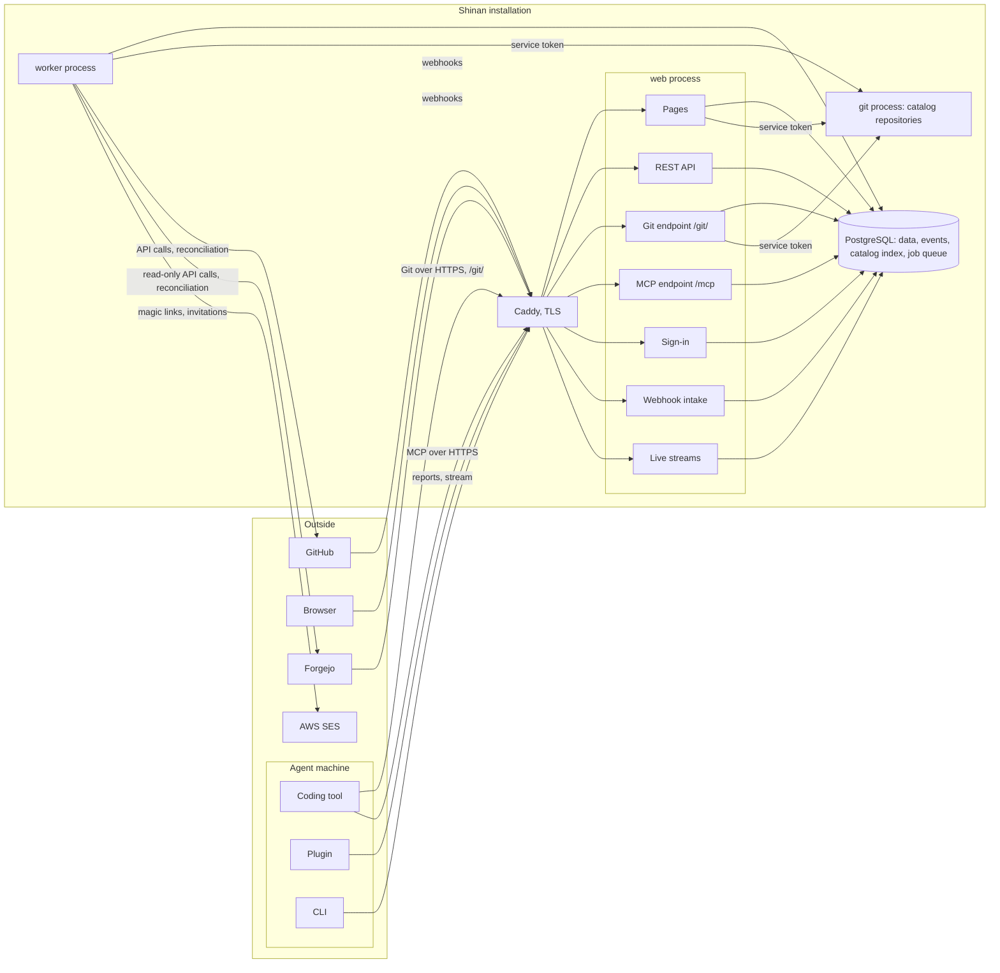

# Architecture and operations

Status: **approved by the owner on 2026-11-16** ([issue #11](https://github.com/guneet-xyz/shinan/issues/11); integrated in [#26](https://github.com/guneet-xyz/shinan/issues/26)).
Updated with the owner's answers in [issue #25](https://github.com/guneet-xyz/shinan/issues/25)
and the integration review in [issue #26](https://github.com/guneet-xyz/shinan/issues/26).

This document describes how Shinan is built and run: the technology stack
(D-020), the parts of the system and how they talk, where data lives, how the
catalog's Git repositories and its agent index stay in sync (D-006, D-059),
how git host events come in, how agents and plugins reach Shinan, email and
notifications, the task address, security
for a public app with sign-in (D-015), deployment on Musashi at
`shinan.guneet.dev` (D-016), self-hosting (D-012), observability, and the
accepted risk of having no backups.

It does not specify what the other documents own: catalog schema and conflict
rules, task rules, sign-in rules and token rules, git host event lists, MCP
tool lists or screens. It links to them instead (see
[Dependencies](#dependencies-on-other-documents)).

## How to read this document

Every statement is marked:

- **Decided**: follows from an accepted plan decision, or from an owner answer
  in [issue #25](https://github.com/guneet-xyz/shinan/issues/25) (written
  "Decided (owner, O-n)" or "N-n") or in the integration review
  [#26](https://github.com/guneet-xyz/shinan/issues/26) (written "NO-n"). The [decision log](decisions/README.md) maps
  the answers to decision records.
- **Proposed**: suggested here, with a reason.
- **Open**: not settled; listed under [Open questions](#open-questions).

Terms follow the [domain model and glossary](domain-model.md). In
particular, a **Shinan installation** is one running copy of Shinan; a
**workspace** is a team's container inside it. "Sync" is used only for the
catalog Markdown and its index; keeping up with git hosts is
**reconciliation**.

External facts were checked against primary sources on **2026-11-16**. Facts
about Musashi and its services come from the `workspace` repository's catalog at
revision `86bba32` and the Musashi infrastructure repository (`infra/musashi`) at
`29a8cba`, both read on 2026-11-16. Nothing was deployed, and no DNS or server
action was taken.

## Summary

| Area                    | Position                                                                                                                                                                                                                                                                                                                                                                                                    |
| ----------------------- | ----------------------------------------------------------------------------------------------------------------------------------------------------------------------------------------------------------------------------------------------------------------------------------------------------------------------------------------------------------------------------------------------------------- |
| Stack                   | **Decided:** TypeScript, with a plain Node.js server and a React single-page app (owner, O-60, O-61).                                                                                                                                                                                                                                                                                                       |
| Shape                   | One codebase and one container image, run as three roles: `web` (pages, API, the Git endpoint and MCP endpoint, webhook intake, live streams), `worker` (background jobs) and `git` (the catalog's repositories, in a container of its own, D-065); a one-shot `migrate` command runs before each start.                                                                                                    |
| Storage                 | PostgreSQL for everything but the catalog's text, including the job queue; the catalog's Git repositories on the `git` role's volume (D-059). No Redis, no other file storage in the first version.                                                                                                                                                                                                         |
| Catalog (D-006)         | **Decided:** one Git repository per workspace, hosted by Shinan; the documents on `main` are the source of truth (D-059). Agents push; every push is checked before Git keeps it, with no catalog approval (D-060). The index is built only from `main`'s text.                                                                                                                                             |
| Git hosts               | Webhooks are verified, stored and acknowledged at once, then processed by the worker. Reconciliation catches anything missed. Shinan writes to GitHub only as its app and never writes to Forgejo (owner, O-1, O-51, N-4).                                                                                                                                                                                  |
| Agents                  | The catalog over Git at `/git/` (HTTPS, agent token as the Basic password, D-061), a remote MCP endpoint at `/mcp` for tasks, a REST API for the CLI and plugins, and a server-sent event stream for nudge offers. One long-lived token per agent, accepted at every agent endpoint (owner, O-44, NO-1); made by hand until browser approval arrives (M4). All connections go out from the agent's machine. |
| Email and notifications | **Decided:** Shinan sends email from the first version (magic links, invitations, security alerts) through the AWS SES SDK (owner, O-41, O-48, N-6). This document owns sending notifications, email first (owner, NO-3).                                                                                                                                                                                   |
| Security                | Threat model and controls for a public app holding infrastructure details, with the owner's accepted risks stated plainly.                                                                                                                                                                                                                                                                                  |
| Musashi                 | A new `shinan` stack following Musashi's rules; deployed as needed, each deployment with its own approval (owner, O-83).                                                                                                                                                                                                                                                                                    |
| Backups                 | **Decided:** none built in, no backup target and no recovery objectives for now; an accepted risk (owner, O-62 to O-64).                                                                                                                                                                                                                                                                                    |

## 1. Requirements that shape the architecture

| Requirement                                                                                         | Source                    | Effect here                                                                               |
| --------------------------------------------------------------------------------------------------- | ------------------------- | ----------------------------------------------------------------------------------------- |
| Catalog Markdown is the source of truth; the agent index is generated from it                       | D-006; owner, O-11; D-059 | [Section 5](#5-catalog-markdown-and-agent-index)                                          |
| Every fact has a state, source and last-checked time                                                | D-007                     | Stored in the Markdown; indexed for freshness queries                                     |
| Task status is calculated from linked work and recorded events                                      | D-005; owner, O-4         | Recalculated by the worker; never typed in                                                |
| Agents connect from outside; no model runs in Shinan                                                | D-008                     | Shinan is an ordinary web service                                                         |
| GitHub and Forgejo first                                                                            | D-009                     | Webhook intake and reconciliation designed for both                                       |
| Self-hostable                                                                                       | D-012                     | One image plus PostgreSQL and the Git container's volume ([section 12](#12-self-hosting)) |
| Git and the skill for the catalog, MCP and the skill for tasks, plugins, launcher later             | D-014, D-063              | [Section 8](#8-how-agents-the-mcp-server-and-plugins-reach-shinan)                        |
| Public internet, sign-in required                                                                   | D-015                     | [Section 10](#10-security)                                                                |
| Runs on Musashi; every deployment approved by the owner                                             | D-016; owner, O-83        | [Section 11](#11-deployment-on-musashi)                                                   |
| Shinan starts empty; the `workspace` repository's catalog stays the source of truth until migration | D-018                     | Data loss before migration is survivable; see [section 14](#14-backups-accepted-risk)     |
| Workspaces and invitations from the start                                                           | D-019                     | Workspace-owned records carry their workspace ([3.4](#34-workspace-isolation))            |

## 2. Technology stack

### 2.1 Decided stack

**Decided (owner, O-60, O-61):** TypeScript; a plain Node.js server and a React
single-page app; no Next.js.

**Proposed** components, chosen with the reasons given:

| Part            | Choice                                                                                                                                    | Reason                                                                                                                                                             |
| --------------- | ----------------------------------------------------------------------------------------------------------------------------------------- | ------------------------------------------------------------------------------------------------------------------------------------------------------------------ |
| HTTP server     | A small Node.js framework, for example Fastify or Hono, picked when building                                                              | Serves the REST API, MCP endpoint, webhook intake and SSE streams as ordinary code.                                                                                |
| Pages           | React single-page app built with Vite, served as static files by the same server                                                          | Pages are behind sign-in, so server rendering adds little.                                                                                                         |
| Database access | Drizzle ORM and migrations                                                                                                                | Used by the owner's Walls and Dockyard.                                                                                                                            |
| Jobs            | [pg-boss](https://github.com/timgit/pg-boss) (MIT) or [graphile-worker](https://github.com/graphile/worker) (MIT), both PostgreSQL-backed | No separate queue server. pg-boss adds jobs inside an existing transaction and has cron, retries with backoff and dead-letter queues (README, checked 2026-11-16). |
| Sign-in         | [Better Auth](https://www.better-auth.com/docs), already used by Walls                                                                    | Its docs (checked 2026-11-16) cover both methods the owner chose (N-7): GitHub sign-in and a magic link plugin.                                                    |
| MCP             | Official TypeScript SDK, Tier 1 ([SDK list](https://modelcontextprotocol.io/docs/sdk), checked 2026-11-16)                                | Most complete SDK support.                                                                                                                                         |
| CLI             | TypeScript compiled to a single executable                                                                                                | Shares the API client with the plugin.                                                                                                                             |
| OpenCode plugin | TypeScript                                                                                                                                | OpenCode loads `.ts` and `.js` plugins ([docs](https://opencode.ai/docs/plugins/), checked 2026-11-16).                                                            |

**Decided (owner, [D-055](decisions/D-055-tailwind-and-shadcn.md)):** the web
app is styled with [Tailwind CSS](https://tailwindcss.com/docs) and built from
[shadcn/ui](https://ui.shadcn.com/docs) components, copied into
`apps/web/src/components/ui`. Reason: the owner wants shadcn components
because they look better.

**Proposed** (M1-8, [#75](https://github.com/guneet-xyz/shinan/issues/75);
versions checked 2026-11-17: Tailwind CSS 4.3, shadcn 4.23, Base UI 1.9):

- Tailwind CSS v4 through its Vite plugin, set up as shadcn's
  [Vite guide](https://ui.shadcn.com/docs/installation/vite) describes, with
  `apps/web/src/index.css` as the stylesheet.
- Components on [Base UI](https://base-ui.com/react/overview/quick-start)
  rather than Radix, in shadcn's `vega` style with the neutral base colour.
  Reason: Base UI's `CSPProvider` turns off the few inline `<style>` tags its
  components add, so the Content Security Policy stays strict
  ([10.2](#102-web-hardening)); Radix's dialogs add an inline `<style>` tag
  to lock page scrolling, which the policy refuses.
- Light and dark follow the device's setting (`prefers-color-scheme`), with
  no switch. Reason: choosing the theme before the first paint would need an
  inline script, which the policy refuses.

**Proposed:** keep business logic and authorization in plain modules that do
not import the web framework. Reason: a framework change stays possible, and no
authorization lives only in framework middleware (the class of bug behind
Next.js's [CVE-2025-29927](https://github.com/vercel/next.js/security/advisories/GHSA-f82v-jwr5-mffw)).

### 2.2 Shared foundations

These hold regardless of library choices (**Proposed**):

- **PostgreSQL** as the only database. Reason: one thing to monitor and
  upgrade; the owner already runs PostgreSQL for mon, Walls, Drawspace and
  easyshell on Musashi. The catalog's Git repositories are the one other
  store (D-059, [4.1](#41-postgresql-holds-everything)).
- **One container image, three process roles** (`web`, `worker` and `git`).
  Reason: one person maintains it, one artifact is easy to self-host, and
  slow git host calls and email sending never delay pages or webhook
  responses; Git runs apart from everything else (D-065).
- **Server-sent events (SSE)** for live updates to browsers and plugins. Reason:
  one-way push over HTTPS is enough (clients send with normal requests), and
  Caddy flushes `text/event-stream` responses immediately
  ([Caddy `reverse_proxy` docs](https://caddyserver.com/docs/caddyfile/directives/reverse_proxy),
  checked 2026-11-16).
- **Multi-architecture images** (`arm64` and `amd64`). Reason: Musashi is ARM64;
  most self-hosters use `amd64`.

### 2.3 Options considered

Kept as a record; the full comparison is in this PR's history and the decision
log.

| Option                           | Why not chosen                                                                                 |
| -------------------------------- | ---------------------------------------------------------------------------------------------- |
| A: TypeScript with Next.js       | Streams, MCP, webhooks and workers sit outside Next.js's model; more framework churn to patch. |
| B: Go with server-rendered pages | Two languages (the plugin must be TypeScript); richer UI is harder.                            |
| C: Elixir with Phoenix LiveView  | Three languages; no official MCP SDK.                                                          |

## 3. System design

### 3.1 Components

| Component      | Role                                                                                                                                                         | Status                                                                             |
| -------------- | ------------------------------------------------------------------------------------------------------------------------------------------------------------ | ---------------------------------------------------------------------------------- |
| Pages          | The catalog pages, task pages, timeline, board and settings ([human experience](human-experience.md)).                                                       | Proposed                                                                           |
| REST API       | JSON over HTTPS for the CLI, plugins and the pages.                                                                                                          | Proposed. Reason: one API for every client keeps behavior consistent.              |
| Git endpoint   | Agents clone, fetch and push the catalog at `/git/<workspace ID>.git`; `web` authenticates them and forwards to the Git container ([8.5](#85-git-endpoint)). | Decided (owner, GD-1, GQ-1; D-059, D-065)                                          |
| MCP endpoint   | Agent actions over MCP ([8.1](#81-mcp-server)): for tasks; one tool, `workspace_context`, until M3.                                                          | Decided that it exists (D-014), not for the catalog (D-063); location proposed.    |
| Sign-in        | GitHub sign-in and email magic links; agent registration ([identity](identity.md)).                                                                          | Methods decided (owner, N-7); design owned by identity                             |
| Webhook intake | Receives git host webhooks ([section 6](#6-git-host-intake-webhooks-and-reconciliation)).                                                                    | Decided that webhooks are used (plan, Integration points).                         |
| Live streams   | SSE for browsers (timeline updates) and plugins (nudge offers).                                                                                              | Proposed                                                                           |
| Worker         | Background jobs, including email ([section 7](#7-background-jobs)).                                                                                          | Proposed                                                                           |
| PostgreSQL     | All data ([section 4](#4-storage)).                                                                                                                          | Proposed                                                                           |
| Git container  | The catalog's Git repositories, one per workspace, on its own volume; answers only the other roles, with the service token ([3.2](#32-process-model)).       | Decided (owner, GQ-1, [D-065](decisions/D-065-git-container-and-service-token.md)) |

**Proposed:** pages, REST API, the Git endpoint and the MCP endpoint all call
one shared application layer, which enforces permissions, applies the rules other documents set (for
example which sources may create nudges) and writes events. Reason: an action
must behave and be credited the same through every path, and a rule enforced in
one place cannot be bypassed through another.

### 3.2 Process model

**Proposed:** a "modular monolith". Modules (catalog, tasks, git hosts, agents,
identity, events, email) live in one codebase with clear boundaries, deployed
as one image and run as `web` and `worker`. A one-shot `migrate` command applies
database migrations before new code starts. Reason: separate services add
network calls, deployments and failure modes that one maintainer and a 2-vCPU
host do not need.

One `web` and one `worker` process are enough for the first version
(**Proposed**). Reason: one owner, a handful of agent sessions and webhook
traffic from a few dozen repositories. Both roles can run more copies later:
jobs are claimed safely by the queue, and live streams are fanned out through
PostgreSQL `LISTEN`/`NOTIFY`
([docs](https://www.postgresql.org/docs/current/sql-notify.html)).

**Decided (owner, GQ-1, [D-065](decisions/D-065-git-container-and-service-token.md)):
a fourth role, `git`,** runs the catalog's Git repositories in a container
of its own: the same image (`shinan git`), Node.js and the `git` programs,
no shell. As built (GC-1b,
[Git-based catalog plan §2.2](build-plan-git-catalog.md#22-how-shinan-serves-git)):

- **What it holds:** its volume (`SHINAN_CATALOG_DIR`, default
  `/var/lib/shinan/catalog`), with one bare repository per workspace
  (`<workspace ID>.git`) and the journal, and the service token
  (`SHINAN_GIT_SERVICE_TOKEN`). No database address, session secret or email
  credential, and no internet access. It refuses to start without the token
  (at least 32 characters), with a volume its group or others can write, or
  unless Shinan's `pre-receive` hook is an executable file outside `/tmp`
  and the volume that refuses a dry run Git starts: a hook Git cannot run
  (a `noexec` mount, a lost execute bit) is skipped without a word, and the
  push would land unchecked.
- **Who reaches it:** only the roles on the internal `git` network, and
  only with `Authorization: Bearer <service token>`, compared in constant
  time; any other request gets `401` and nothing else, the context header
  unread. Calls go one way: `web`, `worker` and `migrate` call it; it calls
  nobody and writes nothing to PostgreSQL. `worker` calls it to create
  repositories, read `main` for the index and store its journal; `web` to
  forward agents' Git requests ([8.5](#85-git-endpoint)), read a page's
  history, its source, the README and Recent changes (at the index's
  commit), store the journal after each push and run a purge; `migrate`
  only for the move into Git on the upgrade to 0.4. A person holds at most 2 of
  `web`'s reads for the catalog pages at once (4 per network address), so
  one browser can't take the container's 4 reads from the index updates.
  History and Recent changes page by cursors `web` signs (HMAC with the
  session secret, over the workspace, the list, the commit the list started
  from and how many of `git log <start>`'s commits came before), so the
  browser can only read on from a commit `web` started at on the index's
  `main`, never another branch, and no commit is skipped however merges
  interleave the history (review of #194). For Recent changes the Git
  container works out each merge's own changes in the same history read
  (`combined`: the files that differ from every parent, as Git's combined
  diff names them, by tree walks within the request's budget; unknown when
  the budget runs out). Each commit of a page gets a fair share of what is
  left of that budget (with a small floor) and gives back what it didn't
  use, so one heavy commit can't leave the rest of its page unknown.
- **Its API** (JSON; the typed client is core's `createGitClient`):
  `GET`/`PUT /repositories/<workspace ID>` (`main`'s commit; create with a
  first commit by Shinan, once), `GET …/tree`, `POST …/documents`,
  `GET …/diff` and `GET …/history` of `main` or a full commit ID, and
  `GET /journal` and `POST /journal/acknowledge`; the smart HTTP paths of
  [8.5](#85-git-endpoint) and the purge API (`POST …/purges`,
  [4.4](#44-purge)). A context header (`Shinan-Git-Context`, base64url JSON, at most
  64 KiB and 100 allowed values) is read only after the token is checked.
- **One request stays small, whatever a repository holds:**
  - **Documents** are streamed, one at a time as the reader takes them, at
    most 32 MiB of contents a response (each size is read from the object's
    header first; documents past the budget come back `deferred`, to ask for
    again; a file over 1 MiB is `tooLarge`).
  - **A tree listing or a diff** returns at most 50,000 entries and 8 MiB of
    paths (a path may be up to 4 KiB), `truncated` when there were more;
    it stops there.
  - **Diffs, and history's changed paths,** do not use `git diff-tree`,
    which builds its whole list of changes before printing any (50,000
    paths of 4 KiB are 200 MiB inside Git). Shinan walks the two trees
    itself: it reads tree objects one at a time through `cat-file`, at most
    16 MiB each and 64 MiB along one path (else `422 tree-too-large`), and
    their entries one at a time from those bytes, never all made into
    objects; it skips subtrees with equal IDs. A test checks that it finds
    exactly what `git diff-tree` finds, in its order.
  - **A work budget per request:** 20,000 tree objects read and 5,000,000
    entries visited, shared by the request's walks. Past it, a diff stops
    `truncated`, and a history commit's change count becomes a lower bound
    (`changeCountAtLeast`). Nothing fails for it, so a few KB of repeated
    subtrees (50 × 50,000 references to one tree) cost seconds, not a
    minute of CPU and an error.
  - **A history page** of at most 100 commits reads each commit only up to
    256 KiB (a longer message comes back truncated and flagged) and lists,
    per commit, at most 50 of the paths it changed against its first parent
    (with their count and a flag; at most 2 MiB of paths across the page),
    by the same tree walk, so no whole commit is held. A page may skip at
    most 1,000,000 commits.
  - **These reads take turns:** at most 4 at once, each holding its place
    until its answer has been sent or its client has gone (a slow reader
    holds memory too), and up to 64 waiting, which leave if their client
    goes; past that, `503` with `Retry-After`. An answer not sent within
    120 seconds of starting (a client that stopped reading) is cut off, and
    so is one whose reading fails after its headers went out: closing the
    connection gives up its place.
  - **A tree deeper than Git reads** (`core.maxTreeDepth`, 2,048 levels)
    answers `422 tree-too-deep`.
  - **Tested under the container's 1,024 MiB limit:** the first-start test
    builds a repository past these limits (1,000 paths to one 1 MiB file,
    70 commits with 15 MiB messages, a branch with 250,000 paths, a branch
    of 50,001 paths of about 4,040 characters, two root trees of 500,000
    entries each) and reads it: one documents read and one history page,
    6 tree and 6 diff reads at once of the wide branch, 4 tree and 4 diff
    reads at once of the long paths, 4 diffs and 4 history pages at once of
    the two 500,000-entry trees, and 40 document reads at once whose
    clients wait before reading. The test reports the container's memory
    peak. Unit tests cover repeated subtrees (50 × 50,000) against the work
    budget.
- **Repositories** are made with `git init --template=` (no sample hooks)
  in `.tmp/` on the volume, configured (`core.hooksPath` to the image's
  read-only hooks, `fsckObjects`, `receive.maxInputSize`, push options,
  `core.fsync`, `gc.autoDetach=false`, modest packing, no reflogs), given
  their first commit (its files written by one `git fast-import`, so 20,000
  files take seconds; a path Git would drop is refused rather than left
  out), checked by Git's own `git fsck --strict` (which refuses names
  Windows or macOS read as `.git`, among others), synced to disk and
  renamed into place, so one exists whole or not at all. A new workspace asks for its repository in the transaction that
  creates it (`catalog_repositories`, and a job); the worker has the Git
  container make it, retrying while it is down.
- **Health:** the image's health check, through the role's own internal
  listener (`127.0.0.1:3001`), ready while the volume is writable.

### 3.3 Who calls what

| Caller              | Endpoint                                    | Credential                                                          | Status                                                                              |
| ------------------- | ------------------------------------------- | ------------------------------------------------------------------- | ----------------------------------------------------------------------------------- |
| Person in a browser | Pages, REST API, live stream                | Sign-in session cookie, after GitHub sign-in or an email magic link | Methods decided (owner, N-7)                                                        |
| Coding tool (Git)   | `/git/<workspace ID>.git`                   | Agent token as the password of HTTP Basic, from a credential helper | Decided (owner, GD-4; D-061) ([8.5](#85-git-endpoint))                              |
| Coding tool (MCP)   | `/mcp`                                      | Agent token as `Authorization: Bearer`                              | Decided (owner, O-44, NO-1) ([8.1](#81-mcp-server))                                 |
| CLI, plugin         | REST API, plugin stream                     | The same agent token                                                | Decided (owner, NO-1)                                                               |
| GitHub              | Webhook intake, one app-level URL           | The GitHub App's webhook secret                                     | Proposed ([6.1](#61-webhook-intake))                                                |
| Forgejo             | Webhook intake, one URL per Forgejo webhook | That webhook's secret                                               | Proposed ([6.1](#61-webhook-intake))                                                |
| Worker, to GitHub   | GitHub API                                  | GitHub App installation tokens only                                 | Decided (owner, O-1, O-51)                                                          |
| Worker, to Forgejo  | Forgejo API, reading only                   | The connecting person's own Forgejo token, any scope                | Decided (owner, O-53, O-54, N-4)                                                    |
| Worker, to email    | AWS SES API through the AWS SDK             | A send-only IAM access key                                          | Decided (owner, N-6); credential proposed ([section 9](#9-email-and-notifications)) |

On GitHub, Shinan writes only as its app and stores no per-person GitHub
tokens (**Decided**, owner, O-1). On Forgejo, Shinan makes no writes at all:
connections are read-only and there are no backlinks there (**Decided**, owner, N-4, [#25](https://github.com/guneet-xyz/shinan/issues/25)).
Anything a person wants done on a git host is done by that person's own agent
sessions, which receive the request as a queued nudge and pick it up when one
is running (**Decided**, owner, N-3, [#25](https://github.com/guneet-xyz/shinan/issues/25)).

### 3.4 Workspace isolation

The glossary lists what belongs to exactly one workspace (members, agents,
tasks, catalog, git host connections, events and more) and what sits outside
(the Shinan installation, person, git host account, git host, repository, work
item and coding tool).

- **Proposed:** repositories and work items are stored once per installation,
  outside workspaces. A workspace reaches them only through the repositories its
  git host connections cover. A repository can be covered by only one workspace
  in the first version (**Decided**, owner, O-59), so this gives the same
  isolation as per-workspace copies. Reason: one model shared with the glossary
  and the [git hosts](git-hosts.md) document.
- **Proposed:** events, including events about work items, belong to the
  workspace whose connection produced them.
- **Proposed:** every workspace-owned table has a `workspace_id` column, and all
  reads and writes go through one data access layer that requires a workspace
  scope; repositories and work items are read only through a workspace's
  connection coverage. Reason: one enforcement point is easier to review and
  test.
- **Proposed:** automated tests that create two workspaces and assert nothing
  crosses between them, for every API and MCP action. Reason: a cross-workspace
  leak is the worst plausible bug here.
- Inside a workspace, every member sees everything, including work from private
  repositories; links to private repositories stay protected by the git host
  (**Decided**, owner, O-43). There is no restricted catalog level (**Decided**,
  owner, O-2).
- **Open:** whether to add PostgreSQL row-level security
  ([docs](https://www.postgresql.org/docs/current/ddl-rowsecurity.html)) as a
  second barrier between workspaces.

### 3.5 Shinan installation

The glossary proposes **Shinan installation** for one running copy of Shinan and
names this document as its owner. **Proposed:** confirm the term, with these
details:

- An installation has one or more **installation operators**: people who run
  it. Being an operator does not make someone a member of any workspace. In the
  app, operators manage installation settings and see installation-level
  health (dead-lettered jobs, email delivery failures, connection health
  without workspace content). Operators **cannot purge** anything
  (**Decided**, owner, O-50).
- Operators with server access can read the database; Shinan cannot protect a
  workspace from its own operator. This is stated plainly.
- **Installation settings:** the email allowlist that decides who can have an
  account (**Decided**, owner, O-48; joining a workspace still needs an
  invitation); the GitHub sign-in credentials; the SES settings
  ([section 9](#9-email-and-notifications)); and the hosts that are exceptions
  to the private-address rule (owner, N-12; [10.1](#101-threats-and-controls)).
- **Who the operators are,** and how the allowlist starts, follow
  [identity](identity.md) §3.2 and §12: the installation's configuration names
  the operators and the first allowlisted addresses (see
  [section 12](#12-self-hosting)).
- On `shinan.guneet.dev` the owner is the only installation operator and the
  only workspace owner.

### 3.6 Task address

[Tasks and work](tasks.md) and [git host integrations](git-hosts.md) use a
**task address** in markers, PR descriptions, backlinks and emails, and leave
its shape to this document and [human experience](human-experience.md).

**Proposed:**

- The task address is `https://<installation address>/t/<task ID>`, for
  example `https://shinan.guneet.dev/t/T-124`. Reason: short enough to write
  next to a task ID in a PR description, and stable whatever the page looks
  like.
- **The task ID alone finds the workspace.** Task prefixes are unique within an
  installation, and a retired prefix is never given to another workspace
  ([tasks](tasks.md) §3), so the address needs no workspace part. Reason: a
  workspace name in the address would break if the workspace were renamed.
- **Old prefixes keep working.** An address with a workspace's former prefix
  redirects to the task's current ID. The ID is matched without regard to case
  and redirected to the upper-case form.
- **Sign-in first.** The address always needs sign-in; someone who is not a
  member of the task's workspace gets the same "not found" answer as for a task
  that does not exist (identity's uniform answers). Git host integrations
  already keep it out of public repositories (O-56).
- **Never changes.** The address is kept for as long as the installation exists,
  including for cancelled tasks. Page layout behind it is owned by
  [human experience](human-experience.md).

## 4. Storage

### 4.1 PostgreSQL holds everything

PostgreSQL holds everything except the catalog's text. **Decided** (owner,
GD-1, [D-059](decisions/D-059-catalog-in-git-hosted-by-shinan.md)): the
catalog lives in Git, on the Git container's volume (`SHINAN_CATALOG_DIR`),
the one other store. It holds one bare repository per workspace, made with
the workspace with a first commit by Shinan holding `README.md`, and the Git
container's journal ([4.2](#42-kinds-of-data)); only the Git container mounts
it ([3.2](#32-process-model)). From v0.4.0 the catalog's text is no longer
in PostgreSQL (GC-6).

**Proposed.** Search uses PostgreSQL full-text search
([docs](https://www.postgresql.org/docs/current/textsearch.html)) at first.
Reason: catalog and tasks are small text collections; a search engine would be a
second stateful component.

**Considered and not proposed:** SQLite. The `web` and `worker` processes write
at the same time, which SQLite handles less well, and the owner's practice on
Musashi is PostgreSQL.

**Proposed:** no file or blob storage in the first version. Reason: nothing
needs uploads; catalog pages are text and work items are links. **Open** until
[human experience](human-experience.md) and [catalog](catalog.md) confirm.

### 4.2 Kinds of data

| Data                                                                                                                                                                                                                                                                                                                                                                          | Rebuildable if lost?                                                                                                | Retention                          | Status                                                                                                        |
| ----------------------------------------------------------------------------------------------------------------------------------------------------------------------------------------------------------------------------------------------------------------------------------------------------------------------------------------------------------------------------- | ------------------------------------------------------------------------------------------------------------------- | ---------------------------------- | ------------------------------------------------------------------------------------------------------------- |
| M2's catalog revisions (the Markdown text) and catalog proposals: **dropped in v0.4.0** once moved into the repositories (GC-6)                                                                                                                                                                                                                                               | No ([14](#14-backups-accepted-risk))                                                                                | Dropped by v0.4.0                  | As built (GC-6)                                                                                               |
| The record of each workspace's move into Git (GC-6, `catalog_moves`): M2's revision, the documents moved, the first commit, when it was verified, the proposals left waiting (numbers and IDs) and the problems reported (codes and IDs)                                                                                                                                      | No                                                                                                                  | Forever                            | As built (GC-6)                                                                                               |
| Agent index and all other catalog-derived data                                                                                                                                                                                                                                                                                                                                | Yes, from `main` of the workspace's repository ([5.3](#53-how-sync-works))                                          | Updated after each push to `main`  | As built (GC-4)                                                                                               |
| Catalog repositories (GC-1b): one bare Git repository per workspace, on the Git container's volume; `catalog_repositories` in PostgreSQL records each one's first commit                                                                                                                                                                                                      | No; clones hold partial copies ([Git-based catalog plan §2.11](build-plan-git-catalog.md#211-backups-and-recovery)) | Forever, except purge              | Decided (owner, GD-1); as built (GC-1b)                                                                       |
| The Git container's journal (GC-1b): entries for PostgreSQL, one file each, beside the repositories ; numbers never reused; a damaged entry ends a read page after the good entries before it, and the next read and any acknowledgement stop at its number (an error, never a skip); it is kept for an operator                                                              | Not needed once `web` has stored and acknowledged them                                                              | Deleted when acknowledged          | Decided with the plan ([§2.6](build-plan-git-catalog.md#26-the-push-log-and-events))                          |
| The push log (GC-3): every push that reached the hook (`catalog_pushes`), its refs (`catalog_push_refs`), each commit's first push (`catalog_commit_first_pushes`), when commits reached `main` (`catalog_main_arrivals`); the values owners allowed as "not a secret" (`catalog_allowed_values`, fingerprints only); history rewrites (`catalog_rewrites`, `catalog_purges`) | No                                                                                                                  | Forever, except purge              | As built (GC-3, GC-8; [identity §11](identity.md#11-audit))                                                   |
| Tasks, subtasks, comments, progress updates, manual states, task flag definitions                                                                                                                                                                                                                                                                                             | No                                                                                                                  | Forever                            | Proposed                                                                                                      |
| Workspaces, people, members, invitations, email allowlist, agents, token hashes                                                                                                                                                                                                                                                                                               | No                                                                                                                  | Until deleted                      | Proposed                                                                                                      |
| Events (the timeline)                                                                                                                                                                                                                                                                                                                                                         | Partly: git host events can be re-read by reconciliation within what each host's API returns                        | Forever, except purge              | Proposed                                                                                                      |
| Security log                                                                                                                                                                                                                                                                                                                                                                  | No                                                                                                                  | Forever (**Decided**, owner, O-47) | No entry can ever be purged (**Decided**, owner, N-8, N-13); see [4.4](#44-purge)                             |
| Repositories and work items (cached state)                                                                                                                                                                                                                                                                                                                                    | Yes, by reconciliation                                                                                              | Kept while covered                 | Proposed                                                                                                      |
| Raw webhook deliveries                                                                                                                                                                                                                                                                                                                                                        | Not needed after processing                                                                                         | 14 days, then deleted              | Proposed. Reason: long enough to replay after a bug fix; follows "link, don't copy" (D-001).                  |
| Presence                                                                                                                                                                                                                                                                                                                                                                      | No, but short-lived by nature                                                                                       | Current state plus presence events | Proposed                                                                                                      |
| Job records, including sent email metadata                                                                                                                                                                                                                                                                                                                                    | Not needed                                                                                                          | 7 days after completion            | Proposed. Reason: enough to debug recent failures.                                                            |
| Notification records (what was sent to whom, when, outcome; no message body)                                                                                                                                                                                                                                                                                                  | Not needed                                                                                                          | 90 days                            | Proposed. Reason: a person can see why they received something; long enough to explain a missed notification. |
| GitHub App private key, webhook secrets, Forgejo tokens                                                                                                                                                                                                                                                                                                                       | No (must be re-entered)                                                                                             | Until removed                      | Proposed; encrypted, see [10.3](#103-secrets-and-credentials)                                                 |

### 4.3 Events

**Proposed:** one append-only events table. Rows are never updated or deleted
except by workspace deletion or [purge](#44-purge); corrections are new events,
as the glossary proposes. Each event records its origin (Shinan action, webhook,
reconciliation, plugin report, MCP call) and an idempotency key, so the same git
host change arriving by webhook and by reconciliation is stored once.

Derived views, such as task status and agent session presence, are recalculated
by the worker and stored as ordinary rows for fast reads (**Proposed**). Reason:
recalculating on every page view would be slow.

### 4.4 Purge

The glossary and the [catalog](catalog.md) call this operation **purge**.

**Who:** only workspace owners can purge, including operational records about
their workspace (raw webhook deliveries, job records); installation operators
cannot purge (**Decided**, owner, O-50).

**How (Proposed):** one narrow operation for events, the catalog's history
(below), comments, progress updates, raw webhook deliveries and job records
of one workspace:

- The content is replaced by a marker. The record stays, with its time, kind,
  actor and subjects, so history keeps its shape.
- The purge is itself an event saying who purged what and why, without the
  removed content.
- Derived data (search text, agent index rows) is rebuilt. Since the
  catalog moved into Git, its history is rewritten on the server (below;
  owner, GD-11).
- Copies outside Shinan's control are reported, not assumed clean: agents'
  clones of the catalog, workspace exports downloaded earlier
  ([5.5](#55-export-and-import)), and the host's own backups, if any. The
  purge screen says so.
- **Security log:** kept forever (owner, O-47), and no entry, installation-level
  or workspace-level, can ever be purged (**Decided**, owner, N-8, N-13,
  [#25](https://github.com/guneet-xyz/shinan/issues/25)). A person's deletion
  request therefore cannot remove their security-log entries; this is the
  residual risk [identity](identity.md) §11 states. The log holds structured
  entries (actor, time, network address, action), not free text, so leaked
  secrets should not reach it.
- **Application logs** (process output collected by Docker) are outside the
  app's reach. They carry IDs, not workspace content (see
  [section 13](#13-observability)), so there is nothing to purge there.

Reason: "never edited" keeps history trustworthy, but a leaked secret or a
lawful deletion request must still be removable; a visible, attributed purge
keeps both. A secret that reached Shinan must also be rotated at its source.

**As built for the catalog (GC-8, [#170](https://github.com/guneet-xyz/shinan/issues/170); M2-10's matching, owner M2-Q17).**
What a purge removes and records is in [catalog §9](catalog.md#9-history-and-purge);
the plan is [§2.9](build-plan-git-catalog.md#29-undo-and-purge). A purge
runs as a job, because a large history takes minutes (review of #197), and
the Git container is never called inside a database transaction:

1. **Check** (core `purgeCatalogText`): a workspace owner who signed in
   again recently (`catalog.purge`); the text and the reason. `web` then
   stores the Git container's journal, so every rewrite it made is known.
2. **The repository, in the Git container** (`apps/server/src/git/purge.ts`),
   as a job under a new purge ID (`POST /repositories/<ID>/purges`, then
   `GET …/purges/<purge ID>`; one at a time per repository, a second is
   refused `purge-running`). **Without the push lock** (pushes go on):
   - **Scan:** `git fast-export --all --show-original-ids --reencode=no`
     is read once (each blob and commit once, each path name matched once),
     and the objects no branch reaches (`cat-file --batch-check` less
     `rev-list --objects --all`) are read whole. It also gathers every path
     the history holds. If nothing holds the text, the purge takes the lock
     and reads what was pushed meanwhile (fast-export of the moved branches
     less the old tips); only if that holds none either does it end, with
     no rewrite (review of #197). The repository isn't pruned while a purge
     reads it (`Purges.running`).
   - **New names, planned first** (`apps/server/src/git/purge-plan.ts`,
     review of #197): every path, folder and catalog ID holding the text
     gets its new name once, the same in every commit, and never one the
     history already has: folder by folder, the names that keep their form
     first, then the new ones, numbered when taken
     (names compared as Windows and macOS see them, letter case aside;
     `machine/purged-box.md` beside an existing one becomes
     `machine/purged-box-2.md`, a renamed folder beside an existing
     `notes/purged/` becomes `notes/purged-2/`). The page's ID, its links and references
     follow its path (`machine/purged-box-2`); an alias or reference that
     would now name another page is numbered too. So a purge never writes
     one page over another. The preview lists the paths it numbers.
   - **Rewrite:** the same stream (`@shinan/git` `rewriteHistory`), each
     blob, commit message, author and committer name and email, path and
     branch name passed through core's `PurgeScanner` (the same
     `PurgeMatcher`, on bytes: UTF-8 as text, anything else byte for
     byte), into `git fast-import` in a new repository in
     `.tmp/purge-<ID>/`, with the marks of both sides kept. The text
     becomes `(purged)`, but in names and where it is part of a catalog ID
     (a page's `id`, an alias, a reference) the name the plan gives, so a
     page's ID still equals its path. A commit nothing changes
     keeps its ID (signed commits lose their signature, so they and what
     follows them get new IDs). Branch names are made unique (`purged-2`),
     and `main` keeps its name.
   - **Check:** every blob and commit of the new repository (names, emails,
     headers and messages, not object IDs or times), every path name it
     was written with (its trees' names), and every branch name; any copy
     stops the purge before the swap.

   **With the push lock** (pushes meanwhile are refused at once: "Shinan is
   removing text from this catalog's history: wait a few minutes, fetch,
   then push again"): if a push moved a branch during the first part, only
   what it added is rewritten and checked (fast-export and fast-import
   again, with the first run's marks; review of #197), the new repository's
   branches are set to where the pushes left them, and branches deleted
   meanwhile go. A pushed path that keeps a name the plan gave away (rare)
   makes the plan and rewrite start again, whole, with the lock held. Then,
   with the text: the journal entries
   not yet acknowledged, the first-pusher record and earlier purges'
   records get the new branch names, and the record of fact check groups
   ever on `main` (GC-3b's revert rule) the text replaced as on `main` (a
   group where it can't be is dropped and recorded again from `main` by the
   next push). The purge's record (`records/<workspace>/purges/<ID>.json`:
   commit IDs old and new, removed commits, branches, the IDs named apart,
   an HMAC-SHA256 of the text under a key made once on the volume,
   `records/purge-key`; never the text) is written `swapping`. Git
   processes on the repository are ended and held back (`gate.drain`); the
   answers they were giving are cut short with a TCP reset, by the Git
   container and then by `web` towards the agent, so what was still on its
   way is dropped rather than delivered (review of #197). What had already
   left `web` (in Caddy's buffers and the network) still arrives, so a
   clone in progress at the swap may hold some of the old history, as the
   after-removal steps say; the folders are swapped; the
   record says `swapped`; the old repository is deleted. Then, from the
   record alone: every commit the old repository held that the new one
   does not (unreachable ones included) joins `purged-commits`, which
   pre-receive refuses; each rewritten commit inherits the first pusher of
   the commit it replaces; the journal gets `repository.rewritten` (2,000
   commits an entry) and `repository.purged` (branches, counts and the IDs
   named apart); the record becomes `done`.
   - **Interrupted:** while a record is `swapping` or `swapped`, every push
     is refused (the same message), and the refs the minute check of the
     push log asks for are answered busy, so no removed commit comes back
     before `purged-commits` holds it. What follows the swap is tried three
     times, then again every minute and at start (`finishPending`). A
     `swapping` record counts as swapped when its folder holds the old
     repository and no new one, or (folder gone) when the branches are the
     record's; otherwise the swap never happened and it is abandoned, which
     is safe: the repository is the old one. At start, a repository stopped
     between the two renames is put in place before `.tmp/` is emptied.
     Meanwhile the purge's status says `running`, with why it takes longer;
     once finished, `done` (review of #197).
   - **Measured** on Daedalus (review of #197's case: a branch of 20,000
     pages of about 2 KB, 6,002 commits, 59 MiB packed): 69 s in all
     (scan 8 s, rewrite 60 s), **pushes held back 1.2 s**, 330 MiB of
     memory. With a push every 3 seconds while it ran (25 accepted, a fifth
     of them on branches named with the text, a third holding it): 85 s,
     what was pushed meanwhile rewritten in 2.8 s, **pushes held back
     3.6 s**, and no object holding the text afterwards. Earlier, on the
     first version: removing the same text again took 34 s, no rewrite; a
     text that is nowhere, 25 s.

3. **The database, in one transaction** (`web`, when the job ends; it
   follows the job in the process that started it, holding the text in
   memory meanwhile): the journal is stored (the rewrite becomes a
   `catalog_rewrites` row, the minute check of the push log starts from
   its branches, and the rewritten commits' first-pusher rows are copied
   with `replaces_commit`); then the purge's record (`catalog_purges`,
   under the rewrite's ID); the text replaced in the push log's branch
   names (`catalog_push_refs.ref`, `catalog_commit_first_pushes.ref`,
   `catalog_rewrites.refs`), in `events.summary` and `events.data`, and in
   the catalog IDs of the record of the move into Git
   (`catalog_moves.waiting_proposals`, `catalog_moves.problems`); index
   rows that hold it dropped and a rebuild from the new `main` asked for; a
   check that nothing it purges still holds it; a `catalog.purged` event and
   security-log entry with counts only. Catalog IDs the rewrite named apart
   (`catalog_rewrites.ids`) are named the same way in events and in the
   record of the move. The list lives in core (`purgeTargets`). Once
   recorded, `web` tells the Git container to drop the text's keyed hash
   (`DELETE …/purges/<purge ID>/text`; review of #197). The screen asks how
   the purge stands every 3 seconds
   (`GET /api/workspaces/<ID>/catalog/purges/<purge ID>`, workspace owners
   only, `catalog.purge-status`, without signing in again).
   - **A rewrite never recorded** (`web` stopped while following it, or the
     database part failed) stays listed as unfinished until it is
     finished, and only by the same text: a purge first asks the Git
     container whether its text is an unfinished rewrite's
     (`POST …/purges/<purge ID>/text`, by the keyed hash, which only an
     unrecorded rewrite keeps), and if so
     records that rewrite under its own ID without rewriting again. A
     rewrite is never recorded under another text.

- **The append-only triggers are narrowed, not removed** (migrations
  `0010_catalog_purge`, `0022_catalog_purge_rewrite`): an update of
  `events` may change only `summary` and `data`, of `catalog_push_refs`,
  `catalog_commit_first_pushes` and `catalog_rewrites` only the branch
  names, of `catalog_moves` only its catalog IDs, and only in the transaction that recorded a purge of the row's
  workspace in `catalog_purges` (matched by transaction ID). Deletes and
  truncation stay refused. `catalog_purges` is append-only itself: the
  only update is the purge filling in its own counts, in its own
  transaction. The security log's triggers are untouched (D-049).
- **Matching:** whitespace-insensitive ([catalog §9](catalog.md#9-history-and-purge)),
  by one matcher (`PurgeMatcher`) for the preview, the purge and its checks,
  in time linear in the value and the text (Knuth-Morris-Pratt over the
  characters other than whitespace, each place then checked against the
  whitespace around it with running counts). In the database, candidates
  are found in SQL by a regular expression on the text's first 64
  characters other than whitespace, a superset. Between values it gives the
  event loop back once matching has held it for 50 ms (#149). Matching
  stops after 15 seconds in all for a request in `web`, and 30 minutes for
  the Git container's passes over a whole history (`purge-too-slow`). Only
  the exact text (whitespace aside) is removed; the preview also reports
  places that may hold it encoded (base64 at each alignment, also wrapped
  across lines, every byte percent-encoded, quoted-printable with soft
  breaks, UTF-16, another letter case), which a purge does not remove.
  They are looked for in what is left once the text itself is removed, so
  a file holding both is reported too, and a text of at most 12 bytes in
  another case only as a word of its own ("Mark", not "markdown"; review
  of #197). A link to a page written with a leading slash
  (`/machine/box`) is renamed like any other.
- **Unreachable objects after pushes:** a pushed pack may hold objects no
  pushed commit uses, which the checks never read, and a deleted branch
  leaves its commits; the Git API reads any object by full ID. So the `git`
  role looks at each repository whose refs a push moved, and every
  repository once after a start, once no push has reached it for 20
  seconds (or it has waited 10 minutes), with its push lock held
  (`apps/server/src/git/prune.ts`). It counts first, while fetches go on,
  whether any object is unreachable: every object it holds against those
  its branches reach, by the reachability bitmap, in milliseconds (a
  repository without a bitmap counts as having some). If none, it joins
  the packs pushes added (`git repack -d --geometric=2`) and prunes loose
  objects (`git prune --expire=now`), holding Git processes back for
  milliseconds; if some (a branch deleted or rewound, a pack with more
  than its commits), it repacks the whole repository (`git repack -a -d`,
  which keeps only what the branches reach and writes the bitmap) and
  prunes, with no Git process running on it (a Git process that would
  start waits). On a branch of 20,000 pages and 6,002 commits: 0.01 to
  0.05 s held after a push, 9.4 s after a deleted branch (review of #197:
  the whole repack after every push held fetches about 10 s a minute).
  The count reads one byte per object, never their names. A pruning that
  fails (a whole repack out of memory or past its time) has its
  half-written pack removed, and the repository waits an hour before it
  is tried again, pushes or restarts or not (the time is kept in the
  repository's folder), and the log says how Git ended without any catalog
  text; meanwhile the unreachable objects stay, readable by ID (GC-11: on a 1,000,000-commit history the
  whole repack needs more than the container's 1,024 MiB; tried every
  minute, it held the repository for minutes each time and left a
  400 MB pack behind each time).
  **Proposed** (GC-8): the reviews of GC-1b and GC-3a asked for it.
- **Text kept in memory:** the type schema cache keeps parsed text. The
  purging process forgets it at once; every `web` and `worker` process
  checks for new purges each minute.
- **Earlier row versions:** PostgreSQL keeps a row's earlier version until
  vacuum clears it, so the purge asks for a vacuum of the tables it changed
  right after (best effort; autovacuum does it otherwise), and a database
  dump then has no trace of the text (`purge.test.ts` in core and in the
  `git` role read every table; checked with `pg_dump` too). The bytes of
  deleted row versions stay in the database's files until the space is
  reused, and the write-ahead log and the host's backups may hold the text:
  the purge screen says copies outside Shinan's control remain, and the
  [operator guide](operator-guide.md#catalog-purge) says how to clear the
  files with `VACUUM FULL`. On the Git volume, the old repository's files
  are deleted, not overwritten.

## 5. Catalog Markdown and agent index

The [catalog document](catalog.md) owns the schema, fact format, the checks
on push and the index format. This section owns how the repositories, the
checks and the index are kept in step.

### 5.1 Decided

- The Markdown text of the documents on `main` of each workspace's catalog
  repository is the source of truth; everything else is rebuilt from it
  (**Decided**, owner, O-11). The repositories are Git, hosted by Shinan
  (**Decided**, owner, GD-1, [D-059](decisions/D-059-catalog-in-git-hosted-by-shinan.md),
  replacing N-5's "PostgreSQL only, no Git mirror for now").
- Agents change the catalog by pushing; Shinan checks every push before Git
  keeps it, and there is no catalog approval (**Decided**, owner, GD-2,
  GD-10, [D-060](decisions/D-060-no-catalog-approval.md), replacing O-12's
  review inside Shinan). Pushes are authenticated by the agent token and
  recorded in a push log ([D-061](decisions/D-061-push-authentication-and-push-log.md),
  [D-066](decisions/D-066-by-names-the-first-pusher.md)).
- Custom entity types are allowed in the first version; the eight built-in
  types are defaults (**Decided**, owner, O-17).

### 5.2 The invariant

**Proposed**; reason: this is what O-11 means in a system where agents push
text.

1. **The files on `main` are the source of truth. Nothing else is
   authoritative.** The agent index, search text, relation lists, freshness
   queries and the catalog pages' rendering are derived from that text.
2. **Shinan never writes a document from structured rows.** Documents change
   only by commits: agents' pushes, and Shinan's own commits (a repository's
   first commit, the move into Git and a purge's rewrite). Reason: otherwise
   the rows would be the real source of truth.
3. **The index is built only from `main`'s text,** by parsing it.
4. **Checked before kept.** A push is checked in Git's `pre-receive` hook
   while its objects wait in quarantine; one blocking problem refuses the
   whole push, and nothing of it is kept. The push log and the index follow
   the accepted update through the Git container's journal, so a push Git
   applied is recorded even if `web` stopped meanwhile.
5. **Round-trip test.** Automated tests, and a daily job on real data, check
   that text → parse → index equals the stored index. Differences are
   reported in the log and to the installation operator.
6. **Only the indexer writes the index.**

Custom entity types (O-17) do not change this: a workspace's type schema
documents are themselves files on `main` that the same parser reads when
validating and indexing (**Proposed**).

### 5.3 How sync works

- **Every change is a commit.** Git keeps each version; the push log records
  which agent and person first pushed each commit and when it reached `main`
  ([D-061](decisions/D-061-push-authentication-and-push-log.md)). Conflicts
  are Git merges ([catalog §8.5](catalog.md#85-conflicts-as-git-merges)).
- **Parser versions and rebuilds.** Each index row records the parser version
  that produced it. When a release changes the parser, the worker rebuilds the
  index from `main`, and the agent index reports that it is behind until done.
  **Proposed.**
- **Serving the agent index.** Every answer names the commit of `main` it came
  from ([catalog §12.4](catalog.md#124-the-index-format)). **Proposed.**
- **As built (GC-4, [#166](https://github.com/guneet-xyz/shinan/issues/166)):
  the index from `main`** ([plan §2.7](build-plan-git-catalog.md#27-the-index-after-a-push)).
  It replaces M2-3's index of stored revisions (decided by the owner,
  2026-11-19, M2-Q17), keeping what still applies: the rules version, one
  snapshot per answer, rebuilds in one transaction and sharing the worker's
  event loop.
  - **Source.** The index is built only from `main` of the workspace's
    catalog repository (D-006, D-059), read through the Git container's API
    (the tree, documents by path, the diff between two commits; plan
    [§2.2](build-plan-git-catalog.md#22-how-shinan-serves-git)). Neither
    `worker` nor `web` runs `git`, and the Git container is never asked
    anything while a database transaction is open: the indexer reads first
    and writes after (tests run the client through a wrapper that refuses
    it). Every read names a full commit ID, so one build reads one tree
    however `main` moves meanwhile. It takes the API's limits as they come:
    documents an answer `deferred` (past its 32 MiB) are asked for again; a
    tree listing past one answer is listed folder by folder; a diff past one
    answer means a rebuild; `503 busy` is asked again after 0.5 to 8
    seconds, about 15 in all, then the job is retried later. A tree the Git
    container refuses (`tree-too-large`, `tree-too-deep`), or one folder too
    large to list even one level down, leaves the index behind, saying so,
    rather than leaving files out; pushes to `main` cannot bring such a tree
    once they are checked (GC-3).
  - **Documents and rows.** A document is a regular file on `main` whose
    name ends in `.md`, except the root `README.md` (free Markdown for
    people, plan [§2.1](build-plan-git-catalog.md#21-the-repository-layout-and-rules));
    anything else is left out, since pushes to `main` cannot bring it once
    they are checked (GC-3). Index rows are keyed by the workspace and the
    document's path (its ID plus `.md`) and record the Git blob ID of the
    text they came from; the index no longer references M2's revision
    store. A file larger than the Git container reads (1 MiB, far above a
    document's 64 KiB) is indexed as a document with one `too-large`
    problem; bytes that are not UTF-8, and NUL characters, which PostgreSQL
    cannot store, read as U+FFFD, so such a file reads with problems rather
    than stopping the index. A file whose name the Git container cannot
    read (a control character such as a newline, or bytes that are not
    UTF-8, which reach Shinan as U+FFFD) is not read at all: it is indexed
    under its name with one `unreadable-path` problem, an update whose diff
    touches such a name rebuilds, and two names that reach Shinan as the
    same text are one row. GC-3b refuses such names on `main`. (**Proposed** in GC-4; reason: one bad file
    must not leave a workspace's index behind for good.)
  - **Where the index stands.** Each workspace's index state records the
    commit the index was built from (`commit`) and the latest commit of
    `main` Shinan knows of (`main_commit`), recorded in the transaction
    that stores an accepted update of `main` from the Git container's
    journal (GC-3; core's `recordCatalogMain`, which queues the index job
    in that transaction), when a new repository is made, and as soon as the
    indexer reads `main`, before it builds anything, so the index shows as
    behind even if the build then fails
    ([#187](https://github.com/guneet-xyz/shinan/issues/187)). Answers carry `catalog_commit` and say
    `index_behind` while the two differ, while the index was never built
    from a repository the workspace has, while another parser or rules
    version built it (or any of its rows), and while a rebuild is asked for.
  - **The index job** (`catalog-index-update`, at most one waiting and one
    running per workspace, retried with backoff) brings the index up to
    `main` as it is when the job runs, so several pushes in a row cost one
    update. It reads the index state, then `main`; if the index already
    stands there, it only records `main`. Otherwise it reads the diff
    between the two commits and derives again the documents the diff adds
    or changes, and drops the rows of those it deletes; when a type schema
    document changed (or a document became or stopped being one), it also
    derives again the entities of the types it describes or described, and
    every other type schema document, as M2 did (catalog §3.9). Nothing
    else in a document's rows depends on other documents: references to
    other IDs (relations, links, start-here steps, `applies-to`) are
    resolved when the index is read, so a document referring to a changed
    ID needs no update. A property test checks it: over random pushes
    (entities, custom and extended types, two schema documents for one
    type, a document that becomes a type schema document, unreadable files,
    deletions), with updates sometimes several pushes apart, the updated
    index always equals a rebuild from `main`. When the update changes more
    than 50 documents and a quarter of the catalog, or the Git container no
    longer has the commit the index stood at (a purge rewrote history,
    GC-8), it rebuilds instead. It writes in one transaction holding the
    workspace's index lock (the state row), after checking that the index
    still stands where it read it, and otherwise starts again (up to three
    times). Type schemas are kept parsed between jobs, keyed by each schema
    document's path and blob ID, which never names other text, so an update
    of an entity reads only that entity. Measured on Daedalus (load 3 to 5)
    with an in-memory stand-in for the Git container: about 20 ms per
    one-document update for catalogs of 500 to 5,000 entities.
  - **Index rules version.** The index's own rules have a version
    (`indexRulesVersion`, 2 since GC-4), recorded like the parser version on
    the index state and on each document's rows. An index built by another
    version is behind and is rebuilt; so are rows an older release wrote
    after a rollback, which the round-trip check then reports as behind
    rather than as differing. A worker of an older release that updates the
    index during a rolling deployment leaves rows of its version, so the
    next job of the newer one rebuilds.
  - **Answers are read from one snapshot** (repeatable read, read only), so
    an answer's `catalog_commit` and its rows agree.
  - **Rebuilds** read `main`'s whole tree through the Git container, then
    delete a workspace's index rows and derive them again in one
    transaction, so readers see the old rows, marked behind, until it
    commits. The type schema documents are found by reading only their
    frontmatter, then every document is derived once. Measured on Daedalus
    (load 3 to 5) with agent-written entities of about 300 words of body:
    4.8 s to rebuild and 2.4 s to check 2,000 entities, 12 s and 6 s for
    5,000, reading from memory; through the Git container's API over HTTP,
    5,000 smaller entities took 23 s, most of it reading 25 batches of 200
    documents. Rebuilds run when a release changed the parser or the rules,
    when the index was never built, after a purge, and when an operator runs
    `shinan catalog-index rebuild`.
  - **Catch-up on start.** When the worker starts, it asks for the rebuilds
    above and queues an index job for every workspace with a repository, so
    `main` moving while no worker ran (a job lost, an update stored while
    the worker was down) never leaves an index silently behind. A job whose
    index already stands at `main` costs one request to the Git container.
  - **The daily round-trip check** (rule 5, 03:40 UTC) reads, for each
    workspace with a repository, the text on `main`, parses it and derives
    the index, and compares it row by row with the stored index in one
    snapshot. Differences are reported by path and table only, never by
    value; they are logged and kept as installation health, which
    operators read at `/api/installation/catalog-index` (each workspace's
    `commit`, `mainCommit`, whether it is behind, the last check, and the
    last failure). A workspace whose index is not at `main` is not compared
    but gets an index job; one built by another version gets a rebuild. One
    workspace whose check fails is reported as `failed`, with its reason,
    and the others are checked all the same.
  - **Failures have a fixed reason**
    ([#187](https://github.com/guneet-xyz/shinan/issues/187)):
    `tree-too-large` or `tree-too-deep` (the Git container refuses to list
    `main`), `folder-too-large`, `git-busy` (still busy after every wait),
    `git-unavailable` (no answer, or a `5xx`), `deferred-none`, or `failed`.
    An index job, a rebuild or a check that fails stores the reason and its
    time on the index state (`failure`, `failed_at`), which health shows;
    the worker logs it with the workspace ID (`Catalog index of workspace
<ID> not brought up to main: <reason>`), never with catalog text. The
    next build or check that succeeds clears it. The text →
    parse → apply no operations → text half of rule 5 went with the
    operations (GC-5).
  - **Sharing the worker's event loop** (**decided**, owner, 2026-11-19,
    M2-Q17; [#135](https://github.com/guneet-xyz/shinan/issues/135)). Index
    jobs, rebuilds and the daily check run in the `worker` process beside
    every other job, so they give the event loop back between documents
    once 50 ms of work have passed since the last time. The result does not
    depend on when they yield. Measured on Daedalus (load 3 to 4), a rebuild
    of 5,000 entities held the event loop at most 102 ms, and a 50 ms timer
    ran at most 89 ms late; heap 89 to 98 MiB. (M2's measurements at 20,000
    entities, in a container limited to 384 MiB, showed 104 to 176 ms with
    word provenance replayed, which the index no longer does.) Reason: a job
    waiting seconds delays sign-in links and invitations; yields are cheaper
    and simpler than moving the work to a worker thread.
- **M2's write path is gone (GC-5, v0.4.0).** M2 (v0.3.0) applied catalog
  proposals as text edits in a pool of catalog worker threads
  (`SHINAN_CATALOG_WORKERS`, `SHINAN_CATALOG_WORKER_HEAP_MB`) and stored each
  revision's text in PostgreSQL; the [M2 build plan](build-plan-m2.md) and
  this document's history describe it. Its parser, validation and secret
  check are kept and run on push (below).
- **Fact checks.** A recheck that changes only the last-checked time is a
  commit like any other, and an event once it reaches `main`. Reason: no
  fact data may live outside the text.

**Expected volume (estimate, not a measurement).** The `workspace`
repository's catalog is 36 files, about 124 KB, with 73 commits touching it
in its first 10 days (read 2026-11-16). Git stores each version compressed,
so years of such changes stay well under the repository limit of 1 GiB
([Git-based catalog plan §2.10](build-plan-git-catalog.md#210-limits)).

- **As built (GC-3a, [#165](https://github.com/guneet-xyz/shinan/issues/165)):
  changes arrive as pushes, checked in the Git container** ([plan §2.5,
  §2.6](build-plan-git-catalog.md#25-checks-on-push)).
  - **The hooks are thin clients.** When `git http-backend` starts for a
    push ([8.5](#85-git-endpoint)), the `git` role puts a one-time nonce
    and the address of its own loopback listener (`127.0.0.1`, a port
    chosen at start, never published) in Git's environment.
    `pre-receive` sends the ref lines, the quarantine variables and the
    push options there with the nonce; `post-receive` says the refs were
    updated. Both are Node.js scripts that start no other process (a
    detached one would escape Git's time limit; a test reads them for
    it). Without a nonce, a nonce used already, or no answer, the push is
    refused ("Shinan: this push could not be checked").
  - **One push at a time per repository.** The `git` role holds the
    repository's lock from `pre-receive` until it has recorded which refs
    Git updated (at `post-receive`, or when the request ends if Git updated
    none); the next push waits up to 30 seconds, then is refused `busy`.
    Git's compare-and-swap still decides a race: a push checked against an
    old `main` fails to update it and records nothing.
  - **The checks of every push** (checks 1 to 3, and the limits that keep
    a repository readable): only branches with plain names of at most 100
    characters; `main` never deleted or forced; at most 100 branches; no
    commit a purge removed; at most 1,000 new commits, each at most 64 KiB;
    new files at most 1 MiB (from the object's size, never inflated); no
    symbolic links or submodules; names that Windows and macOS can check
    out (no case or Unicode-normalisation pairs in a folder, no trailing
    dot or space, no `\`, `:` or other characters Windows refuses, no
    reserved device names, at most 255 bytes); at most 20,000 entries in a
    folder (a tree object larger than such a folder can be is refused by
    its size before it is read, and entries are counted before any is
    kept) and 200,000 reached from a commit's tree (counting a subtree
    every place it appears); the repository under 1 GiB (branch deletions
    still pass); the secret check on every new file, commit message,
    author and committer line, branch name and file or folder name
    ([catalog §7.3](catalog.md#73-a-check-for-secret-looking-values)); a
    path holding something secret-looking is never shown, in any problem.
    They read only objects no branch held before, through the push's
    quarantine, and stop after 30 seconds (`too-slow`). Codes and limits
    are core's `pushCheckCodes` and `pushLimits`.
  - **The checks of `main` (as built, GC-3b)**, when a push fast-forwards
    `main`, run in a worker thread of the `git` role (heap limit 384 MiB,
    stopped after 5 idle minutes), one push at a time across all
    workspaces (a heavy push to one workspace's `main` makes the next
    workspace's wait, within its own 60 seconds; enough for the trial),
    within 60 seconds for the whole push: the layout (only `<type>/<slug>.md`,
    `schema/<type>.md`, `start-here.md` and `README.md`, lower-case
    letters, digits and dashes, plain files; a document's ID is its path),
    IDs and aliases never disappearing, at most 20,000 documents and
    50 MiB of text, validation of the new catalog charged to the push
    ([catalog §8.3](catalog.md#83-validation-on-push)), the `by` rule
    (D-066) and at most 2,000 commits added to `main`. Parsed documents
    are kept by Git blob ID between pushes, at most 64 MiB of text. The
    `by` rule reads the first pusher of each commit added to `main` from
    the first-pusher record, and the fact check groups ever on `main`
    from `records/<workspace ID>/main-groups.jsonl` (the revert rule),
    which gets the new `main`'s groups once its update is applied.
    Every problem names its file, even in a document with no readable ID
    (a `start-here.md` without one, a frontmatter that does not parse),
    and validation's messages are shown in the push checks' style
    (starting lower-case, without a final full stop).
  - **Output.** Every refusal and warning is one `remote:` line with its
    place (file and line, commit, or ref), Shinan's code and a message of
    about 70 characters, and never a suspected secret's value; a name is
    quoted with control and format characters (right-to-left overrides,
    zero-width characters) written as `\u…`. Warnings do not block. The
    last line says what to do, chosen by the codes present (product
    review): problems inside the pushed commits (`secret`, `symlink`,
    `submodule`, `file-too-large`, `commit-too-large`,
    `path-not-portable`, `tree-too-large`) need the commits rewritten
    (`git rebase -i origin/main`), since a new commit on top leaves them in
    the push; others are fixed in new commits; a `secret` adds that a
    workspace owner can allow a value that is not a secret; a
    `by-not-first-pusher` adds "name yourself only on fact checks you
    made. For another agent's, merge its pushed branch; don't rebase,
    cherry-pick or squash it.", so a refused agent is never steered into
    claiming another agent's checks (product review of GC-3b). A
    `-o check-only` push reads as a check ("Shinan checked this push
    (check only)…") and changes nothing; any other push option is refused.
    A hook that cannot reach the checks refuses with "Shinan: this push
    could not be checked. Nothing was changed. Try again; tell your person
    if it happens again."
  - **The journal and the first-pusher record.** `pre-receive` appends the
    verdict with the context `web` sent (`push.checked`). After Git updated
    the refs, the `git` role compares each ref with what the push asked,
    appends `push.confirmed` with the refs that moved, the commits they
    first brought (each with the first ref, in Git's order, that carried
    it, only for commits Shinan never received before) and the update of
    `main`, and then, before any other request is served, writes those
    commits to the first-pusher record on its volume
    (`records/<workspace ID>/first-pushes.jsonl`, outside the repository,
    inserted once). A new repository's first commit is recorded the same
    way, first pushed by `shinan` (`repository.created`). At start, the
    `git` role completes the record from the journal entries not
    acknowledged yet, so a stop between the two writes loses nothing, and
    records the first commit of a repository with no record at all (made
    before the push log). One with records whose root is not among them
    had `main` rewritten outside Shinan and is left alone. Only
    the `git` role's process appends to the journal. The journal has an ID
    of its own, so a new volume is read from its first entry.
  - **`web` stores the journal** right after each forwarded push, and the
    worker every minute (a push whose connection dropped), one transaction
    per entry, idempotent by entry number per journal, then acknowledges
    it. An entry that can never be stored (about a workspace PostgreSQL
    does not have, as for a repository restored from a backup or made
    through the Git API alone; invalid; or refused by a constraint) is
    set aside instead: recorded once in the security log
    (`catalog.journal-set-aside`, with its number, kind, workspace and
    reason, never its data), reported in one log line, and acknowledged,
    so it never holds back the entries after it. Only an entry of a kind
    this release does not know, or a database failure, stops the run, to
    be tried again. Stored: `catalog_pushes`, `catalog_push_refs` (confirmed once
    Git applied them), `catalog_commit_first_pushes`,
    `catalog_main_arrivals` (when each commit reached `main`: the commits
    each applied update of `main` made reachable, which `push.confirmed`
    lists as `main.added`, at the time Shinan recorded the update; a
    repository's first commit when Shinan made it; a commit's first
    arrival is kept, and a purge's rewritten commits read theirs through
    `replaces_commit`), a `catalog.pushed`
    event for each accepted update of `main` (credited to the agent, with
    the documents it changed), `recordCatalogMain` for the index, and a
    `catalog.push-refused` security-log entry for a refusal that held a
    secret. These tables are append-only by triggers. Every minute the
    worker also compares each repository's branches (read under its lock,
    with the journal's number at that moment) with the push log, and
    records an update the log does not explain once
    (`catalog.unlogged-update`).

### 5.4 Importing the `workspace` repository's catalog

**Proposed:** a one-time importer reads a folder of Markdown with frontmatter,
such as the `workspace` repository's catalog, and writes it to the catalog
repository as Shinan's own commit, checked as a push would be. Each imported document gets the `imported_from` field (source path and
revision) that [catalog](catalog.md) §2.3 defines; the importer sets it once and
nothing changes it afterwards. When the `workspace` repository moves over is
owned by the [roadmap](roadmap.md) (D-018).

### 5.5 Export and import

A full export of a workspace (catalog, tasks and their records) and import back
into an empty workspace are in the first version (**Decided**, owner, O-75; the
[roadmap](roadmap.md) needs them for its exit and rollback criterion). Not
built yet (cut line, before G2). The catalog's part is its repository
([catalog §2.2](catalog.md#22-the-repository-the-exit-path)). **Proposed**
machinery:

- **Started by a workspace owner** after re-authentication ([identity](identity.md)
  §3.3), built by the worker, and offered as a single download behind sign-in.
  The export is recorded in the security log.
- **Format:** one archive file. At its top, a generated `manifest.json` names
  the export format version, the installation, the workspace, the commit of
  `main` and the time it was taken. **Proposed.** Reason: an importer must
  know what it is reading before it reads it.
- **The catalog part** is a Git bundle of the catalog repository, with the
  push log beside it, so the documents and their whole history come out
  byte for byte ([5.2](#52-the-invariant)).
- **Everything else** sits beside it as JSON Lines files, one record per
  line: tasks with their subtasks, work links and comments; and events.
  **Proposed.** Reason: easy to read without Shinan.
- **Not included:** git host credentials, webhook secrets and token hashes,
  which are set up again after an import.
- **Import** recreates the workspace in an empty one, on the same or another
  installation, started by a workspace owner of the empty workspace after
  re-authentication. It restores the catalog repository from the bundle as
  Shinan's own commits, not as an agent's push (the `by` rule would refuse
  old fact checks), so the catalog and its history come back exactly;
  `imported_from` values are kept as they were. It then runs the round-trip
  test ([5.2](#52-the-invariant)).
- Reason: with no backups (O-62), a recent export is the only copy of a
  workspace's tasks that a person can take off the machine; for the catalog,
  agents' clones are partial copies too ([section 14](#14-backups-accepted-risk)).

Storing the catalog in Git was first set aside (N-5) and then decided by the
owner (GD-1, [D-059](decisions/D-059-catalog-in-git-hosted-by-shinan.md)):
the repositories are the only store of the catalog's text, so there are not
two stores to keep consistent.

## 6. Git host intake: webhooks and reconciliation

The [git host integrations](git-hosts.md) document owns which events matter,
connection methods, reconciliation layers and intervals, rate limits and
write-back. This section owns the machinery.

### 6.1 Webhook intake

**Proposed** pipeline:

1. **Endpoint.**
   - **GitHub:** a GitHub App has one webhook URL and one secret for all its
     installations, so Shinan has one URL, such as
     `https://shinan.guneet.dev/hooks/github`. The connection, and so the
     workspace, is found from `installation.id` after the signature is verified.
   - **Forgejo:** one URL per Forgejo webhook (owner-level for the owner's own
     accounts, per-repository elsewhere; owner, O-55), such as
     `https://shinan.guneet.dev/hooks/forgejo/<webhook-id>`, each with its own
     secret and belonging to one git host connection.
2. **Verify the signature** before parsing: GitHub's `X-Hub-Signature-256`
   ([GitHub docs](https://docs.github.com/en/webhooks/using-webhooks/validating-webhook-deliveries))
   and Forgejo's `X-Forgejo-Signature`
   ([Forgejo docs](https://forgejo.org/docs/latest/user/repository/webhooks/)),
   both HMAC-SHA256, checked 2026-11-16. Reject unsigned, wrongly signed or
   oversized requests.
3. **Route.** For GitHub, find the connection by `installation.id`; deliveries
   for unknown installations are recorded as a health warning and dropped.
4. **Store and acknowledge.** Save the raw delivery with its delivery ID, skip
   repeats, queue a processing job in the same transaction, and return `202`.
   Reason: GitHub fails a delivery after 10 seconds and does not redeliver
   automatically
   ([GitHub docs](https://docs.github.com/en/webhooks/using-webhooks/handling-failed-webhook-deliveries));
   Forgejo's default timeout is 5 seconds
   ([config cheat sheet](https://forgejo.org/docs/latest/admin/config-cheat-sheet/)),
   both checked 2026-11-16.
5. **Process in the worker:** normalize into events and work item updates,
   idempotently, then queue follow-ups: recalculating task status, creating a
   task from an outside issue (D-003), or a `related` link from a member's
   mention of a task ID in a comment (owner, O-25). The handling rules are the
   git hosts and tasks documents'.
6. **Record health:** last valid delivery and last signature failure per
   connection.

### 6.2 Reconciliation

GitHub keeps deliveries for redelivery for only 3 days
([GitHub docs](https://docs.github.com/en/webhooks/testing-and-troubleshooting-webhooks/redelivering-webhooks),
checked 2026-11-16), and Forgejo does not retry. **Proposed** machinery (the
layers and intervals are the [git hosts](git-hosts.md) document's):

- **Scheduled jobs per git host connection,** one per reconciliation layer, each
  with its own stored watermark.
- **Catch-up after downtime.** On start, the worker queues the right layers at
  once for any connection with a gap. Reason: an approved deployment restart
  should not leave silent gaps.
- **Same output as webhooks,** with the same idempotency keys.
- **Freshness recorded** per work item (display owned by
  [human experience](human-experience.md)).
- **Rate limits respected** by a per-connection limiter that reads the host's
  remaining-quota responses.

### 6.3 Writing back to git hosts

Shinan writes only to GitHub, only as its app, with the installation token
(**Decided**, owner, O-1, O-51); for example backlinks (owner, O-56). It makes
no writes on Forgejo (**Decided**, owner, N-4, [#25](https://github.com/guneet-xyz/shinan/issues/25)). **Proposed:** GitHub writes run as worker
jobs with retries, never inside a web request. Reason: git host APIs can be
slow, and a click or an MCP call should not fail because of them.

## 7. Background jobs

**Proposed:** a PostgreSQL-backed job queue with these properties:

- Jobs are added in the same transaction as the change that needs them.
- Every job is safe to run twice (at-least-once delivery).
- Retries with backoff, then a dead-letter state visible to the installation
  operator, with a manual "retry".
- Scheduled jobs run once across all worker copies.

| Job                                                                                                 | Trigger                                                                                                                                                 | Owner of the rules                                                                                        |
| --------------------------------------------------------------------------------------------------- | ------------------------------------------------------------------------------------------------------------------------------------------------------- | --------------------------------------------------------------------------------------------------------- |
| Process webhook delivery                                                                            | Webhook stored                                                                                                                                          | [Git hosts](git-hosts.md)                                                                                 |
| Reconciliation layers                                                                               | Schedule, startup gap, on demand                                                                                                                        | [Git hosts](git-hosts.md)                                                                                 |
| Recalculate task status, including subtasks at any depth (owner, O-21, N-1)                         | New event on linked work, a subtask or an agent session                                                                                                 | [Tasks](tasks.md)                                                                                         |
| Create a task from an outside issue                                                                 | Normalized issue event                                                                                                                                  | [Tasks](tasks.md)                                                                                         |
| Write back to GitHub (never Forgejo, N-4)                                                           | Task or work link change                                                                                                                                | [Git hosts](git-hosts.md)                                                                                 |
| Presence timeouts (`unresponsive`, `offline`, release after silence; owner, O-32)                   | Every minute                                                                                                                                            | [Agent integrations](agent-integrations.md)                                                               |
| Offer and withdraw nudge deliveries, including git host actions a person asks for (N-3)             | A nudge is created or withdrawn                                                                                                                         | [Tasks](tasks.md), [agent integrations](agent-integrations.md)                                            |
| Create a workspace's catalog repository through the Git container, retrying while it is down        | A new workspace (queued in the same transaction)                                                                                                        | This document ([3.2](#32-process-model))                                                                  |
| Store the Git container's journal (the push log, events) and compare its branches with the push log | Every minute, besides `web` storing it after each push                                                                                                  | This document ([5.3](#53-how-sync-works)); [identity §11](identity.md#11-audit)                           |
| Build a workspace export; run an import                                                             | A workspace owner asks                                                                                                                                  | This document ([5.5](#55-export-and-import))                                                              |
| Bring the agent index up to `main` (an update from the diff, or a rebuild)                          | An accepted update of `main` (queued in the same transaction), a new repository, worker start (catch-up, and rebuilds after a parser change), on demand | This document ([5.3](#53-how-sync-works))                                                                 |
| Verify the agent index (round-trip check)                                                           | Daily at 03:40 UTC                                                                                                                                      | This document ([5.2](#52-the-invariant), [5.3](#53-how-sync-works))                                       |
| Send email (magic links, invitations, security alerts)                                              | Sign-in, invitation, or a security event identity names                                                                                                 | This document ([section 9](#9-email-and-notifications)); content by [identity](identity.md)               |
| Build notifications (phase 2)                                                                       | A new event that human experience's rules turn into a notification                                                                                      | This document ([9.3](#93-notifications-phase-2)); what is sent by [human experience](human-experience.md) |
| Send daily notification summaries (phase 2)                                                         | Daily, per person, at their chosen hour                                                                                                                 | This document ([9.3](#93-notifications-phase-2))                                                          |
| Automatic fact checks by Shinan, if adopted                                                         | Schedule                                                                                                                                                | [Catalog](catalog.md), [git hosts](git-hosts.md)                                                          |
| Prune raw webhooks, old job records and old notification records                                    | Daily                                                                                                                                                   | This document ([4.2](#42-kinds-of-data))                                                                  |

## 8. How agents, the MCP server and plugins reach Shinan

The [agent integrations](agent-integrations.md) document owns tools, the skill,
presence and nudge semantics; [identity](identity.md) owns agent registration,
scopes and revocation. This section owns transport, how tokens reach the
endpoints, and network shape. Agents read and change the catalog through the
Git endpoint ([8.5](#85-git-endpoint)) and act on tasks through MCP
([8.1](#81-mcp-server); [D-063](decisions/D-063-no-mcp-for-the-catalog.md)).

**Proposed:** every agent-side component makes **outgoing HTTPS connections** to
Shinan; Shinan never connects into an agent's machine. Reason: agent machines
sit behind NAT, firewalls or tailnets. The agent-facing parts of
`shinan.guneet.dev` are public behind tokens (**Decided**, owner, O-45).

### 8.1 MCP server

- **Hosted, not installed (Proposed).** Shinan serves MCP at
  `https://shinan.guneet.dev/mcp` over Streamable HTTP. The CLI can also act as
  a local stdio MCP server that forwards to the API, for coding tools without
  remote MCP support.
- **Protocol versions (Proposed).** The current MCP revision is 2026-07-28,
  which removed protocol-level sessions and the GET stream
  ([spec](https://modelcontextprotocol.io/specification/2026-07-28/basic/transports/streamable-http.md),
  checked 2026-11-16). OpenCode connects with the older `initialize` handshake
  by default (`protocol: "legacy"`)
  ([OpenCode MCP docs](https://opencode.ai/docs/mcp-servers/), checked
  2026-11-16). So the endpoint supports both 2026-07-28 and 2025-11-25.
- **Statelessness (Proposed).** No per-connection state; everything a call needs
  is in the request and the database.
- **Tokens.** Agent tokens are long-lived and last until revoked (**Decided**,
  owner, O-44). An agent is per person, coding tool and machine (**Decided**,
  owner, O-40). How an agent gets its token is settled (**Decided**, owner, NO-1,
  [#26](https://github.com/guneet-xyz/shinan/issues/26)); [identity](identity.md)
  owns the flow and this document the transport:
  - **Browser approval, started from the plugin or the CLI.** The tool asks
    Shinan to connect, shows a link (and a short code for machines without a
    browser), the person signs in, chooses or creates the agent for this tool
    and machine, and approves; the tool then receives the token. The exchange
    has the shape of the OAuth device authorization grant (RFC 8628); Better
    Auth has a device authorization plugin that implements that grant (docs,
    checked 2026-11-16). One approval covers the plugin, MCP and the CLI on the
    machine, and headless runs work.
  - **A hand-made token as the fallback.** The person creates the token in the
    web app after re-authentication, sees it once, and places it on the machine,
    for example as an environment variable the coding tool sends as a header.
  - **One token per agent, accepted at every agent endpoint** of the
    installation: `/git/` (as the Basic password, [8.5](#85-git-endpoint)),
    `/mcp`, the REST API and the plugin stream. It is not accepted by any
    other installation.
  - **No MCP-specific OAuth sign-in in the first version.** It may come later,
    only if a coding tool needs it.
  - **Transport (Proposed):** the token is sent as an `Authorization: Bearer`
    header. OpenCode supports this for remote MCP servers with `oauth: false`
    and a `headers` entry that reads an environment variable (OpenCode MCP docs
    above). Installing the plugin also sets up MCP and the skill (owner, O-36),
    so the plugin writes that configuration without putting the token itself in
    a project file.
- **One authentication seam (M2-5).** Every agent endpoint uses the same
  check (`requireAgent` in `apps/server`, calling core's
  `authenticateAgent`): the token only from `Authorization: Bearer`, no
  sign-in cookie, the same 401 `invalid-token` answer for every refused
  token, failed attempts throttled per network address (a working token is
  never held up by them) and each token's requests limited
  ([identity §7.4, §10](identity.md#74-handling)). Agent endpoints are
  routed ahead of the web app's same-origin check and refuse cookies; no
  other route skips that check. The first
  agent endpoint is `GET /api/agent`, which tells the agent who it is, which
  workspace it is in and what its token allows, so a person setting up a
  tool can check the connection. **Proposed.**
- **Required checks.** Validate the `Origin` header and check that
  `MCP-Protocol-Version`, `Mcp-Method` and `Mcp-Name` match the request body, as
  the 2026-07-28 transport requires; reject tokens in query strings.
- **Trust labels on text.** Not on catalog content, which is information,
  never instructions (**Decided**, owner, GD-5,
  [D-062](decisions/D-062-no-catalog-trust-labels.md)); M2's labels went with
  the catalog MCP tools (GC-5). Whether task text carries labels is the M3
  plan's to decide ([agent integrations](agent-integrations.md#trust-labels)).
- **As built (M2-6, [#87](https://github.com/guneet-xyz/shinan/issues/87)),
  decided (owner, 2026-11-19, M2-Q17):** `/mcp` uses the official TypeScript SDK's v2 packages
  (`@modelcontextprotocol/server` 2.4), whose `createMcpHandler` serves the
  2026-07-28 revision and, statelessly, the 2025 `initialize` handshake from
  one per-request server. Each request passes, in order: the per-address
  request limit (as `/api/agent`), at most 16 requests in flight per
  address (an IPv6 address by its /64), a 512 KB body limit (larger than the
  API's 64 KB; set for M2's catalog proposals and kept, M2-Q16), the `Origin` check (a request
  carrying any `Origin` but the installation's own is refused with 403),
  `requireAgent`, and at most 8 requests in flight per token; over either
  in-flight cap the answer is 429 before the body is read, and Node gives a
  client 30 seconds to send a whole request (**decided**, owner, 2026-11-19, M2-Q16; M2-12: slow
  senders otherwise held about 0.63 MiB of memory per stalled body for up
  to 300 seconds). The SDK then checks the 2026-07-28 headers against the
  body (400 when they disagree). Answers to the 2025 handshake's requests
  are short event streams (`text/event-stream`) that close after the
  result; `responseMode: "json"` shapes only 2026-07-28 exchanges.
  Before the SDK, Shinan refuses a JSON array of messages (400: neither
  revision allows batches, and a batch would multiply the request limits,
  which count HTTP requests), an `MCP-Protocol-Version` other than the two
  it serves (400; an `initialize` asking for an older revision is offered
  2025-11-25), and `subscriptions/listen` (an in-band "method not found":
  Shinan sends no change notifications, so a listening stream would only
  hold a connection and memory open; decided (owner, 2026-11-19,
  M2-Q17) until a tool needs
  notifications, which would then come with a per-agent cap and a maximum
  lifetime). 2026-07-28 answers are single JSON bodies
  (`responseMode: "json"`); 2025-11-25 answers are one Server-Sent Events
  message (`event: message`), which the SDK's stateless legacy serving
  always uses; both with `Cache-Control: no-store`. The agent's token is
  not handed to the SDK: the handler gets the authenticated agent, and core
  checks it again on every operation. A rejected promise nothing handles
  is logged by name, code and stack frames, and the process keeps serving;
  an uncaught exception is logged the same way and ends the process, for
  the container to restart.
  Since GC-5a it serves one tool, `workspace_context` (who the agent acts
  for, what its token allows and the catalog repository's address, without
  catalog content); M2's catalog tools are gone
  ([D-063](decisions/D-063-no-mcp-for-the-catalog.md),
  [Git-based catalog plan §2.13](build-plan-git-catalog.md#213-mcp-after-this-change)).
  Checked with OpenCode v2.3.0 on Daedalus against a local server: with the
  default `protocol` it connects over 2025-11-25, and with
  `"protocol": "auto"` over 2026-07-28 (`server/discover`); both call the
  tools, and OpenCode carries on when `subscriptions/listen` is refused.
- **Session IDs are hints, never credentials.** OpenCode sends its session ID in
  `_meta["ai.opencode/sessionID"]` and documents that it must not be used for
  authentication. Matching calls to agent sessions follows the owner's answer
  (O-29) and is owned by agent integrations.

### 8.2 CLI

**Proposed:** the CLI uses the same agent token, stored as
[agent integrations](agent-integrations.md) and identity decide (the machine's
credential store preferred), and never accepts it as a command-line argument.
Reason: command lines are visible to other processes and end up in shell
history.

### 8.3 Plugins

**Proposed** transport for the OpenCode plugin (and later others); the delivery
states and the "one owner at a time" rules are the [agent integrations](agent-integrations.md) document's:

- **Reports go up as normal requests.** Presence changes and heartbeats are
  POSTed with the agent session ID and a sequence number, so repeats and
  reordering are harmless. Shinan accepts only allow-listed metadata
  (**Decided**, owner, O-34).
- **One stream per agent on a machine.** The plugin keeps one SSE stream per
  agent token, carrying offers for all of that agent's sessions on the machine,
  including subagents, each of which is its own agent session (**Decided**,
  owner, O-37). Reason: a stream per session would multiply connections as
  subagents start and stop.
- **Offers, withdrawals and answers.** The stream carries nudge offers and
  withdrawals. The plugin answers each (accepted, rejected, withdrawal
  confirmed, delivered, cancelled in the tool) with a POST. Deliveries are rows
  in the database; the stream only announces changes. If the stream drops, the
  plugin reconnects with backoff and receives every offer still open. Streams
  drop on network changes and whenever the `web` process or Caddy restarts; on
  Musashi a Caddyfile change reaches the proxy only through a restart or
  recreation (ingress catalog entry). Reason: answers stored server-side
  survive all of these; IDs prevent doubles.
- **Keep-alives** every 30 seconds (**Proposed**; a starting value).
- **Presence evidence.** Heartbeats and the stream feed the presence timeouts
  (owner, O-32; thresholds owned by agent integrations).

### 8.4 Launcher (phase 3)

Users register hardware by installing the launcher on it, and a setup guide for
such devices (VM, MacBook, and so on) is provided (**Decided**, owner, O-1).
**Proposed:** the launcher follows the same pattern as plugins: an outgoing
stream for start requests, with its own credential from identity. Reason: no
inbound ports on users' machines. Details belong to phase 3.

### 8.5 Git endpoint

**As built (GC-2, [#164](https://github.com/guneet-xyz/shinan/issues/164);
decided with the [Git-based catalog plan](build-plan-git-catalog.md) §2.2,
§2.10, §2.14, [D-065](decisions/D-065-git-container-and-service-token.md)):**
agents clone, fetch and push a workspace's catalog over HTTPS at
`https://<installation>/git/<workspace ID>.git`. `web` checks each request
and forwards it to the Git container, which runs `git http-backend`.
Pushes are refused by the image's `pre-receive` hook ("pushes are not open
yet") until the push checks arrive (GC-3a).

**In `web`** (`apps/server/src/git-endpoint.ts`), in this order, all before
the body is read:

1. **The path.** Only the four smart HTTP requests:
   `GET info/refs?service=git-upload-pack` (or `git-receive-pack`) and
   `POST git-upload-pack` (or `git-receive-pack`) under
   `/git/<workspace ID>.git/`, with nothing else in the address. Anything
   else, including Git's "dumb" HTTP paths (`HEAD`, `objects/…`,
   `info/packs`), other methods and other query strings, is `404` and
   reads nothing else, not even the database.
2. **The per-address request limit** (300 a minute, shared with `/api` and
   `/mcp`).
3. **At most 16 requests in flight per address**, shared with `/mcp`.
4. **The declared body size:** 64 MiB for a push, 4 MiB for a fetch, else
   `413`.
5. **The agent token**, on the agent seam (`checkAgentRequest`, as
   `requireAgent`): the password of HTTP Basic authentication (the user name
   is ignored), which is how Git sends what a credential helper gives it, or
   `Authorization: Bearer`. Without one, `401` with
   `WWW-Authenticate: Basic realm="Shinan"`, which makes Git ask its
   credential helper; GC-9's setup (a helper that reads
   `~/.config/shinan/token`) answers it. Cookies and tokens in the address
   are refused, and the route is outside the same-origin check, as `/mcp`
   is. Each token's 600 requests a minute are counted here.
6. **At most 8 requests in flight per token**, shared with `/mcp`. Both
   in-flight places are held until the answer has been sent, not only
   until it starts.
7. **Permission in core** (`authorizeGitRequest`): `catalog.fetch` (scope
   `catalog:read`) or `catalog.push` (scope `catalog:write`), for agents
   only. A token of another workspace gets the same `404` as a workspace
   that does not exist; a read-only token is refused `403` at
   `info/refs?service=git-receive-pack`, so Git stops before it sends
   anything. Each push's `POST` counts against its agent's 60 pushes in 10
   minutes. Core also builds the context for the Git container.

**Forwarding.** `web` sends the request to `SHINAN_GIT_URL` through the
one Git client it also reads the catalog pages with (its `smartHttp`
requests stream both ways and get a longer time limit than API calls: Git's
own 10 minutes, plus a minute), with `Authorization: Bearer <service token>` and the `Shinan-Git-Context` header
(request ID, workspace, agent, member, person, the pusher's written form,
whether the token may push, the workspace's member handles; the allowed
"not a secret" values arrive with GC-3a). It forwards only `Content-Type`,
`Content-Length`, `Content-Encoding` and `Git-Protocol` from the agent's
request: never its `Authorization` header or cookies. The body streams as
it arrives, counted against its limit; past it, the Git container's request
is ended and the agent gets `413`. A proxy in front must pass bodies on as
they come, or a declared oversize push is answered only once sent (the
operator guide's `proxy_request_buffering off`). The Git container's answer is given once
the whole body has gone (Git answers only after reading it), then streams
back as it arrives, with only `Content-Type`, `Cache-Control`, `Expires`,
`Pragma` and `Retry-After`. Neither direction is held in memory whole. If the
agent goes, the Git container's request ends, and Git with it; an answer cut
short closes the agent's connection, so Git sees it is incomplete. If the
Git container does not answer, `503` with `Retry-After`.

**In the Git container** (`apps/server/src/git/smart-http.ts`), behind the
service token like the rest of its API:

- The same path checks again, the context's workspace equal to the path's,
  `mayPush` for `git-receive-pack` (`403`), `Content-Encoding` only `gzip`
  (which Git uses for long fetch requests) or none (`415`), a `Git-Protocol`
  header of Git's form, and a repository that exists (`404`).
- **The whole body arrives before Git starts** (code review of GC-2), so a
  client that sends slowly holds no Git process: a fetch's in memory, a
  push's in a file in `.tmp/` on the volume (at most 8 at once, 2 per
  agent, counted before a byte is read; a full volume is answered `507`,
  "the Git service's disk is full", and logged as the service's own
  failure), both
  counted against their limits **after inflating** a gzip body (a 4 MiB
  gzip body can hold a gigabyte of negotiation lines; this also bounds the
  `want`, `have` and `ref-prefix` lines of a v2 request), and handed to Git
  uncompressed with their length.
- **At most 4 Git processes at once** (`git http-backend` and what it
  starts), **at most 2 per agent** and **3 for all the agents of one
  person**, running or waiting, so one token (even a read-only one), or one
  member making agents, cannot take them all; up to 16 more requests wait
  their turn for at most 10 seconds, then `429` with `Retry-After: 10`,
  which `web` passes on. Git shows the text of a `429` to `info/refs`; to a
  `POST` it shows only "RPC failed; HTTP 429", which the skill explains
  (GC-9).
- **The CGI bridge.** `git` runs with Shinan's repository settings on its
  command line (`-c`, which overrides the repository's `config`):
  `core.hooksPath` first, then the rest of what Shinan sets when it creates
  a repository ([3.2](#32-process-model)), plus `http.getanyfile=false`
  (no dumb HTTP), `http.uploadpack=true` and `http.receivepack` from the
  context. Among them, `core.bigFileThreshold=1m` (the catalog's file
  limit): a push's objects larger than that are streamed to disk when Git
  unpacks or indexes them, never inflated whole in memory, so a 449 KiB
  pack of a 450 MiB file of zeros costs about 3 MiB instead of 450 MiB
  (four at once had the Git container killed for memory). So a repository whose `config` lost or changed a setting still
  runs Shinan's hooks. Its environment is built from nothing: Git's clean
  environment (`PATH`, an empty `HOME`, no system or global configuration)
  and the CGI variables `GIT_PROJECT_ROOT`, `PATH_INFO`, `REQUEST_METHOD`,
  `QUERY_STRING`, `CONTENT_TYPE`, `CONTENT_LENGTH`, `GIT_PROTOCOL` (from
  `Git-Protocol`), `REMOTE_USER` (the agent's handle) and
  `GIT_HTTP_EXPORT_ALL`. The service token, and everything else of the
  container's own environment, is not in it. Git's CGI headers are read (at
  most 64 KiB) and its output streamed back.
- **An answer must keep moving:** if the client takes none of it for 30
  seconds, Git is ended and the connection closed, so a reader that stopped
  reading does not hold a Git process for its 10 minutes. A slow reader
  that keeps reading keeps going.
- **A Git process may run 10 minutes** (a full clone on a slow link); then
  it and everything it started are killed, and the answer is cut short.

**Errors** are plain text (`text/plain; charset=utf-8`) in Shinan's own
words, which Git shows as `remote: …` for the first request of a clone,
fetch or push. They are in one voice (product review, D-067;
`apps/server/src/git-text.ts`): each starts with `Shinan: ` so an agent
tells them from Git's own, ends with a full stop, says what happened and
what to do, and fits in 115 characters (a test checks every text). A token Shinan does not
accept points the agent to its person ("this agent's token was not
accepted (revoked or replaced). Tell your person; they can make a new
one."); a token anywhere in the address is named as the leak it is,
before anything else is checked ("never put the token in the address.
Remove it from the remote URL and tell your person to replace it."); and
an unknown workspace and another workspace's token read the same ("no
catalog here for this agent's token. Check the clone address and the
token's workspace in Shinan.").

**Time to send.** A push's body may take 120 seconds to arrive: `web`'s and
the Git container's listeners allow that, and `web` keeps every other
request, fetches included, to 30 seconds (`receiveDeadline`), counted from
its headers.

**Security log.** Refusals are `request.refused` entries for
`catalog.fetch` or `catalog.push`, as for any operation. Each fetch or clone
(its `info/refs?service=git-upload-pack` request, once it passes the
checks) is counted on its token, and every hour each token that fetched gets
one `catalog.fetched` entry with `fetches` since the last one,
`totalFetches` and `lastFetchedAt` (plan §2.14), like the token use summary.

**Why these limits** ([plan §2.10](build-plan-git-catalog.md#210-limits)):
64 MiB is a catalog at its 50 MiB text limit pushed at once, compressed,
with room to spare, and the repositories' `receive.maxInputSize`; 4 MiB is
room for some 80,000 negotiation lines; 120 seconds is a large push on a
slow link; 4 Git processes and the shared in-flight caps fit Musashi's two
cores; 60 pushes in 10 minutes per agent matches M2's proposals; 10 minutes
per process is a full clone on a slow link. The operator guide says how a
proxy must pass these requests on.

## 9. Email and notifications

This document owns **sending**: channels, delivery, retries and failures. What
is sent and each person's settings are owned by
[human experience](human-experience.md) for notifications and by
[identity](identity.md) for sign-in and security messages (**Decided**, owner, NO-3, [#26](https://github.com/guneet-xyz/shinan/issues/26)).
Email is the first channel, through the **AWS SES SDK**, not SMTP (**Decided**,
owner, N-6, [#25](https://github.com/guneet-xyz/shinan/issues/25)).

### 9.1 What Shinan sends

| Message                                                                                                                        | When                              | What it says, and to whom                                | Status                                                                     |
| ------------------------------------------------------------------------------------------------------------------------------ | --------------------------------- | -------------------------------------------------------- | -------------------------------------------------------------------------- |
| Email magic link                                                                                                               | First version                     | [Identity](identity.md) §3.1                             | Decided (owner, O-41, N-7)                                                 |
| Invitation                                                                                                                     | First version                     | [Identity](identity.md) §5.2                             | Decided (owner, O-48)                                                      |
| Security alerts: sign-in from a browser not seen before, GitHub added or removed as a sign-in method, an agent token approved  | First version                     | [Identity](identity.md) §3.3                             | Proposed by identity                                                       |
| Email address change: the confirmation link to the new address; alerts to the old address when asked for and to both when made | First version (#66)               | [Identity](identity.md) §3.4                             | Proposed by identity                                                       |
| Notifications: Needs you items and replies to a person's own comments, immediately or as a daily summary                       | Phase 2 (plan, sections 5 and 10) | [Human experience](human-experience.md), "Notifications" | Decided that they are phase 2 (plan); content proposed by human experience |

### 9.2 How Shinan sends

**Proposed**, for every message:

- **SES API through the AWS SDK for JavaScript,** called by the worker. The
  sender sits behind a small channel interface, so another channel (for
  example chat) or another email provider (for example SMTP for a self-hoster
  without SES) can be added later without touching callers. Reason: N-6 decides
  SES for the first version; the interface keeps self-hosting open (D-012).
- **Sent by the worker,** queued in the same transaction as the change that
  causes it and picked up at once (`LISTEN`/`NOTIFY`). Reason: SES latency or
  an outage must not block a web request.
- **Only to verified addresses.** Every message goes to the email address an
  account was created with, which Shinan itself verified ([identity](identity.md)
  §3.2). A magic link is sent only if the address is on the email allowlist
  (O-48), and the sign-in page answers the same either way. Reason: the sign-in
  form cannot be used to send mail to anyone, and it does not reveal who has
  an account.
- **Throttled** per recipient and, for sign-in requests, per network address.
  Reason: limits floods and cost.
- **Retries:** temporary SES errors (throttling, service errors) are retried
  with backoff for up to an hour; magic links are not retried after their own
  expiry. Permanent rejections are not retried.
- **Failures are visible.** Each message's outcome (accepted by SES, rejected,
  given up) is recorded without its body. Failures show as installation health
  for the operator and, for notifications, in the person's account settings.
  Bounces and complaints after SES has accepted a message are not handled in
  the first version; the `guneet.dev` configuration set's suppression is the
  only protection today (email catalog entry).
- **Content stays short.** Messages carry a title, the workspace, a task ID
  where there is one, and a link that needs sign-in (task links use the
  [task address](#36-task-address)); never fact values, comment text or
  tokens. Reason: email leaves the signed-in app, and the workspace holds
  infrastructure details (D-015); human experience proposes the same for
  notifications.
- **If email is down,** GitHub sign-in still works; magic links, invitations
  and alerts wait or fail visibly (N-7).

### 9.3 Notifications (phase 2)

**Proposed** machinery; the rules for what is sent and the person's settings
are human experience's:

1. When an event is recorded, a job applies human experience's notification
   rules and creates one **notification record** per recipient (who, what
   item, why). The same item is never notified twice to the same person.
2. Records for people who want immediate notifications are sent at once,
   unless the person is in their quiet hours; those wait until the quiet hours
   end. Deployment approval requests follow human experience's rule (sent
   immediately unless the person turned them off).
3. Records for people who chose a daily summary are collected, and one email
   per person per day lists them, at the hour the person chose.
4. If the item no longer needs the person when the message would go out (for
   example the approval was already given), it is dropped from the message.
   Reason: notifications should bring a person back only for what still needs
   them.
5. Records are kept for 90 days ([4.2](#42-kinds-of-data)) so a person can see
   what was sent and why.

### 9.4 On `shinan.guneet.dev`

**Proposed**, following path A of the `workspace` repository's SES sender
onboarding runbook (the SDK path proven by Walls; runbook verified 2026-11-07):

- Sender `auth@guneet.dev`, display name "Shinan", on the already verified
  `guneet.dev` identity (any local part on `guneet.dev` is sendable, per the
  runbook), in `us-east-1`, with the `guneet-dev` configuration set used by the
  other senders. The address is **decided** (owner, 2026-11-17,
  [#73](https://github.com/guneet-xyz/shinan/issues/73)): the IAM user
  `mail-shinan` sends only as `auth@guneet.dev`.
- A **dedicated IAM user** (`mail-shinan`) whose only permission is
  `ses:SendEmail` for that From address. Not the shared `mail` key that Walls,
  easyshell and Drawspace use. Reason: the runbook's rule, and a leaked key can
  then only send as `auth@guneet.dev`.
- Its access key goes into the `shinan` Obscuro namespace and reaches only the
  worker. Creating the IAM user and key is an owner action in the AWS console.
- Outgoing HTTPS from the worker to the SES API uses `shinan-egress`.

## 10. Security

Shinan holds infrastructure details and is on the public internet (**Decided**,
D-015). Sign-in, roles, token and access rules are owned by
[identity](identity.md). This section owns the platform controls and states the
owner's accepted risks.

### 10.1 Threats and controls

| Threat                                                       | Controls                                                                                                                                                                                                                                                                                                                                                                                                                                                                                                                                                                                                                                                                                                                      | Status                                                                                                                                                                                                                                |
| ------------------------------------------------------------ | ----------------------------------------------------------------------------------------------------------------------------------------------------------------------------------------------------------------------------------------------------------------------------------------------------------------------------------------------------------------------------------------------------------------------------------------------------------------------------------------------------------------------------------------------------------------------------------------------------------------------------------------------------------------------------------------------------------------------------- | ------------------------------------------------------------------------------------------------------------------------------------------------------------------------------------------------------------------------------------- |
| A person's account is taken over                             | Sign-in by GitHub or email magic link only, with no second factor and no passwords (**Decided**, owner, N-7, [#25](https://github.com/guneet-xyz/shinan/issues/25)). Controls here: an email allowlist (O-48); throttling of magic-link requests; short-lived single-use links (identity); sign-in session cookies `HttpOnly`, `Secure`, `SameSite`; uniform answers                                                                                                                                                                                                                                                                                                                                                          | **Accepted risk:** one compromised mailbox or GitHub account opens the account                                                                                                                                                        |
| An agent token is stolen from a machine                      | Long-lived until revoked (**Decided**, owner, O-44). Controls: hashes only in storage; a recognizable prefix for leak scanning; per-machine agents (O-40) so one machine is revoked alone; "last used" shown; never logged; header only                                                                                                                                                                                                                                                                                                                                                                                                                                                                                       | **Accepted risk:** a stolen token works until someone notices and revokes it                                                                                                                                                          |
| Forged or replayed webhooks                                  | HMAC verified before parsing, unique delivery IDs, size limits ([6.1](#61-webhook-intake))                                                                                                                                                                                                                                                                                                                                                                                                                                                                                                                                                                                                                                    | Proposed                                                                                                                                                                                                                              |
| One workspace sees another's data                            | [3.4](#34-workspace-isolation)                                                                                                                                                                                                                                                                                                                                                                                                                                                                                                                                                                                                                                                                                                | Proposed                                                                                                                                                                                                                              |
| Text written by strangers steers an agent (prompt injection) | Outside issues become tasks automatically (D-003), so text from anyone reaches agents through MCP. Controls: (1) outside text never creates nudges ([tasks](tasks.md)), enforced in the shared application layer; (2) catalog content is information, never instructions, as the skill says ([D-062](decisions/D-062-no-catalog-trust-labels.md)), and the M3 plan decides trust labels for task text; (3) an agent cannot claim a task in `triage` until a member accepts it ([tasks](tasks.md) §10); agents may still suggest a triage action in a progress update; (4) the skill tells agents to treat outside text as data. Mentions by outside accounts are ignored (owner, O-25)                                        | (1), (3) adopted in [tasks](tasks.md); (4) in [agent integrations](agent-integrations.md); (2) proposed here                                                                                                                          |
| An agent is steered into leaking what it reads               | Every member, and so every member's agent, can read the whole workspace (owner, O-2, O-43). Injected text could get an agent to post infrastructure details on a public issue with its own git host credentials. Controls: read-only tokens (the two `read` scopes) where writing is not needed ([identity](identity.md) §7.2); each token's catalog fetches summarized in the security log (`catalog.fetched`); no secrets in the catalog, with a secret check on every push (owner, O-2; the catalog only records where a secret lives)                                                                                                                                                                                     | Residual risk while agents share their person's git host account (D-017)                                                                                                                                                              |
| A Forgejo token with broad rights leaks                      | Shinan accepts any Forgejo token (**Decided**, owner, O-54) and only reads with it (**Decided**, owner, N-4, [#25](https://github.com/guneet-xyz/shinan/issues/25)). A token is not limited by how Shinan uses it: a site administrator's broad token can act as any user on that Forgejo, and the owner is a site administrator of `git.guneet.dev`. Controls: encrypted at rest, usable only by the worker ([10.3](#103-secrets-and-credentials)), never shown again, never logged, never given to agents; the connect screen suggests a read-only token                                                                                                                                                                    | **Accepted risk:** whoever gets the database and the worker's key gets whatever the token allows                                                                                                                                      |
| A workspace export leaks                                     | Only workspace owners can export; recorded in the security log; no credentials in the export; no secrets in the catalog (O-2)                                                                                                                                                                                                                                                                                                                                                                                                                                                                                                                                                                                                 | Proposed; a downloaded file is outside Shinan's control                                                                                                                                                                               |
| Email is abused                                              | Magic links only to allowlisted addresses; messages only to verified account addresses; throttling; uniform answers ([9.2](#92-how-shinan-sends))                                                                                                                                                                                                                                                                                                                                                                                                                                                                                                                                                                             | Proposed                                                                                                                                                                                                                              |
| Malicious Markdown or HTML in the catalog pages              | Raw HTML stripped or sanitized; strict Content Security Policy                                                                                                                                                                                                                                                                                                                                                                                                                                                                                                                                                                                                                                                                | Proposed                                                                                                                                                                                                                              |
| Shinan tricked into calling internal addresses               | Anyone can enter any Forgejo address to connect (owner, N-7). The rule is **decided**: Shinan contacts only the address entered, over HTTPS, refuses addresses that resolve to private, loopback or link-local ranges, re-checks on every request, and an installation operator may allow specific hosts (owner, N-12; [identity](identity.md) §3.5). **Mechanism (Proposed):** every outgoing request resolves the host name, checks every resolved address, and connects to the address it checked, so a DNS answer cannot change between the check and the connection; redirects are checked the same way before they are followed; the operator's exceptions are an installation setting ([3.5](#35-shinan-installation)) | Rule decided (owner, N-12); mechanism proposed. Reason: on Musashi, private addresses reach other services                                                                                                                            |
| Cross-site request forgery                                   | Same-site (`Lax`) sign-in cookies plus an origin check on every state-changing request: its `Origin` must be the installation's and its `Sec-Fetch-Site`, if sent, `same-origin` (M1-6). Reason: the web app's `fetch` always sends these headers, so the check needs no token state; same-site cookies alone would trust other sites under the same domain                                                                                                                                                                                                                                                                                                                                                                   | Implemented ([checklist](security-checklist.md) §2)                                                                                                                                                                                   |
| Vulnerable dependencies                                      | Lockfiles; automated update PRs; critical advisories patched within 7 days; images rebuilt on base image updates                                                                                                                                                                                                                                                                                                                                                                                                                                                                                                                                                                                                              | Proposed                                                                                                                                                                                                                              |
| Tampered CLI or plugin                                       | Releases publish checksums and build provenance attestations ([12](#12-self-hosting))                                                                                                                                                                                                                                                                                                                                                                                                                                                                                                                                                                                                                                         | Proposed                                                                                                                                                                                                                              |
| Container compromise spreading                               | Non-root, read-only root filesystem, `cap_drop: ALL`, `no-new-privileges`, no Docker socket, no host ports, database on an internal-only network ([11.2](#112-shinan-stack))                                                                                                                                                                                                                                                                                                                                                                                                                                                                                                                                                  | Proposed                                                                                                                                                                                                                              |
| Another service on Musashi is compromised                    | `monitoring-agent` and `mon-private-agent` have owner-approved root-equivalent access through the Docker socket; if either is compromised, Shinan's secrets and data are exposed                                                                                                                                                                                                                                                                                                                                                                                                                                                                                                                                              | Residual risk of sharing the host                                                                                                                                                                                                     |
| Abuse and floods                                             | Per-IP and per-token rate limits, counted in PostgreSQL so they hold across `web` processes; the client's IP is taken from `X-Forwarded-For` only when the connection comes from a configured trusted proxy (`SHINAN_TRUSTED_PROXIES`); request size limits; at `/git/`, a push rate per agent and a cap on Git processes ([8.5](#85-git-endpoint))                                                                                                                                                                                                                                                                                                                                                                           | Per-IP limits and size limits implemented (M1-6); per-token limits and per-address throttling of failed token use implemented (M2-5, [identity §10](identity.md#10-protections-for-a-public-installation)); the Git endpoint's (GC-2) |
| Undetected misuse                                            | Every write is an event credited to an actor; the security log, kept forever (owner, O-47)                                                                                                                                                                                                                                                                                                                                                                                                                                                                                                                                                                                                                                    | Log owned by identity                                                                                                                                                                                                                 |
| Git is reached with more than it should                      | Only `web`, `worker` and `migrate` reach the Git container, on an internal network, with the service token, and only `web` forwards agents' requests ([8.5](#85-git-endpoint)). `web` forwards only the four smart HTTP requests, after the agent token, the permission and the limits, and never the agent's own `Authorization` header or cookies. `git http-backend` runs with an environment built from nothing (no service token), Shinan's settings on its command line (`core.hooksPath` first, dumb HTTP off), a cap of 4 processes and 10 minutes each                                                                                                                                                               | Implemented (GC-2)                                                                                                                                                                                                                    |
| Git, which parses what agents send, is compromised           | Git runs in its own container with only the repositories and the service token: no database address, no other secret, no internet access, no published port ([3.2](#32-process-model), [D-065](decisions/D-065-git-container-and-service-token.md))                                                                                                                                                                                                                                                                                                                                                                                                                                                                           | Implemented (GC-1b); a compromised Git still reaches every workspace's repository on the volume                                                                                                                                       |

**Proposed:** a written security checklist covering this table must pass before
the first public deployment, and again before the `workspace` repository's
catalog moves over. The [roadmap](roadmap.md) owns where these gates sit. The
checklist is [security-checklist.md](security-checklist.md), with each item's
current result.

### 10.2 Web hardening

**Proposed:** HTTPS only with HSTS; a Content Security Policy without inline
scripts; `frame-ancestors 'none'`; a strict `Referrer-Policy`; no sensitive data
in URLs; uniform, generic error pages; no stack traces to clients. Nothing is
served without sign-in except the sign-in and invitation pages, the magic-link
landing page, the landing page of an email address change's link (which
shows only the installation's name before sign-in), the skill's files at `/skills/` (**Decided**, owner,
[D-056](decisions/D-056-public-skill-path.md)), and the webhook, MCP and
Git endpoints, which need their own credentials.

As built in M1-6 (details and tests in the [checklist](security-checklist.md)):

- Every answer carries a Content Security Policy that allows only the
  installation's own files (`default-src 'none'`, no inline scripts or styles,
  `base-uri 'none'`, `frame-ancestors 'none'`), `Referrer-Policy: no-referrer`,
  `X-Content-Type-Options: nosniff`, `X-Frame-Options: DENY`, a
  `Permissions-Policy` turning off unused browser features, and same-origin
  opener and resource policies. An HTTPS installation adds HSTS (two years,
  with subdomains) and `upgrade-insecure-requests`. API answers are
  `Cache-Control: no-store`.
- Public API routes, besides the sign-in routes: `/api/status` (a constant
  status answer, which the external uptime check can use; it touches no
  database and is not rate limited), `/api/installation`
  (the installation's name and sign-in methods, for the sign-in pages), the
  first-start setup and the sign-in link confirm page.
- **The skill at `/skills/`** (decided, owner, 2026-11-19, M2-Q17; M2-9,
  [#90](https://github.com/guneet-xyz/shinan/issues/90); the public path is
  [D-056](decisions/D-056-public-skill-path.md)). The `web` role reads the
  skill's files from `packages/skill` when it starts and serves them from
  memory: GET or HEAD of exactly `/skills/index.json` and
  `/skills/shinan/<file>` for each file the index lists. Every other path
  under `/skills` (`/skills/` itself, folders, other names, other methods)
  is a JSON 404, never the web app's page, so there is no directory listing
  and nothing reaches the file system or the database. Answers are
  `application/json` or `text/markdown` in UTF-8, with
  `Cache-Control: public, max-age=300` (OpenCode and any cache may keep a
  copy for five minutes; the skill changes only with a release), a strong
  `ETag` honoured by `If-None-Match` (304 for `*` or a listed tag, compared
  weakly as RFC 9110 §13.1.2 says, so a tag a compressing proxy weakened
  still matches), `X-Robots-Tag: noindex`, and the
  security headers above; no cookie is read or set. Not rate limited, like
  `/api/status`: the answers are a few kilobytes from memory. The catalog
  format and version are in
  [agent integrations](agent-integrations.md#the-skill).
- **The Git endpoint at `/git/`** (GC-2, [8.5](#85-git-endpoint)): only
  the four smart HTTP requests under `/git/<workspace ID>.git/`, everything
  else a plain-text `404` before anything is read; agent tokens only (HTTP
  Basic or `Bearer`), no cookies, outside the same-origin check like
  `/mcp`; answers `no-store` (or Git's own `no-cache` headers) with the
  security headers above; errors are plain text in Shinan's words, never
  Git's or the request's.

### 10.3 Secrets and credentials

- **Installation secrets** (database password, session signing key, data
  encryption keys, the SES access key, GitHub App client secret for sign-in) come
  from environment variables or `*_FILE` variables; on Musashi, from Obscuro.
  **Proposed.** Reason: Musashi's rule that secrets come only from Obscuro, and
  any secret manager works for self-hosters.
- **Credentials that act on git hosts** (the GitHub App private key, Forgejo
  tokens) and webhook secrets are encrypted in the
  database. **Proposed:** the `web` process encrypts new ones with a public key
  and only the `worker` holds the private key to use them. Reason: Forgejo
  tokens may carry site-administrator rights (O-54); a flaw in the
  internet-facing `web` process should not expose them. Webhook verification in
  `web` needs only the webhook secrets, which are encrypted separately with a
  key `web` holds.
- **Agent tokens**, magic-link tokens and sign-in session tokens are stored
  as hashes only; there are no passwords (N-7). The token from GitHub sign-in
  is never stored, and the database refuses one
  ([identity](identity.md) §3.1).
- **Logs** never contain tokens, cookies, magic links, webhook bodies or
  Authorization headers. The one exception is the first-start setup link
  ([section 12](#12-self-hosting)), printed once on purpose, single-use and
  short-lived.
- **People type secrets** (for example a Forgejo token) into Shinan's settings
  pages; agents never handle them. Reason: the `workspace` repository's rule
  that secrets never pass through agents, issues or files.

### 10.4 Extra sign-in layer

No identity-aware proxy in front of the pages in the first version (**Decided**,
owner, O-68).

## 11. Deployment on Musashi

`shinan.guneet.dev` runs on Musashi (**Decided**, D-016). Shinan is deployed as
needed, each deployment with its own approval (**Decided**, owner, O-83). This
is a plan only: carrying it out needs the approvals in
[11.6](#116-what-needs-deployment-approval).

### 11.1 Facts about Musashi that matter

From the `workspace` repository's catalog and `infra/musashi` (read 2026-11-16):

- Azure VM, ARM64, 2 vCPU, 8 GiB RAM, no swap; 32 containers running on
  2026-11-14.
- Docker data on the 128 GiB data disk at `/mnt`; the 30 GiB root disk 93% full
  on 2026-11-13.
- Docker's default address pools are exhausted; every new Compose network needs
  an explicit subnet; `10.88.10.0/24` to `10.88.13.0/24` are taken.
- Stacks live in `stacks/<name>/`, run with
  `obscuro run -n <name> -- docker compose up -d`. No environment files, no host
  ports, stack-local binds only, one `caddy-public-<app>` proxy bridge per public
  app, owned by public Caddy. Private bridges do not block outgoing internet
  access unless an egress restriction is approved.
- Images come from `cr.guneet.dev` (Dockyard, also on Musashi), pinned by
  digest. mon and easyshell images are pulled anonymously from public projects;
  so is Shinan's ([D-054](decisions/D-054-public-image-registry-project.md)).
- DNS for `guneet.dev` is owned by the Terraform project's guarded workflow;
  `tools.guneet.dev` and `mon.guneet.dev` are CNAMEs to `musashi.guneet.xyz`.
- Fleet backups are paused and Musashi's backup tooling was retired.
- Fleet metrics run on Musashi, tailnet-only, with no alerting yet.

### 11.2 Shinan stack

> **Changing with the [Git-based catalog](build-plan-git-catalog.md):** the `shinan-git` service, its folder, network and secret ([plan §4.3](build-plan-git-catalog.md#43-deployment-changes-on-musashi)), as the rows marked "Git-based catalog" say. The reference Compose file has them since GC-1b ([12](#12-self-hosting)); GC-11 prepares Musashi's stack. Otherwise this section describes M2 as built (v0.3.0).

| Service                          | Role                                                                                                                    | Networks                                                 |
| -------------------------------- | ----------------------------------------------------------------------------------------------------------------------- | -------------------------------------------------------- |
| `shinan-db`                      | PostgreSQL, data in `./postgres` (stack-local, ignored by Git)                                                          | `shinan-backend`                                         |
| `shinan-migrate`                 | One-shot: runs migrations, then exits                                                                                   | `shinan-backend`                                         |
| `shinan-web`                     | Pages, API, MCP, sign-in, webhooks, streams                                                                             | `caddy-public-shinan`, `shinan-backend`, `shinan-egress` |
| `shinan-worker`                  | Jobs, reconciliation, email                                                                                             | `shinan-backend`, `shinan-egress`                        |
| `shinan-git` (Git-based catalog) | The catalog's repositories, in `./catalog` (stack-local, owned by 65532, mode `0700`); only the service token as secret | `shinan-git` only                                        |

| Network                          | Created by         | Subnet                            | Outgoing internet       | Members                                                                                                 |
| -------------------------------- | ------------------ | --------------------------------- | ----------------------- | ------------------------------------------------------------------------------------------------------- |
| `caddy-public-shinan`            | Public Caddy stack | Fixed `/24`, chosen at deployment | Docker default          | `caddy-public`, `shinan-web`                                                                            |
| `shinan-backend`                 | `shinan` stack     | Fixed `/24`                       | None (`internal: true`) | All four services                                                                                       |
| `shinan-egress`                  | `shinan` stack     | Fixed `/24`                       | Yes                     | `shinan-web` (GitHub sign-in), `shinan-worker` (git host APIs, SES API)                                 |
| `shinan-git` (Git-based catalog) | `shinan` stack     | Fixed `/24`, chosen in GC-11      | None (`internal: true`) | `shinan-git`, and the roles that call it: `shinan-worker`, `shinan-web` (GC-2), `shinan-migrate` (GC-6) |

- `shinan-backend` is internal, with no internet access (**Decided**, owner,
  O-67); mon-public uses the same internal-plus-egress pattern.
- **Proposed:** names follow Musashi's rules; three fixed `/24` subnets from the
  unused `10.88.0.0/16` range, recorded in the machine entry at deployment.
- **Proposed** starting memory limits: web 512 MiB, worker 384 MiB, PostgreSQL
  512 MiB; estimates to be measured during the proof of concept.
  **Decided (owner, 2026-11-19, M2-Q15):** web 1,536 MiB, for M2's catalog
  worker ([infra/musashi#130](https://git.guneet.dev/infra/musashi/issues/130),
  [#131](https://git.guneet.dev/infra/musashi/pulls/131); M2-12). The
  catalog worker is gone (GC-5); the reference Compose file keeps 1,536 MiB
  for `web` and gives `git` 1,024 MiB until GC-11 measures both under the
  push checks.
- **Proposed:** containers hardened as in [10.1](#101-threats-and-controls); the
  same image and reference Compose layout self-hosters get, adapted to
  Musashi's rules. Reason: proves the self-hosting path by using it.
- **Prepared (M1-7, not deployed):** the `shinan` stack in a draft
  `infra/musashi` pull request, awaiting deployment approval. Subnets
  `10.88.14.0/24` (`caddy-public-shinan`), `10.88.15.0/24` (`shinan-backend`)
  and `10.88.16.0/24` (`shinan-egress`), the next free ones after
  `10.88.10.0/24` to `10.88.13.0/24`. Public Caddy gets the fixed address
  `10.88.14.2` on `caddy-public-shinan`, so `SHINAN_TRUSTED_PROXIES` names
  that one address rather than the bridge's whole range, which would include
  its gateway. The bridge's `ip_range` (`10.88.14.128/25`) keeps Docker from
  handing that address to `shinan-web` while Caddy is stopped.
- **Proposed:** on Musashi, `web` and `worker` take their secrets as
  environment variables from Obscuro, each container only its own (the SES key
  only in `worker`; the session secret and GitHub client secret only in
  `web`), not as `*_FILE` files. Reason: Obscuro supplies environment
  variables, Musashi's rules forbid secrets in files on disk, and Compose can
  turn an environment variable into a secret file only in a container whose
  file system is writable. Docker administrators can read either form.

### 11.3 DNS and ingress

- **Proposed:** `shinan.guneet.dev` as a CNAME to `musashi.guneet.xyz`, through
  the Terraform project's guarded DNS workflow.
- **Proposed:** a public Caddy route to `shinan-web`, with certificates from the
  existing Cloudflare DNS challenge. Adding the bridge needs one coordinated
  recreation of public Caddy, briefly interrupting all public sites on Musashi.
- **Proposed:** `shinan-web` sets `SHINAN_TRUSTED_PROXIES` to public Caddy's
  address on `caddy-public-shinan` (or that bridge's fixed `/24`, whose only
  other member is `shinan-web`), so the security log, rate limits and
  new-browser alerts see the visitor's address rather than Caddy's. Caddy
  replaces any `X-Forwarded-For` a visitor sends unless it trusts them, and
  Shinan reads the header only from that address (M1-6). Reason: without it,
  every visitor shares one address and one set of limits.
- **Open:** whether Forgejo, also on Musashi, can deliver webhooks to
  `shinan.guneet.dev`. Forgejo allows only public targets by default
  (`ALLOWED_HOST_LIST = external`), and Musashi reaching its own public address
  through Azure is untested. Reconciliation covers the gap meanwhile.

### 11.4 Building and releasing

**Proposed** flow:

1. Work merges to `main` of the `guneet-xyz/shinan` repository (public,
   [D-058](decisions/D-058-public-repository.md)) through
   reviewed PRs; GitHub Actions runs tests (with PostgreSQL) on every PR.
2. A release (release-please, as mon and Walls use) builds `arm64` and `amd64`
   images on native runners and pushes them to a public `shinan` project on
   `cr.guneet.dev` with build provenance attestations, using a project-scoped
   push key in GitHub secrets (mon's model). The project is public
   (**Decided**, owner, [D-054](decisions/D-054-public-image-registry-project.md),
   reversing O-66), so anyone can download the image and its provenance. The
   CLI and plugin are released with checksums and attestations. GitHub offers
   `ubuntu-24.04-arm` runners to private repositories, drawing on included
   minutes and then per-minute charges
   ([GitHub docs](https://docs.github.com/en/actions/reference/runners/github-hosted-runners),
   checked 2026-11-16).

   Note (owner, 2026-11-19): this step was written while the source repository
   was private (D-011). It is now public
   ([D-058](decisions/D-058-public-repository.md)), and standard GitHub-hosted
   runners are free in public repositories
   ([GitHub Actions billing](https://docs.github.com/en/billing/concepts/product-billing/github-actions),
   checked 2026-11-19).

   As built (M1-7, `.github/workflows/release.yml`): after the full CI suite
   passes on the release commit, each architecture is built on its own runner
   and pushed by digest only, with BuildKit's SLSA build provenance
   (`mode=max`) and an SBOM attached in the registry; the first-start test
   ([12](#12-self-hosting)) then runs against each pushed digest on its own
   architecture, and only then are `vX.Y.Z`, `vX.Y` and `latest` created as
   one multi-architecture index. Registry secrets `REGISTRY_USERNAME` and
   `REGISTRY_PASSWORD` (the push key). GitHub's own artifact attestations are
   not used: for a private repository they need GitHub Enterprise Cloud, so
   mon uses them only because it is public. The CLI and plugin come later.
   Now that this repository is public too (D-058, 2026-11-19), GitHub's
   artifact attestations are available to it; whether to adopt them is
   **open**.

3. A PR to `infra/musashi` pins the new digests and updates the stack README.
   Changing Compose files does not deploy anything (Musashi's rules).
4. When a release is needed on Musashi, the owner gives deployment approval for
   that deployment (owner, O-83), naming revision, impact, checks and rollback.
5. The deploying agent takes a pre-deployment database dump to the data disk,
   runs `migrate`, then `web` and `worker`, checks health and records evidence.

- Musashi pulls the image anonymously, with no pull key and no registry login
  (**Decided**, owner, [D-054](decisions/D-054-public-image-registry-project.md),
  reversing O-66's project-scoped pull key in Obscuro).

### 11.5 Migrations and rollback

- **Proposed:** migrations are forward-only and backward-compatible for one
  release ("expand, then contract"), so rolling back means pinning the previous
  image digests.
- **Proposed:** a migration that cannot be backward-compatible is called out in
  the approval request, with the pre-deployment dump as its rollback. Reason:
  matches the owner's practice for Drawspace and Walls (a snapshot before a
  migration). This dump is a rollback point for one deployment, kept until the
  next successful one, not a backup (see [section 14](#14-backups-accepted-risk)).
- **Decided (owner, GQ-5), as built (GC-6): v0.4.0 is such a release.** It
  moves the catalog into Git and drops M2's tables in one release
  ([Git-based catalog plan §4.2](build-plan-git-catalog.md#42-database-changes)).
  `migrate` applies the migrations up to the drop, moves each workspace's
  catalog into its repository through the Git container (so `migrate`
  joins the `git` network and starts after `git` is healthy), verifies
  every file by SHA-256, records the verified move (`catalog_moves`), and
  only then applies the drop, which itself refuses to run unless every
  workspace with M2 documents or proposals has a verified move of exactly
  what M2 holds then (revision, documents, waiting proposals); `web` and
  `worker` are stopped before the dump, so nothing writes meanwhile. A failed move stops
  `migrate` with M2's tables kept, so `web` and `worker` never start; a
  second run changes nothing. Rolling back to v0.3.0 is by the
  pre-deployment dump: stop the stack, restore the dump with only
  PostgreSQL running, pin v0.3.0 and its Compose file, remove the Git
  container's volume, start v0.3.0
  ([operator guide](operator-guide.md#upgrading-from-03-to-04-the-catalog-in-git)).
  Pushes made after the upgrade are lost from Shinan by a rollback; agents'
  clones still hold them, and after a later upgrade (a new first commit)
  agents clone again and redo them.

### 11.6 What needs deployment approval

> **Changing with the [Git-based catalog](build-plan-git-catalog.md)** ([GC-11](build-plan-git-catalog.md#gc-11-security-review-and-deployment-preparation)): the Git container's deployment. Until then, this section describes M2 as built (v0.3.0).

Each item changes a real deployment or a live credential and needs the owner's
approval before it happens (**Decided** for deployments, D-016, O-83; the list
is **Proposed**). None of it is done by this document.

| Item                                                                       | Kind                                        |
| -------------------------------------------------------------------------- | ------------------------------------------- |
| First start of the stack and every later deployment                        | Deployment                                  |
| DNS record `shinan.guneet.dev`                                             | DNS change through Terraform                |
| Public Caddy route and `caddy-public-shinan` bridge (one Caddy recreation) | Deployment                                  |
| `shinan-backend` internal network (approved in principle, O-67)            | Deployment                                  |
| Obscuro namespace `shinan` and its secrets (the owner types the values)    | Credentials                                 |
| Public registry project and push key in GitHub secrets (D-054)             | Credentials                                 |
| Registering the GitHub App and installing it on `guneet-xyz`               | Credentials ([git hosts](git-hosts.md))     |
| GitHub sign-in credentials                                                 | Credentials ([identity](identity.md))       |
| Forgejo token (read-only use) and webhook                                  | Credentials ([git hosts](git-hosts.md))     |
| SES IAM user and access key                                                | Credentials ([9.4](#94-on-shinanguneetdev)) |
| Metrics scraping by Musashi's monitoring agent (O-69)                      | Deployment of the monitoring stack          |

## 12. Self-hosting

Shinan is self-hostable by design (**Decided**, D-012). Distribution waits on
licensing (D-013); this section makes sure nothing blocks it. All **proposed**:

- **Artifact:** one multi-architecture image, a reference Compose file
  (PostgreSQL, migrate, web, worker, git), an operator guide, and the CLI and plugin
  with published checksums and attestations. As built (M1-7):
  [`deploy/Dockerfile`](../deploy/Dockerfile) (distroless Node.js, unprivileged
  user, one image for `web`, `worker`, `git`, `migrate` and `health`),
  [`deploy/compose.yml`](../deploy/compose.yml) with secrets as files, and the
  [operator guide](operator-guide.md). `deploy/test/first-start.mjs` starts
  the reference Compose file from nothing and claims the installation; CI runs
  it on every pull request and against every release's images. The image also
  holds Debian 13's `git` and `git http-backend`, the PCRE2 library they
  need and Shinan's Git hooks (`/app/packages/git/hooks`, Node.js scripts
  Git starts without a shell), and still no shell, Perl or Git remote helper
  (GC-1a, [Git-based catalog plan §2.3](build-plan-git-catalog.md#23-git-in-a-distroless-image));
  only the `git` role runs them. The `.deb` files are downloaded for the
  target architecture and unpacked on the build machine, so one machine
  still builds both architectures. Release and CI builds never take that step from the
  build cache, so a release has Debian's current Git (its summary records
  the version per architecture); a Debian security advisory for Git means
  cutting a release. The first-start test runs Git inside the
  image, on both architectures for every pull request.
- **The Git container** (GC-1b, D-065): operators run a fifth service,
  `git`, and keep its volume as well as PostgreSQL's. The reference Compose
  file gives it the `catalog` volume (the image's empty
  `/var/lib/shinan/catalog`, owned by the image's user with mode `0700`, so a
  new named volume starts that way), one new secret
  (`secrets/git_service_token`, also given to `migrate`, `web` and
  `worker`, which join the `git` network too) and the internal `git`
  network, which it alone of its networks joins, with no published port.
  `migrate` starts after `git` is healthy: on the upgrade to v0.4.0 it has
  `git` make the repositories the catalog moves into (GC-6). The first-start test checks that it runs hardened like the other
  roles, holds no other secret, answers `401` without the token on its own
  network and cannot be reached from outside it, and that a new workspace
  gets its repository, kept across a restart.
- **Requirements:** PostgreSQL (supported major versions listed per release), an
  HTTPS reverse proxy, an AWS SES account for email in the first version
  ([9.2](#92-how-shinan-sends)), and a public URL if webhooks are wanted.
- **Configuration:** environment variables, with `*_FILE` variants for secrets.
- **Reconciliation-only mode:** an installation git hosts cannot reach still
  works, with freshness limited to the reconciliation intervals.
- **First start:** the rule is [identity](identity.md)'s (§3.2): the
  installation's configuration names the operators' email addresses, which seed
  the email allowlist, and the first operator account is claimed through a
  one-time setup link printed to the installation's log, confirmed by an email
  magic link sent to one of the configured operator addresses. **Proposed**
  mechanism:
  - On start, if no operator account exists, the `web` process creates a random
    setup token, stores only its hash, and prints the setup link (installation
    address plus token) once to its own log. Nothing else shows it. The token
    is in the link's fragment (`/setup#…`), which browsers never send to a
    server, so it reaches no access log.
  - The link works once and expires after 24 hours; an expired or lost link is
    replaced by restarting the process, which invalidates the old one. Reason:
    only someone with access to the server's log can start the claim.
  - Opening the link asks which configured operator address to use (the
    person types it; the page does not list them) and sends a magic link
    there ([section 9](#9-email-and-notifications)), so SES must be
    configured before first use. Opening that magic link creates the operator
    account and disables the setup link for good. Reason: identity requires
    both server access and control of an operator's mailbox.
  - Both steps are recorded in the installation-level security log. Later
    operators and everyone else get accounts through the normal email allowlist
    flow.
- **Deployment approval:** D-016's rule that every deployment needs the
  owner's approval covers only `shinan.guneet.dev`. Self-hosters set their own
  rules. **Proposed.** Reason: D-016 is about the owner's installation on
  Musashi.
- **GitHub App per installation,** registered through GitHub's manifest flow
  ([git hosts](git-hosts.md)).
- **Installation operator:** see [3.5](#35-shinan-installation).
- **No telemetry:** a self-hosted installation never contacts the Shinan project.
- **Backups:** none built in (owner, O-62); the operator guide says plainly that
  the operator must back up PostgreSQL, the catalog volume and the
  encryption keys.
- **Upgrades:** `migrate` runs on every upgrade; release notes state the minimum
  version that can be upgraded from directly.

## 13. Observability

**Proposed:**

- **Logs:** structured JSON to standard output, with a request ID on every line,
  IDs instead of content, and secrets removed ([10.3](#103-secrets-and-credentials)).
  As built so far (M1-6): plain text lines; an unexpected error is logged by
  its name, database error code and stack frames only, never its message,
  which for a failed query quotes the query's values; the same error is
  logged at most once a minute, so a database that is down cannot flood the
  log.
- **Health endpoints:** liveness and readiness (database reachable, migrations
  current), served only inside the container network. As built (M1-6): the
  `web` role serves `/healthz` (liveness) and `/readyz` (readiness, 503 when
  the database does not answer within 2 seconds or migrations are behind) on a
  separate internal listener (`INTERNAL_HOST`, default `127.0.0.1`, and
  `INTERNAL_PORT`, default `3001`), which the reverse proxy never routes to.
  The image's container health check (M1-7) runs `shinan health` inside the
  container, which asks `/readyz`; `worker` and `migrate` turn it off; the
  `git` role answers it on its own internal listener, ready while its volume
  is writable (GC-1b);
  the public listener answers 404 to any spelling of those paths. Reason: they need no credentials,
  and a readiness answer tells an outsider when the database is down. The
  public `/api/status` stays as the minimal check
  [identity §10](identity.md#10-protections-for-a-public-installation) allows,
  for the external uptime tile; it is a constant answer that reads and
  writes nothing, so it says nothing about the database.
- **Metrics:** Prometheus-format metrics on an unpublished internal port,
  scraped by Musashi's monitoring agent into VictoriaMetrics and Grafana
  (**Decided**, owner, O-69). Key metrics: request rates and errors by route type
  (pages, API, Git, MCP, sign-in, webhooks), pushes accepted and refused, webhooks received and rejected per
  connection, time since the last webhook and reconciliation per connection,
  job queue depth and oldest job age, dead-lettered jobs, email sent and failed,
  open plugin streams, agent sessions by presence state, round-trip test
  failures and database size.
- **In-app status:** connection health and the time of the last export for
  workspace owners;
  email failures and dead-lettered jobs for the installation operator. As
  built (M2-3, GC-4): the agent index's health for operators, per workspace
  by ID (the commit of `main` it stands at, whether behind, last round-trip
  check), at
  `/api/installation/catalog-index`; no screen yet.
- **Pushes and refusals** are records, not only logs: the push log holds
  every push, refused ones with their codes (never text); the security log
  holds pushes refused for a secret, each token's fetches summarized, and any
  update of a repository the push log cannot explain
  (`catalog.unlogged-update`) ([identity §11](identity.md#11-audit)).
- **External uptime:** a website tile for `shinan.guneet.dev` on the private mon
  board.
- **Alerting: Open.** The fleet has no alerting yet.
- **Error tracking:** no third-party service by default; errors are logs plus
  metrics.

## 14. Backups: accepted risk

> **GC-11** ([plan](build-plan-git-catalog.md#gc-11-security-review-and-deployment-preparation)) adds Musashi's specifics and how to recreate a lost repository from a clone.

**Decided (owner, O-62, O-63, O-64):** no built-in backups, no backup target and
no recovery objectives for now. Shinan relies on host-level backups, which are
currently paused on Musashi. This is an accepted risk.

What it means today:

- **Everything is in one place.** Shinan's database and the catalog's
  repositories live only on Musashi's data disk. If that disk is lost, they
  are lost: the catalog and its history, the push log, tasks, comments,
  members, agents and the security log.
- **Clones are partial copies, not backups.** Every agent's clone holds the
  catalog's `main` up to its last fetch. Nothing checks them, but a lost
  repository can be recreated from the freshest one, and the push log (if
  the database survived) shows what it missed
  ([Git-based catalog plan §2.11](build-plan-git-catalog.md#211-backups-and-recovery)).
- **What comes back:** git host data, through reconciliation within what each
  host's API still returns; and whatever was in the most recent workspace export
  ([5.5](#55-export-and-import)), if someone downloaded one. Nothing else. Git host
  credentials, webhook secrets and agent tokens would have to be set up again.
- **The pre-deployment dump** ([11.5](#115-migrations-and-rollback)) sits on the
  same disk, so it helps roll back a deployment, not recover from losing the
  disk.
- **During the trial,** losing the catalog is survivable, because the
  `workspace` repository's catalog stays the source of truth (D-018). Losing the
  trial projects' cross-project coordination is not, because it moves into
  Shinan during the trial (**Decided**, owner, O-73), and nothing outside
  Shinan holds it unless someone takes an export.
- **Before migration,** when Shinan becomes the only copy of the catalog, the
  [roadmap](roadmap.md) records this as a consideration (owner, O-62).
- Restore tests, if run, use a temporary local-only installation on Daedalus
  (**Decided**, owner, O-65).

## 15. Environments and testing

- **Local development (Proposed):** a development Compose file
  (`deploy/compose.dev.yml`) with PostgreSQL and a local mail catcher, later
  joined by seeded test workspaces and fake webhooks. Not a deployment. The
  reference Compose file for self-hosting ([section 12](#12-self-hosting)) is
  separate.
- **Automated tests (Proposed):** unit tests, database tests against real
  PostgreSQL, the catalog round-trip test, export-then-import tests (same
  catalog content and tasks), workspace-isolation tests, webhook
  signature, routing and idempotency tests with recorded payloads, and an MCP
  conformance test against both supported protocol revisions.
- **Staging (Proposed):** none in the first version. Reason: a deployed staging
  environment also needs deployment approval, and the proof of concept is
  low-risk while the `workspace` repository remains the source of truth.

## Dependencies on other documents

| Document                                        | What this document needs from it                                                                                                                                                                                                                                                      |
| ----------------------------------------------- | ------------------------------------------------------------------------------------------------------------------------------------------------------------------------------------------------------------------------------------------------------------------------------------- |
| [Domain model and glossary](domain-model.md)    | Terms used throughout, including Shinan installation, installation operator, purge, task address ([3.6](#36-task-address)), trust label ([8.1](#81-mcp-server)) and workspace export ([5.5](#55-export-and-import)).                                                                  |
| [Catalog](catalog.md)                           | Operations applied as text edits ([5.2](#52-the-invariant)); per-operation conflicts and the check for secret-looking values; type schema documents for custom types (O-17).                                                                                                          |
| [Tasks and work](tasks.md)                      | Status rules including subtasks at any depth; nudge sources; task ID prefixes unique within an installation ([3.6](#36-task-address)).                                                                                                                                                |
| [Identity, agents and permissions](identity.md) | Sign-in methods and the email allowlist; the agent token flow (D-050); who may export, import and purge; the security alerts it asks for ([9.1](#91-what-shinan-sends)); the private-address rule (N-12); the first-start rule, whose mechanism is in [section 12](#12-self-hosting). |
| [Git host integrations](git-hosts.md)           | GitHub App and installation token; read-only Forgejo connections; webhook setup; reconciliation layers and intervals; use of the task address in backlinks.                                                                                                                           |
| [Agent integrations](agent-integrations.md)     | Stream offers and answers ([8.3](#83-plugins)); trust label field names and skill wording; the plugin starting the token approval and writing MCP configuration.                                                                                                                      |
| [Human experience](human-experience.md)         | Pages behind the task address; notification rules and personal settings ([9.3](#93-notifications-phase-2)); export and import screens; how freshness and connection health are shown.                                                                                                 |
| [Roadmap and migration](roadmap.md)             | The no-backup risk before migration (O-62); export and import (O-75); the security checklist gate; notifications in phase 2.                                                                                                                                                          |
| [Decision log](decisions/README.md)             | Records for the answers cited here, for example [D-050](decisions/D-050-agent-token-browser-approval.md) (agent tokens, NO-1) and [D-052](decisions/D-052-notification-ownership.md) (notifications, NO-3).                                                                           |

## Open questions

1. **Row-level security.** Add PostgreSQL row-level security as a second
   workspace barrier? ([3.4](#34-workspace-isolation))
2. **Forgejo webhooks on the same host.** Can Forgejo on Musashi deliver to
   `shinan.guneet.dev`? Needs a test after deployment approval.
   ([11.3](#113-dns-and-ingress))
3. **Alerting.** How does the owner learn about email failures or stalled
   reconciliation while the fleet has no alerting?
   ([section 13](#13-observability))
4. **Resource use.** Real memory, disk and repository growth on Musashi, measured
   during the proof of concept. ([11.2](#112-shinan-stack), [5.3](#53-how-sync-works))
5. **CI cost.** GitHub Actions minutes for ARM64 builds in a private repository.
   Note (owner, 2026-11-19): the repository is public
   ([D-058](decisions/D-058-public-repository.md)), and standard
   GitHub-hosted runners are free in public repositories, so this applies only
   to larger runners.
6. **Uploads.** Confirm no attachments are needed in the first version.
7. **Retention numbers.** Raw webhooks 14 days, job records 7 days,
   notification records 90 days.
8. **Public pages.** If any page must be readable without sign-in, the
   single-page app needs server rendering for it.

## Decisions needed from the owner

None.
