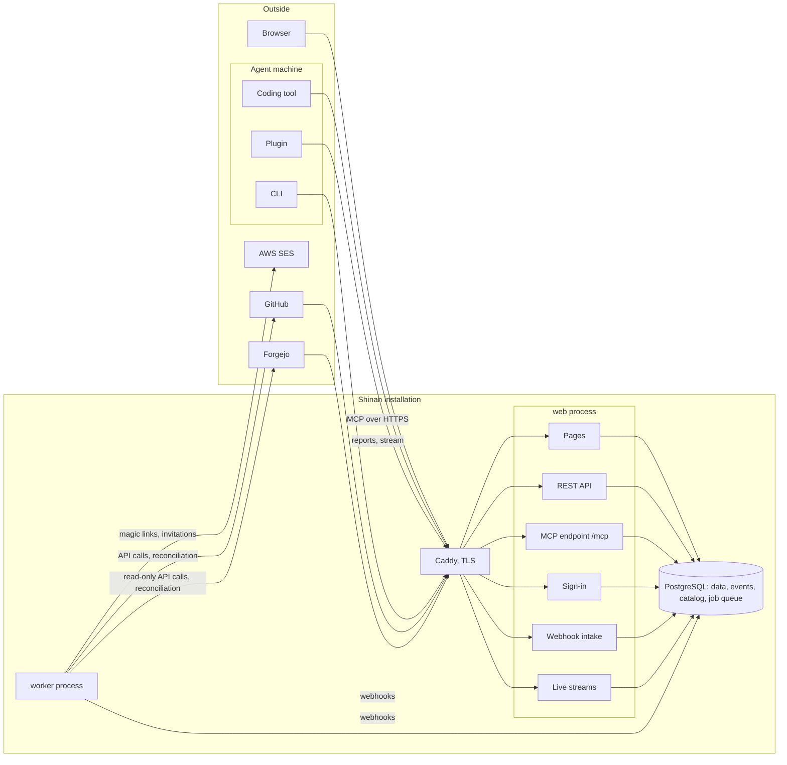

# Architecture and operations

Status: **approved by the owner on 2026-11-16** ([issue #11](https://github.com/guneet-xyz/shinan/issues/11); integrated in [#26](https://github.com/guneet-xyz/shinan/issues/26)).
Updated with the owner's answers in [issue #25](https://github.com/guneet-xyz/shinan/issues/25)
and the integration review in [issue #26](https://github.com/guneet-xyz/shinan/issues/26).

This document describes how Shinan is built and run: the technology stack
(D-020), the parts of the system and how they talk, where data lives, how the
catalog's Markdown and its agent index stay in sync (D-006), how
git host events come in, how agents and plugins reach Shinan, email and
notifications, the task address, security
for a public app with sign-in (D-015), deployment on Musashi at
`shinan.guneet.dev` (D-016), self-hosting (D-012), observability, and the
accepted risk of having no backups.

It does not specify what the other documents own: catalog schema and conflict
rules, task rules, sign-in rules and token rules, git host event lists, MCP
tool lists or screens. It links to them instead (see
[Dependencies](#dependencies-on-other-documents)).

## How to read this document

Every statement is marked:

- **Decided**: follows from an accepted plan decision, or from an owner answer
  in [issue #25](https://github.com/guneet-xyz/shinan/issues/25) (written
  "Decided (owner, O-n)" or "N-n") or in the integration review
  [#26](https://github.com/guneet-xyz/shinan/issues/26) (written "NO-n"). The [decision log](decisions/README.md) maps
  the answers to decision records.
- **Proposed**: suggested here, with a reason.
- **Open**: not settled; listed under [Open questions](#open-questions).

Terms follow the [domain model and glossary](domain-model.md). In
particular, a **Shinan installation** is one running copy of Shinan; a
**workspace** is a team's container inside it. "Sync" is used only for the
catalog Markdown and its index; keeping up with git hosts is
**reconciliation**.

External facts were checked against primary sources on **2026-11-16**. Facts
about Musashi and its services come from the `workspace` repository's catalog at
revision `86bba32` and the Musashi infrastructure repository (`infra/musashi`) at
`29a8cba`, both read on 2026-11-16. Nothing was deployed, and no DNS or server
action was taken.

## Summary

| Area                    | Position                                                                                                                                                                                                                                                                                        |
| ----------------------- | ----------------------------------------------------------------------------------------------------------------------------------------------------------------------------------------------------------------------------------------------------------------------------------------------- |
| Stack                   | **Decided:** TypeScript, with a plain Node.js server and a React single-page app (owner, O-60, O-61).                                                                                                                                                                                           |
| Shape                   | One codebase and one container image, run as two processes: `web` (pages, API, MCP endpoint, webhook intake, live streams) and `worker` (background jobs).                                                                                                                                      |
| Storage                 | PostgreSQL for everything, including the job queue. No Redis, no file storage in the first version.                                                                                                                                                                                             |
| Catalog (D-006)         | **Decided:** each revision's Markdown text is the source of truth, stored in PostgreSQL only; no Git mirror for now (owner, O-11, O-12, N-5). Changes are applied as text edits; the index is built only from stored text.                                                                      |
| Git hosts               | Webhooks are verified, stored and acknowledged at once, then processed by the worker. Reconciliation catches anything missed. Shinan writes to GitHub only as its app and never writes to Forgejo (owner, O-1, O-51, N-4).                                                                      |
| Agents                  | A remote MCP endpoint at `/mcp`, a REST API for the CLI and plugins, and a server-sent event stream for nudge offers. One long-lived token per agent, obtained by a browser approval and accepted at every agent endpoint (owner, O-44, NO-1). All connections go out from the agent's machine. |
| Email and notifications | **Decided:** Shinan sends email from the first version (magic links, invitations, security alerts) through the AWS SES SDK (owner, O-41, O-48, N-6). This document owns sending notifications, email first (owner, NO-3).                                                                       |
| Security                | Threat model and controls for a public app holding infrastructure details, with the owner's accepted risks stated plainly.                                                                                                                                                                      |
| Musashi                 | A new `shinan` stack following Musashi's rules; deployed as needed, each deployment with its own approval (owner, O-83).                                                                                                                                                                        |
| Backups                 | **Decided:** none built in, no backup target and no recovery objectives for now; an accepted risk (owner, O-62 to O-64).                                                                                                                                                                        |

## 1. Requirements that shape the architecture

| Requirement                                                                                         | Source                  | Effect here                                                                           |
| --------------------------------------------------------------------------------------------------- | ----------------------- | ------------------------------------------------------------------------------------- |
| Catalog Markdown is the source of truth; the agent index is generated from it                       | D-006; owner, O-11, N-5 | [Section 5](#5-catalog-markdown-and-agent-index)                                      |
| Every fact has a state, source and last-checked time                                                | D-007                   | Stored in the Markdown; indexed for freshness queries                                 |
| Task status is calculated from linked work and recorded events                                      | D-005; owner, O-4       | Recalculated by the worker; never typed in                                            |
| Agents connect from outside; no model runs in Shinan                                                | D-008                   | Shinan is an ordinary web service                                                     |
| GitHub and Forgejo first                                                                            | D-009                   | Webhook intake and reconciliation designed for both                                   |
| Self-hostable                                                                                       | D-012                   | One image plus PostgreSQL ([section 12](#12-self-hosting))                            |
| MCP and skill, plugins, launcher later                                                              | D-014                   | [Section 8](#8-how-agents-the-mcp-server-and-plugins-reach-shinan)                    |
| Public internet, sign-in required                                                                   | D-015                   | [Section 10](#10-security)                                                            |
| Runs on Musashi; every deployment approved by the owner                                             | D-016; owner, O-83      | [Section 11](#11-deployment-on-musashi)                                               |
| Shinan starts empty; the `workspace` repository's catalog stays the source of truth until migration | D-018                   | Data loss before migration is survivable; see [section 14](#14-backups-accepted-risk) |
| Workspaces and invitations from the start                                                           | D-019                   | Workspace-owned records carry their workspace ([3.4](#34-workspace-isolation))        |

## 2. Technology stack

### 2.1 Decided stack

**Decided (owner, O-60, O-61):** TypeScript; a plain Node.js server and a React
single-page app; no Next.js.

**Proposed** components, chosen with the reasons given:

| Part            | Choice                                                                                                                                    | Reason                                                                                                                                                             |
| --------------- | ----------------------------------------------------------------------------------------------------------------------------------------- | ------------------------------------------------------------------------------------------------------------------------------------------------------------------ |
| HTTP server     | A small Node.js framework, for example Fastify or Hono, picked when building                                                              | Serves the REST API, MCP endpoint, webhook intake and SSE streams as ordinary code.                                                                                |
| Pages           | React single-page app built with Vite, served as static files by the same server                                                          | Pages are behind sign-in, so server rendering adds little.                                                                                                         |
| Database access | Drizzle ORM and migrations                                                                                                                | Used by the owner's Walls and Dockyard.                                                                                                                            |
| Jobs            | [pg-boss](https://github.com/timgit/pg-boss) (MIT) or [graphile-worker](https://github.com/graphile/worker) (MIT), both PostgreSQL-backed | No separate queue server. pg-boss adds jobs inside an existing transaction and has cron, retries with backoff and dead-letter queues (README, checked 2026-11-16). |
| Sign-in         | [Better Auth](https://www.better-auth.com/docs), already used by Walls                                                                    | Its docs (checked 2026-11-16) cover both methods the owner chose (N-7): GitHub sign-in and a magic link plugin.                                                    |
| MCP             | Official TypeScript SDK, Tier 1 ([SDK list](https://modelcontextprotocol.io/docs/sdk), checked 2026-11-16)                                | Most complete SDK support.                                                                                                                                         |
| CLI             | TypeScript compiled to a single executable                                                                                                | Shares the API client with the plugin.                                                                                                                             |
| OpenCode plugin | TypeScript                                                                                                                                | OpenCode loads `.ts` and `.js` plugins ([docs](https://opencode.ai/docs/plugins/), checked 2026-11-16).                                                            |

**Decided (owner, [D-055](decisions/D-055-tailwind-and-shadcn.md)):** the web
app is styled with [Tailwind CSS](https://tailwindcss.com/docs) and built from
[shadcn/ui](https://ui.shadcn.com/docs) components, copied into
`apps/web/src/components/ui`. Reason: the owner wants shadcn components
because they look better.

**Proposed** (M1-8, [#75](https://github.com/guneet-xyz/shinan/issues/75);
versions checked 2026-11-17: Tailwind CSS 4.3, shadcn 4.23, Base UI 1.9):

- Tailwind CSS v4 through its Vite plugin, set up as shadcn's
  [Vite guide](https://ui.shadcn.com/docs/installation/vite) describes, with
  `apps/web/src/index.css` as the stylesheet.
- Components on [Base UI](https://base-ui.com/react/overview/quick-start)
  rather than Radix, in shadcn's `vega` style with the neutral base colour.
  Reason: Base UI's `CSPProvider` turns off the few inline `<style>` tags its
  components add, so the Content Security Policy stays strict
  ([10.2](#102-web-hardening)); Radix's dialogs add an inline `<style>` tag
  to lock page scrolling, which the policy refuses.
- Light and dark follow the device's setting (`prefers-color-scheme`), with
  no switch. Reason: choosing the theme before the first paint would need an
  inline script, which the policy refuses.

**Proposed:** keep business logic and authorization in plain modules that do
not import the web framework. Reason: a framework change stays possible, and no
authorization lives only in framework middleware (the class of bug behind
Next.js's [CVE-2025-29927](https://github.com/vercel/next.js/security/advisories/GHSA-f82v-jwr5-mffw)).

### 2.2 Shared foundations

These hold regardless of library choices (**Proposed**):

- **PostgreSQL** as the only stateful component. Reason: one thing to monitor
  and upgrade; the owner already runs PostgreSQL for mon, Walls, Drawspace and
  easyshell on Musashi.
- **One container image, two process roles** (`web` and `worker`). Reason: one
  person maintains it, one artifact is easy to self-host, and slow git host
  calls and email sending never delay pages or webhook responses.
- **Server-sent events (SSE)** for live updates to browsers and plugins. Reason:
  one-way push over HTTPS is enough (clients send with normal requests), and
  Caddy flushes `text/event-stream` responses immediately
  ([Caddy `reverse_proxy` docs](https://caddyserver.com/docs/caddyfile/directives/reverse_proxy),
  checked 2026-11-16).
- **Multi-architecture images** (`arm64` and `amd64`). Reason: Musashi is ARM64;
  most self-hosters use `amd64`.

### 2.3 Options considered

Kept as a record; the full comparison is in this PR's history and the decision
log.

| Option                           | Why not chosen                                                                                 |
| -------------------------------- | ---------------------------------------------------------------------------------------------- |
| A: TypeScript with Next.js       | Streams, MCP, webhooks and workers sit outside Next.js's model; more framework churn to patch. |
| B: Go with server-rendered pages | Two languages (the plugin must be TypeScript); richer UI is harder.                            |
| C: Elixir with Phoenix LiveView  | Three languages; no official MCP SDK.                                                          |

## 3. System design

### 3.1 Components

| Component      | Role                                                                                          | Status                                                                |
| -------------- | --------------------------------------------------------------------------------------------- | --------------------------------------------------------------------- |
| Pages          | The wiki, task pages, timeline, board and settings ([human experience](human-experience.md)). | Proposed                                                              |
| REST API       | JSON over HTTPS for the CLI, plugins and the pages.                                           | Proposed. Reason: one API for every client keeps behavior consistent. |
| MCP endpoint   | Agent actions over MCP ([8.1](#81-mcp-server)).                                               | Decided that it exists (D-014); location proposed.                    |
| Sign-in        | GitHub sign-in and email magic links; agent registration ([identity](identity.md)).           | Methods decided (owner, N-7); design owned by identity                |
| Webhook intake | Receives git host webhooks ([section 6](#6-git-host-intake-webhooks-and-reconciliation)).     | Decided that webhooks are used (plan, Integration points).            |
| Live streams   | SSE for browsers (timeline updates) and plugins (nudge offers).                               | Proposed                                                              |
| Worker         | Background jobs, including email ([section 7](#7-background-jobs)).                           | Proposed                                                              |
| PostgreSQL     | All data ([section 4](#4-storage)).                                                           | Proposed                                                              |

**Proposed:** pages, REST API and MCP endpoint all call one shared application
layer, which enforces permissions, applies the rules other documents set (for
example which sources may create nudges) and writes events. Reason: an action
must behave and be credited the same through every path, and a rule enforced in
one place cannot be bypassed through another.

### 3.2 Process model

**Proposed:** a "modular monolith". Modules (catalog, tasks, git hosts, agents,
identity, events, email) live in one codebase with clear boundaries, deployed
as one image and run as `web` and `worker`. A one-shot `migrate` command applies
database migrations before new code starts. Reason: separate services add
network calls, deployments and failure modes that one maintainer and a 2-vCPU
host do not need.

One `web` and one `worker` process are enough for the first version
(**Proposed**). Reason: one owner, a handful of agent sessions and webhook
traffic from a few dozen repositories. Both roles can run more copies later:
jobs are claimed safely by the queue, and live streams are fanned out through
PostgreSQL `LISTEN`/`NOTIFY`
([docs](https://www.postgresql.org/docs/current/sql-notify.html)).

### 3.3 Who calls what

| Caller              | Endpoint                                    | Credential                                                          | Status                                                                              |
| ------------------- | ------------------------------------------- | ------------------------------------------------------------------- | ----------------------------------------------------------------------------------- |
| Person in a browser | Pages, REST API, live stream                | Sign-in session cookie, after GitHub sign-in or an email magic link | Methods decided (owner, N-7)                                                        |
| Coding tool (MCP)   | `/mcp`                                      | Agent token as `Authorization: Bearer`                              | Decided (owner, O-44, NO-1) ([8.1](#81-mcp-server))                                 |
| CLI, plugin         | REST API, plugin stream                     | The same agent token                                                | Decided (owner, NO-1)                                                               |
| GitHub              | Webhook intake, one app-level URL           | The GitHub App's webhook secret                                     | Proposed ([6.1](#61-webhook-intake))                                                |
| Forgejo             | Webhook intake, one URL per Forgejo webhook | That webhook's secret                                               | Proposed ([6.1](#61-webhook-intake))                                                |
| Worker, to GitHub   | GitHub API                                  | GitHub App installation tokens only                                 | Decided (owner, O-1, O-51)                                                          |
| Worker, to Forgejo  | Forgejo API, reading only                   | The connecting person's own Forgejo token, any scope                | Decided (owner, O-53, O-54, N-4)                                                    |
| Worker, to email    | AWS SES API through the AWS SDK             | A send-only IAM access key                                          | Decided (owner, N-6); credential proposed ([section 9](#9-email-and-notifications)) |

On GitHub, Shinan writes only as its app and stores no per-person GitHub
tokens (**Decided**, owner, O-1). On Forgejo, Shinan makes no writes at all:
connections are read-only and there are no backlinks there (**Decided**, owner, N-4, [#25](https://github.com/guneet-xyz/shinan/issues/25)).
Anything a person wants done on a git host is done by that person's own agent
sessions, which receive the request as a queued nudge and pick it up when one
is running (**Decided**, owner, N-3, [#25](https://github.com/guneet-xyz/shinan/issues/25)).

### 3.4 Workspace isolation

The glossary lists what belongs to exactly one workspace (members, agents,
tasks, catalog, git host connections, events and more) and what sits outside
(the Shinan installation, person, git host account, git host, repository, work
item and coding tool).

- **Proposed:** repositories and work items are stored once per installation,
  outside workspaces. A workspace reaches them only through the repositories its
  git host connections cover. A repository can be covered by only one workspace
  in the first version (**Decided**, owner, O-59), so this gives the same
  isolation as per-workspace copies. Reason: one model shared with the glossary
  and the [git hosts](git-hosts.md) document.
- **Proposed:** events, including events about work items, belong to the
  workspace whose connection produced them.
- **Proposed:** every workspace-owned table has a `workspace_id` column, and all
  reads and writes go through one data access layer that requires a workspace
  scope; repositories and work items are read only through a workspace's
  connection coverage. Reason: one enforcement point is easier to review and
  test.
- **Proposed:** automated tests that create two workspaces and assert nothing
  crosses between them, for every API and MCP action. Reason: a cross-workspace
  leak is the worst plausible bug here.
- Inside a workspace, every member sees everything, including work from private
  repositories; links to private repositories stay protected by the git host
  (**Decided**, owner, O-43). There is no restricted catalog level (**Decided**,
  owner, O-2).
- **Open:** whether to add PostgreSQL row-level security
  ([docs](https://www.postgresql.org/docs/current/ddl-rowsecurity.html)) as a
  second barrier between workspaces.

### 3.5 Shinan installation

The glossary proposes **Shinan installation** for one running copy of Shinan and
names this document as its owner. **Proposed:** confirm the term, with these
details:

- An installation has one or more **installation operators**: people who run
  it. Being an operator does not make someone a member of any workspace. In the
  app, operators manage installation settings and see installation-level
  health (dead-lettered jobs, email delivery failures, connection health
  without workspace content). Operators **cannot purge** anything
  (**Decided**, owner, O-50).
- Operators with server access can read the database; Shinan cannot protect a
  workspace from its own operator. This is stated plainly.
- **Installation settings:** the email allowlist that decides who can have an
  account (**Decided**, owner, O-48; joining a workspace still needs an
  invitation); the GitHub sign-in credentials; the SES settings
  ([section 9](#9-email-and-notifications)); and the hosts that are exceptions
  to the private-address rule (owner, N-12; [10.1](#101-threats-and-controls)).
- **Who the operators are,** and how the allowlist starts, follow
  [identity](identity.md) §3.2 and §12: the installation's configuration names
  the operators and the first allowlisted addresses (see
  [section 12](#12-self-hosting)).
- On `shinan.guneet.dev` the owner is the only installation operator and the
  only workspace owner.

### 3.6 Task address

[Tasks and work](tasks.md) and [git host integrations](git-hosts.md) use a
**task address** in markers, PR descriptions, backlinks and emails, and leave
its shape to this document and [human experience](human-experience.md).

**Proposed:**

- The task address is `https://<installation address>/t/<task ID>`, for
  example `https://shinan.guneet.dev/t/T-124`. Reason: short enough to write
  next to a task ID in a PR description, and stable whatever the page looks
  like.
- **The task ID alone finds the workspace.** Task prefixes are unique within an
  installation, and a retired prefix is never given to another workspace
  ([tasks](tasks.md) §3), so the address needs no workspace part. Reason: a
  workspace name in the address would break if the workspace were renamed.
- **Old prefixes keep working.** An address with a workspace's former prefix
  redirects to the task's current ID. The ID is matched without regard to case
  and redirected to the upper-case form.
- **Sign-in first.** The address always needs sign-in; someone who is not a
  member of the task's workspace gets the same "not found" answer as for a task
  that does not exist (identity's uniform answers). Git host integrations
  already keep it out of public repositories (O-56).
- **Never changes.** The address is kept for as long as the installation exists,
  including for cancelled tasks. Page layout behind it is owned by
  [human experience](human-experience.md).

## 4. Storage

### 4.1 PostgreSQL holds everything

**Proposed.** Search uses PostgreSQL full-text search
([docs](https://www.postgresql.org/docs/current/textsearch.html)) at first.
Reason: catalog and tasks are small text collections; a search engine would be a
second stateful component.

**Considered and not proposed:** SQLite. The `web` and `worker` processes write
at the same time, which SQLite handles less well, and the owner's practice on
Musashi is PostgreSQL.

**Proposed:** no file or blob storage in the first version. Reason: nothing
needs uploads; catalog pages are text and work items are links. **Open** until
[human experience](human-experience.md) and [catalog](catalog.md) confirm.

### 4.2 Kinds of data

| Data                                                                              | Rebuildable if lost?                                                                         | Retention                          | Status                                                                                                        |
| --------------------------------------------------------------------------------- | -------------------------------------------------------------------------------------------- | ---------------------------------- | ------------------------------------------------------------------------------------------------------------- |
| Catalog revisions (the Markdown text) and catalog proposals                       | No ([14](#14-backups-accepted-risk))                                                         | Forever, except [purge](#44-purge) | Proposed                                                                                                      |
| Agent index and all other catalog-derived data                                    | Yes, from the stored Markdown ([5.2](#52-the-invariant))                                     | Replaced on each revision          | Proposed                                                                                                      |
| Tasks, subtasks, comments, progress updates, manual states, task flag definitions | No                                                                                           | Forever                            | Proposed                                                                                                      |
| Workspaces, people, members, invitations, email allowlist, agents, token hashes   | No                                                                                           | Until deleted                      | Proposed                                                                                                      |
| Events (the timeline)                                                             | Partly: git host events can be re-read by reconciliation within what each host's API returns | Forever, except purge              | Proposed                                                                                                      |
| Security log                                                                      | No                                                                                           | Forever (**Decided**, owner, O-47) | No entry can ever be purged (**Decided**, owner, N-8, N-13); see [4.4](#44-purge)                             |
| Repositories and work items (cached state)                                        | Yes, by reconciliation                                                                       | Kept while covered                 | Proposed                                                                                                      |
| Raw webhook deliveries                                                            | Not needed after processing                                                                  | 14 days, then deleted              | Proposed. Reason: long enough to replay after a bug fix; follows "link, don't copy" (D-001).                  |
| Presence                                                                          | No, but short-lived by nature                                                                | Current state plus presence events | Proposed                                                                                                      |
| Job records, including sent email metadata                                        | Not needed                                                                                   | 7 days after completion            | Proposed. Reason: enough to debug recent failures.                                                            |
| Notification records (what was sent to whom, when, outcome; no message body)      | Not needed                                                                                   | 90 days                            | Proposed. Reason: a person can see why they received something; long enough to explain a missed notification. |
| GitHub App private key, webhook secrets, Forgejo tokens                           | No (must be re-entered)                                                                      | Until removed                      | Proposed; encrypted, see [10.3](#103-secrets-and-credentials)                                                 |

### 4.3 Events

**Proposed:** one append-only events table. Rows are never updated or deleted
except by workspace deletion or [purge](#44-purge); corrections are new events,
as the glossary proposes. Each event records its origin (Shinan action, webhook,
reconciliation, plugin report, MCP call) and an idempotency key, so the same git
host change arriving by webhook and by reconciliation is stored once.

Derived views, such as task status and agent session presence, are recalculated
by the worker and stored as ordinary rows for fast reads (**Proposed**). Reason:
recalculating on every page view would be slow.

### 4.4 Purge

The glossary and the [catalog](catalog.md) call this operation **purge**.

**Who:** only workspace owners can purge, including operational records about
their workspace (raw webhook deliveries, job records); installation operators
cannot purge (**Decided**, owner, O-50).

**How (Proposed):** one narrow operation for events, catalog revisions,
comments, progress updates, raw webhook deliveries and job records of one
workspace:

- The content is replaced by a marker. The record stays, with its time, kind,
  actor and subjects, so history keeps its shape.
- The purge is itself an event saying who purged what and why, without the
  removed content.
- Derived data (search text, agent index rows) is rebuilt in the same
  transaction. There is no Git mirror to rewrite (**Decided**, owner, N-5, [#25](https://github.com/guneet-xyz/shinan/issues/25)).
- Copies outside Shinan's control are reported, not assumed clean: workspace
  exports downloaded earlier ([5.5](#55-export-and-import)), and the host's own
  backups, if any. The purge screen says so.
- **Security log:** kept forever (owner, O-47), and no entry, installation-level
  or workspace-level, can ever be purged (**Decided**, owner, N-8, N-13,
  [#25](https://github.com/guneet-xyz/shinan/issues/25)). A person's deletion
  request therefore cannot remove their security-log entries; this is the
  residual risk [identity](identity.md) §11 states. The log holds structured
  entries (actor, time, network address, action), not free text, so leaked
  secrets should not reach it.
- **Application logs** (process output collected by Docker) are outside the
  app's reach. They carry IDs, not workspace content (see
  [section 13](#13-observability)), so there is nothing to purge there.

Reason: "never edited" keeps history trustworthy, but a leaked secret or a
lawful deletion request must still be removable; a visible, attributed purge
keeps both. A secret that reached Shinan must also be rotated at its source.

## 5. Catalog Markdown and agent index

The [catalog document](catalog.md) owns the schema, fact format, catalog
proposals and their operations, conflict rules, approval classes (owner, O-3)
and the index format. This section owns how the text and the index are kept in
step.

### 5.1 Decided

- Each catalog revision's Markdown text is the source of truth; everything else
  is rebuilt from it (**Decided**, owner, O-11). Revisions live in
  **PostgreSQL only**: there is no Git mirror for now; it is left for later
  (**Decided**, owner, N-5, [#25](https://github.com/guneet-xyz/shinan/issues/25)). This replaces O-11's "always-on mirror".
- Catalog proposals and review happen inside Shinan (**Decided**, owner, O-12).
- Custom entity types are allowed in the first version; the eight built-in
  types are defaults (**Decided**, owner, O-17).

### 5.2 The invariant

**Proposed**; reason: this is what O-11 means in a system where changes arrive
as operations.

1. **The stored Markdown text of each revision is the source of truth. Nothing
   else is authoritative.** Every applied catalog revision is a set of Markdown
   documents. The agent index, search text, relation lists, freshness queries,
   the wiki's rendering and workspace exports are derived from that text.
2. **Operations are applied as text edits.** Applying a catalog proposal's
   operation edits the previous revision's text, changing only the bytes it
   targets and leaving every other byte as it was. Shinan never renders a
   document anew from structured rows. Reason: otherwise the rows would be the
   real source of truth.
3. **The index is built only from stored text,** by parsing the full new text,
   never from the operations themselves.
4. **One transaction.** Writing the new text, replacing the entity's index rows,
   running the catalog's per-operation conflict check (including its check for
   secret-looking values) and appending the event happen in one database
   transaction. If any step
   fails, nothing is applied.
5. **Round-trip test.** Automated tests, and a daily job on real data, check
   that text → parse → apply no operations → text is byte-for-byte unchanged,
   and that text → parse → index equals the stored index. Differences are
   reported as a metric and to the installation operator.
6. **Only the indexer writes the index.**

Because every revision keeps its full text, a Git mirror can be added later
(N-9) by generating commits from stored revisions, without changing this
invariant (**Proposed**).

Custom entity types (O-17) do not change this: a workspace's type definitions
are themselves stored data that the same parser reads when validating and
indexing (**Proposed**).

### 5.3 How sync works

- **Every change is a new revision.** A revision stores the full text of each
  entity it changed, its author (actor and attribution), the catalog proposal
  it came from and the revision it was based on. The "based on" revision is for
  history and display; conflicts are decided per operation by the catalog's
  rules. **Proposed.** Reason: revision-level conflicts would make two agents
  rechecking different facts of one entity conflict all the time.
- **Parser versions and rebuilds.** Each index row records the parser version
  that produced it. When a release changes the parser, the worker rebuilds the
  index from the latest revisions, and the agent index reports that it is
  behind until done. **Proposed.**
- **Serving the agent index.** Every answer names the catalog revision it came
  from (catalog document), so agents and plugins can cache and ask "what changed
  since revision N". **Proposed.**
- **As built (M2-3, [#85](https://github.com/guneet-xyz/shinan/issues/85)),
  proposed:**
  - **Storage.** Each document has a stable ID of its own, because its
    catalog ID lives in its text and can change (catalog §2.4). A catalog
    revision is numbered from 1 in each workspace and credited like an event;
    the full text of each document it changed is stored with it, and a
    document's latest text is the one at its current revision. The database
    refuses updates and deletes of revisions and their text, as for events;
    purge (M2-10) narrows that. M2-3 adds these tables because the index is
    built from them; catalog proposals and approval (M2-4) add their own
    records and call one function, inside the apply transaction, that stores
    a revision and indexes it.
  - **The index lock.** Applying a revision and rebuilding take the
    workspace's index-state row lock, so revisions are numbered one at a
    time and a rebuild never overwrites a revision applied while it runs; that
    revision waits and is indexed on top.
  - **Applying a revision re-reads only what it touches:** the changed
    documents (already parsed, if the caller has them), the type schema
    documents (kept between revisions while their text is unchanged, by a
    hash of the text, so a rolled-back revision or a purge cannot bring back
    a stale schema), and, when a type schema document changes, the entities
    of the types it describes or described and every other type schema
    document. Measured on Daedalus: about 20 to 30 ms per one-document
    revision for catalogs of 500 to 5,000 entities.
  - **Section credits.** Each body section records the revision that last
    changed it and that revision's author, and the least-trusted author
    whose words may remain in it, for trust labels (catalog §12.4). The
    second comes from each document's **word provenance**: hashed word
    3-grams, each with the least-trusted author who ever brought it into the
    document (people's are not kept, since they never lower a credit),
    stored as one row per document, 10 bytes per unit, and compared by the
    round-trip check. Applying a revision updates the stored credits and
    provenance; a rebuild replays each document's history, reading only
    revisions whose body changed. Tests replay random histories (edits,
    moves, renames, reverts by people, agents and Shinan) both ways and find
    no difference.
  - **Index rules version.** These rules have a version of their own
    (`indexRulesVersion`), recorded like the parser version on the index
    state and on each document's rows. An index built by another version is
    behind and is rebuilt, as after a parser change; so are rows an older
    release wrote after a rollback, which the round-trip check then reports
    as behind rather than as differing, and answers say the index is behind
    while any such rows remain. Changing the rules needs no migration of
    data.
  - **Answers are read from one snapshot** (repeatable read, read only), so
    an answer's catalog revision and its rows agree.
  - **Rolling deployments.** A process still running an older parser after
    a newer worker has rebuilt the index would add rows of the older
    version. Applying a revision with an older parser than the index's
    therefore marks the index behind, so answers say so until the next
    rebuild. The reference Compose setup replaces `web` and `worker`
    together, so this only matters for setups that run several versions at
    once.
  - **Rebuilds** delete a workspace's index rows and derive them again from
    the stored text in one transaction, so readers see the old rows, marked
    behind, until it commits. Measured on Daedalus (2 cores shared with
    other work, load 3 to 4) with agent-written entities of about 300 words
    of body each: 6.4 s to rebuild and 3.4 s to check 2,000 entities, 23 s
    and 16 s for 5,000. The word provenance takes about 8.5 KB per such
    entity (17 MB for 2,000 and 42 MB for 5,000, of 98 MB and 220 MB for
    the whole index). A rebuild reads only the frontmatter of each document
    to find the type schema documents before reading every document in full
    once. The worker asks for one on start for every
    workspace whose index (or any of its rows) another parser or rules
    version built, or whose rebuild never finished, and an installation
    operator can run one with `shinan catalog-index rebuild`.
  - **The daily round-trip check** (rule 5) derives each workspace's index
    from its text in one snapshot and compares it, row by row, with the
    stored index. The result (documents that differ and in which tables, by
    ID only) is logged and kept as installation health, which operators read
    at `/api/installation/catalog-index`; workspaces whose index is behind
    get a rebuild instead. The text → parse → apply no operations → text half
    of rule 5 joins the job when operations as text edits (M2-2) land.
- **As built (M2-4, [#86](https://github.com/guneet-xyz/shinan/issues/86)),
  proposed:**
  - **Proposals and revisions.** A catalog proposal is stored with its
    operations, author, explanation, approval classes and state. A
    revision records the proposal it applied, the revision that proposal
    was made against and, when it needed catalog approval, the approving
    person. These revision columns are nullable: revisions are never
    edited, so they could not be filled in for revisions stored before them.
  - **Turns, then a short write.** Making or approving a proposal takes
    a turn in its workspace's queue, first come first served. In its turn
    it reads the latest revision (its number and each document's revision)
    in a short read, the catalog worker applies, validates and classifies
    the operations with no transaction open, and a short transaction takes
    the workspace's index lock, then the proposal row, checks that no other
    revision came first and stores the result. Within a process nothing
    else stores a revision during a turn, so no proposal works on a
    revision that is already out of date, and proposals are served in the
    order they came (measured: six agents proposing as fast as they could
    each had the same number applied, every one on the revision it read).
    A revision stored by another process meanwhile makes the turn start
    over, up to five times, then the author is told to send it again. A
    proposal never holds a database connection or a lock while it waits
    for or runs in the worker; per-operation expectations decide conflicts
    (catalog §8.5).
  - **Catalog workers.** Parsing, applying (`applyOperations`),
    validation and approval classes run in worker threads (security
    checklist 10.8), one by default (`SHINAN_CATALOG_WORKERS`). Each keeps
    one workspace's catalog parsed, by document and revision; turns take
    the workers first come first served across workspaces, and a workspace
    without a worker takes over the one least recently used. Numbers, all
    **proposed**:
    - **Loading is not charged to a proposal.** Stored texts a worker has
      not parsed (after a start, a restart, a switch of workspace or a
      change) are read in short reads of 100 and parsed in batches of at
      most 512 KiB of text, each with its own 60-second limit, and kept as
      they come. Then the latest revision is validated, with a 60-second
      limit of its own: every document after a start, only what another
      process's revision can affect otherwise. A proposal's 20-second limit
      starts after that.
    - **A proposal past its limit** stops only its own workspace's worker;
      the next proposal there loads that catalog again.
    - **Kept validation** ([#116](https://github.com/guneet-xyz/shinan/issues/116)).
      Each worker also keeps the validation of its workspace's latest
      revision, so a proposal validates only the documents it can affect
      (catalog §8.3, "Cost"), and the secret check's findings for each
      document text, by its SHA-256, so a document validated again (an
      entity of a type whose schema changed, a referrer) is not scanned
      again; scanning is most of validating long prose. A proposal ready to
      store leaves its parsed documents and the validation of the catalog
      it would make; the next proposal keeps them if it finds them stored,
      telling so by the stored text, never by revision numbers, and drops
      them otherwise (the proposal waits for approval, its transaction
      rolled back, or another process stored a revision first and the turn
      starts over). Any revision's validation gives the same result, so
      keeping the latest only saves work. Scans are kept only for the texts
      of the kept validations. All of it is dropped with the worker (a time
      limit, out of memory, a new workspace taking it over), when documents
      are evicted for the cache's budget, and by `CatalogWorkers.forget`,
      which purge needs because it rewrites stored text in place (to call
      within the workspace's turn). A new parser or rules version comes with
      new code, so with new processes and empty workers.
    - **Memory.** `estimatedBytes` estimates each document: parsed, 3 ×
      text bytes + 1,792 × facts + 2,048 × fact check groups + 256 × body
      sections + 128 × body links + 8 KiB; and what its validation keeps,
      256 × problems + 384 × secrets found + 256 × names referenced, from
      the counts of the validations a proposal makes. Both are above the
      heap measured for every shape tried (the least an entity holds, small
      and typical entities, 100 long-form facts in one check group or each
      in its own, 365 short facts, prose with and without dead links, 2,000
      dead links to one name or each to its own, 1,000 suspected secrets),
      by 1.25 to 2.75 times. Each worker's parse cache is limited to
      384 MiB of parsed documents. The worker's heap is limited to 768 MiB
      (`resourceLimits`, `SHINAN_CATALOG_WORKER_HEAP_MB`, at least 640 MiB);
      one out of memory is stopped like one out of time. A workspace's
      catalog is limited to 20,000 documents, 50 MiB of text and an
      estimate of 320 MiB with its validation (catalog §8.2). Measured on
      Daedalus under a load of 6 to 10 on 2 cores, at those limits:
      validating the latest revision while loading took 1 to 6 s; a
      one-field change 0.1 to 2 s, most of it applying the operations, which
      reads the catalog's entities twice; extending the type of every
      document 0.1 to 1.3 s; and every shape ran within a 384 MiB heap,
      keeping 65 to 263 MiB. Through the database, after a restart, 20,000
      small documents took 27 s to the first proposal, almost all of it
      reading and parsing, and 1,000 documents of 49 KB of prose 7 s to
      extend their type.
    - **A catalog that no longer fits** (only if the estimate were wrong)
      makes proposals there fail with `catalog-too-large`; the `web` log
      and the workspace's security log say so, and the operator raises the
      heap until the workspace shrinks its catalog (operator guide).
    - **Queues.** At most 8 requests per workspace and 32 in all may run
      or wait; beyond that a request is refused at once as busy, to send
      again in a few seconds. Agents also have a proposal rate limit
      (60 in 10 minutes), counted when a proposal's turn comes, so a
      refusal as busy does not count.
    - Results come back as the new texts, already parsed, which the indexer
      reuses.
- **Fact checks.** A recheck that changes only the last-checked time is still a
  text edit and a new revision, and also an event. **Proposed.** Reason: no fact
  data may live outside the text.

**Expected volume (estimate, not a measurement).** The `workspace` repository's
catalog is 36 files, about 124 KB, with 73 commits touching it in its first 10
days (read 2026-11-16). If each change rewrote two entities of about 4 KB, that
is under 25 MB of revision text a year; ten times more, from frequent rechecks,
is still well under a gigabyte. **Proposed:** store full text per revision; revisit
only if measured growth requires it.

### 5.4 Importing the `workspace` repository's catalog

**Proposed:** a one-time importer reads a folder of Markdown with frontmatter,
such as the `workspace` repository's catalog, and creates catalog proposals for
review. Each imported document gets the `imported_from` field (source path and
revision) that [catalog](catalog.md) §2.3 defines; the importer sets it once and
nothing changes it afterwards. When the `workspace` repository moves over is
owned by the [roadmap](roadmap.md) (D-018).

### 5.5 Export and import

A full export of a workspace (catalog, tasks and their records) and import back
into an empty workspace are in the first version (**Decided**, owner, O-75; the
[roadmap](roadmap.md) needs them for its exit and rollback criterion).
**Proposed** machinery:

- **Started by a workspace owner** after re-authentication ([identity](identity.md)
  §3.3), built by the worker, and offered as a single download behind sign-in.
  The export is recorded in the security log.
- **Format:** one archive file. At its top, a generated `manifest.json` names
  the export format version, the installation, the workspace, the catalog
  revision and the time it was taken. **Proposed.** Reason: an importer must
  know what it is reading before it reads it.
- **The catalog part** is the `catalog/` folder, written exactly in the layout
  [catalog](catalog.md) §2.2 defines, including `catalog/history.jsonl`. This
  document does not restate that layout. The entity files are the stored text of
  the latest revision, byte for byte ([5.2](#52-the-invariant)), and
  `history.jsonl` is written from the stored revisions.
- **Everything else** sits beside `catalog/` as JSON Lines files, one record per
  line: catalog proposals; tasks with their subtasks, work links and comments;
  and events. **Proposed.** Reason: the same machine-readable form as
  `catalog/history.jsonl`, and easy to read without Shinan.
- **Not included:** git host credentials, webhook secrets and token hashes,
  which are set up again after an import.
- **Import** recreates the workspace in an empty one, on the same or another
  installation, started by a workspace owner of the empty workspace after
  re-authentication. It rebuilds the catalog's revisions from
  `catalog/history.jsonl`, so the catalog and its history come back exactly, as
  catalog §2.2 requires; `imported_from` values are kept as they were. It then
  runs the round-trip test ([5.2](#52-the-invariant)) and checks that the entity
  files match the last revision in the history.
- Reason: with no Git mirror (N-5) and no backups (O-62), a recent export is the
  only copy of a workspace that a person can take off the machine
  ([section 14](#14-backups-accepted-risk)).

A Git store or mirror was considered and set aside: storing text only in a Git
repository would need two stores kept consistent, and the always-on mirror was
dropped for now (**Decided**, owner, N-5, [#25](https://github.com/guneet-xyz/shinan/issues/25)).

## 6. Git host intake: webhooks and reconciliation

The [git host integrations](git-hosts.md) document owns which events matter,
connection methods, reconciliation layers and intervals, rate limits and
write-back. This section owns the machinery.

### 6.1 Webhook intake

**Proposed** pipeline:

1. **Endpoint.**
   - **GitHub:** a GitHub App has one webhook URL and one secret for all its
     installations, so Shinan has one URL, such as
     `https://shinan.guneet.dev/hooks/github`. The connection, and so the
     workspace, is found from `installation.id` after the signature is verified.
   - **Forgejo:** one URL per Forgejo webhook (owner-level for the owner's own
     accounts, per-repository elsewhere; owner, O-55), such as
     `https://shinan.guneet.dev/hooks/forgejo/<webhook-id>`, each with its own
     secret and belonging to one git host connection.
2. **Verify the signature** before parsing: GitHub's `X-Hub-Signature-256`
   ([GitHub docs](https://docs.github.com/en/webhooks/using-webhooks/validating-webhook-deliveries))
   and Forgejo's `X-Forgejo-Signature`
   ([Forgejo docs](https://forgejo.org/docs/latest/user/repository/webhooks/)),
   both HMAC-SHA256, checked 2026-11-16. Reject unsigned, wrongly signed or
   oversized requests.
3. **Route.** For GitHub, find the connection by `installation.id`; deliveries
   for unknown installations are recorded as a health warning and dropped.
4. **Store and acknowledge.** Save the raw delivery with its delivery ID, skip
   repeats, queue a processing job in the same transaction, and return `202`.
   Reason: GitHub fails a delivery after 10 seconds and does not redeliver
   automatically
   ([GitHub docs](https://docs.github.com/en/webhooks/using-webhooks/handling-failed-webhook-deliveries));
   Forgejo's default timeout is 5 seconds
   ([config cheat sheet](https://forgejo.org/docs/latest/admin/config-cheat-sheet/)),
   both checked 2026-11-16.
5. **Process in the worker:** normalize into events and work item updates,
   idempotently, then queue follow-ups: recalculating task status, creating a
   task from an outside issue (D-003), or a `related` link from a member's
   mention of a task ID in a comment (owner, O-25). The handling rules are the
   git hosts and tasks documents'.
6. **Record health:** last valid delivery and last signature failure per
   connection.

### 6.2 Reconciliation

GitHub keeps deliveries for redelivery for only 3 days
([GitHub docs](https://docs.github.com/en/webhooks/testing-and-troubleshooting-webhooks/redelivering-webhooks),
checked 2026-11-16), and Forgejo does not retry. **Proposed** machinery (the
layers and intervals are the [git hosts](git-hosts.md) document's):

- **Scheduled jobs per git host connection,** one per reconciliation layer, each
  with its own stored watermark.
- **Catch-up after downtime.** On start, the worker queues the right layers at
  once for any connection with a gap. Reason: an approved deployment restart
  should not leave silent gaps.
- **Same output as webhooks,** with the same idempotency keys.
- **Freshness recorded** per work item (display owned by
  [human experience](human-experience.md)).
- **Rate limits respected** by a per-connection limiter that reads the host's
  remaining-quota responses.

### 6.3 Writing back to git hosts

Shinan writes only to GitHub, only as its app, with the installation token
(**Decided**, owner, O-1, O-51); for example backlinks (owner, O-56). It makes
no writes on Forgejo (**Decided**, owner, N-4, [#25](https://github.com/guneet-xyz/shinan/issues/25)). **Proposed:** GitHub writes run as worker
jobs with retries, never inside a web request. Reason: git host APIs can be
slow, and a click or an MCP call should not fail because of them.

## 7. Background jobs

**Proposed:** a PostgreSQL-backed job queue with these properties:

- Jobs are added in the same transaction as the change that needs them.
- Every job is safe to run twice (at-least-once delivery).
- Retries with backoff, then a dead-letter state visible to the installation
  operator, with a manual "retry".
- Scheduled jobs run once across all worker copies.

| Job                                                                                     | Trigger                                                                  | Owner of the rules                                                                                        |
| --------------------------------------------------------------------------------------- | ------------------------------------------------------------------------ | --------------------------------------------------------------------------------------------------------- |
| Process webhook delivery                                                                | Webhook stored                                                           | [Git hosts](git-hosts.md)                                                                                 |
| Reconciliation layers                                                                   | Schedule, startup gap, on demand                                         | [Git hosts](git-hosts.md)                                                                                 |
| Recalculate task status, including subtasks at any depth (owner, O-21, N-1)             | New event on linked work, a subtask or an agent session                  | [Tasks](tasks.md)                                                                                         |
| Create a task from an outside issue                                                     | Normalized issue event                                                   | [Tasks](tasks.md)                                                                                         |
| Write back to GitHub (never Forgejo, N-4)                                               | Task or work link change                                                 | [Git hosts](git-hosts.md)                                                                                 |
| Presence timeouts (`unresponsive`, `offline`, release after silence; owner, O-32)       | Every minute                                                             | [Agent integrations](agent-integrations.md)                                                               |
| Offer and withdraw nudge deliveries, including git host actions a person asks for (N-3) | A nudge is created or withdrawn                                          | [Tasks](tasks.md), [agent integrations](agent-integrations.md)                                            |
| Build a workspace export; run an import                                                 | A workspace owner asks                                                   | This document ([5.5](#55-export-and-import))                                                              |
| Rebuild or verify the agent index (round-trip test)                                     | Release (worker start, by parser version), on demand, daily at 03:40 UTC | This document ([5.2](#52-the-invariant), [5.3](#53-how-sync-works))                                       |
| Send email (magic links, invitations, security alerts)                                  | Sign-in, invitation, or a security event identity names                  | This document ([section 9](#9-email-and-notifications)); content by [identity](identity.md)               |
| Build notifications (phase 2)                                                           | A new event that human experience's rules turn into a notification       | This document ([9.3](#93-notifications-phase-2)); what is sent by [human experience](human-experience.md) |
| Send daily notification summaries (phase 2)                                             | Daily, per person, at their chosen hour                                  | This document ([9.3](#93-notifications-phase-2))                                                          |
| Automatic fact checks by Shinan, if adopted                                             | Schedule                                                                 | [Catalog](catalog.md), [git hosts](git-hosts.md)                                                          |
| Prune raw webhooks, old job records and old notification records                        | Daily                                                                    | This document ([4.2](#42-kinds-of-data))                                                                  |

## 8. How agents, the MCP server and plugins reach Shinan

The [agent integrations](agent-integrations.md) document owns tools, the skill,
presence and nudge semantics; [identity](identity.md) owns agent registration,
scopes and revocation. This section owns transport, how tokens reach the
endpoints, and network shape.

**Proposed:** every agent-side component makes **outgoing HTTPS connections** to
Shinan; Shinan never connects into an agent's machine. Reason: agent machines
sit behind NAT, firewalls or tailnets. The agent-facing parts of
`shinan.guneet.dev` are public behind tokens (**Decided**, owner, O-45).

### 8.1 MCP server

- **Hosted, not installed (Proposed).** Shinan serves MCP at
  `https://shinan.guneet.dev/mcp` over Streamable HTTP. The CLI can also act as
  a local stdio MCP server that forwards to the API, for coding tools without
  remote MCP support.
- **Protocol versions (Proposed).** The current MCP revision is 2026-07-28,
  which removed protocol-level sessions and the GET stream
  ([spec](https://modelcontextprotocol.io/specification/2026-07-28/basic/transports/streamable-http.md),
  checked 2026-11-16). OpenCode connects with the older `initialize` handshake
  by default (`protocol: "legacy"`)
  ([OpenCode MCP docs](https://opencode.ai/docs/mcp-servers/), checked
  2026-11-16). So the endpoint supports both 2026-07-28 and 2025-11-25.
- **Statelessness (Proposed).** No per-connection state; everything a call needs
  is in the request and the database.
- **Tokens.** Agent tokens are long-lived and last until revoked (**Decided**,
  owner, O-44). An agent is per person, coding tool and machine (**Decided**,
  owner, O-40). How an agent gets its token is settled (**Decided**, owner, NO-1,
  [#26](https://github.com/guneet-xyz/shinan/issues/26)); [identity](identity.md)
  owns the flow and this document the transport:
  - **Browser approval, started from the plugin or the CLI.** The tool asks
    Shinan to connect, shows a link (and a short code for machines without a
    browser), the person signs in, chooses or creates the agent for this tool
    and machine, and approves; the tool then receives the token. The exchange
    has the shape of the OAuth device authorization grant (RFC 8628); Better
    Auth has a device authorization plugin that implements that grant (docs,
    checked 2026-11-16). One approval covers the plugin, MCP and the CLI on the
    machine, and headless runs work.
  - **A hand-made token as the fallback.** The person creates the token in the
    web app after re-authentication, sees it once, and places it on the machine,
    for example as an environment variable the coding tool sends as a header.
  - **One token per agent, accepted at every agent endpoint** of the
    installation: `/mcp`, the REST API and the plugin stream. It is not accepted
    by any other installation.
  - **No MCP-specific OAuth sign-in in the first version.** It may come later,
    only if a coding tool needs it.
  - **Transport (Proposed):** the token is sent as an `Authorization: Bearer`
    header. OpenCode supports this for remote MCP servers with `oauth: false`
    and a `headers` entry that reads an environment variable (OpenCode MCP docs
    above). Installing the plugin also sets up MCP and the skill (owner, O-36),
    so the plugin writes that configuration without putting the token itself in
    a project file.
- **One authentication seam (M2-5).** Every agent endpoint uses the same
  check (`requireAgent` in `apps/server`, calling core's
  `authenticateAgent`): the token only from `Authorization: Bearer`, no
  sign-in cookie, the same 401 `invalid-token` answer for every refused
  token, failed attempts throttled per network address (a working token is
  never held up by them) and each token's requests limited
  ([identity §7.4, §10](identity.md#74-handling)). Agent endpoints are
  routed ahead of the web app's same-origin check and refuse cookies; no
  other route skips that check. The first
  agent endpoint is `GET /api/agent`, which tells the agent who it is, which
  workspace it is in and what its token allows, so a person setting up a
  tool can check the connection. **Proposed.**
- **Required checks.** Validate the `Origin` header and check that
  `MCP-Protocol-Version`, `Mcp-Method` and `Mcp-Name` match the request body, as
  the 2026-07-28 transport requires; reject tokens in query strings.
- **Trust labels on text (Proposed).** Every text field an MCP answer returns
  carries a machine-readable field saying who wrote it (member, agent, outside
  actor, Shinan) and whether it may be treated as an instruction. Field names
  and skill wording are owned by [agent integrations](agent-integrations.md).
- **As built (M2-6, [#87](https://github.com/guneet-xyz/shinan/issues/87)),
  proposed:** `/mcp` uses the official TypeScript SDK's v2 packages
  (`@modelcontextprotocol/server` 2.4), whose `createMcpHandler` serves the
  2026-07-28 revision and, statelessly, the 2025 `initialize` handshake from
  one per-request server. Each request passes, in order: the per-address
  request limit (as `/api/agent`), a 512 KB body limit (larger than the
  API's 64 KB, because one catalog proposal may hold 256 KiB of JSON; M2-12
  reviews it), the `Origin` check (a request carrying any `Origin` but the
  installation's own is refused with 403), and `requireAgent`; the SDK then
  checks the 2026-07-28 headers against the body (400 when they disagree).
  Before the SDK, Shinan refuses a JSON array of messages (400: neither
  revision allows batches, and a batch would multiply the request limits,
  which count HTTP requests), an `MCP-Protocol-Version` other than the two
  it serves (400; an `initialize` asking for an older revision is offered
  2025-11-25), and `subscriptions/listen` (an in-band "method not found":
  Shinan sends no change notifications, so a listening stream would only
  hold a connection and memory open; proposed until a tool needs
  notifications, which would then come with a per-agent cap and a maximum
  lifetime). 2026-07-28 answers are single JSON bodies
  (`responseMode: "json"`); 2025-11-25 answers are one Server-Sent Events
  message (`event: message`), which the SDK's stateless legacy serving
  always uses; both with `Cache-Control: no-store`. The agent's token is
  not handed to the SDK: the handler gets the authenticated agent, and core
  checks it again on every operation. A rejected promise nothing handles
  is logged by name, code and stack frames, and the process keeps serving;
  an uncaught exception is logged the same way and ends the process, for
  the container to restart.
  The write tools (M2-6, second PR) call M2-4's `proposeCatalogChange`, so
  every proposal from MCP is applied in a catalog worker with its time
  limit ([5.3](#53-how-sync-works)), like one from the web app; a full
  queue is a `busy` tool error the agent retries with the same idempotency
  key.
  Checked with OpenCode v2.3.0 on Daedalus against a local server: with the
  default `protocol` it connects over 2025-11-25, and with
  `"protocol": "auto"` over 2026-07-28 (`server/discover`); both call the
  tools, and OpenCode carries on when `subscriptions/listen` is refused.
- **Session IDs are hints, never credentials.** OpenCode sends its session ID in
  `_meta["ai.opencode/sessionID"]` and documents that it must not be used for
  authentication. Matching calls to agent sessions follows the owner's answer
  (O-29) and is owned by agent integrations.

### 8.2 CLI

**Proposed:** the CLI uses the same agent token, stored as
[agent integrations](agent-integrations.md) and identity decide (the machine's
credential store preferred), and never accepts it as a command-line argument.
Reason: command lines are visible to other processes and end up in shell
history.

### 8.3 Plugins

**Proposed** transport for the OpenCode plugin (and later others); the delivery
states and the "one owner at a time" rules are the [agent integrations](agent-integrations.md) document's:

- **Reports go up as normal requests.** Presence changes and heartbeats are
  POSTed with the agent session ID and a sequence number, so repeats and
  reordering are harmless. Shinan accepts only allow-listed metadata
  (**Decided**, owner, O-34).
- **One stream per agent on a machine.** The plugin keeps one SSE stream per
  agent token, carrying offers for all of that agent's sessions on the machine,
  including subagents, each of which is its own agent session (**Decided**,
  owner, O-37). Reason: a stream per session would multiply connections as
  subagents start and stop.
- **Offers, withdrawals and answers.** The stream carries nudge offers and
  withdrawals. The plugin answers each (accepted, rejected, withdrawal
  confirmed, delivered, cancelled in the tool) with a POST. Deliveries are rows
  in the database; the stream only announces changes. If the stream drops, the
  plugin reconnects with backoff and receives every offer still open. Streams
  drop on network changes and whenever the `web` process or Caddy restarts; on
  Musashi a Caddyfile change reaches the proxy only through a restart or
  recreation (ingress catalog entry). Reason: answers stored server-side
  survive all of these; IDs prevent doubles.
- **Keep-alives** every 30 seconds (**Proposed**; a starting value).
- **Presence evidence.** Heartbeats and the stream feed the presence timeouts
  (owner, O-32; thresholds owned by agent integrations).

### 8.4 Launcher (phase 3)

Users register hardware by installing the launcher on it, and a setup guide for
such devices (VM, MacBook, and so on) is provided (**Decided**, owner, O-1).
**Proposed:** the launcher follows the same pattern as plugins: an outgoing
stream for start requests, with its own credential from identity. Reason: no
inbound ports on users' machines. Details belong to phase 3.

## 9. Email and notifications

This document owns **sending**: channels, delivery, retries and failures. What
is sent and each person's settings are owned by
[human experience](human-experience.md) for notifications and by
[identity](identity.md) for sign-in and security messages (**Decided**, owner, NO-3, [#26](https://github.com/guneet-xyz/shinan/issues/26)).
Email is the first channel, through the **AWS SES SDK**, not SMTP (**Decided**,
owner, N-6, [#25](https://github.com/guneet-xyz/shinan/issues/25)).

### 9.1 What Shinan sends

| Message                                                                                                                       | When                              | What it says, and to whom                                | Status                                                                     |
| ----------------------------------------------------------------------------------------------------------------------------- | --------------------------------- | -------------------------------------------------------- | -------------------------------------------------------------------------- |
| Email magic link                                                                                                              | First version                     | [Identity](identity.md) §3.1                             | Decided (owner, O-41, N-7)                                                 |
| Invitation                                                                                                                    | First version                     | [Identity](identity.md) §5.2                             | Decided (owner, O-48)                                                      |
| Security alerts: sign-in from a browser not seen before, GitHub added or removed as a sign-in method, an agent token approved | First version                     | [Identity](identity.md) §3.3                             | Proposed by identity                                                       |
| Notifications: Needs you items and replies to a person's own comments, immediately or as a daily summary                      | Phase 2 (plan, sections 5 and 10) | [Human experience](human-experience.md), "Notifications" | Decided that they are phase 2 (plan); content proposed by human experience |

### 9.2 How Shinan sends

**Proposed**, for every message:

- **SES API through the AWS SDK for JavaScript,** called by the worker. The
  sender sits behind a small channel interface, so another channel (for
  example chat) or another email provider (for example SMTP for a self-hoster
  without SES) can be added later without touching callers. Reason: N-6 decides
  SES for the first version; the interface keeps self-hosting open (D-012).
- **Sent by the worker,** queued in the same transaction as the change that
  causes it and picked up at once (`LISTEN`/`NOTIFY`). Reason: SES latency or
  an outage must not block a web request.
- **Only to verified addresses.** Every message goes to the email address an
  account was created with, which Shinan itself verified ([identity](identity.md)
  §3.2). A magic link is sent only if the address is on the email allowlist
  (O-48), and the sign-in page answers the same either way. Reason: the sign-in
  form cannot be used to send mail to anyone, and it does not reveal who has
  an account.
- **Throttled** per recipient and, for sign-in requests, per network address.
  Reason: limits floods and cost.
- **Retries:** temporary SES errors (throttling, service errors) are retried
  with backoff for up to an hour; magic links are not retried after their own
  expiry. Permanent rejections are not retried.
- **Failures are visible.** Each message's outcome (accepted by SES, rejected,
  given up) is recorded without its body. Failures show as installation health
  for the operator and, for notifications, in the person's account settings.
  Bounces and complaints after SES has accepted a message are not handled in
  the first version; the `guneet.dev` configuration set's suppression is the
  only protection today (email catalog entry).
- **Content stays short.** Messages carry a title, the workspace, a task ID
  where there is one, and a link that needs sign-in (task links use the
  [task address](#36-task-address)); never fact values, comment text or
  tokens. Reason: email leaves the signed-in app, and the workspace holds
  infrastructure details (D-015); human experience proposes the same for
  notifications.
- **If email is down,** GitHub sign-in still works; magic links, invitations
  and alerts wait or fail visibly (N-7).

### 9.3 Notifications (phase 2)

**Proposed** machinery; the rules for what is sent and the person's settings
are human experience's:

1. When an event is recorded, a job applies human experience's notification
   rules and creates one **notification record** per recipient (who, what
   item, why). The same item is never notified twice to the same person.
2. Records for people who want immediate notifications are sent at once,
   unless the person is in their quiet hours; those wait until the quiet hours
   end. Deployment approval requests follow human experience's rule (sent
   immediately unless the person turned them off).
3. Records for people who chose a daily summary are collected, and one email
   per person per day lists them, at the hour the person chose.
4. If the item no longer needs the person when the message would go out (for
   example the approval was already given), it is dropped from the message.
   Reason: notifications should bring a person back only for what still needs
   them.
5. Records are kept for 90 days ([4.2](#42-kinds-of-data)) so a person can see
   what was sent and why.

### 9.4 On `shinan.guneet.dev`

**Proposed**, following path A of the `workspace` repository's SES sender
onboarding runbook (the SDK path proven by Walls; runbook verified 2026-11-07):

- Sender `auth@guneet.dev`, display name "Shinan", on the already verified
  `guneet.dev` identity (any local part on `guneet.dev` is sendable, per the
  runbook), in `us-east-1`, with the `guneet-dev` configuration set used by the
  other senders. The address is **decided** (owner, 2026-11-17,
  [#73](https://github.com/guneet-xyz/shinan/issues/73)): the IAM user
  `mail-shinan` sends only as `auth@guneet.dev`.
- A **dedicated IAM user** (`mail-shinan`) whose only permission is
  `ses:SendEmail` for that From address. Not the shared `mail` key that Walls,
  easyshell and Drawspace use. Reason: the runbook's rule, and a leaked key can
  then only send as `auth@guneet.dev`.
- Its access key goes into the `shinan` Obscuro namespace and reaches only the
  worker. Creating the IAM user and key is an owner action in the AWS console.
- Outgoing HTTPS from the worker to the SES API uses `shinan-egress`.

## 10. Security

Shinan holds infrastructure details and is on the public internet (**Decided**,
D-015). Sign-in, roles, token and access rules are owned by
[identity](identity.md). This section owns the platform controls and states the
owner's accepted risks.

### 10.1 Threats and controls

| Threat                                                       | Controls                                                                                                                                                                                                                                                                                                                                                                                                                                                                                                                                                                                                                                                                                                                      | Status                                                                                                                                                                                                     |
| ------------------------------------------------------------ | ----------------------------------------------------------------------------------------------------------------------------------------------------------------------------------------------------------------------------------------------------------------------------------------------------------------------------------------------------------------------------------------------------------------------------------------------------------------------------------------------------------------------------------------------------------------------------------------------------------------------------------------------------------------------------------------------------------------------------- | ---------------------------------------------------------------------------------------------------------------------------------------------------------------------------------------------------------- |
| A person's account is taken over                             | Sign-in by GitHub or email magic link only, with no second factor and no passwords (**Decided**, owner, N-7, [#25](https://github.com/guneet-xyz/shinan/issues/25)). Controls here: an email allowlist (O-48); throttling of magic-link requests; short-lived single-use links (identity); sign-in session cookies `HttpOnly`, `Secure`, `SameSite`; uniform answers                                                                                                                                                                                                                                                                                                                                                          | **Accepted risk:** one compromised mailbox or GitHub account opens the account                                                                                                                             |
| An agent token is stolen from a machine                      | Long-lived until revoked (**Decided**, owner, O-44). Controls: hashes only in storage; a recognizable prefix for leak scanning; per-machine agents (O-40) so one machine is revoked alone; "last used" shown; never logged; header only                                                                                                                                                                                                                                                                                                                                                                                                                                                                                       | **Accepted risk:** a stolen token works until someone notices and revokes it                                                                                                                               |
| Forged or replayed webhooks                                  | HMAC verified before parsing, unique delivery IDs, size limits ([6.1](#61-webhook-intake))                                                                                                                                                                                                                                                                                                                                                                                                                                                                                                                                                                                                                                    | Proposed                                                                                                                                                                                                   |
| One workspace sees another's data                            | [3.4](#34-workspace-isolation)                                                                                                                                                                                                                                                                                                                                                                                                                                                                                                                                                                                                                                                                                                | Proposed                                                                                                                                                                                                   |
| Text written by strangers steers an agent (prompt injection) | Outside issues become tasks automatically (D-003), so text from anyone reaches agents through MCP. Controls: (1) outside text never creates nudges ([tasks](tasks.md)), enforced in the shared application layer; (2) machine-readable trust labels ([8.1](#81-mcp-server)); (3) an agent cannot claim a task in `triage` until a member accepts it ([tasks](tasks.md) §10); agents may still suggest a triage action in a progress update; (4) the skill tells agents to treat outside text as data. Mentions by outside accounts are ignored (owner, O-25)                                                                                                                                                                  | (1), (3) adopted in [tasks](tasks.md); (4) in [agent integrations](agent-integrations.md); (2) proposed here                                                                                               |
| An agent is steered into leaking what it reads               | Every member, and so every member's agent, can read the whole workspace (owner, O-2, O-43). Injected text could get an agent to post infrastructure details on a public issue with its own git host credentials. Controls: read-only tokens (the two `read` scopes) where writing is not needed ([identity](identity.md) §7.2); bulk reads in the security log; trust labels; no secrets in the catalog (owner, O-2; the catalog only records where a secret lives)                                                                                                                                                                                                                                                           | Residual risk while agents share their person's git host account (D-017)                                                                                                                                   |
| A Forgejo token with broad rights leaks                      | Shinan accepts any Forgejo token (**Decided**, owner, O-54) and only reads with it (**Decided**, owner, N-4, [#25](https://github.com/guneet-xyz/shinan/issues/25)). A token is not limited by how Shinan uses it: a site administrator's broad token can act as any user on that Forgejo, and the owner is a site administrator of `git.guneet.dev`. Controls: encrypted at rest, usable only by the worker ([10.3](#103-secrets-and-credentials)), never shown again, never logged, never given to agents; the connect screen suggests a read-only token                                                                                                                                                                    | **Accepted risk:** whoever gets the database and the worker's key gets whatever the token allows                                                                                                           |
| A workspace export leaks                                     | Only workspace owners can export; recorded in the security log; no credentials in the export; no secrets in the catalog (O-2)                                                                                                                                                                                                                                                                                                                                                                                                                                                                                                                                                                                                 | Proposed; a downloaded file is outside Shinan's control                                                                                                                                                    |
| Email is abused                                              | Magic links only to allowlisted addresses; messages only to verified account addresses; throttling; uniform answers ([9.2](#92-how-shinan-sends))                                                                                                                                                                                                                                                                                                                                                                                                                                                                                                                                                                             | Proposed                                                                                                                                                                                                   |
| Malicious Markdown or HTML in the wiki                       | Raw HTML stripped or sanitized; strict Content Security Policy                                                                                                                                                                                                                                                                                                                                                                                                                                                                                                                                                                                                                                                                | Proposed                                                                                                                                                                                                   |
| Shinan tricked into calling internal addresses               | Anyone can enter any Forgejo address to connect (owner, N-7). The rule is **decided**: Shinan contacts only the address entered, over HTTPS, refuses addresses that resolve to private, loopback or link-local ranges, re-checks on every request, and an installation operator may allow specific hosts (owner, N-12; [identity](identity.md) §3.5). **Mechanism (Proposed):** every outgoing request resolves the host name, checks every resolved address, and connects to the address it checked, so a DNS answer cannot change between the check and the connection; redirects are checked the same way before they are followed; the operator's exceptions are an installation setting ([3.5](#35-shinan-installation)) | Rule decided (owner, N-12); mechanism proposed. Reason: on Musashi, private addresses reach other services                                                                                                 |
| Cross-site request forgery                                   | Same-site (`Lax`) sign-in cookies plus an origin check on every state-changing request: its `Origin` must be the installation's and its `Sec-Fetch-Site`, if sent, `same-origin` (M1-6). Reason: the web app's `fetch` always sends these headers, so the check needs no token state; same-site cookies alone would trust other sites under the same domain                                                                                                                                                                                                                                                                                                                                                                   | Implemented ([checklist](security-checklist.md) §2)                                                                                                                                                        |
| Vulnerable dependencies                                      | Lockfiles; automated update PRs; critical advisories patched within 7 days; images rebuilt on base image updates                                                                                                                                                                                                                                                                                                                                                                                                                                                                                                                                                                                                              | Proposed                                                                                                                                                                                                   |
| Tampered CLI or plugin                                       | Releases publish checksums and build provenance attestations ([12](#12-self-hosting))                                                                                                                                                                                                                                                                                                                                                                                                                                                                                                                                                                                                                                         | Proposed                                                                                                                                                                                                   |
| Container compromise spreading                               | Non-root, read-only root filesystem, `cap_drop: ALL`, `no-new-privileges`, no Docker socket, no host ports, database on an internal-only network ([11.2](#112-shinan-stack))                                                                                                                                                                                                                                                                                                                                                                                                                                                                                                                                                  | Proposed                                                                                                                                                                                                   |
| Another service on Musashi is compromised                    | `monitoring-agent` and `mon-private-agent` have owner-approved root-equivalent access through the Docker socket; if either is compromised, Shinan's secrets and data are exposed                                                                                                                                                                                                                                                                                                                                                                                                                                                                                                                                              | Residual risk of sharing the host                                                                                                                                                                          |
| Abuse and floods                                             | Per-IP and per-token rate limits, counted in PostgreSQL so they hold across `web` processes; the client's IP is taken from `X-Forwarded-For` only when the connection comes from a configured trusted proxy (`SHINAN_TRUSTED_PROXIES`); request size limits                                                                                                                                                                                                                                                                                                                                                                                                                                                                   | Per-IP limits and size limits implemented (M1-6); per-token limits and per-address throttling of failed token use implemented (M2-5, [identity §10](identity.md#10-protections-for-a-public-installation)) |
| Undetected misuse                                            | Every write is an event credited to an actor; the security log, kept forever (owner, O-47)                                                                                                                                                                                                                                                                                                                                                                                                                                                                                                                                                                                                                                    | Log owned by identity                                                                                                                                                                                      |

**Proposed:** a written security checklist covering this table must pass before
the first public deployment, and again before the `workspace` repository's
catalog moves over. The [roadmap](roadmap.md) owns where these gates sit. The
checklist is [security-checklist.md](security-checklist.md), with each item's
current result.

### 10.2 Web hardening

**Proposed:** HTTPS only with HSTS; a Content Security Policy without inline
scripts; `frame-ancestors 'none'`; a strict `Referrer-Policy`; no sensitive data
in URLs; uniform, generic error pages; no stack traces to clients. Nothing is
served without sign-in except the sign-in and invitation pages, the magic-link
landing page, the skill's files at `/skills/` (**Decided**, owner,
[D-056](decisions/D-056-public-skill-path.md)), and the webhook and MCP
endpoints, which need their own credentials.

As built in M1-6 (details and tests in the [checklist](security-checklist.md)):

- Every answer carries a Content Security Policy that allows only the
  installation's own files (`default-src 'none'`, no inline scripts or styles,
  `base-uri 'none'`, `frame-ancestors 'none'`), `Referrer-Policy: no-referrer`,
  `X-Content-Type-Options: nosniff`, `X-Frame-Options: DENY`, a
  `Permissions-Policy` turning off unused browser features, and same-origin
  opener and resource policies. An HTTPS installation adds HSTS (two years,
  with subdomains) and `upgrade-insecure-requests`. API answers are
  `Cache-Control: no-store`.
- Public API routes, besides the sign-in routes: `/api/status` (a constant
  status answer, which the external uptime check can use; it touches no
  database and is not rate limited), `/api/installation`
  (the installation's name and sign-in methods, for the sign-in pages), the
  first-start setup and the sign-in link confirm page.
- **The skill at `/skills/`** (proposed, M2-9,
  [#90](https://github.com/guneet-xyz/shinan/issues/90); the public path is
  [D-056](decisions/D-056-public-skill-path.md)). The `web` role reads the
  skill's files from `packages/skill` when it starts and serves them from
  memory: GET or HEAD of exactly `/skills/index.json` and
  `/skills/shinan/<file>` for each file the index lists. Every other path
  under `/skills` (`/skills/` itself, folders, other names, other methods)
  is a JSON 404, never the web app's page, so there is no directory listing
  and nothing reaches the file system or the database. Answers are
  `application/json` or `text/markdown` in UTF-8, with
  `Cache-Control: public, max-age=300` (OpenCode and any cache may keep a
  copy for five minutes; the skill changes only with a release), a strong
  `ETag` honoured by `If-None-Match` (304 for `*` or a listed tag, compared
  weakly as RFC 9110 §13.1.2 says, so a tag a compressing proxy weakened
  still matches), `X-Robots-Tag: noindex`, and the
  security headers above; no cookie is read or set. Not rate limited, like
  `/api/status`: the answers are a few kilobytes from memory. The catalog
  format and version are in
  [agent integrations](agent-integrations.md#the-skill).

### 10.3 Secrets and credentials

- **Installation secrets** (database password, session signing key, data
  encryption keys, the SES access key, GitHub App client secret for sign-in) come
  from environment variables or `*_FILE` variables; on Musashi, from Obscuro.
  **Proposed.** Reason: Musashi's rule that secrets come only from Obscuro, and
  any secret manager works for self-hosters.
- **Credentials that act on git hosts** (the GitHub App private key, Forgejo
  tokens) and webhook secrets are encrypted in the
  database. **Proposed:** the `web` process encrypts new ones with a public key
  and only the `worker` holds the private key to use them. Reason: Forgejo
  tokens may carry site-administrator rights (O-54); a flaw in the
  internet-facing `web` process should not expose them. Webhook verification in
  `web` needs only the webhook secrets, which are encrypted separately with a
  key `web` holds.
- **Agent tokens**, magic-link tokens and sign-in session tokens are stored
  as hashes only; there are no passwords (N-7). The token from GitHub sign-in
  is never stored, and the database refuses one
  ([identity](identity.md) §3.1).
- **Logs** never contain tokens, cookies, magic links, webhook bodies or
  Authorization headers. The one exception is the first-start setup link
  ([section 12](#12-self-hosting)), printed once on purpose, single-use and
  short-lived.
- **People type secrets** (for example a Forgejo token) into Shinan's settings
  pages; agents never handle them. Reason: the `workspace` repository's rule
  that secrets never pass through agents, issues or files.

### 10.4 Extra sign-in layer

No identity-aware proxy in front of the pages in the first version (**Decided**,
owner, O-68).

## 11. Deployment on Musashi

`shinan.guneet.dev` runs on Musashi (**Decided**, D-016). Shinan is deployed as
needed, each deployment with its own approval (**Decided**, owner, O-83). This
is a plan only: carrying it out needs the approvals in
[11.6](#116-what-needs-deployment-approval).

### 11.1 Facts about Musashi that matter

From the `workspace` repository's catalog and `infra/musashi` (read 2026-11-16):

- Azure VM, ARM64, 2 vCPU, 8 GiB RAM, no swap; 32 containers running on
  2026-11-14.
- Docker data on the 128 GiB data disk at `/mnt`; the 30 GiB root disk 93% full
  on 2026-11-13.
- Docker's default address pools are exhausted; every new Compose network needs
  an explicit subnet; `10.88.10.0/24` to `10.88.13.0/24` are taken.
- Stacks live in `stacks/<name>/`, run with
  `obscuro run -n <name> -- docker compose up -d`. No environment files, no host
  ports, stack-local binds only, one `caddy-public-<app>` proxy bridge per public
  app, owned by public Caddy. Private bridges do not block outgoing internet
  access unless an egress restriction is approved.
- Images come from `cr.guneet.dev` (Dockyard, also on Musashi), pinned by
  digest. mon and easyshell images are pulled anonymously from public projects;
  so is Shinan's ([D-054](decisions/D-054-public-image-registry-project.md)).
- DNS for `guneet.dev` is owned by the Terraform project's guarded workflow;
  `tools.guneet.dev` and `mon.guneet.dev` are CNAMEs to `musashi.guneet.xyz`.
- Fleet backups are paused and Musashi's backup tooling was retired.
- Fleet metrics run on Musashi, tailnet-only, with no alerting yet.

### 11.2 Shinan stack

| Service          | Role                                                           | Networks                                                 |
| ---------------- | -------------------------------------------------------------- | -------------------------------------------------------- |
| `shinan-db`      | PostgreSQL, data in `./postgres` (stack-local, ignored by Git) | `shinan-backend`                                         |
| `shinan-migrate` | One-shot: runs migrations, then exits                          | `shinan-backend`                                         |
| `shinan-web`     | Pages, API, MCP, sign-in, webhooks, streams                    | `caddy-public-shinan`, `shinan-backend`, `shinan-egress` |
| `shinan-worker`  | Jobs, reconciliation, email                                    | `shinan-backend`, `shinan-egress`                        |

| Network               | Created by         | Subnet                            | Outgoing internet       | Members                                                                 |
| --------------------- | ------------------ | --------------------------------- | ----------------------- | ----------------------------------------------------------------------- |
| `caddy-public-shinan` | Public Caddy stack | Fixed `/24`, chosen at deployment | Docker default          | `caddy-public`, `shinan-web`                                            |
| `shinan-backend`      | `shinan` stack     | Fixed `/24`                       | None (`internal: true`) | All four services                                                       |
| `shinan-egress`       | `shinan` stack     | Fixed `/24`                       | Yes                     | `shinan-web` (GitHub sign-in), `shinan-worker` (git host APIs, SES API) |

- `shinan-backend` is internal, with no internet access (**Decided**, owner,
  O-67); mon-public uses the same internal-plus-egress pattern.
- **Proposed:** names follow Musashi's rules; three fixed `/24` subnets from the
  unused `10.88.0.0/16` range, recorded in the machine entry at deployment.
- **Proposed** starting memory limits: web 512 MiB, worker 384 MiB, PostgreSQL
  512 MiB; estimates to be measured during the proof of concept. **M2-4:**
  web 1,536 MiB, for its one catalog worker (heap up to 768 MiB, §5.3); the
  `infra/musashi` stack needs the same change when M2 is deployed.
- **Proposed:** containers hardened as in [10.1](#101-threats-and-controls); the
  same image and reference Compose layout self-hosters get, adapted to
  Musashi's rules. Reason: proves the self-hosting path by using it.
- **Prepared (M1-7, not deployed):** the `shinan` stack in a draft
  `infra/musashi` pull request, awaiting deployment approval. Subnets
  `10.88.14.0/24` (`caddy-public-shinan`), `10.88.15.0/24` (`shinan-backend`)
  and `10.88.16.0/24` (`shinan-egress`), the next free ones after
  `10.88.10.0/24` to `10.88.13.0/24`. Public Caddy gets the fixed address
  `10.88.14.2` on `caddy-public-shinan`, so `SHINAN_TRUSTED_PROXIES` names
  that one address rather than the bridge's whole range, which would include
  its gateway. The bridge's `ip_range` (`10.88.14.128/25`) keeps Docker from
  handing that address to `shinan-web` while Caddy is stopped.
- **Proposed:** on Musashi, `web` and `worker` take their secrets as
  environment variables from Obscuro, each container only its own (the SES key
  only in `worker`; the session secret and GitHub client secret only in
  `web`), not as `*_FILE` files. Reason: Obscuro supplies environment
  variables, Musashi's rules forbid secrets in files on disk, and Compose can
  turn an environment variable into a secret file only in a container whose
  file system is writable. Docker administrators can read either form.

### 11.3 DNS and ingress

- **Proposed:** `shinan.guneet.dev` as a CNAME to `musashi.guneet.xyz`, through
  the Terraform project's guarded DNS workflow.
- **Proposed:** a public Caddy route to `shinan-web`, with certificates from the
  existing Cloudflare DNS challenge. Adding the bridge needs one coordinated
  recreation of public Caddy, briefly interrupting all public sites on Musashi.
- **Proposed:** `shinan-web` sets `SHINAN_TRUSTED_PROXIES` to public Caddy's
  address on `caddy-public-shinan` (or that bridge's fixed `/24`, whose only
  other member is `shinan-web`), so the security log, rate limits and
  new-browser alerts see the visitor's address rather than Caddy's. Caddy
  replaces any `X-Forwarded-For` a visitor sends unless it trusts them, and
  Shinan reads the header only from that address (M1-6). Reason: without it,
  every visitor shares one address and one set of limits.
- **Open:** whether Forgejo, also on Musashi, can deliver webhooks to
  `shinan.guneet.dev`. Forgejo allows only public targets by default
  (`ALLOWED_HOST_LIST = external`), and Musashi reaching its own public address
  through Azure is untested. Reconciliation covers the gap meanwhile.

### 11.4 Building and releasing

**Proposed** flow:

1. Work merges to `main` of the private `guneet-xyz/shinan` repository through
   reviewed PRs; GitHub Actions runs tests (with PostgreSQL) on every PR.
2. A release (release-please, as mon and Walls use) builds `arm64` and `amd64`
   images on native runners and pushes them to a public `shinan` project on
   `cr.guneet.dev` with build provenance attestations, using a project-scoped
   push key in GitHub secrets (mon's model). The project is public
   (**Decided**, owner, [D-054](decisions/D-054-public-image-registry-project.md),
   reversing O-66), so anyone can download the image and its provenance while
   the source repository stays private (D-011). The CLI and plugin are released
   with checksums and attestations. GitHub offers `ubuntu-24.04-arm` runners to
   private repositories, drawing on included minutes and then per-minute
   charges
   ([GitHub docs](https://docs.github.com/en/actions/reference/runners/github-hosted-runners),
   checked 2026-11-16).

   As built (M1-7, `.github/workflows/release.yml`): after the full CI suite
   passes on the release commit, each architecture is built on its own runner
   and pushed by digest only, with BuildKit's SLSA build provenance
   (`mode=max`) and an SBOM attached in the registry; the first-start test
   ([12](#12-self-hosting)) then runs against each pushed digest on its own
   architecture, and only then are `vX.Y.Z`, `vX.Y` and `latest` created as
   one multi-architecture index. Registry secrets `REGISTRY_USERNAME` and
   `REGISTRY_PASSWORD` (the push key). GitHub's own artifact attestations are
   not used: for a private repository they need GitHub Enterprise Cloud, so
   mon uses them only because it is public. The CLI and plugin come later.

3. A PR to `infra/musashi` pins the new digests and updates the stack README.
   Changing Compose files does not deploy anything (Musashi's rules).
4. When a release is needed on Musashi, the owner gives deployment approval for
   that deployment (owner, O-83), naming revision, impact, checks and rollback.
5. The deploying agent takes a pre-deployment database dump to the data disk,
   runs `migrate`, then `web` and `worker`, checks health and records evidence.

- Musashi pulls the image anonymously, with no pull key and no registry login
  (**Decided**, owner, [D-054](decisions/D-054-public-image-registry-project.md),
  reversing O-66's project-scoped pull key in Obscuro).

### 11.5 Migrations and rollback

- **Proposed:** migrations are forward-only and backward-compatible for one
  release ("expand, then contract"), so rolling back means pinning the previous
  image digests.
- **Proposed:** a migration that cannot be backward-compatible is called out in
  the approval request, with the pre-deployment dump as its rollback. Reason:
  matches the owner's practice for Drawspace and Walls (a snapshot before a
  migration). This dump is a rollback point for one deployment, kept until the
  next successful one, not a backup (see [section 14](#14-backups-accepted-risk)).

### 11.6 What needs deployment approval

Each item changes a real deployment or a live credential and needs the owner's
approval before it happens (**Decided** for deployments, D-016, O-83; the list
is **Proposed**). None of it is done by this document.

| Item                                                                       | Kind                                        |
| -------------------------------------------------------------------------- | ------------------------------------------- |
| First start of the stack and every later deployment                        | Deployment                                  |
| DNS record `shinan.guneet.dev`                                             | DNS change through Terraform                |
| Public Caddy route and `caddy-public-shinan` bridge (one Caddy recreation) | Deployment                                  |
| `shinan-backend` internal network (approved in principle, O-67)            | Deployment                                  |
| Obscuro namespace `shinan` and its secrets (the owner types the values)    | Credentials                                 |
| Public registry project and push key in GitHub secrets (D-054)             | Credentials                                 |
| Registering the GitHub App and installing it on `guneet-xyz`               | Credentials ([git hosts](git-hosts.md))     |
| GitHub sign-in credentials                                                 | Credentials ([identity](identity.md))       |
| Forgejo token (read-only use) and webhook                                  | Credentials ([git hosts](git-hosts.md))     |
| SES IAM user and access key                                                | Credentials ([9.4](#94-on-shinanguneetdev)) |
| Metrics scraping by Musashi's monitoring agent (O-69)                      | Deployment of the monitoring stack          |

## 12. Self-hosting

Shinan is self-hostable by design (**Decided**, D-012). Distribution waits on
licensing (D-013); this section makes sure nothing blocks it. All **proposed**:

- **Artifact:** one multi-architecture image, a reference Compose file
  (PostgreSQL, migrate, web, worker), an operator guide, and the CLI and plugin
  with published checksums and attestations. As built (M1-7):
  [`deploy/Dockerfile`](../deploy/Dockerfile) (distroless Node.js, unprivileged
  user, one image for `web`, `worker`, `migrate` and `health`),
  [`deploy/compose.yml`](../deploy/compose.yml) with secrets as files, and the
  [operator guide](operator-guide.md). `deploy/test/first-start.mjs` starts
  the reference Compose file from nothing and claims the installation; CI runs
  it on every pull request and against every release's images.
- **Requirements:** PostgreSQL (supported major versions listed per release), an
  HTTPS reverse proxy, an AWS SES account for email in the first version
  ([9.2](#92-how-shinan-sends)), and a public URL if webhooks are wanted.
- **Configuration:** environment variables, with `*_FILE` variants for secrets.
- **Reconciliation-only mode:** an installation git hosts cannot reach still
  works, with freshness limited to the reconciliation intervals.
- **First start:** the rule is [identity](identity.md)'s (§3.2): the
  installation's configuration names the operators' email addresses, which seed
  the email allowlist, and the first operator account is claimed through a
  one-time setup link printed to the installation's log, confirmed by an email
  magic link sent to one of the configured operator addresses. **Proposed**
  mechanism:
  - On start, if no operator account exists, the `web` process creates a random
    setup token, stores only its hash, and prints the setup link (installation
    address plus token) once to its own log. Nothing else shows it. The token
    is in the link's fragment (`/setup#…`), which browsers never send to a
    server, so it reaches no access log.
  - The link works once and expires after 24 hours; an expired or lost link is
    replaced by restarting the process, which invalidates the old one. Reason:
    only someone with access to the server's log can start the claim.
  - Opening the link asks which configured operator address to use (the
    person types it; the page does not list them) and sends a magic link
    there ([section 9](#9-email-and-notifications)), so SES must be
    configured before first use. Opening that magic link creates the operator
    account and disables the setup link for good. Reason: identity requires
    both server access and control of an operator's mailbox.
  - Both steps are recorded in the installation-level security log. Later
    operators and everyone else get accounts through the normal email allowlist
    flow.
- **Deployment approval:** D-016's rule that every deployment needs the
  owner's approval covers only `shinan.guneet.dev`. Self-hosters set their own
  rules. **Proposed.** Reason: D-016 is about the owner's installation on
  Musashi.
- **GitHub App per installation,** registered through GitHub's manifest flow
  ([git hosts](git-hosts.md)).
- **Installation operator:** see [3.5](#35-shinan-installation).
- **No telemetry:** a self-hosted installation never contacts the Shinan project.
- **Backups:** none built in (owner, O-62); the operator guide says plainly that
  the operator must back up PostgreSQL and the encryption keys.
- **Upgrades:** `migrate` runs on every upgrade; release notes state the minimum
  version that can be upgraded from directly.

## 13. Observability

**Proposed:**

- **Logs:** structured JSON to standard output, with a request ID on every line,
  IDs instead of content, and secrets removed ([10.3](#103-secrets-and-credentials)).
  As built so far (M1-6): plain text lines; an unexpected error is logged by
  its name, database error code and stack frames only, never its message,
  which for a failed query quotes the query's values; the same error is
  logged at most once a minute, so a database that is down cannot flood the
  log.
- **Health endpoints:** liveness and readiness (database reachable, migrations
  current), served only inside the container network. As built (M1-6): the
  `web` role serves `/healthz` (liveness) and `/readyz` (readiness, 503 when
  the database does not answer within 2 seconds or migrations are behind) on a
  separate internal listener (`INTERNAL_HOST`, default `127.0.0.1`, and
  `INTERNAL_PORT`, default `3001`), which the reverse proxy never routes to.
  The image's container health check (M1-7) runs `shinan health` inside the
  container, which asks `/readyz`; `worker` and `migrate` turn it off;
  the public listener answers 404 to any spelling of those paths. Reason: they need no credentials,
  and a readiness answer tells an outsider when the database is down. The
  public `/api/status` stays as the minimal check
  [identity §10](identity.md#10-protections-for-a-public-installation) allows,
  for the external uptime tile; it is a constant answer that reads and
  writes nothing, so it says nothing about the database.
- **Metrics:** Prometheus-format metrics on an unpublished internal port,
  scraped by Musashi's monitoring agent into VictoriaMetrics and Grafana
  (**Decided**, owner, O-69). Key metrics: request rates and errors by route type
  (pages, API, MCP, sign-in, webhooks), webhooks received and rejected per
  connection, time since the last webhook and reconciliation per connection,
  job queue depth and oldest job age, dead-lettered jobs, email sent and failed,
  open plugin streams, agent sessions by presence state, round-trip test
  failures and database size.
- **In-app status:** connection health and the time of the last export for
  workspace owners;
  email failures and dead-lettered jobs for the installation operator. As
  built (M2-3): the agent index's health for operators, per workspace by ID
  (revision, whether behind, last round-trip check), at
  `/api/installation/catalog-index`; no screen yet.
- **External uptime:** a website tile for `shinan.guneet.dev` on the private mon
  board.
- **Alerting: Open.** The fleet has no alerting yet.
- **Error tracking:** no third-party service by default; errors are logs plus
  metrics.

## 14. Backups: accepted risk

**Decided (owner, O-62, O-63, O-64):** no built-in backups, no backup target and
no recovery objectives for now. Shinan relies on host-level backups, which are
currently paused on Musashi. There is also no Git mirror for now (**Decided**, owner, N-5, [#25](https://github.com/guneet-xyz/shinan/issues/25)).
This is an accepted risk.

What it means today:

- **Everything is in one place.** Shinan's database lives only on Musashi's
  data disk. If that disk is lost, everything in it is lost: the catalog's
  revisions and proposals, tasks, comments, members, agents and the security
  log.
- **What comes back:** git host data, through reconciliation within what each
  host's API still returns; and whatever was in the most recent workspace export
  ([5.5](#55-export-and-import)), if someone downloaded one. Nothing else. Git host
  credentials, webhook secrets and agent tokens would have to be set up again.
- **The pre-deployment dump** ([11.5](#115-migrations-and-rollback)) sits on the
  same disk, so it helps roll back a deployment, not recover from losing the
  disk.
- **During the trial,** losing the catalog is survivable, because the
  `workspace` repository's catalog stays the source of truth (D-018). Losing the
  trial projects' cross-project coordination is not, because it moves into
  Shinan during the trial (**Decided**, owner, O-73), and nothing outside
  Shinan holds it unless someone takes an export.
- **Before migration,** when Shinan becomes the only copy of the catalog, the
  [roadmap](roadmap.md) records this as a consideration (owner, O-62).
- Restore tests, if run, use a temporary local-only installation on Daedalus
  (**Decided**, owner, O-65).

## 15. Environments and testing

- **Local development (Proposed):** a development Compose file
  (`deploy/compose.dev.yml`) with PostgreSQL and a local mail catcher, later
  joined by seeded test workspaces and fake webhooks. Not a deployment. The
  reference Compose file for self-hosting ([section 12](#12-self-hosting)) is
  separate.
- **Automated tests (Proposed):** unit tests, database tests against real
  PostgreSQL, the catalog round-trip test, export-then-import tests (same
  catalog content and tasks), workspace-isolation tests, webhook
  signature, routing and idempotency tests with recorded payloads, and an MCP
  conformance test against both supported protocol revisions.
- **Staging (Proposed):** none in the first version. Reason: a deployed staging
  environment also needs deployment approval, and the proof of concept is
  low-risk while the `workspace` repository remains the source of truth.

## Dependencies on other documents

| Document                                        | What this document needs from it                                                                                                                                                                                                                                                      |
| ----------------------------------------------- | ------------------------------------------------------------------------------------------------------------------------------------------------------------------------------------------------------------------------------------------------------------------------------------- |
| [Domain model and glossary](domain-model.md)    | Terms used throughout, including Shinan installation, installation operator, purge, task address ([3.6](#36-task-address)), trust label ([8.1](#81-mcp-server)) and workspace export ([5.5](#55-export-and-import)).                                                                  |
| [Catalog](catalog.md)                           | Operations applied as text edits ([5.2](#52-the-invariant)); per-operation conflicts and the check for secret-looking values; type schema documents for custom types (O-17).                                                                                                          |
| [Tasks and work](tasks.md)                      | Status rules including subtasks at any depth; nudge sources; task ID prefixes unique within an installation ([3.6](#36-task-address)).                                                                                                                                                |
| [Identity, agents and permissions](identity.md) | Sign-in methods and the email allowlist; the agent token flow (D-050); who may export, import and purge; the security alerts it asks for ([9.1](#91-what-shinan-sends)); the private-address rule (N-12); the first-start rule, whose mechanism is in [section 12](#12-self-hosting). |
| [Git host integrations](git-hosts.md)           | GitHub App and installation token; read-only Forgejo connections; webhook setup; reconciliation layers and intervals; use of the task address in backlinks.                                                                                                                           |
| [Agent integrations](agent-integrations.md)     | Stream offers and answers ([8.3](#83-plugins)); trust label field names and skill wording; the plugin starting the token approval and writing MCP configuration.                                                                                                                      |
| [Human experience](human-experience.md)         | Pages behind the task address; notification rules and personal settings ([9.3](#93-notifications-phase-2)); export and import screens; how freshness and connection health are shown.                                                                                                 |
| [Roadmap and migration](roadmap.md)             | The no-backup risk before migration (O-62); export and import (O-75); the security checklist gate; notifications in phase 2.                                                                                                                                                          |
| [Decision log](decisions/README.md)             | Records for the answers cited here, for example [D-050](decisions/D-050-agent-token-browser-approval.md) (agent tokens, NO-1) and [D-052](decisions/D-052-notification-ownership.md) (notifications, NO-3).                                                                           |

## Open questions

1. **Row-level security.** Add PostgreSQL row-level security as a second
   workspace barrier? ([3.4](#34-workspace-isolation))
2. **Forgejo webhooks on the same host.** Can Forgejo on Musashi deliver to
   `shinan.guneet.dev`? Needs a test after deployment approval.
   ([11.3](#113-dns-and-ingress))
3. **Alerting.** How does the owner learn about email failures or stalled
   reconciliation while the fleet has no alerting?
   ([section 13](#13-observability))
4. **Resource use.** Real memory, disk and revision growth on Musashi, measured
   during the proof of concept. ([11.2](#112-shinan-stack), [5.3](#53-how-sync-works))
5. **CI cost.** GitHub Actions minutes for ARM64 builds in a private repository.
6. **Uploads.** Confirm no attachments are needed in the first version.
7. **Retention numbers.** Raw webhooks 14 days, job records 7 days,
   notification records 90 days.
8. **Public pages.** If any page must be readable without sign-in, the
   single-page app needs server rendering for it.

## Decisions needed from the owner

None.
