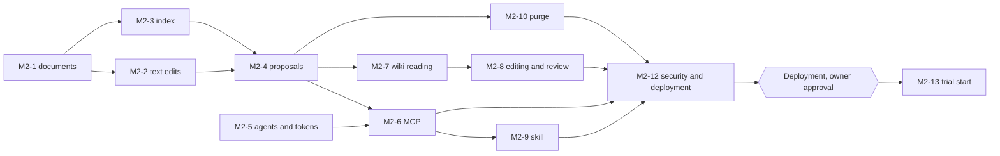

# Shinan: build plan for M2 (Catalog)

Status: **approved by the owner on 2026-11-17**
([issue #79](https://github.com/guneet-xyz/shinan/issues/79)), with the
answers in [section 7](#7-owner-answers).

> **Being replaced (2026-11-19).** The owner decided that the catalog this
> plan built is not working and that it moves to Git: one repository per
> workspace, hosted by Shinan, with no catalog approval. The
> [Git-based catalog plan](build-plan-git-catalog.md) (approved by the
> owner on 2026-11-19, [#161](https://github.com/guneet-xyz/shinan/issues/161))
> says what is removed and kept. This plan stays as the record of what M2
> built. The trial is paused until the Git-based catalog is deployed.

This plan splits milestone M2 into work packages, in the same way and under
the same process as M1 ([build plan](build-plan.md), §4). Where the documents
left a choice open, it says what it proposes and why; the owner's answers to
the real choices are in [section 7](#7-owner-answers). One answer is recorded
as a new decision, [D-056](decisions/D-056-public-skill-path.md); the plan
changes no other decision.

M1 is complete and deployed as v0.2.0 at `shinan.guneet.dev`. M2 builds on its
code: core's actors, scopes and single check path (`packages/core`), the
append-only events and security log, the job queue, the web app shell with
Tailwind CSS and shadcn/ui ([D-055](decisions/D-055-tailwind-and-shadcn.md)),
and the security baseline ([security checklist](security-checklist.md)).

## 1. What M2 delivers

The [roadmap](roadmap.md#33-build-milestones) defines M2 as: catalog
entities, facts with provenance, catalog proposals and catalog approval, the
wiki, the agent index, MCP read and propose, and the skill. Its screens are
the wiki, start here, catalog review and recent changes, and registering
agents with hand-made tokens until the plugin arrives in M4. M2 unlocks the
**catalog part of the trial** ([roadmap 4.3](roadmap.md#43-the-catalog-during-the-trial)).

In detail (**decided** where the cited document decides it; the split into
packages is **proposed**):

| Area            | M2 delivers                                                                                                                                                                                                                                                                                                                                                                   | Implements                                                                                                                                                                                                                                                                                                      |
| --------------- | ----------------------------------------------------------------------------------------------------------------------------------------------------------------------------------------------------------------------------------------------------------------------------------------------------------------------------------------------------------------------------- | --------------------------------------------------------------------------------------------------------------------------------------------------------------------------------------------------------------------------------------------------------------------------------------------------------------- |
| Catalog content | Entity documents (frontmatter and body), the eight built-in type schemas, custom types and extensions through type schema documents, facts grouped by fact check, the four fact states, fact identity and cardinality, relations with generated inverses, discrepancies, known unknowns and not-yet-recorded keys, freshness and recheck intervals, the start-here document   | [Catalog](catalog.md) §2 to §7, §11; [D-006](decisions/D-006-document-first-catalog.md), [D-007](decisions/D-007-fact-provenance.md), [D-025](decisions/D-025-fact-state-planned.md), [D-026](decisions/D-026-custom-entity-types.md)                                                                           |
| Changes         | Every change is a catalog proposal of operations, applied as text edits to the latest revision; validation (including the check for secret-looking values); per-operation conflict checks; gated catalog approval with the strict setting and bulk approval; self-approval of one's own agents' proposals; comments on proposals; withdraw; revert                            | [Catalog](catalog.md) §8; [D-024](decisions/D-024-gated-catalog-approval.md); [architecture §5.2, §5.3](architecture.md#52-the-invariant)                                                                                                                                                                       |
| History         | Catalog revisions (full Markdown text, PostgreSQL only), revision events on the entity timeline, retired entities kept readable, the round-trip test in CI and as a daily job                                                                                                                                                                                                 | [Catalog §9](catalog.md#9-history-and-purge); [architecture §5](architecture.md#5-catalog-markdown-and-agent-index); [D-022](decisions/D-022-catalog-storage-and-git-mirror.md), [D-043](decisions/D-043-no-git-mirror-for-now.md)                                                                              |
| Agent index     | The generated, rebuildable index; search (PostgreSQL full-text); every answer names its catalog revision and shows lag; the JSON format (catalog open question 7)                                                                                                                                                                                                             | [Catalog §12.1, §12.2](catalog.md#12-the-agent-index); [architecture §4.1, §5.3](architecture.md#53-how-sync-works)                                                                                                                                                                                             |
| Wiki            | Entity pages, freshness display, type indexes (built-in and custom, with their schema documents), workspace-wide lists, search, page history with revision comparison, start here for people and for agents (with "preview as agent"), Suggest a change, Record a check, catalog review (waiting for approval, recent changes with revert), catalog settings (strict setting) | [Human experience](human-experience.md#the-catalog): the wiki, start here and onboarding, workspace settings (Catalog settings); [catalog §10, §11](catalog.md#10-the-catalog-pages)                                                                                                                            |
| Agents          | Agents (person, coding tool, machine), one long-lived hashed token per agent with scopes (full or read-only), tokens made by hand after re-authentication, revocation (including on member removal, allowlist removal and "sign out everywhere"), token use recorded, security emails, per-token rate limits, Your agents and the workspace settings Agents screen            | [Identity §6, §7, §11](identity.md#6-agents); [D-031](decisions/D-031-agent-and-session-granularity.md), [D-035](decisions/D-035-tokens-security-log-purge.md), [D-050](decisions/D-050-agent-token-browser-approval.md) (hand-made fallback); [human experience, Your agents](human-experience.md#your-agents) |
| MCP             | The hosted MCP endpoint (`/mcp`, Streamable HTTP, protocol versions 2026-07-28 and 2025-11-25), token-only authentication, the catalog tools, trust labels on every text field, server instructions pointing to the skill, retry-safe writes                                                                                                                                  | [Agent integrations](agent-integrations.md#mcp-server-and-tools): design rules, trust labels, the Context and Catalog rows of the tool set, authentication requirements; [architecture §8.1](architecture.md#81-mcp-server)                                                                                     |
| Skill           | One `shinan` skill with its catalog conventions, served by the installation as an HTTP skill catalog on the public path `/skills/` ([D-056](decisions/D-056-public-skill-path.md)); setup instructions for OpenCode with a hand-made token                                                                                                                                    | [Agent integrations, the skill and conventions](agent-integrations.md#the-skill)                                                                                                                                                                                                                                |
| Trial           | A trial guide for the catalog part, the GitHub `trial` label for findings, machine-level OpenCode configuration on Daedalus that enables Shinan for the trial projects only, and the trial-start steps in [section 4](#4-starting-the-catalog-part-of-the-trial)                                                                                                              | [Roadmap 4.3, 4.5](roadmap.md#43-the-catalog-during-the-trial)                                                                                                                                                                                                                                                  |

### What M2 does not deliver

| Not in M2                                                                                                             | When                                                    | Reason                                                                                                                                                                                                                                                                                                                                                  |
| --------------------------------------------------------------------------------------------------------------------- | ------------------------------------------------------- | ------------------------------------------------------------------------------------------------------------------------------------------------------------------------------------------------------------------------------------------------------------------------------------------------------------------------------------------------------- |
| Tasks, related tasks on entity pages, `from-task` resolution, the workspace timeline screen, the readiness report     | M3                                                      | [Roadmap 3.3](roadmap.md#33-build-milestones).                                                                                                                                                                                                                                                                                                          |
| Agent sessions, presence, the OpenCode plugin, the "start agent session" and "check in" tools                         | M4                                                      | Roadmap 3.3. In M2 every MCP call is credited to the agent with no agent session, which the [glossary](domain-model.md#agent-session) allows; the written actor form names the agent anyway ([identity §8.7](identity.md#87-how-an-actor-is-written-in-text)).                                                                                          |
| Browser approval of agents (device flow with a short code), formerly package M2-11                                    | **Decided (owner, M2-Q1):** M4, with the plugin         | Only the plugin or the CLI can start it, and neither exists in M2. Hand-made tokens are the decided fallback ([D-050](decisions/D-050-agent-token-browser-approval.md)). The M4 plan picks up the content in [section 3.11](#311-moved-to-m4-browser-approval).                                                                                         |
| The CLI, including its local MCP bridge                                                                               | **Proposed:** after M4, before G2                       | On the cut line ([roadmap 3.2](roadmap.md#32-cut-line)). Every trial agent is OpenCode, which reaches a remote MCP server with a header.                                                                                                                                                                                                                |
| Workspace export and import                                                                                           | Before G2                                               | On the cut line. The wiki's export link for owners waits for it.                                                                                                                                                                                                                                                                                        |
| The migration importer and the rollback converter                                                                     | Before the rehearsal (R14), before G2                   | The trial checks every fact, pointers included, at its source and copies nothing ([O-71](roadmap.md#43-the-catalog-during-the-trial), M2-Q10); a bulk importer is not needed for it ([architecture §5.4](architecture.md#54-importing-the-workspace-repositorys-catalog), [catalog §13](catalog.md#13-mapping-from-the-workspace-repositorys-catalog)). |
| Automatic fact checks by Shinan                                                                                       | Phase 2a                                                | Cut line; they need git host connections (M3) anyway ([catalog §12.3](catalog.md#123-automatic-fact-checks-by-shinan)).                                                                                                                                                                                                                                 |
| Nudges and the `messages` field in MCP answers                                                                        | Phase 2 (field added when nudges or task notices exist) | [Agent integrations, design rule 4](agent-integrations.md#design-rules).                                                                                                                                                                                                                                                                                |
| Git mirror, MCP-specific OAuth, MCP resources, agent signing keys, external link checking, body embeds of fact values | Later or not planned                                    | [D-043](decisions/D-043-no-git-mirror-for-now.md), [D-050](decisions/D-050-agent-token-browser-approval.md); the defaults in [section 7.2](#72-defaults-for-open-questions-in-the-documents).                                                                                                                                                           |
| Screens for a second member (contributor role in catalog screens, nudges from others)                                 | Before a second member joins                            | [Identity §13](identity.md#13-first-version-scope). Core still enforces the role rules, as M1 does.                                                                                                                                                                                                                                                     |

## 2. Code layout additions (proposed)

Same layout as M1 ([build plan §2](build-plan.md#2-code-layout-proposed)), with:

| Path                                       | What it holds                                                                                                                                                                                                                                                        |
| ------------------------------------------ | -------------------------------------------------------------------------------------------------------------------------------------------------------------------------------------------------------------------------------------------------------------------- |
| `packages/core/src/catalog/document/`      | The pure document model: parser, type schemas, facts, operations as text edits, validation. No database and no I/O, so it can be tested exhaustively and later reused by the importer, the export and the rollback converter.                                        |
| `packages/markdown`                        | Shinan's one Markdown configuration (markdown-it): the body model in core reads sections and links with it, and the wiki renders with it, so both agree (proposed in M2-1b, [#102](https://github.com/guneet-xyz/shinan/issues/102)). Browser-safe: no Node.js APIs. |
| `packages/core/src/catalog/`               | Catalog operations with permissions: proposals, apply, approval, revert, purge, the indexer and index queries.                                                                                                                                                       |
| `packages/core/src/identity/agents.ts`     | Agents and tokens.                                                                                                                                                                                                                                                   |
| `apps/server/src/mcp/`                     | The MCP endpoint and tool definitions. Tools only translate between MCP and core operations; no rule lives here.                                                                                                                                                     |
| `packages/skill`                           | The skill's Markdown files and a build step that writes the HTTP catalog's `index.json` with a version that changes when the files change. `apps/server` serves the built files.                                                                                     |
| `apps/web/src/pages/wiki/`, `.../catalog/` | Wiki, start here, catalog review and catalog settings screens. The Markdown renderer is loaded only on wiki routes (route-level splitting, as [PR #76](https://github.com/guneet-xyz/shinan/pull/76) suggests for bundle size).                                      |

## 3. M2 work packages

Each package is one GitHub issue (labels `build` and a new `M2` label), one
build agent, one branch and worktree, and a pull request reviewed by a
reviewer agent against the documents it implements, as in M1. Every package
updates the documents its behaviour changes, and the
[security checklist](security-checklist.md) items it builds.

| #     | Package                                                                            | Implements                                                                                                                                           | Depends on                                        |
| ----- | ---------------------------------------------------------------------------------- | ---------------------------------------------------------------------------------------------------------------------------------------------------- | ------------------------------------------------- |
| M2-1  | **Catalog documents: parser, type schemas, validation**                            | Catalog §2, §3, §4, §5, §7.3, §8.3, §11 (document shape)                                                                                             | M1                                                |
| M2-2  | **Operations as text edits, and conflict checks**                                  | Catalog §4.2, §4.3, §8.1 (operations), §8.5; architecture §5.2 (rules 2 and 5)                                                                       | M2-1                                              |
| M2-3  | **Agent index and search**                                                         | Catalog §12.1, §12.2; architecture §4.1, §5.2 (rules 3 and 6), §5.3                                                                                  | M2-1                                              |
| M2-4  | **Catalog storage, proposals and approval**                                        | Catalog §8, §9 (without purge); architecture §5.2 (rule 4), §5.3, §7; identity §5.1 (catalog rows), §11 (catalog approvals)                          | M2-2, M2-3                                        |
| M2-5  | **Agents and tokens**                                                              | Identity §6.1, §6.3, §7, §11 (agent rows), §10 (token throttling); human experience "Your agents" (hand-made tokens) and workspace settings "Agents" | M1                                                |
| M2-6  | **MCP server and catalog tools**                                                   | Agent integrations: MCP server and tools, trust labels, authentication requirements; architecture §8.1                                               | M2-4, M2-5                                        |
| M2-7  | **Wiki: reading**                                                                  | Human experience: an entity page, freshness, moving around the wiki, start here; catalog §10, §11                                                    | M2-4                                              |
| M2-8  | **Wiki: changing the catalog and catalog review**                                  | Human experience: changing the catalog from the wiki, reviewing catalog changes, catalog settings; catalog §8.2, §8.6                                | M2-4; the page shell of M2-7                      |
| M2-9  | **The skill and agent setup**                                                      | Agent integrations: the skill, conventions agents follow (catalog parts), authentication requirement 3                                               | Drafted with M2-6, finished after it              |
| M2-10 | **Catalog purge** (owner, M2-Q4)                                                   | Catalog §9 (purge); architecture §4.4; identity §11                                                                                                  | M2-4                                              |
| M2-11 | _Not in M2: browser approval moved to M4 (owner, M2-Q1); the number is not reused_ | Identity §6.2                                                                                                                                        | —                                                 |
| M2-12 | **Security review and deployment preparation**                                     | Security checklist (the M2 **Later** items); operator guide; architecture §11.6                                                                      | All packages that ship in M2                      |
| M2-13 | **Trial start kit**                                                                | Roadmap 4.3, 4.5; agent integrations, the skill (O-38)                                                                                               | Drafting: none; steps: the M2 deployment and M2-9 |

### Order and parallel work

1. **First:** M2-1 and M2-5 in parallel. M2-13's documents can be drafted at
   any time.
2. **Then:** M2-2 and M2-3 in parallel, once M2-1 has merged the document
   model's types.
3. **Then:** M2-4, the integration point.
4. **Then, in parallel:** M2-6, M2-7, M2-10, and the first draft of M2-9.
   M2-8 starts once M2-7 has the entity page shell (the two agree the page
   structure in their issues).
5. **Last:** M2-12, then the release and the deployment request, then the
   trial-start steps.

The longest chain is M2-1 → M2-2 → M2-4 → M2-7 → M2-8. To keep it short, M2-1
merges the document model's types and parser first (one PR) and validation in
a second PR, so M2-2 and M2-3 can start earlier.

### 3.1 M2-1: Catalog documents: parser, type schemas, validation

- **Parser** for the limited YAML subset of [catalog §2.1](catalog.md#21-one-document-per-entity-and-what-source-of-truth-means):
  plain maps, lists, strings, numbers, booleans, dates and `null`; anchors,
  aliases, tags, multi-document files and duplicate keys refused. YAML 1.2
  core schema, so `no` stays a string and dates are checked by Shinan, not
  turned into time values by the library.
- **Body** split by heading into sections, keeping the exact source text of
  each, for section edits (M2-2) and section search (M2-3).
- **Entity fields** ([2.3](catalog.md#23-entity-fields)), IDs, aliases and
  references, including body links whose target is an entity ID
  ([2.4](catalog.md#24-ids-and-references)).
- **Facts:** groups by fact check, short and long forms, states, `via`,
  `note`, `task`, `remove`, `unknown` lists ([4.3](catalog.md#43-how-facts-are-written));
  fact identity and current facts ([4.2](catalog.md#42-fact-identity-cardinality-and-current-facts));
  discrepancies ([4.7](catalog.md#47-discrepancies)); known unknowns and
  not-yet-recorded keys ([4.8](catalog.md#48-unknowns)); freshness computed
  when read ([4.6](catalog.md#46-freshness)).
- **Each fact gets a stable identity key** computed from its identity (for
  example `disk.data.size|observed|filesystem`). **Proposed.** Reason: agents
  and the web editor then name the fact an operation replaces or removes
  without rebuilding the identity rules themselves; it is derived, never
  stored in the text.
- **The eight built-in type schemas** with keys, cardinality, relations and
  inverses ([section 3](catalog.md#3-entity-types), [§5](catalog.md#5-relations)),
  and **proposed recheck intervals** for their keys (catalog open question 2),
  listed in the PR for review.
- **Type schema documents** for custom types and extensions of built-in types
  ([3.9](catalog.md#39-custom-types-and-type-schema-documents)): the key
  options, reserved names, and "extend, never change" for built-ins.
- **The start-here document** shape: two ordered paths of entity references
  with a sentence each ([§11](catalog.md#11-start-here)).
- **Validation** on the resulting document set: every blocking and warning
  rule of [8.3](catalog.md#83-validation), including the check for
  secret-looking values ([7.3](catalog.md#73-a-check-for-secret-looking-values))
  with Shinan's own token prefix from M2-5, and the start-here warnings.
- **Tests:** the examples in the catalog document (Dockyard, Musashi, the
  `domain` schema) as fixtures; property tests that random valid documents
  parse and validate; a table test per validation rule.

### 3.2 M2-2: Operations as text edits, and conflict checks

- Every operation of [8.1](catalog.md#81-catalog-proposals): create entity;
  set a fact (replace or add beside); remove a fact; recheck facts; edit the
  whole body or one section; change an entity field; retire; change ID (old
  ID to `aliases`); create or change a type schema document; change the
  start-here document.
- **Applied as text edits** ([architecture §5.2](architecture.md#52-the-invariant),
  rule 2): only the bytes an operation targets change. New content (a new
  fact check group, a new fact, a new entity) is written in one canonical
  style; existing text keeps its style. A recheck moves a fact to its new
  group; a new check merges into an existing group only when every field
  matches; groups left empty are dropped ([4.3](catalog.md#43-how-facts-are-written)).
- **`by` is never sent by the caller.** The operation's applier writes the
  actor's written form from the request ([identity §8.7](identity.md#87-how-an-actor-is-written-in-text)).
- **Expectations and conflicts** ([8.5](catalog.md#85-conflicts)): each
  operation states what it expects (the fact's identity key, value and fact
  check, or "absent"); operations whose expectations hold apply even if other
  parts of the entity changed.
- **Multi-entity proposals** apply all or nothing, in an order that lets a
  proposal create a type schema and entities of that type together.
- **Round-trip tests** (rule 5): text → parse → apply no operations → text is
  byte-for-byte unchanged; for each operation, parse(apply(text, op)) equals
  the expected model and every untouched byte is unchanged; random sequences
  of operations on the fixtures.

### 3.3 M2-3: Agent index and search

- Derived tables built **only** from a revision's stored text (rule 3), each
  row recording the parser version: entities, aliases, facts with their
  checks, relations in both directions (written and generated), discrepancies,
  unknowns, applicable policies and runbooks (through `applies-to`, including
  ones that apply to a type or the whole workspace), body sections, search
  text.
- **Query operations** for [12.2](catalog.md#122-rules): get an entity by ID
  or alias; list by type and status; get a type schema; text search across
  titles, summaries, facts and body sections (PostgreSQL full-text,
  [architecture §4.1](architecture.md#41-postgresql-holds-everything));
  neighbours through relations; policies and runbooks for an entity; the
  workspace lists (discrepancies, due for recheck, known unknowns); changes
  since a given catalog revision; the agents' start-here path.
- **The JSON format** of an entity and of each list (catalog open question 7),
  using the documents' field names, with the catalog revision and an "index
  behind" flag on every answer. Written down in the catalog document by this
  package.
- **Rebuild:** a worker job rebuilds a workspace's index from the latest
  revisions when the parser version changes or on demand; while it runs,
  answers say the index is behind. A daily job checks text → parse → index
  equals the stored index and reports differences in the log and as installation
  health (architecture §5.2 rule 5).
- **Tests:** index from text equals stored index; rebuild after deleting all
  derived rows gives the same rows.
- **As built ([#85](https://github.com/guneet-xyz/shinan/issues/85)):** the
  index is built from stored text, so M2-3 also adds the tables that hold it:
  catalog documents (a stable ID and the current revision), catalog revisions
  (numbered per workspace, credited like events) and each revision's
  document text, with `appendCatalogRevision` storing and indexing a
  revision in the caller's transaction. M2-4 adds the proposal, approver and
  based-on records and calls that function when it applies a proposal.

### 3.4 M2-4: Catalog storage, proposals and approval

- **Tables:** catalog documents (current revision per document), catalog
  revisions (full text, author and attribution, approver, catalog proposal,
  based-on revision, time; M2-3 built the documents, revisions, text and
  author, so M2-4 adds the rest), catalog proposals (author, explanation, related
  task ID as text until M3, operations, inline fact checks, validation
  results, approval class, state `pending`/`applied`/`rejected`/`withdrawn`,
  idempotency key), proposal comments.
- **Apply in one transaction** (rule 4): new text, index rows (M2-3), conflict
  check, secret check, revision, event. Nothing else writes the index (rule 6).
- **Approval classes** of [8.2](catalog.md#82-when-catalog-approval-is-needed),
  the **strict setting** with bulk approval, a person's own edit applied at once
  when they may approve it, and self-approval of one's own agents' proposals
  while one person uses Shinan ([D-024](decisions/D-024-gated-catalog-approval.md), O-46).
- **Withdraw, reject with a reason, comment** (agents with `catalog:propose`;
  only people approve, [identity §6.3](identity.md#63-what-an-agent-may-do)).
- **Recent changes and revert:** a revert is a new proposal restoring the
  earlier values.
- **Events and security log:** each revision is an event credited to its
  author (and approver); catalog approvals go to the security log
  ([identity §11](identity.md#11-audit)); refused agent attempts to approve are
  recorded.
- **Permissions in core:** new rules in `permissions.ts` for reading,
  proposing, commenting, approving and changing the strict setting.
- **Planned facts and tasks (proposed):** until tasks exist (M3), a `planned`
  fact may name an accepted `decision` entity, or a task ID that is checked
  only for its format; M3 adds the check that the task exists and reports any
  that do not. Reason: the trial catalog may need `planned` facts before M3,
  and an unresolvable reference must not block it.
- **Tests:** the D-006 invariant end to end (delete all derived data and
  rebuild gives the same index; stored text is never rendered from rows);
  concurrent proposals on different facts of one entity both apply; each
  approval class; idempotent retries.

### 3.5 M2-5: Agents and tokens

- **Agents table** (person, workspace, membership row, coding tool, machine,
  handle `<coding tool>-<machine>`, optional link to a `machine` entity,
  enabled), the foreign key on `events.actor_agent_id`, and `AgentActor` built
  from the token. Core checks the agent's own membership row, not only its
  person's current membership (note in [PR #61](https://github.com/guneet-xyz/shinan/pull/61)).
- **Tokens:** one per agent, a recognisable prefix, only a SHA-256 hash
  stored, shown once, scopes ([identity §7.2](identity.md#72-scopes)): full
  (all five scopes; `tasks:*` and `presence` have no effect until M3 and M4) or
  read-only. Issuing a new token revokes the previous one. The token records
  the installation, and other installations reject it ([7.4](identity.md#74-handling)).
- **Made by hand** in Your agents after re-authentication: the person picks
  coding tool and machine, chooses full or read-only, and sees the token once.
- **Authentication seam** for agent endpoints: `Authorization: Bearer` only;
  never a query string; never a cookie. Requests with a token and no cookie
  are exempt from the same-origin check; requests with both are refused.
  Uniform errors; failed token use throttled per network address and recorded.
  Per-token rate limits in core's `rateLimits`.
- **Revocation and disabling** ([7.5](identity.md#75-revocation)): by the
  member or a workspace owner; automatically on member removal and leaving,
  allowlist removal, and optionally in "sign out everywhere" (comments mark
  the spots, [PR #65](https://github.com/guneet-xyz/shinan/pull/65)).
- **Security log and email:** agents created, renamed, disabled; tokens
  issued and revoked (and why); each token's first and last use, network
  address and request count (summarised, not per request); the security email
  for a new token (`sendSecurityAlert`, kind `agent-token-approved`).
- **Screens:** Your agents (list, last use shown prominently, unused for 30
  days marked, create by hand, rename, disable, revoke); workspace settings
  Agents (all agents, disable, revoke); the Members row gains the member's
  agents.
- **Checklist items:** 3.8, 4.8, 5.7, 10.7 (with M2-6).

### 3.6 M2-6: MCP server and catalog tools

- **Endpoint** `/mcp` over Streamable HTTP with the official TypeScript SDK,
  stateless, supporting protocol versions 2026-07-28 and 2025-11-25
  ([architecture §8.1](architecture.md#81-mcp-server)); `Origin` validated;
  `MCP-Protocol-Version`, `Mcp-Method` and `Mcp-Name` checked against the
  body; token from M2-5 only.
- **Tools** (names illustrative, fixed in the PR; [tool set](agent-integrations.md#tool-set)):

  | Tool                          | Scope             | What it does                                                                                                                                                         |
  | ----------------------------- | ----------------- | -------------------------------------------------------------------------------------------------------------------------------------------------------------------- |
  | `workspace_context`           | any `read`        | The agent, its member, the workspace, what the agent may do, the latest catalog revision and the agents' start-here path. Task prefix and flags join in M3.          |
  | `search_catalog`              | `catalog:read`    | Text, type, status and relation search, with fact freshness.                                                                                                         |
  | `get_entity`                  | `catalog:read`    | One entity in the M2-3 format, optionally with its type schema.                                                                                                      |
  | `catalog_lists`               | `catalog:read`    | Discrepancies, due for recheck, known unknowns, type schemas, changes since a revision.                                                                              |
  | `propose_catalog_change`      | `catalog:propose` | Operations with expectations, inline fact checks, explanation, optional related task ID, idempotency key. Returns whether it applied or waits for approval, and why. |
  | `record_fact_check`           | `catalog:propose` | A recheck with scope, source and limits, value unchanged.                                                                                                            |
  | `get_catalog_proposal`        | `catalog:read`    | A proposal with its operations, state, validation results and comments.                                                                                              |
  | `withdraw_catalog_proposal`   | `catalog:propose` | Withdraws the agent's own pending proposal.                                                                                                                          |
  | `comment_on_catalog_proposal` | `catalog:propose` | Adds a comment, for example review findings.                                                                                                                         |

- **Trust labels** ([trust labels](agent-integrations.md#trust-labels)) on
  every text field: `author_kind`, `author` and `instruction`. All catalog
  text is `instruction: no`. The author of each fact is its fact check's
  actor; the author of each body section is its `written_by`, the
  least-trusted author whose words may remain in it, derived from history by
  the indexer (M2-3, [#110](https://github.com/guneet-xyz/shinan/issues/110);
  catalog §12.4). Labels come from Shinan's records, never from claims in
  the text.
- **Server instructions:** a short version of the conventions and a pointer
  to the skill ([design rule 7](agent-integrations.md#design-rules)).
- **Writes are retry-safe** (design rule 3) through the idempotency key.
- **Security log:** agent index bulk reads (for example `catalog_lists` over
  the whole catalog) recorded as bulk reads; refusals recorded.
- **As built** (M2-6, [#87](https://github.com/guneet-xyz/shinan/issues/87)):
  every tool above except `comment_on_catalog_proposal`, which needs
  proposal comments and comes with M2-4b
  ([#86](https://github.com/guneet-xyz/shinan/issues/86)); and `/mcp`
  reads bodies up to 512 KB, the limit proposed below for M2-12, because
  one proposal may hold 256 KiB of JSON.
- **Checklist items:** 10.4 (trust labels part), 10.5, 10.7.
- **Tests:** an MCP client session against a test server for each tool and
  both protocol versions; a cookie-only request refused; a foreign `Origin`
  refused; a read-only token refused on writes; trust labels present on every
  text field (a test walks every answer).

### 3.7 M2-7: Wiki: reading

- **REST routes and `api-client` methods** for the M2-3 queries and history.
- **Entity page** in the order of [human experience](human-experience.md#an-entity-page),
  without the Tasks section (M3): pending proposals, discrepancies, owning
  sources, freshness summary, facts with state labels and age, body, links in
  both directions, history with any earlier revision opened and compared.
- **Navigation:** wiki home with Start here, type indexes (with the schema
  document, custom types included), workspace-wide lists, search, retired
  entities excluded from default search, old IDs leading to the current page.
  `/w/:id` opens the wiki until the Now screen exists (M3).
- **Start here:** the people's path as numbered steps; the agents' path with
  "preview as agent" and its total size with a warning. **Proposed:** "opened"
  and "changed since you opened it" markers are kept per person in a small
  table; they are not catalog content.
- **Markdown rendering under the Content Security Policy:** rendered in the
  browser into React elements, with raw HTML not rendered; links limited to
  `http`, `https`, `mailto` and entity references (rewritten to wiki routes);
  images shown as links, because `img-src 'self'` blocks outside images and
  catalog images are not stored; no inline styles; no syntax highlighting in
  M2. `csp.test.ts` gains a test with hostile Markdown (script, `javascript:`
  links, HTML, style attributes). **Checklist item:** 10.3.

### 3.8 M2-8: Wiki: changing the catalog and catalog review

- **Suggest a change:** forms for entity fields and facts, and the body as
  Markdown text with a preview, producing the same operations agents send.
  Before saving, the screen shows whether the change applies at once or waits
  for approval, and the validation results. **Proposed:** no raw editing of
  the frontmatter in M2. Reason: operations stay precise and reviewable; the
  raw document is still visible read-only on the history view.
- **Record a check,** which cannot be saved without scope and source.
- **New entity** and **New type** (a type schema document proposal).
- **Catalog review:** waiting for approval (before and after per fact, body
  changes, evidence, author with attribution, "from your agent", agents'
  comments; Approve, Reject with a reason, Comment; bulk approval when strict);
  recent changes feed with Revert.
- **Catalog settings** in workspace settings: the strict setting.
- **Start here** editing (gated) from its page.

### 3.9 M2-9: The skill and agent setup

- `packages/skill`: `SKILL.md` (short) and supporting files: reading
  catalog entities and their freshness before relying on them; rechecking
  volatile or consequential facts before acting; proposing changes with
  evidence and a narrow scope (the documentation-impact obligation,
  [catalog §8.4](catalog.md#84-agents-documentation-impact-obligation));
  provenance rules (copying is not checking; `unknown` over guesses); secrets
  never sent, only where they live; trust labels, in the wording of
  [agent integrations](agent-integrations.md#trust-labels); falling back to
  the `workspace` repository if Shinan is down. Task, presence and nudge
  conventions are added in M3 and M4. **As built** (owner, M2-Q12): the
  fallback is worded generically, the project's own instructions and the
  owning sources, without naming the `workspace` repository; the trial
  note in that repository names it ([3.13](#313-m2-13-trial-start-kit)).
- **Served** as an HTTP skill catalog at `/skills/` with `index.json`, whose
  `version` changes when the files change ([OpenCode skills](https://opencode.ai/docs/skills),
  checked 2026-11-17). OpenCode's HTTP catalogs send no credentials, so the
  path is public ([D-056](decisions/D-056-public-skill-path.md)): it serves
  only the built skill files, never workspace content, and the PR adds it to
  the public routes test and checklist item 1.12.
- **Setup guide** for OpenCode with a hand-made token, for any machine: the
  MCP entry (`type: remote`, `oauth: false`, the `Authorization` header read
  with `{file:…}` from a file only its user can read, never written into a
  project file), the skill catalog URL, and how to check the connection
  (`opencode mcp list`). Linked from Your agents. For the trial, the
  machine-level layout on Daedalus is M2-13's ([3.13](#313-m2-13-trial-start-kit)).

### 3.10 M2-10: Catalog purge

In M2 (owner, M2-Q4), for catalog content only.
A workspace owner, after re-authentication, purges content from catalog
revisions, proposals and comments: the content is replaced by a marker, the
record keeps its shape, the purge is an event and a security-log entry, and
the index is rebuilt in the same transaction. The screen warns that model
providers and earlier copies may still hold the content and that the secret
must be rotated at its source ([catalog §9](catalog.md#9-history-and-purge),
[architecture §4.4](architecture.md#44-purge)). It narrows the `events`
triggers in a migration and never touches the `security_log` ones (note in
[PR #61](https://github.com/guneet-xyz/shinan/pull/61)).

### 3.11 Moved to M4: Browser approval

Not in M2 (owner, M2-Q1); the number M2-11 is not reused. The M4 plan
includes it with the plugin, which is the first client that can start it:
the device-style flow of [identity §6.2](identity.md#62-registering-an-agent)
(link and short code, sign-in and re-authentication, choose or create the
agent, full or read-only, approve), its throttling and expiry, the approval
page, and "waiting for first contact". Until then agents use tokens made by
hand (M2-5).

### 3.12 M2-12: Security review and deployment preparation

- Run the whole [security checklist](security-checklist.md) again; the M2
  items (3.8, 4.8, 5.7, 10.3, 10.4 for trust labels, 10.5, 10.7, and 10.6 if
  export were built) move from **Later** to **Pass**.
- Request size limits: the API's 64 KB limit stays; catalog proposal routes
  and `/mcp` get their own, larger limit (proposed: 512 KB), applied before the
  body is read.
- Operator guide: the MCP endpoint, agent tokens, the skill path, the daily
  round-trip job and how to read its result.
- The deployment request in `infra/musashi` (image pin), with pre-checks and
  rollback. **Expected:** no DNS, Caddy route or network change, because `/mcp`
  and `/skills/` are paths on the same host; the request confirms this from
  the Caddyfile and that streamed answers are not buffered.

### 3.13 M2-13: Trial start kit

- `docs/trial.md` (**proposed** new document; the [roadmap](roadmap.md#4-proof-of-concept)
  stays the owner of the rules): the trial entities, how to seed them by
  checking owning sources (section 4), the weekly comparison between the
  `workspace` repository and the trial catalog (O-72) as an agent procedure,
  and how trial findings are filed.
- The GitHub `trial` label for findings ([roadmap 4.4](roadmap.md#44-tasks-during-the-trial)).
- **Machine-level OpenCode configuration on Daedalus** that enables the MCP
  server and skill for the trial projects only (O-38; owner, M2-Q3). Nothing
  is committed to any repository, and nothing to mon or easyshell.
  - **How OpenCode scopes it** ([config](https://opencode.ai/docs/config),
    checked 2026-11-17): for each session OpenCode merges every
    `opencode.json(c)` it finds from the session's directory up to the
    filesystem root, on top of the global `~/.config/opencode` configuration.
    A file in a folder above a repository therefore applies to every session
    and task worktree below that folder, and to nothing else. The global and
    system (`/etc/opencode`) files are not used, because they apply to every
    project.
  - **Files:** `/mnt/projects/shinan/opencode.jsonc`,
    `/mnt/projects/mon/opencode.jsonc` and
    `/mnt/projects/easyshell/opencode.jsonc`, the same content in each: the
    MCP server `shinan` (`type: remote`, `url: https://shinan.guneet.dev/mcp`,
    `oauth: false`, an `Authorization` header read with `{file:…}`) and
    `skills: ["https://shinan.guneet.dev/skills/"]`. These folders hold the
    trial projects' task worktrees (`/mnt/projects/<project>/<task>`) and
    mon's clone (`/mnt/projects/mon/mon`), following Daedalus's worktree
    convention in the `workspace` catalog. They contain no secret.
  - **Token file:** `/root/.config/shinan/token`, owned by root, mode `0600`
    in a `0700` folder, written by the owner (owner action). A `{file:…}`
    reference inside a longer string works (checked with OpenCode v2.3.0,
    [trial guide §4.4](trial.md#44-opencode-behaviour-this-relies-on)), so
    the file holds only the token and the header is `Bearer {file:…}`, as
    on the Set up OpenCode page.
  - **Limits:** sessions started outside these folders, such as in the
    canonical checkout `/root/shinan`, do not get Shinan. Trial work therefore
    starts in `/mnt/projects/<project>` or a task worktree there, as
    Daedalus's convention already says. The setup is checked with
    `opencode mcp list`: `shinan` connected from a trial worktree, absent
    from `/root` and from another project's folder.
  - **Documentation:** the `workspace` repository's Daedalus machine entry
    records where these files are (with the trial note, step 7 of section 4).
- A draft of the trial note for the `workspace` repository (section 4, step 7).

## 4. Starting the catalog part of the trial

After the owner approves the M2 deployment and it is verified:

1. **Agent and token.** The owner creates the agent "OpenCode on Daedalus"
   (`opencode-daedalus`) with a full token made by hand (owner, M2-Q5) and
   writes it to `/root/.config/shinan/token`. Agents never see, copy or relay
   it.
2. **Trial configuration.** An agent writes the three machine-level
   configuration files of [M2-13](#313-m2-13-trial-start-kit) on Daedalus and
   checks with `opencode mcp list` that only trial folders connect.
3. **First document.** `person/guneet` (the entity owner of everything),
   gated: the owner writes it or approves an agent's proposal. It comes
   first because every trial entity names it as `owner`.
4. **Seeding.** One task-scoped agent session per entity group creates the 17
   trial entities listed in [roadmap 4.3](roadmap.md#43-the-catalog-during-the-trial)
   through MCP: `project/shinan`, `project/mon`, `project/easyshell`;
   `machine/musashi`, `machine/anzen`, `machine/daedalus`; `service/ingress`,
   `service/container-registry`, `service/cloudflare-dns`, `service/obscuro`,
   `service/email`, `service/forgejo`, `service/monitoring`; and the trial
   projects' deployments `service/shinan`, `service/mon-private`,
   `service/mon-public`, `service/easyshell` (owner, M2-Q9). Rules
   ([O-71](roadmap.md#43-the-catalog-during-the-trial) as amended by M2-Q10,
   catalog §13):
   - each `workspace` repository entry is a map, not a source: facts are
     checked at their owning sources and recorded with real check times;
   - pointers (repository URLs, IDs, documentation links) are checked too, by
     opening them, and become ordinary `observed` facts; nothing is copied
     from the entries (owner, M2-Q10);
   - a fact or pointer that cannot be checked within the agent's existing
     access is `unknown`; seeding never widens access (P6), so no new SSH or
     scanning;
   - no secrets; `secrets-in` records only where a secret lives;
   - trial entities are not imports, so they carry no `imported_from`.
5. **Owner check, right after seeding.** The owner reads a few entities in
   the wiki and the recent changes list, which offers Revert (part of the M2
   milestone review). It is the only review the seeded facts get, because
   seeding is not gated and the strict setting starts off (O-3); the first R6
   sample is also taken from the seeded entities
   ([trial guide](trial.md#3-starting-the-catalog-part-step-by-step)).
6. **Start-here document,** after seeding, so its steps can point to the
   trial entities (owner, M2-Q11): gated, one approval; the owner reads both
   paths when approving. The agents' path links to the `workspace`
   repository's policies by URL, because policies stay there during the trial
   (D-018).
7. **Trial note.** A `workspace` repository pull request, through that
   repository's own workflow (a Forgejo issue, its own branch and review), adds
   the catalog part of the trial note ([roadmap 4.5](roadmap.md#45-agents-in-the-trial)):
   for trial projects, use Shinan (on Daedalus it is already configured for
   them); make a catalog proposal whenever a
   trial entity is updated in the `workspace` repository; fall back to the
   `workspace` repository if Shinan is down. The task and plugin parts are
   added at M3 and M4. The same PR records the configuration files in the
   Daedalus machine entry. This is a separate change in that repository, not
   part of any Shinan PR.
8. **From then on:** agents keep both in step (O-72), the weekly comparison
   runs, and evidence for R5, R6 and R7 starts to accumulate
   ([roadmap 5](roadmap.md#5-readiness-criteria)).

## 5. Risks and the hardest design points

| Risk or design point                                                                                                                                                                                                                                                                          | Mitigation                                                                                                                                                                                                                                                                                                                             |
| --------------------------------------------------------------------------------------------------------------------------------------------------------------------------------------------------------------------------------------------------------------------------------------------- | -------------------------------------------------------------------------------------------------------------------------------------------------------------------------------------------------------------------------------------------------------------------------------------------------------------------------------------- |
| **The Markdown-as-source-of-truth invariant with text edits** (D-006, architecture §5.2). YAML libraries reformat on output; a naive "parse, change, print" would rewrite bytes the operation did not target, or slowly make rows the real source.                                            | Edits on the parsed document's source ranges (for example the `yaml` package's CST or document nodes) with canonical output only for new content; the round-trip tests and property tests of M2-2; the daily round-trip job on real data; the pure document model in its own folder so the rule is reviewed in one place.              |
| **Fact identity and cardinality.** Two endpoints or two checkouts must not look like a discrepancy; a recheck must replace, not duplicate; a key outside the schema, a `via`, and a schema change from many to one all change identity.                                                       | Identity computed only by M2-1 and exposed as an identity key; operations name it with an expectation; validation blocks two current facts with one identity; schema changes that would break current entities are blocked and list them.                                                                                              |
| **Custom entity types.** Validation and indexing depend on schema documents that are themselves catalog content and change through proposals; a schema change can change freshness and discrepancies for every entity of the type.                                                            | One parser reads schemas and entities from the same revision; a schema change in a proposal is validated against every current entity of the type; changing a schema re-indexes that type's entities in the same transaction; built-ins can be extended, never changed.                                                                |
| **MCP authentication.** A public endpoint with long-lived tokens (O-44, O-45); MCP clients send no cookies, browsers do.                                                                                                                                                                      | Token only in the `Authorization` header; cookies refused at `/mcp`; `Origin` validated; per-token rate limits; token use recorded; instant revocation checked on every request; the SDK's support for both protocol versions confirmed at the start of M2-6, with a fallback of handling the 2026-07-28 headers in Shinan's own code. |
| **Trust labels and prompt injection.** Catalog text is written by agents that may have read outside text; the author of a body is spread over many revisions.                                                                                                                                 | All catalog text is `instruction: no`; per-section and per-fact authors derived from history; a test that walks every MCP answer for missing labels; the skill wording from agent integrations.                                                                                                                                        |
| **Content Security Policy with the wiki's Markdown.** Rendering Markdown to HTML usually means raw HTML, inline styles or `innerHTML`.                                                                                                                                                        | Rendering into React elements with raw HTML off, a URL allow-list, no images from elsewhere, no highlighting in M2; hostile-Markdown tests; checking every new screen in a browser under the real headers, as in M1-8.                                                                                                                 |
| **The token on the agent's machine.** A token in an environment variable or file is readable by the agent's own shell commands, so "never in the model's sight" ([authentication requirement 3](agent-integrations.md#authentication-requirements)) holds only while the agent does not look. | The skill forbids reading or printing it; on Daedalus it is a root-only `0600` file read by the machine-level MCP configuration (M2-13); revocation is instant and the security email shows new tokens. The plugin (M4) moves it to the machine's credential store where possible.                                                     |
| **Secrets slipping into the catalog** during seeding.                                                                                                                                                                                                                                         | The secret check blocks near-certain credentials and holds weaker matches for approval; seeding rules forbid values; catalog purge (M2-10) before the trial starts. A leak is a pause condition (RM-10).                                                                                                                               |
| **M2 is the largest milestone.**                                                                                                                                                                                                                                                              | The pure document model first, so most rules are tested without a database or a browser; browser approval and the CLI out of M2; the owner's review at the end of M2 checks scope against the cut line.                                                                                                                                |
| **Seeding cost and double maintenance** (roadmap risks).                                                                                                                                                                                                                                      | Small trial catalog (O-71); one agent session per entity group; owner approvals limited to the person entity and the start-here document.                                                                                                                                                                                              |
| **Attribution without agent sessions.** M2 credits agents, not agent sessions.                                                                                                                                                                                                                | Accepted for M2; the written form already names only the agent. M4 adds agent sessions, matched as O-29 decides.                                                                                                                                                                                                                       |

## 6. Owner actions and approvals for M2

People type secrets; agents never handle them. Agents prepare every step.

1. **Approve this plan** (done, 2026-11-17, [section 7](#7-owner-answers)).
2. **Release:** merge the release-please PR for the M2 version (proposed
   v0.3.0). Merging is the approval to release; it does not deploy.
3. **Approve the M2 deployment** to Musashi ([D-039](decisions/D-039-deploy-as-needed.md)):
   the image pin in `infra/musashi`. New database migrations run with it. No
   DNS, route, network or new server credential is expected; the request says
   so explicitly or lists what changed.
4. **Create the agent token by hand** for OpenCode on Daedalus in Your agents,
   after signing in again, and write it to `/root/.config/shinan/token`
   (root-only, [M2-13](#313-m2-13-trial-start-kit)). No new server-side
   credential is needed in M2.
5. **Catalog approvals** for the first gated documents: `person/guneet` and
   the start-here document (minutes).
6. **Review the trial note** in the `workspace` repository (recommended,
   because it changes what agents do; merging it needs no deployment
   approval).
7. **M2 milestone review:** a short demo note, what was built against the
   roadmap, anything cut, and decisions that came up, as for M1.
   Proposed choices made during the build that the owner confirms or
   changes there:
   - accepting a discrepancy only through `accept-discrepancy`, with
     `accepted` written from the approving person, never sent with a fact
     ([catalog §4.7](catalog.md#47-discrepancies), raised in review of
     [#108](https://github.com/guneet-xyz/shinan/pull/108));
   - the limits on one catalog proposal, 50 operations naming 100 facts
     ([catalog §8.1](catalog.md#81-catalog-proposals));
   - no operation that brings a retired entity back
     ([catalog §8.1](catalog.md#81-catalog-proposals)).

## 7. Owner answers

Decided by the owner on 2026-11-17 ("Approve and start",
[issue #79](https://github.com/guneet-xyz/shinan/issues/79)). The labels
M2-Q1 to M2-Q5 name the questions this plan asked; M2-Q6 came up during
M2-3, M2-Q7 and M2-Q8 during M2-4, M2-Q9 to M2-Q11 and M2-Q13 during M2-13
([7.3](#73-answers-on-the-trial-start-kit)), M2-Q12 during M2-9, and M2-Q14
to M2-Q17 at the M2 security review, M2-12
(2026-11-18 and 2026-11-19).

### 7.1 Answers

1. **M2-Q1, browser approval:** moves to M4, with the plugin. M2 uses tokens
   made by hand; package M2-11 is removed from M2
   ([3.11](#311-moved-to-m4-browser-approval)). This only schedules
   [D-050](decisions/D-050-agent-token-browser-approval.md), which already
   names hand-made tokens as the fallback, so no decision record changes.
2. **M2-Q2, the skill on a public path:** yes, at `/skills/`. Recorded as
   [D-056](decisions/D-056-public-skill-path.md), because it adds an exception
   to "nothing without sign-in"; [identity §10](identity.md#10-protections-for-a-public-installation),
   [architecture §10.2](architecture.md#102-web-hardening) and
   [agent integrations, the skill](agent-integrations.md#the-skill) say so.
   The question's reason: OpenCode loads HTTP skill catalogs without
   credentials, and the skill holds only product conventions.
3. **M2-Q3, enabling Shinan for trial projects only (O-38):** machine-level
   OpenCode configuration on Daedalus, with the token in a root-only file,
   scoped to the trial projects' folders; nothing is committed to mon or
   easyshell, or to any repository. How it is scoped is in
   [M2-13](#313-m2-13-trial-start-kit). This implements O-38; no decision
   record changes.
4. **M2-Q4, catalog purge:** in M2 (M2-10), catalog content only.
5. **M2-Q5, agents at trial start:** OpenCode on Daedalus only.
6. **M2-Q6, what a trust label's author means for catalog body sections**
   (owner, 2026-11-18, [#110](https://github.com/guneet-xyz/shinan/issues/110)):
   the least-trusted actor whose words may remain in the section, judged
   from the document's history (catalog §12.4), not the actor of the last
   change. Recorded in [agent integrations, trust labels](agent-integrations.md#trust-labels);
   M2-6 shows `written_by` as `author`/`author_kind`. No decision record
   changes.
7. **M2-Q7, changing what an accepted decision says** (owner, 2026-11-18,
   [#112](https://github.com/guneet-xyz/shinan/pull/112)): not gated. An
   agent may edit the text of an `accepted`, `rejected` or `superseded`
   decision, or create a new decision that supersedes one, without catalog
   approval; only changing a decision's state to one of those is gated
   (rules). Recorded in [catalog §8.2](catalog.md#82-when-catalog-approval-is-needed).
   No decision record changes.
8. **M2-Q8, approving one's own agents' proposals in a team** (owner,
   2026-11-18, [#112](https://github.com/guneet-xyz/shinan/pull/112)):
   follow [D-024](decisions/D-024-gated-catalog-approval.md) and O-46 as
   written. A person may approve their own agents' catalog proposals only
   while the workspace has one member; with more, another member approves.
   Recorded in [catalog §8.2](catalog.md#82-when-catalog-approval-is-needed).
   No decision record changes.
9. **M2-Q12, the skill's fallback when Shinan is down** (owner,
   2026-11-18, [#90](https://github.com/guneet-xyz/shinan/issues/90)): keep
   it generic: carry on with the project's own instructions and the owning
   sources, say so, and record the catalog updates owed. The skill does not
   name the `workspace` repository, because it is public and the same for
   every installation; the trial note in that repository covers the trial
   ([3.13](#313-m2-13-trial-start-kit)). Recorded in
   [agent integrations, the skill](agent-integrations.md#the-skill). No
   decision record changes.
10. **M2-Q14, the application's database role** (owner, 2026-11-19,
    [recorded on #92](https://github.com/guneet-xyz/shinan/issues/92#issuecomment-6999453136)): option B of the
    [security checklist](security-checklist.md#owner-decisions-for-the-m2-release).
    `web` and `worker` keep connecting as the role that owns the tables, and
    can turn off the append-only triggers, as an accepted risk for v0.3.0
    (checklist 6.7). Running them as a non-owner, non-superuser role is the
    first work of M3, before git host credentials or a second member's data
    are stored ([#156](https://github.com/guneet-xyz/shinan/issues/156)).
    Recorded as [D-057](decisions/D-057-app-database-role-accepted-risk.md).
11. **M2-Q15, `web`'s memory limit** (owner, 2026-11-19,
    [recorded on #92](https://github.com/guneet-xyz/shinan/issues/92#issuecomment-6999453136)): 1,536 MiB, with
    the catalog worker's 768 MiB heap. Recorded in
    [architecture §11.2](architecture.md#112-shinan-stack) and the
    deployment request ([infra/musashi#130](https://git.guneet.dev/infra/musashi/issues/130)).
    No decision record changes.
12. **M2-Q16, M2's limits** (owner, 2026-11-19,
    [recorded on #92](https://github.com/guneet-xyz/shinan/issues/92#issuecomment-6999453136)): all accepted as built:
    - request bodies: 512 KB on `/mcp`, 272 KiB on the catalog proposal and
      repair routes, refused before they are read;
    - requests in flight: at most 8 per agent token or signed-in person, and
      16 per network address (an IPv6 address by its /64), on `/mcp` and
      those routes;
    - 30 seconds to send a whole request;
    - rate limits: 600 requests a minute per agent token and 300 per
      address; per agent, 60 catalog proposals and 60 comments in 10
      minutes;
    - per catalog, 20,000 documents, 50 MiB of text and an estimate of
      320 MiB; per proposal, 50 operations and 100 facts.

    Recorded in [catalog §8.1 and §8.2](catalog.md#81-catalog-proposals),
    [architecture §5.3 and §8.1](architecture.md#53-how-sync-works),
    [identity §10](identity.md#10-protections-for-a-public-installation)
    and [security checklist](security-checklist.md) 1.11. No decision
    record changes.

13. **M2-Q17, M2's other choices built as proposed** (owner, 2026-11-19,
    [recorded on #92](https://github.com/guneet-xyz/shinan/issues/92#issuecomment-6999453136)):
    all accepted as decided, as built. Among them:
    - the agent token's format (`shinan_agent_` and 43 letters and digits;
      [identity §7](identity.md#7-tokens));
    - the recheck intervals of built-in keys ([catalog §4.6](catalog.md#46-freshness));
    - the 64 KiB document limit and the nesting limits on what Shinan reads
      ([catalog §2.1](catalog.md#21-one-document-per-entity-and-what-source-of-truth-means));
    - task status in facts as a narrow warning only ([catalog §8.3](catalog.md#83-validation));
    - a known value removing the `unknown` facts it settles, and acceptance
      written on a discrepancy's facts and kept by a recheck that leaves
      the values as they are ([catalog §4.2, §4.7](catalog.md#47-discrepancies));
    - a discrepancy accepted only through a person's approval
      (`accept-discrepancy`; `accepted` is never sent);
    - no operation that brings a retired entity back;
    - waiting proposals from a disabled agent or a member who left still
      approved or rejected ([catalog §8.2](catalog.md#82-when-catalog-approval-is-needed));
    - a confirmed email change keeping the person's agent tokens, with
      alerts that name both addresses in full ([identity §3.4](identity.md#34-recovery));
    - changing `SHINAN_URL` stopping every agent token;
    - purge by exact text ([catalog §9](catalog.md#9-history-and-purge)).

    The documents' "proposed" labels for M2's choices now read "Decided
    (owner, 2026-11-19, M2-Q17)", or M2-Q15 and M2-Q16 for the memory limit
    and the limits; nothing they describe changed. The strict setting's
    state at trial start is M2-Q13 ([7.3](#73-answers-on-the-trial-start-kit)).
    No decision record changes.

### 7.2 Defaults for open questions in the documents

Accepted by the owner with the answers above. Each can be changed later
without changing stored catalog text.

| Open question                                                                       | Default for M2                              |
| ----------------------------------------------------------------------------------- | ------------------------------------------- |
| Body embeds of fact values (catalog 1)                                              | Not supported. Raw Markdown stays readable. |
| Recheck intervals for built-in keys (catalog 2)                                     | Per key in catalog 4.6; decided (M2-Q17).   |
| Flagging gaps between intended and observed values of multi-valued keys (catalog 3) | Not flagged.                                |
| Shinan enforcing `policy` entities beyond its own settings (catalog 4)              | No.                                         |
| External link checking (catalog 5)                                                  | Not built.                                  |
| More than one start-here path (catalog 6)                                           | One per workspace.                          |
| Agent index JSON schema (catalog 7)                                                 | Written by M2-3 into the catalog document.  |
| The agent index as MCP resources (agent integrations 5)                             | Not offered; tools only.                    |

The packages that settle these update the owning documents' open questions
in the same PR.

### 7.3 Answers on the trial start kit

Decided by the owner on the questions the [trial guide](trial.md) asked in
[PR #101](https://github.com/guneet-xyz/shinan/pull/101): M2-Q9 to M2-Q11 on
2026-11-18, M2-Q13 on 2026-11-19.

1. **M2-Q9, deployments of the trial projects:** the trial catalog also gets
   `service/shinan`, `service/mon-private`, `service/mon-public` and
   `service/easyshell`, making 17 trial entities. This widens O-71's list
   ([roadmap 4.3](roadmap.md#43-the-catalog-during-the-trial)). Reason:
   deployment facts live only on `service` entities (O-16), and without them
   R12's "where and how a trial project is deployed" could not be answered
   from Shinan; rollouts are also the trial facts that change most often, so
   they test R6 and R7 best.
2. **M2-Q10, pointers:** every pointer is checked at its source like any other
   fact; a pointer an agent cannot open is recorded as `unknown`. Nothing is
   copied from `workspace` repository entries, and validation is unchanged
   (`checked: null` and `by: unknown` stay for imports only). This narrows
   O-71, which allowed copying pure pointers. Reason: every trial pointer is a
   link an agent can open, so checking costs little and gives real check
   times.
3. **M2-Q11, the start-here document:** written after seeding, with one
   approval, so its steps can point to the trial entities
   ([section 4](#4-starting-the-catalog-part-of-the-trial)).
4. **M2-Q13, the strict setting at trial start** (2026-11-19): **off.** Only
   gated changes need catalog approval from the start, as O-3 decided; the
   owner checks the seeded entities right after seeding (section 4, step 5),
   and the first R6 sample is taken from them, so a bad seeding run is the
   signal to switch strict on early. Reason: seeding is all ungated changes,
   and strict on would put a bulk approval between each of the four
   dependent seeding sessions for little gain. No decision record changes.

## 8. What this plan does not do

- No deployment, DNS change or credential is created by agents.
- The `workspace` repository's trial note and its Daedalus entry update are a
  separate change in that repository.
