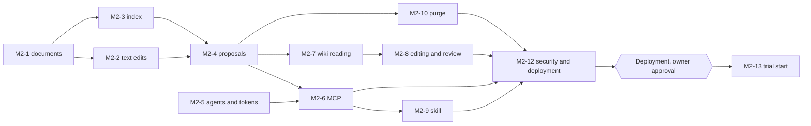

# Shinan: build plan for M2 (Catalog)

Status: **proposed**, for the owner's review
([issue #79](https://github.com/guneet-xyz/shinan/issues/79)).

This plan splits milestone M2 into work packages, in the same way and under
the same process as M1 ([build plan](build-plan.md), §4). It changes no
decision. Where the documents leave a choice open, it says what it proposes
and why; real choices for the owner are in [section 7](#7-questions-for-the-owner).

M1 is complete and deployed as v0.2.0 at `shinan.guneet.dev`. M2 builds on its
code: core's actors, scopes and single check path (`packages/core`), the
append-only events and security log, the job queue, the web app shell with
Tailwind CSS and shadcn/ui ([D-055](decisions/D-055-tailwind-and-shadcn.md)),
and the security baseline ([security checklist](security-checklist.md)).

## 1. What M2 delivers

The [roadmap](roadmap.md#33-build-milestones) defines M2 as: catalog
entities, facts with provenance, catalog proposals and catalog approval, the
wiki, the agent index, MCP read and propose, and the skill. Its screens are
the wiki, start here, catalog review and recent changes, and registering
agents with hand-made tokens until the plugin arrives in M4. M2 unlocks the
**catalog part of the trial** ([roadmap 4.3](roadmap.md#43-the-catalog-during-the-trial)).

In detail (**decided** where the cited document decides it; the split into
packages is **proposed**):

| Area            | M2 delivers                                                                                                                                                                                                                                                                                                                                                                   | Implements                                                                                                                                                                                                                                                                                                      |
| --------------- | ----------------------------------------------------------------------------------------------------------------------------------------------------------------------------------------------------------------------------------------------------------------------------------------------------------------------------------------------------------------------------- | --------------------------------------------------------------------------------------------------------------------------------------------------------------------------------------------------------------------------------------------------------------------------------------------------------------- |
| Catalog content | Entity documents (frontmatter and body), the eight built-in type schemas, custom types and extensions through type schema documents, facts grouped by fact check, the four fact states, fact identity and cardinality, relations with generated inverses, discrepancies, known unknowns and not-yet-recorded keys, freshness and recheck intervals, the start-here document   | [Catalog](catalog.md) §2 to §7, §11; [D-006](decisions/D-006-document-first-catalog.md), [D-007](decisions/D-007-fact-provenance.md), [D-025](decisions/D-025-fact-state-planned.md), [D-026](decisions/D-026-custom-entity-types.md)                                                                           |
| Changes         | Every change is a catalog proposal of operations, applied as text edits to the latest revision; validation (including the check for secret-looking values); per-operation conflict checks; gated catalog approval with the strict setting and bulk approval; self-approval of one's own agents' proposals; comments on proposals; withdraw; revert                            | [Catalog](catalog.md) §8; [D-024](decisions/D-024-gated-catalog-approval.md); [architecture §5.2, §5.3](architecture.md#52-the-invariant)                                                                                                                                                                       |
| History         | Catalog revisions (full Markdown text, PostgreSQL only), revision events on the entity timeline, retired entities kept readable, the round-trip test in CI and as a daily job                                                                                                                                                                                                 | [Catalog §9](catalog.md#9-history-and-purge); [architecture §5](architecture.md#5-catalog-markdown-and-agent-index); [D-022](decisions/D-022-catalog-storage-and-git-mirror.md), [D-043](decisions/D-043-no-git-mirror-for-now.md)                                                                              |
| Agent index     | The generated, rebuildable index; search (PostgreSQL full-text); every answer names its catalog revision and shows lag; the JSON format (catalog open question 7)                                                                                                                                                                                                             | [Catalog §12.1, §12.2](catalog.md#12-the-agent-index); [architecture §4.1, §5.3](architecture.md#53-how-sync-works)                                                                                                                                                                                             |
| Wiki            | Entity pages, freshness display, type indexes (built-in and custom, with their schema documents), workspace-wide lists, search, page history with revision comparison, start here for people and for agents (with "preview as agent"), Suggest a change, Record a check, catalog review (waiting for approval, recent changes with revert), catalog settings (strict setting) | [Human experience](human-experience.md#the-wiki): the wiki, start here and onboarding, workspace settings (Catalog settings); [catalog §10, §11](catalog.md#10-the-wiki)                                                                                                                                        |
| Agents          | Agents (person, coding tool, machine), one long-lived hashed token per agent with scopes (full or read-only), tokens made by hand after re-authentication, revocation (including on member removal, allowlist removal and "sign out everywhere"), token use recorded, security emails, per-token rate limits, Your agents and the workspace settings Agents screen            | [Identity §6, §7, §11](identity.md#6-agents); [D-031](decisions/D-031-agent-and-session-granularity.md), [D-035](decisions/D-035-tokens-security-log-purge.md), [D-050](decisions/D-050-agent-token-browser-approval.md) (hand-made fallback); [human experience, Your agents](human-experience.md#your-agents) |
| MCP             | The hosted MCP endpoint (`/mcp`, Streamable HTTP, protocol versions 2026-07-28 and 2025-11-25), token-only authentication, the catalog tools, trust labels on every text field, server instructions pointing to the skill, retry-safe writes                                                                                                                                  | [Agent integrations](agent-integrations.md#mcp-server-and-tools): design rules, trust labels, the Context and Catalog rows of the tool set, authentication requirements; [architecture §8.1](architecture.md#81-mcp-server)                                                                                     |
| Skill           | One `shinan` skill with its catalog conventions, served by the installation as an HTTP skill catalog; setup instructions for OpenCode with a hand-made token                                                                                                                                                                                                                  | [Agent integrations, the skill and conventions](agent-integrations.md#the-skill)                                                                                                                                                                                                                                |
| Trial           | A trial guide for the catalog part, the GitHub `trial` label for findings, configuration that enables Shinan for trial projects only, and the trial-start steps in [section 4](#4-starting-the-catalog-part-of-the-trial)                                                                                                                                                     | [Roadmap 4.3, 4.5](roadmap.md#43-the-catalog-during-the-trial)                                                                                                                                                                                                                                                  |

### What M2 does not deliver

| Not in M2                                                                                                             | When                                                                         | Reason                                                                                                                                                                                                                                                                                        |
| --------------------------------------------------------------------------------------------------------------------- | ---------------------------------------------------------------------------- | --------------------------------------------------------------------------------------------------------------------------------------------------------------------------------------------------------------------------------------------------------------------------------------------- |
| Tasks, related tasks on entity pages, `from-task` resolution, the workspace timeline screen, the readiness report     | M3                                                                           | [Roadmap 3.3](roadmap.md#33-build-milestones).                                                                                                                                                                                                                                                |
| Agent sessions, presence, the OpenCode plugin, the "start agent session" and "check in" tools                         | M4                                                                           | Roadmap 3.3. In M2 every MCP call is credited to the agent with no agent session, which the [glossary](domain-model.md#agent-session) allows; the written actor form names the agent anyway ([identity §8.7](identity.md#87-how-an-actor-is-written-in-text)).                                |
| Browser approval of agents (device flow with a short code)                                                            | **Proposed:** M4, with the plugin ([question 1](#7-questions-for-the-owner)) | Only the plugin or the CLI can start it, and neither exists in M2. Hand-made tokens are the decided fallback ([D-050](decisions/D-050-agent-token-browser-approval.md)).                                                                                                                      |
| The CLI, including its local MCP bridge                                                                               | **Proposed:** after M4, before G2                                            | On the cut line ([roadmap 3.2](roadmap.md#32-cut-line)). Every trial agent is OpenCode, which reaches a remote MCP server with a header.                                                                                                                                                      |
| Workspace export and import                                                                                           | Before G2                                                                    | On the cut line. The wiki's export link for owners waits for it.                                                                                                                                                                                                                              |
| The migration importer and the rollback converter                                                                     | Before the rehearsal (R14), before G2                                        | The trial copies only pointers ([O-71](roadmap.md#43-the-catalog-during-the-trial)); a bulk importer is not needed for it ([architecture §5.4](architecture.md#54-importing-the-workspace-repositorys-catalog), [catalog §13](catalog.md#13-mapping-from-the-workspace-repositorys-catalog)). |
| Automatic fact checks by Shinan                                                                                       | Phase 2a                                                                     | Cut line; they need git host connections (M3) anyway ([catalog §12.3](catalog.md#123-automatic-fact-checks-by-shinan)).                                                                                                                                                                       |
| Nudges and the `messages` field in MCP answers                                                                        | Phase 2 (field added when nudges or task notices exist)                      | [Agent integrations, design rule 4](agent-integrations.md#design-rules).                                                                                                                                                                                                                      |
| Git mirror, MCP-specific OAuth, MCP resources, agent signing keys, external link checking, body embeds of fact values | Later or not planned                                                         | [D-043](decisions/D-043-no-git-mirror-for-now.md), [D-050](decisions/D-050-agent-token-browser-approval.md); the defaults in [section 7.2](#72-defaults-for-open-questions-in-the-documents).                                                                                                 |
| Screens for a second member (contributor role in catalog screens, nudges from others)                                 | Before a second member joins                                                 | [Identity §13](identity.md#13-first-version-scope). Core still enforces the role rules, as M1 does.                                                                                                                                                                                           |

## 2. Code layout additions (proposed)

Same layout as M1 ([build plan §2](build-plan.md#2-code-layout-proposed)), with:

| Path                                       | What it holds                                                                                                                                                                                                                   |
| ------------------------------------------ | ------------------------------------------------------------------------------------------------------------------------------------------------------------------------------------------------------------------------------- |
| `packages/core/src/catalog/document/`      | The pure document model: parser, type schemas, facts, operations as text edits, validation. No database and no I/O, so it can be tested exhaustively and later reused by the importer, the export and the rollback converter.   |
| `packages/core/src/catalog/`               | Catalog operations with permissions: proposals, apply, approval, revert, purge, the indexer and index queries.                                                                                                                  |
| `packages/core/src/identity/agents.ts`     | Agents and tokens.                                                                                                                                                                                                              |
| `apps/server/src/mcp/`                     | The MCP endpoint and tool definitions. Tools only translate between MCP and core operations; no rule lives here.                                                                                                                |
| `packages/skill`                           | The skill's Markdown files and a build step that writes the HTTP catalog's `index.json` with a version that changes when the files change. `apps/server` serves the built files.                                                |
| `apps/web/src/pages/wiki/`, `.../catalog/` | Wiki, start here, catalog review and catalog settings screens. The Markdown renderer is loaded only on wiki routes (route-level splitting, as [PR #76](https://github.com/guneet-xyz/shinan/pull/76) suggests for bundle size). |

## 3. M2 work packages

Each package is one GitHub issue (labels `build` and a new `M2` label), one
build agent, one branch and worktree, and a pull request reviewed by a
reviewer agent against the documents it implements, as in M1. Every package
updates the documents its behaviour changes, and the
[security checklist](security-checklist.md) items it builds.

| #     | Package                                                                          | Implements                                                                                                                                           | Depends on                               |
| ----- | -------------------------------------------------------------------------------- | ---------------------------------------------------------------------------------------------------------------------------------------------------- | ---------------------------------------- |
| M2-1  | **Catalog documents: parser, type schemas, validation**                          | Catalog §2, §3, §4, §5, §7.3, §8.3, §11 (document shape)                                                                                             | M1                                       |
| M2-2  | **Operations as text edits, and conflict checks**                                | Catalog §4.2, §4.3, §8.1 (operations), §8.5; architecture §5.2 (rules 2 and 5)                                                                       | M2-1                                     |
| M2-3  | **Agent index and search**                                                       | Catalog §12.1, §12.2; architecture §4.1, §5.2 (rules 3 and 6), §5.3                                                                                  | M2-1                                     |
| M2-4  | **Catalog storage, proposals and approval**                                      | Catalog §8, §9 (without purge); architecture §5.2 (rule 4), §5.3, §7; identity §5.1 (catalog rows), §11 (catalog approvals)                          | M2-2, M2-3                               |
| M2-5  | **Agents and tokens**                                                            | Identity §6.1, §6.3, §7, §11 (agent rows), §10 (token throttling); human experience "Your agents" (hand-made tokens) and workspace settings "Agents" | M1                                       |
| M2-6  | **MCP server and catalog tools**                                                 | Agent integrations: MCP server and tools, trust labels, authentication requirements; architecture §8.1                                               | M2-4, M2-5                               |
| M2-7  | **Wiki: reading**                                                                | Human experience: an entity page, freshness, moving around the wiki, start here; catalog §10, §11                                                    | M2-4                                     |
| M2-8  | **Wiki: changing the catalog and catalog review**                                | Human experience: changing the catalog from the wiki, reviewing catalog changes, catalog settings; catalog §8.2, §8.6                                | M2-4; the page shell of M2-7             |
| M2-9  | **The skill and agent setup**                                                    | Agent integrations: the skill, conventions agents follow (catalog parts), authentication requirement 3                                               | Drafted with M2-6, finished after it     |
| M2-10 | **Catalog purge** ([question 4](#7-questions-for-the-owner))                     | Catalog §9 (purge); architecture §4.4; identity §11                                                                                                  | M2-4                                     |
| M2-11 | **Browser approval** (proposed for M4, [question 1](#7-questions-for-the-owner)) | Identity §6.2; architecture §8.1; human experience "Your agents" steps 2 to 5                                                                        | M2-5                                     |
| M2-12 | **Security review and deployment preparation**                                   | Security checklist (the M2 **Later** items); operator guide; architecture §11.6                                                                      | All packages that ship in M2             |
| M2-13 | **Trial start kit**                                                              | Roadmap 4.3, 4.5; agent integrations, the skill (O-38)                                                                                               | Drafting: none; steps: the M2 deployment |

### Order and parallel work

1. **First:** M2-1 and M2-5 in parallel. M2-13's documents can be drafted at
   any time.
2. **Then:** M2-2 and M2-3 in parallel, once M2-1 has merged the document
   model's types.
3. **Then:** M2-4, the integration point.
4. **Then, in parallel:** M2-6, M2-7, M2-10, and the first draft of M2-9.
   M2-8 starts once M2-7 has the entity page shell (the two agree the page
   structure in their issues).
5. **Last:** M2-12, then the release and the deployment request, then the
   trial-start steps.

The longest chain is M2-1 → M2-2 → M2-4 → M2-7 → M2-8. To keep it short, M2-1
merges the document model's types and parser first (one PR) and validation in
a second PR, so M2-2 and M2-3 can start earlier.

### 3.1 M2-1: Catalog documents: parser, type schemas, validation

- **Parser** for the limited YAML subset of [catalog §2.1](catalog.md#21-one-document-per-entity-and-what-source-of-truth-means):
  plain maps, lists, strings, numbers, booleans, dates and `null`; anchors,
  aliases, tags, multi-document files and duplicate keys refused. YAML 1.2
  core schema, so `no` stays a string and dates are checked by Shinan, not
  turned into time values by the library.
- **Body** split by heading into sections, keeping the exact source text of
  each, for section edits (M2-2) and section search (M2-3).
- **Entity fields** ([2.3](catalog.md#23-entity-fields)), IDs, aliases and
  references, including body links whose target is an entity ID
  ([2.4](catalog.md#24-ids-and-references)).
- **Facts:** groups by fact check, short and long forms, states, `via`,
  `note`, `task`, `remove`, `unknown` lists ([4.3](catalog.md#43-how-facts-are-written));
  fact identity and current facts ([4.2](catalog.md#42-fact-identity-cardinality-and-current-facts));
  discrepancies ([4.7](catalog.md#47-discrepancies)); known unknowns and
  not-yet-recorded keys ([4.8](catalog.md#48-unknowns)); freshness computed
  when read ([4.6](catalog.md#46-freshness)).
- **Each fact gets a stable identity key** computed from its identity (for
  example `disk.data.size|observed|filesystem`). **Proposed.** Reason: agents
  and the web editor then name the fact an operation replaces or removes
  without rebuilding the identity rules themselves; it is derived, never
  stored in the text.
- **The eight built-in type schemas** with keys, cardinality, relations and
  inverses ([section 3](catalog.md#3-entity-types), [§5](catalog.md#5-relations)),
  and **proposed recheck intervals** for their keys (catalog open question 2),
  listed in the PR for review.
- **Type schema documents** for custom types and extensions of built-in types
  ([3.9](catalog.md#39-custom-types-and-type-schema-documents)): the key
  options, reserved names, and "extend, never change" for built-ins.
- **The start-here document** shape: two ordered paths of entity references
  with a sentence each ([§11](catalog.md#11-start-here)).
- **Validation** on the resulting document set: every blocking and warning
  rule of [8.3](catalog.md#83-validation), including the check for
  secret-looking values ([7.3](catalog.md#73-a-check-for-secret-looking-values))
  with Shinan's own token prefix from M2-5, and the start-here warnings.
- **Tests:** the examples in the catalog document (Dockyard, Musashi, the
  `domain` schema) as fixtures; property tests that random valid documents
  parse and validate; a table test per validation rule.

### 3.2 M2-2: Operations as text edits, and conflict checks

- Every operation of [8.1](catalog.md#81-catalog-proposals): create entity;
  set a fact (replace or add beside); remove a fact; recheck facts; edit the
  whole body or one section; change an entity field; retire; change ID (old
  ID to `aliases`); create or change a type schema document; change the
  start-here document.
- **Applied as text edits** ([architecture §5.2](architecture.md#52-the-invariant),
  rule 2): only the bytes an operation targets change. New content (a new
  fact check group, a new fact, a new entity) is written in one canonical
  style; existing text keeps its style. A recheck moves a fact to its new
  group; a new check merges into an existing group only when every field
  matches; groups left empty are dropped ([4.3](catalog.md#43-how-facts-are-written)).
- **`by` is never sent by the caller.** The operation's applier writes the
  actor's written form from the request ([identity §8.7](identity.md#87-how-an-actor-is-written-in-text)).
- **Expectations and conflicts** ([8.5](catalog.md#85-conflicts)): each
  operation states what it expects (the fact's identity key, value and fact
  check, or "absent"); operations whose expectations hold apply even if other
  parts of the entity changed.
- **Multi-entity proposals** apply all or nothing, in an order that lets a
  proposal create a type schema and entities of that type together.
- **Round-trip tests** (rule 5): text → parse → apply no operations → text is
  byte-for-byte unchanged; for each operation, parse(apply(text, op)) equals
  the expected model and every untouched byte is unchanged; random sequences
  of operations on the fixtures.

### 3.3 M2-3: Agent index and search

- Derived tables built **only** from a revision's stored text (rule 3), each
  row recording the parser version: entities, aliases, facts with their
  checks, relations in both directions (written and generated), discrepancies,
  unknowns, applicable policies and runbooks (through `applies-to`, including
  ones that apply to a type or the whole workspace), body sections, search
  text.
- **Query operations** for [12.2](catalog.md#122-rules): get an entity by ID
  or alias; list by type and status; get a type schema; text search across
  titles, summaries, facts and body sections (PostgreSQL full-text,
  [architecture §4.1](architecture.md#41-postgresql-holds-everything));
  neighbours through relations; policies and runbooks for an entity; the
  workspace lists (discrepancies, due for recheck, known unknowns); changes
  since a given catalog revision; the agents' start-here path.
- **The JSON format** of an entity and of each list (catalog open question 7),
  using the documents' field names, with the catalog revision and an "index
  behind" flag on every answer. Written down in the catalog document by this
  package.
- **Rebuild:** a worker job rebuilds a workspace's index from the latest
  revisions when the parser version changes or on demand; while it runs,
  answers say the index is behind. A daily job checks text → parse → index
  equals the stored index and reports differences in the log and as installation
  health (architecture §5.2 rule 5).
- **Tests:** index from text equals stored index; rebuild after deleting all
  derived rows gives the same rows.

### 3.4 M2-4: Catalog storage, proposals and approval

- **Tables:** catalog documents (current revision per document), catalog
  revisions (full text, author and attribution, approver, catalog proposal,
  based-on revision, time), catalog proposals (author, explanation, related
  task ID as text until M3, operations, inline fact checks, validation
  results, approval class, state `pending`/`applied`/`rejected`/`withdrawn`,
  idempotency key), proposal comments.
- **Apply in one transaction** (rule 4): new text, index rows (M2-3), conflict
  check, secret check, revision, event. Nothing else writes the index (rule 6).
- **Approval classes** of [8.2](catalog.md#82-when-catalog-approval-is-needed),
  the **strict setting** with bulk approval, a person's own edit applied at once
  when they may approve it, and self-approval of one's own agents' proposals
  while one person uses Shinan ([D-024](decisions/D-024-gated-catalog-approval.md), O-46).
- **Withdraw, reject with a reason, comment** (agents with `catalog:propose`;
  only people approve, [identity §6.3](identity.md#63-what-an-agent-may-do)).
- **Recent changes and revert:** a revert is a new proposal restoring the
  earlier values.
- **Events and security log:** each revision is an event credited to its
  author (and approver); catalog approvals go to the security log
  ([identity §11](identity.md#11-audit)); refused agent attempts to approve are
  recorded.
- **Permissions in core:** new rules in `permissions.ts` for reading,
  proposing, commenting, approving and changing the strict setting.
- **Planned facts and tasks (proposed):** until tasks exist (M3), a `planned`
  fact may name an accepted `decision` entity, or a task ID that is checked
  only for its format; M3 adds the check that the task exists and reports any
  that do not. Reason: the trial catalog may need `planned` facts before M3,
  and an unresolvable reference must not block it.
- **Tests:** the D-006 invariant end to end (delete all derived data and
  rebuild gives the same index; stored text is never rendered from rows);
  concurrent proposals on different facts of one entity both apply; each
  approval class; idempotent retries.

### 3.5 M2-5: Agents and tokens

- **Agents table** (person, workspace, membership row, coding tool, machine,
  handle `<coding tool>-<machine>`, optional link to a `machine` entity,
  enabled), the foreign key on `events.actor_agent_id`, and `AgentActor` built
  from the token. Core checks the agent's own membership row, not only its
  person's current membership (note in [PR #61](https://github.com/guneet-xyz/shinan/pull/61)).
- **Tokens:** one per agent, a recognisable prefix, only a SHA-256 hash
  stored, shown once, scopes ([identity §7.2](identity.md#72-scopes)): full
  (all five scopes; `tasks:*` and `presence` have no effect until M3 and M4) or
  read-only. Issuing a new token revokes the previous one. The token records
  the installation, and other installations reject it ([7.4](identity.md#74-handling)).
- **Made by hand** in Your agents after re-authentication: the person picks
  coding tool and machine, chooses full or read-only, and sees the token once.
- **Authentication seam** for agent endpoints: `Authorization: Bearer` only;
  never a query string; never a cookie. Requests with a token and no cookie
  are exempt from the same-origin check; requests with both are refused.
  Uniform errors; failed token use throttled per network address and recorded.
  Per-token rate limits in core's `rateLimits`.
- **Revocation and disabling** ([7.5](identity.md#75-revocation)): by the
  member or a workspace owner; automatically on member removal and leaving,
  allowlist removal, and optionally in "sign out everywhere" (comments mark
  the spots, [PR #65](https://github.com/guneet-xyz/shinan/pull/65)).
- **Security log and email:** agents created, renamed, disabled; tokens
  issued and revoked (and why); each token's first and last use, network
  address and request count (summarised, not per request); the security email
  for a new token (`sendSecurityAlert`, kind `agent-token-approved`).
- **Screens:** Your agents (list, last use shown prominently, unused for 30
  days marked, create by hand, rename, disable, revoke); workspace settings
  Agents (all agents, disable, revoke); the Members row gains the member's
  agents.
- **Checklist items:** 3.8, 4.8, 5.7, 10.7 (with M2-6).

### 3.6 M2-6: MCP server and catalog tools

- **Endpoint** `/mcp` over Streamable HTTP with the official TypeScript SDK,
  stateless, supporting protocol versions 2026-07-28 and 2025-11-25
  ([architecture §8.1](architecture.md#81-mcp-server)); `Origin` validated;
  `MCP-Protocol-Version`, `Mcp-Method` and `Mcp-Name` checked against the
  body; token from M2-5 only.
- **Tools** (names illustrative, fixed in the PR; [tool set](agent-integrations.md#tool-set)):

  | Tool                          | Scope             | What it does                                                                                                                                                         |
  | ----------------------------- | ----------------- | -------------------------------------------------------------------------------------------------------------------------------------------------------------------- |
  | `workspace_context`           | any `read`        | The agent, its member, the workspace, what the agent may do, the latest catalog revision and the agents' start-here path. Task prefix and flags join in M3.          |
  | `search_catalog`              | `catalog:read`    | Text, type, status and relation search, with fact freshness.                                                                                                         |
  | `get_entity`                  | `catalog:read`    | One entity in the M2-3 format, optionally with its type schema.                                                                                                      |
  | `catalog_lists`               | `catalog:read`    | Discrepancies, due for recheck, known unknowns, type schemas, changes since a revision.                                                                              |
  | `propose_catalog_change`      | `catalog:propose` | Operations with expectations, inline fact checks, explanation, optional related task ID, idempotency key. Returns whether it applied or waits for approval, and why. |
  | `record_fact_check`           | `catalog:propose` | A recheck with scope, source and limits, value unchanged.                                                                                                            |
  | `get_catalog_proposal`        | `catalog:read`    | A proposal with its operations, state, validation results and comments.                                                                                              |
  | `withdraw_catalog_proposal`   | `catalog:propose` | Withdraws the agent's own pending proposal.                                                                                                                          |
  | `comment_on_catalog_proposal` | `catalog:propose` | Adds a comment, for example review findings.                                                                                                                         |

- **Trust labels** ([trust labels](agent-integrations.md#trust-labels)) on
  every text field: `author_kind`, `author` and `instruction`. All catalog
  text is `instruction: no`. The author of each fact is its fact check's
  actor; the author of each body section is the actor of the revision that
  last changed it, derived from history by the indexer (M2-3). Labels come
  from Shinan's records, never from the text.
- **Server instructions:** a short version of the conventions and a pointer
  to the skill ([design rule 7](agent-integrations.md#design-rules)).
- **Writes are retry-safe** (design rule 3) through the idempotency key.
- **Security log:** agent index bulk reads (for example `catalog_lists` over
  the whole catalog) recorded as bulk reads; refusals recorded.
- **Checklist items:** 10.4 (trust labels part), 10.5, 10.7.
- **Tests:** an MCP client session against a test server for each tool and
  both protocol versions; a cookie-only request refused; a foreign `Origin`
  refused; a read-only token refused on writes; trust labels present on every
  text field (a test walks every answer).

### 3.7 M2-7: Wiki: reading

- **REST routes and `api-client` methods** for the M2-3 queries and history.
- **Entity page** in the order of [human experience](human-experience.md#an-entity-page),
  without the Tasks section (M3): pending proposals, discrepancies, owning
  sources, freshness summary, facts with state labels and age, body, links in
  both directions, history with any earlier revision opened and compared.
- **Navigation:** wiki home with Start here, type indexes (with the schema
  document, custom types included), workspace-wide lists, search, retired
  entities excluded from default search, old IDs leading to the current page.
  `/w/:id` opens the wiki until the Now screen exists (M3).
- **Start here:** the people's path as numbered steps; the agents' path with
  "preview as agent" and its total size with a warning. **Proposed:** "opened"
  and "changed since you opened it" markers are kept per person in a small
  table; they are not catalog content.
- **Markdown rendering under the Content Security Policy:** rendered in the
  browser into React elements, with raw HTML not rendered; links limited to
  `http`, `https`, `mailto` and entity references (rewritten to wiki routes);
  images shown as links, because `img-src 'self'` blocks outside images and
  catalog images are not stored; no inline styles; no syntax highlighting in
  M2. `csp.test.ts` gains a test with hostile Markdown (script, `javascript:`
  links, HTML, style attributes). **Checklist item:** 10.3.

### 3.8 M2-8: Wiki: changing the catalog and catalog review

- **Suggest a change:** forms for entity fields and facts, and the body as
  Markdown text with a preview, producing the same operations agents send.
  Before saving, the screen shows whether the change applies at once or waits
  for approval, and the validation results. **Proposed:** no raw editing of
  the frontmatter in M2. Reason: operations stay precise and reviewable; the
  raw document is still visible read-only on the history view.
- **Record a check,** which cannot be saved without scope and source.
- **New entity** and **New type** (a type schema document proposal).
- **Catalog review:** waiting for approval (before and after per fact, body
  changes, evidence, author with attribution, "from your agent", agents'
  comments; Approve, Reject with a reason, Comment; bulk approval when strict);
  recent changes feed with Revert.
- **Catalog settings** in workspace settings: the strict setting.
- **Start here** editing (gated) from its page.

### 3.9 M2-9: The skill and agent setup

- `packages/skill`: `SKILL.md` (short) and supporting files: reading
  catalog entities and their freshness before relying on them; rechecking
  volatile or consequential facts before acting; proposing changes with
  evidence and a narrow scope (the documentation-impact obligation,
  [catalog §8.4](catalog.md#84-agents-documentation-impact-obligation));
  provenance rules (copying is not checking; `unknown` over guesses); secrets
  never sent, only where they live; trust labels, in the wording of
  [agent integrations](agent-integrations.md#trust-labels); falling back to
  the `workspace` repository if Shinan is down. Task, presence and nudge
  conventions are added in M3 and M4.
- **Served** as an HTTP skill catalog at `/skills/` with `index.json`, whose
  `version` changes when the files change ([OpenCode skills](https://opencode.ai/docs/skills),
  checked 2026-11-17). OpenCode's HTTP catalogs send no credentials, so
  serving it needs a public path ([question 2](#7-questions-for-the-owner)).
- **Setup guide** for OpenCode with a hand-made token: the MCP entry
  (`type: remote`, `oauth: false`, the `Authorization` header read from a file
  or an environment variable, never written into a project file), the skill
  catalog URL, and how to check the connection. Linked from Your agents.

### 3.10 M2-10: Catalog purge

Only if the owner wants it in M2 ([question 4](#7-questions-for-the-owner)).
A workspace owner, after re-authentication, purges content from catalog
revisions, proposals and comments: the content is replaced by a marker, the
record keeps its shape, the purge is an event and a security-log entry, and
the index is rebuilt in the same transaction. The screen warns that model
providers and earlier copies may still hold the content and that the secret
must be rotated at its source ([catalog §9](catalog.md#9-history-and-purge),
[architecture §4.4](architecture.md#44-purge)). It narrows the `events`
triggers in a migration and never touches the `security_log` ones (note in
[PR #61](https://github.com/guneet-xyz/shinan/pull/61)).

### 3.11 M2-11: Browser approval

Proposed for M4 ([question 1](#7-questions-for-the-owner)). If built in M2:
the device-style flow of [identity §6.2](identity.md#62-registering-an-agent)
(link and short code, sign-in and re-authentication, choose or create the
agent, full or read-only, approve), its throttling and expiry, the approval
page, and "waiting for first contact".

### 3.12 M2-12: Security review and deployment preparation

- Run the whole [security checklist](security-checklist.md) again; the M2
  items (3.8, 4.8, 5.7, 10.3, 10.4 for trust labels, 10.5, 10.7, and 10.6 if
  export were built) move from **Later** to **Pass**.
- Request size limits: the API's 64 KB limit stays; catalog proposal routes
  and `/mcp` get their own, larger limit (proposed: 512 KB), applied before the
  body is read.
- Operator guide: the MCP endpoint, agent tokens, the skill path, the daily
  round-trip job and how to read its result.
- The deployment request in `infra/musashi` (image pin), with pre-checks and
  rollback. **Expected:** no DNS, Caddy route or network change, because `/mcp`
  and `/skills/` are paths on the same host; the request confirms this from
  the Caddyfile and that streamed answers are not buffered.

### 3.13 M2-13: Trial start kit

- `docs/trial.md` (**proposed** new document; the [roadmap](roadmap.md#4-proof-of-concept)
  stays the owner of the rules): the trial entities, how to seed them by
  checking owning sources (section 4), the weekly comparison between the
  `workspace` repository and the trial catalog (O-72) as an agent procedure,
  and how trial findings are filed.
- The GitHub `trial` label for findings ([roadmap 4.4](roadmap.md#44-tasks-during-the-trial)).
- The configuration that enables the MCP server and skill for trial projects
  only (O-38; [question 3](#7-questions-for-the-owner)).
- A draft of the trial note for the `workspace` repository (section 4, step 6).

## 4. Starting the catalog part of the trial

After the owner approves the M2 deployment and it is verified:

1. **Agents.** The owner creates a hand-made token for each machine used in
   the trial (proposed: OpenCode on Daedalus only, [question 5](#7-questions-for-the-owner))
   and places it on the machine. Agents never see, copy or relay it.
2. **Trial configuration.** Pull requests enable the MCP server and skill in
   the three trial projects (M2-13).
3. **First documents.** `person/guneet` (the entity owner of everything) and
   the start-here document, both gated: the owner writes them or approves an
   agent's proposal. The agents' path links to the `workspace` repository's
   policies by URL, because policies stay there during the trial (D-018).
4. **Seeding.** One task-scoped agent session per entity group creates the
   trial entities listed in [roadmap 4.3](roadmap.md#43-the-catalog-during-the-trial)
   through MCP: `project/shinan`, `project/mon`, `project/easyshell`;
   `machine/musashi`, `machine/anzen`, `machine/daedalus`; `service/ingress`,
   `service/container-registry`, `service/cloudflare-dns`, `service/obscuro`,
   `service/email`, `service/forgejo`, `service/monitoring`. Rules
   ([O-71](roadmap.md#43-the-catalog-during-the-trial), catalog §13):
   - each `workspace` repository entry is a map, not a source: facts are
     checked at their owning sources and recorded with real check times;
   - only pure pointers (repository URLs, IDs) are copied, with the entry at
     its Git revision as the source and the provenance rules of
     [catalog §13.1](catalog.md#131-provenance-of-imported-facts): the
     entry's check date only where its verification scope covers the pointer,
     otherwise `checked: null`. Checking a pointer at its source (for example
     opening the repository) makes it an ordinary `observed` fact instead;
   - a fact that cannot be checked within the agent's existing access is
     `unknown`; seeding never widens access (P6), so no new SSH or scanning;
   - no secrets; `secrets-in` records only where a secret lives;
   - trial entities are not imports, so they carry no `imported_from`.
5. **Owner check.** The owner reads the start-here path and a few entities in
   the wiki (part of the M2 milestone review).
6. **Trial note.** A `workspace` repository pull request, through that
   repository's own workflow (a Forgejo issue, its own branch and review), adds
   the catalog part of the trial note ([roadmap 4.5](roadmap.md#45-agents-in-the-trial)):
   for trial projects, connect to Shinan; make a catalog proposal whenever a
   trial entity is updated in the `workspace` repository; fall back to the
   `workspace` repository if Shinan is down. The task and plugin parts are
   added at M3 and M4. This is a separate change in that repository, not part
   of any Shinan PR.
7. **From then on:** agents keep both in step (O-72), the weekly comparison
   runs, and evidence for R5, R6 and R7 starts to accumulate
   ([roadmap 5](roadmap.md#5-readiness-criteria)).

## 5. Risks and the hardest design points

| Risk or design point                                                                                                                                                                                                                                                                          | Mitigation                                                                                                                                                                                                                                                                                                                             |
| --------------------------------------------------------------------------------------------------------------------------------------------------------------------------------------------------------------------------------------------------------------------------------------------- | -------------------------------------------------------------------------------------------------------------------------------------------------------------------------------------------------------------------------------------------------------------------------------------------------------------------------------------- |
| **The Markdown-as-source-of-truth invariant with text edits** (D-006, architecture §5.2). YAML libraries reformat on output; a naive "parse, change, print" would rewrite bytes the operation did not target, or slowly make rows the real source.                                            | Edits on the parsed document's source ranges (for example the `yaml` package's CST or document nodes) with canonical output only for new content; the round-trip tests and property tests of M2-2; the daily round-trip job on real data; the pure document model in its own folder so the rule is reviewed in one place.              |
| **Fact identity and cardinality.** Two endpoints or two checkouts must not look like a discrepancy; a recheck must replace, not duplicate; a key outside the schema, a `via`, and a schema change from many to one all change identity.                                                       | Identity computed only by M2-1 and exposed as an identity key; operations name it with an expectation; validation blocks two current facts with one identity; schema changes that would break current entities are blocked and list them.                                                                                              |
| **Custom entity types.** Validation and indexing depend on schema documents that are themselves catalog content and change through proposals; a schema change can change freshness and discrepancies for every entity of the type.                                                            | One parser reads schemas and entities from the same revision; a schema change in a proposal is validated against every current entity of the type; changing a schema re-indexes that type's entities in the same transaction; built-ins can be extended, never changed.                                                                |
| **MCP authentication.** A public endpoint with long-lived tokens (O-44, O-45); MCP clients send no cookies, browsers do.                                                                                                                                                                      | Token only in the `Authorization` header; cookies refused at `/mcp`; `Origin` validated; per-token rate limits; token use recorded; instant revocation checked on every request; the SDK's support for both protocol versions confirmed at the start of M2-6, with a fallback of handling the 2026-07-28 headers in Shinan's own code. |
| **Trust labels and prompt injection.** Catalog text is written by agents that may have read outside text; the author of a body is spread over many revisions.                                                                                                                                 | All catalog text is `instruction: no`; per-section and per-fact authors derived from history; a test that walks every MCP answer for missing labels; the skill wording from agent integrations.                                                                                                                                        |
| **Content Security Policy with the wiki's Markdown.** Rendering Markdown to HTML usually means raw HTML, inline styles or `innerHTML`.                                                                                                                                                        | Rendering into React elements with raw HTML off, a URL allow-list, no images from elsewhere, no highlighting in M2; hostile-Markdown tests; checking every new screen in a browser under the real headers, as in M1-8.                                                                                                                 |
| **The token on the agent's machine.** A token in an environment variable or file is readable by the agent's own shell commands, so "never in the model's sight" ([authentication requirement 3](agent-integrations.md#authentication-requirements)) holds only while the agent does not look. | The skill forbids reading or printing it; the setup guide stores it in a `0600` file read by the MCP configuration; revocation is instant and the security email shows new tokens. The plugin (M4) moves it to the machine's credential store where possible.                                                                          |
| **Secrets slipping into the catalog** during seeding.                                                                                                                                                                                                                                         | The secret check blocks near-certain credentials and holds weaker matches for approval; seeding rules forbid values; purge (M2-10) if the owner wants it before the trial. A leak is a pause condition (RM-10).                                                                                                                        |
| **M2 is the largest milestone.**                                                                                                                                                                                                                                                              | The pure document model first, so most rules are tested without a database or a browser; browser approval and the CLI out of M2; purge optional; the owner's review at the end of M2 checks scope against the cut line.                                                                                                                |
| **Seeding cost and double maintenance** (roadmap risks).                                                                                                                                                                                                                                      | Small trial catalog (O-71); one agent session per entity group; owner approvals limited to the person entity and the start-here document.                                                                                                                                                                                              |
| **Attribution without agent sessions.** M2 credits agents, not agent sessions.                                                                                                                                                                                                                | Accepted for M2; the written form already names only the agent. M4 adds agent sessions, matched as O-29 decides.                                                                                                                                                                                                                       |

## 6. Owner actions and approvals for M2

People type secrets; agents never handle them. Agents prepare every step.

1. **Approve this plan** and answer [section 7](#7-questions-for-the-owner).
2. **Release:** merge the release-please PR for the M2 version (proposed
   v0.3.0). Merging is the approval to release; it does not deploy.
3. **Approve the M2 deployment** to Musashi ([D-039](decisions/D-039-deploy-as-needed.md)):
   the image pin in `infra/musashi`. New database migrations run with it. No
   DNS, route, network or new server credential is expected; the request says
   so explicitly or lists what changed.
4. **Create the agent token(s) by hand** in Your agents, after signing in
   again, and place each on its machine as the setup guide says. No new
   server-side credential is needed in M2.
5. **Catalog approvals** for the first gated documents: `person/guneet` and
   the start-here document (minutes).
6. **Review the trial note** in the `workspace` repository (recommended,
   because it changes what agents do; merging it needs no deployment
   approval).
7. **M2 milestone review:** a short demo note, what was built against the
   roadmap, anything cut, and decisions that came up, as for M1.

## 7. Questions for the owner

### 7.1 Choices

1. **Browser approval in M2 or in M4?**
   **Recommendation: M4,** built with the plugin. In M2 the only clients are
   hand-configured OpenCode installs, which nothing can start an approval
   from (the CLI is on the cut line), and the roadmap already plans
   hand-made tokens until M4. Building it in M2 means a flow with no caller
   to test it end to end.
2. **May the skill be served on a public path?** OpenCode loads HTTP skill
   catalogs without credentials, and [identity §10](identity.md#10-protections-for-a-public-installation)
   allows nothing without sign-in except sign-in, invitation and health
   pages. **Recommendation: yes,** at `/skills/`. It holds only product
   conventions, the same for every workspace and like the web app's own
   JavaScript files, which are already public; workspace rules reach agents
   only through the authenticated agents' start-here path. The M2-9 PR
   updates identity §10 and the security checklist to list it. The other
   option is copying the skill to each machine by hand, which is how the
   `workspace` skills drift today.
3. **How are the MCP server and skill enabled for trial projects only
   (O-38)?** **Recommendation:** a committed project `opencode.json` in each
   trial repository (`guneet-xyz/shinan`, `guneet-xyz/mon`,
   `guneet-xyz/easyshell`) that adds the MCP server and the skill catalog,
   with the token read from a file on the machine. It travels with every task
   worktree. mon and easyshell are public, so this publishes only the
   address `shinan.guneet.dev` (already public in DNS) and that they use
   Shinan, never a token. The alternative, machine-local configuration, has
   to be recreated in every new worktree.
4. **Catalog purge in M2?** **Recommendation: yes** (M2-10, catalog content
   only). Agents fill the trial catalog, a leaked secret is a pause condition,
   and without purge the only way to remove one would be a hand edit in the
   production database, which breaks "revisions are not edited" without a
   record. Purge of other content follows with the features that hold it.
5. **Which agents at trial start?** **Recommendation:** OpenCode on Daedalus
   only, where trial agent sessions run ([roadmap 4.2](roadmap.md#42-trial-projects));
   other machines get an agent when they are used for trial work.

### 7.2 Defaults for open questions in the documents

M2 has to settle these to build. Each default is **proposed** and can be
changed later without changing stored catalog text; the owner may override
any of them.

| Open question                                                                       | Proposed default for M2                          |
| ----------------------------------------------------------------------------------- | ------------------------------------------------ |
| Body embeds of fact values (catalog 1)                                              | Not supported. Raw Markdown stays readable.      |
| Recheck intervals for built-in keys (catalog 2)                                     | Proposed per key in the M2-1 PR, reviewed there. |
| Flagging gaps between intended and observed values of multi-valued keys (catalog 3) | Not flagged.                                     |
| Shinan enforcing `policy` entities beyond its own settings (catalog 4)              | No.                                              |
| External link checking (catalog 5)                                                  | Not built.                                       |
| More than one start-here path (catalog 6)                                           | One per workspace.                               |
| Agent index JSON schema (catalog 7)                                                 | Written by M2-3 into the catalog document.       |
| The agent index as MCP resources (agent integrations 5)                             | Not offered; tools only.                         |

## 8. What this plan does not do

- No code is written for M2 until the owner approves this plan.
- No deployment, DNS change or credential is created by agents.
- The `workspace` repository's trial note is a separate change in that
  repository.
