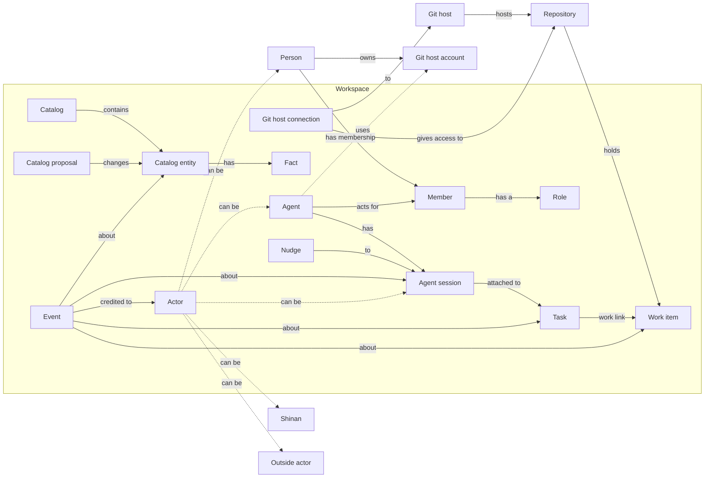

# Domain model and glossary

Status: **draft for review** ([issue #3](https://github.com/guneet-xyz/shinan/issues/3)).

This document defines the words Shinan's documents use and the core objects
behind them. Every other document uses these terms exactly. It stays
conceptual: it says what each thing is and how things relate, not how they are
stored, which API exposes them or which technology builds them. The owning
documents decide those details.

## How to read this document

Each main term has:

- **Definition:** what it is, in plain words.
- **Attributes:** the key information it carries. This is not a schema.
- **Relationships:** how it connects to other terms.
- **Owner:** the document that owns the details.
- **Status:** one of
  - **Decided**: follows from an accepted decision or from approved plan
    content (pillars, integration points, phases, non-goals) in the
    [plan](plan.md), which is cited and gives the reason.
  - **Proposed**: suggested here, with a reason. The owning document confirms
    or changes it. Items that would change or reinterpret the plan are also
    listed under [decisions needed from the owner](#decisions-needed-from-the-owner).
  - **Open**: not settled. Listed under [open questions](#open-questions).

When an owning document changes a proposed term, it updates this glossary in the
same pull request (proposed; reason: one vocabulary only works if it has one
home). Some "decided" items rest on plan pillars rather than numbered
decisions; the [Decision log](https://github.com/guneet-xyz/shinan/issues/13)
may need records for them so later documents have something to link to.

### Owning documents

None of these exist yet. Until they do, links go to their issues.

| Document | Issue |
|---|---|
| Product overview | [#4](https://github.com/guneet-xyz/shinan/issues/4) |
| Catalog | [#5](https://github.com/guneet-xyz/shinan/issues/5) |
| Tasks and work | [#6](https://github.com/guneet-xyz/shinan/issues/6) |
| Identity, agents and permissions | [#7](https://github.com/guneet-xyz/shinan/issues/7) |
| Git host integrations | [#8](https://github.com/guneet-xyz/shinan/issues/8) |
| Agent integrations | [#9](https://github.com/guneet-xyz/shinan/issues/9) |
| Human experience | [#10](https://github.com/guneet-xyz/shinan/issues/10) |
| Architecture and operations | [#11](https://github.com/guneet-xyz/shinan/issues/11) |
| Roadmap and migration | [#12](https://github.com/guneet-xyz/shinan/issues/12) |
| Decision log | [#13](https://github.com/guneet-xyz/shinan/issues/13) |

## Two meanings of "workspace"

Shinan grew out of an existing Git repository named `workspace`, which holds a
hand-made catalog and cross-project coordination practices. Shinan also has an
object called a workspace. They must never be confused.

| Write | Meaning |
|---|---|
| **workspace** (plain word, any capitalization) | A Shinan workspace, as defined [below](#workspace). "Workspace" at the start of a sentence is still the Shinan object. |
| **Shinan workspace** | The same. Use it where both meanings appear in one passage, such as migration plans. |
| **the `workspace` repository** | The existing Git repository. Always use code formatting and the word "repository". |
| **the `workspace` repository's catalog** | The Markdown catalog inside that repository. Never "the workspace catalog". |
| **a checkout of the `workspace` repository** | A local copy such as `~/workspace`. |
| **issues in the `workspace` repository** | Its coordination issues. Never "workspace issues". |
| **the `workspace` `project` entity** | After migration, the catalog entity that describes the `workspace` repository as a project. |
| **a workspace's catalog** | The catalog inside a Shinan workspace. |

Also avoid "workspace" for a local folder, a checkout or an editor window, even
though many coding tools use the word that way. Say [checkout](#supporting-terms)
or folder.

Status: **Proposed**. Reason: the plan requires the distinction, and the
`workspace` repository stays the source of truth until migration (D-018), so
both will be discussed side by side for a long time.

## Overview

A workspace is the boundary around a team's records. It has members (people)
and agents that act for those members. It holds a catalog of entities whose
facts carry their state, source and last-checked time, and it holds tasks whose
work happens on git hosts and is attached through work links. Everything that
happens becomes an event credited to an actor, and events are shown as
timelines.

Status: summary only; statuses are given in each section.

## Workspace and people

### Shinan installation

- **Definition:** one running copy of Shinan, such as `shinan.guneet.dev` or a
  self-hosted copy. It can hold many workspaces.
- **Attributes:** address, operator, settings that apply to every workspace.
- **Relationships:** contains workspaces and the people who can sign in to it.
- **Owner:** Architecture and operations.
- **Status:** **Proposed** term. Reason: Shinan is self-hostable (D-012), so
  documents need a word for "this copy of Shinan" that is not "workspace".

### Workspace

- **Definition:** the container for one team's records in Shinan: its catalog,
  tasks, git host connections, members and agents. People are invited to it.
- **Attributes:** name, task ID prefix, members, invitations, agents, catalog,
  tasks, git host connections, workspace settings (for example which catalog
  proposals need approval).
- **Belongs to one workspace:** member, invitation, agent (with its tokens and
  agent sessions), task, work link, comment, nudge, catalog, catalog entity,
  fact, catalog proposal, git host connection, event.
- **Outside any one workspace:** Shinan installation, person, git host account,
  git host, repository, work item, coding tool. A workspace refers to these; it
  does not own them.
- **Owner:** Identity, agents and permissions (membership and access); Human
  experience (management screens).
- **Status:** **Decided** that workspaces exist and use invitations (D-019:
  adding multi-user support later would mean reworking data, permissions and
  sign-in). **Proposed:** nothing is shared between workspaces except the
  person (their sign-in and linked git host accounts). Reason: a workspace
  holds infrastructure details (D-015), so a single hard boundary is the
  simplest one to keep safe. Whether one repository can be connected to more
  than one workspace is **open**.

### Person

- **Definition:** a human who can sign in to a Shinan installation.
- **Attributes:** name, sign-in identity, linked git host accounts,
  memberships.
- **Relationships:** has a membership in zero or more workspaces; agents act
  for a person through their membership; a `person` catalog entity can describe
  them (see [catalog entity](#catalog-entity)).
- **Owner:** Identity, agents and permissions.
- **Status:** **Proposed**. Reason: separating the human from their membership
  lets one person belong to several workspaces with different roles.

### Member and role

- **Definition:** a member is a person's membership in one workspace. The role
  says what the member may do there.
- **Attributes:** person, workspace, role, date joined, who invited them.
- **Roles (high level):**
  - **Workspace owner:** everything a contributor can do, plus managing
    members, roles, git host connections, workspace settings, and deleting the
    workspace. A workspace has at least one and may have several.
  - **Contributor:** works on tasks, comments, nudges, makes and approves
    catalog proposals where allowed.
  - **Viewer:** reads the catalog, tasks and timelines.
  - Every role may register agents. An agent can never do more than its
    member, so a viewer's agent is read-only.
- **Relationships:** links a person to a workspace; agents act for a member.
- **Owner:** Identity, agents and permissions.
- **Status:** **Decided** that members exist (D-019). **Proposed** role set.
  Reasons: three roles cover one owner today and small teams later without a
  full permission system; several workspace owners avoid lock-out; read-only
  agents still help agents that only need context. Finer rules, such as access
  to private repositories, are **open** (plan question 3).

### Invitation

- **Definition:** an offer for a person to join a workspace with a given role.
- **Attributes:** workspace, role, who invited, invitee address, state
  (`pending`, `accepted`, `declined`, `expired`, `withdrawn`).
- **Owner:** Identity, agents and permissions.
- **Status:** **Decided** (D-019). States **proposed**; reason: the inviter
  needs to see whether an invitation is still waiting.

### Git host account

- **Definition:** a user account on a git host, such as a GitHub username.
- **Attributes:** git host, account name, the person it belongs to.
- **Relationships:** a person links their git host accounts in Shinan. Their
  agents use the same accounts (D-017), so an action on a git host by this
  account may have been done by the person or by one of their agents.
- **Owner:** Identity, agents and permissions.
- **Status:** **Decided** that agents share the person's account (D-017:
  separate bot accounts are a barrier to adoption). **Proposed:** a person
  links their accounts, and the link is verified before it counts. Reason:
  linking is how git host activity gets credited at all, and an unverified link
  would let anyone claim someone else's activity.

## Agents

### Coding tool

- **Definition:** the program that runs an agent conversation, such as
  OpenCode, Claude Code or Codex. Shinan does not run models (D-008); the
  coding tool does.
- **Attributes:** name, which connection levels it supports.
- **Owner:** Agent integrations.
- **Status:** **Proposed** term. Reason: "agent" alone was used for both the
  program and the identity; separating them removes that confusion.

### Agent

- **Definition:** a named, registered identity through which a coding tool
  works in a workspace for one member. Example: "Guneet's OpenCode".
- **Attributes:** name, the member it acts for, coding tool, tokens, state
  (`active` or `disabled`).
- **Relationships:** belongs to one workspace; acts for exactly one member; has
  many agent sessions; an `agent` catalog entity can describe it.
- **Owner:** Identity, agents and permissions (identity, tokens, rights);
  Agent integrations (how it connects).
- **Status:** **Decided** that agents connect from outside (D-008) and act for
  a person (D-017). **Proposed:**
  - An agent belongs to one workspace. A person using the same tool in two
    workspaces registers two agents. Reason: keeps tokens and permissions
    inside the workspace boundary.
  - By default there is one agent per member and coding tool. A member may
    register more, for example one per machine. Reason: the model only needs
    each agent to act for exactly one member.
  - An agent can never do more than the member it acts for. Reason: it already
    uses that member's git host account, so it cannot be trusted with more.
  - The machine is recorded per agent session, not per agent. Reason: the same
    agent may run on several machines.

### Agent session

- **Definition:** the part of one coding tool conversation that works as one
  agent. Presence is tracked per agent session. A conversation that works in
  two workspaces is two agent sessions.
- **Attributes:** agent, coding tool, machine, current task, current
  repository, presence state, presence source, started, last seen, ended. The
  model in use may be recorded as information only.
- **Relationships:** belongs to an agent (and so to a member and workspace);
  attached to at most one task at a time; receives nudges; is the most specific
  actor for an agent's actions.
- **Owner:** Agent integrations.
- **Status:** **Decided** that sessions and presence exist (D-014). **Proposed**
  "at most one task at a time". Reason: nudges need one clear target; moving to
  another task is cheap because it is recorded as an event.

### Connection level

- **Definition:** how deeply an agent session is connected to Shinan (D-014):
  1. **MCP and skill** (any agent): actions such as reading the catalog or
     updating a task. MCP (Model Context Protocol) is a standard way for coding
     tools to call outside tools. A skill is an instruction file that tells the
     agent how to use them. A CLI (command-line program) offers the same
     actions.
  2. **Plugin** (per coding tool, OpenCode first): reports presence from inside
     the tool and delivers nudges live.
  3. **Launcher** (phase 3): a small program on a machine that starts new agent
     sessions on request.
- **Owner:** Agent integrations.
- **Status:** **Decided** (D-014: MCP alone depends on the agent choosing to
  report and cannot reach an idle or crashed session).

### Presence

- **Definition:** what Shinan currently knows about an agent session: whether
  it is running, what it is doing, where, and when it was last seen.
- **Attributes:**
  - **Presence source:** `plugin-reported` (from a tool plugin) or
    `self-reported` (only from the agent's own MCP calls).
  - **Presence state:** for plugin-reported sessions, `starting`, `busy`,
    `idle`, `waiting` (waiting for a person, for example on a question or
    permission prompt) or `ended`, as reported. Shinan calculates
    `unresponsive` when a session that has not ended stops reporting.
    Self-reported sessions cannot report `idle` or `waiting`, so Shinan shows
    only their last-seen time.
  - Last seen, current task, repository, machine.
- **Owner:** Agent integrations (reporting, and the time before a session is
  `unresponsive`, based on the plugin's reporting interval); Human experience
  (display).
- **Status:** **Decided** that presence exists and "self-reported" is marked
  (plan, Agent presence pillar). **Proposed** state names, taken from the
  plugin reports in the plan, plus the calculated `unresponsive`. Reason: a
  crashed session reports nothing, so silence needs its own state.

## Actors and attribution

### Actor

- **Definition:** whoever is credited with an action. One of:
  - a **person** (a member acting directly);
  - an **agent session** acting for a member, or the **agent** when no session
    is known (for example a CLI call);
  - **Shinan** itself, for automatic actions such as creating a task from an
    outside issue;
  - an **outside actor**: a git host account not linked to any member, such as
    an outside contributor or a dependency bot.
- When an action came from a linked git host account but Shinan cannot tell
  who used it (attribution `unknown`), the actor is the linked person, shown as
  "the person or one of their agents". This is not an outside actor.
- **Owner:** Identity, agents and permissions.
- **Status:** **Proposed**. Reason: the timeline must credit every event to
  someone, and git hosts produce events from people who are not members.

### Acting for

- **Definition:** the relationship between an agent (and its sessions) and the
  member it works for. Every action by an agent is shown as "agent, acting for
  person", for example "OpenCode session on Daedalus, acting for Guneet".
- **Status:** **Decided** (plan, Timeline pillar). **Proposed:** the person
  stays accountable for what their agents do. Reason: the agent uses their git
  host account and their permissions.

### Attribution

- **Definition:** how Shinan decides which actor did something, and how sure it
  is. Because agents share their person's git host account (D-017), Shinan
  cannot rely on the git host. It uses its own records: actions that came
  through an agent's token, agent sessions attached to the task, and markers in
  commits and pull requests.
- **Attributes:** the actor, and a **confidence**:
  - `recorded`: the action went through Shinan with a known token.
  - `marked`: the git host item carries a marker naming the agent session.
  - `inferred`: matched by timing or task links only.
  - `unknown`: the git host account is known but not who used it.
- **Owner:** Identity, agents and permissions; markers in Tasks and work and
  Agent integrations.
- **Status:** **Decided** that attribution comes from Shinan's own records
  (D-017). Confidence levels **proposed**; reason: showing how sure a credit is
  follows the same rule as facts in the catalog (D-007). How reliable this can
  be is **open** (plan question 2).

## Tasks and work

### Task

- **Definition:** the story of one piece of work, from intent to verified
  outcome, across any number of repositories and git hosts. The task is the
  core object (D-002).
- **Attributes:**
  - **Task ID:** stable and host-neutral, such as `T-123`. Used in branch names
    and pull request descriptions.
  - Title, intent (what and why), acceptance criteria, decisions made along the
    way.
  - Task status and task flags (below).
  - Assignees (members), attached agent sessions.
  - Origin: where the intent started (in Shinan, an outside issue, or a
    conversation).
  - Work links, related catalog entities, related tasks, comments, progress
    updates, timeline.
- **Relationships:** belongs to one workspace; links to work items through work
  links; can relate to catalog entities it touches and produce catalog
  proposals; can depend on other tasks.
- **Owner:** Tasks and work.
- **Status:**
  - **Decided:** host-neutral ID used in branch names and PR descriptions
    (D-002); a task starts where the intent starts and outside issues become
    tasks automatically (D-003); repository issues are created only when people
    need them (D-004).
  - **Proposed:** IDs are unique within a workspace and never reused. Reason: a
    reused ID would make old branch names and PRs point at the wrong story.
  - **Proposed (owner decision):** each workspace has its own ID prefix, chosen
    when it is created and never reused. Reason: with a shared `T-` prefix, a
    repository connected to two workspaces would have ambiguous branch names.
  - **Proposed:** lasting decisions recorded on a task are promoted to a
    `decision` catalog entity. Reason: the `workspace` repository already
    separates task narrative from durable decisions, and that works.
  - **Proposed:** no subtasks in the first version. Reason: dependencies and
    related tasks cover the need for now.

### Task status, task flags and manual states

D-005 says task status is calculated from linked work, because copied status
goes stale. This document reads that as **calculated from linked work plus
recorded events** (acceptance, agent session attachment, verification). The
result is still calculated; nobody types the status. This reading is
**proposed (owner decision)**. Reason: `triage`, `in progress` and `done`
cannot be told from links alone. Only work links with role `delivers` count
toward status.

A **manual state** is a status or flag set explicitly by an actor rather than
calculated. A **task flag** is shown beside the status and can combine with
any status.

**Task status** (one at a time, **proposed**):

| Status | Meaning | How it is set |
|---|---|---|
| `triage` | Created automatically from an outside issue, not yet accepted. | Calculated on creation; leaving it is manual (accept or cancel). |
| `to do` | Accepted; no active `delivers` work and no attached agent session. | Calculated |
| `in progress` | An agent session is attached, or a `delivers` branch or draft pull request exists. | Calculated |
| `in review` | A `delivers` pull request is open and ready for review. | Calculated |
| `done` | The `delivers` work is merged or completed, and verification is recorded where the acceptance criteria need more than the merge. | Calculated |
| `cancelled` | A person decided the task will not be done. | Manual |

**Verification** is a recorded event checked against the acceptance criteria.
An agent may record it with evidence; a person can reopen the task. Where no
check beyond the merge applies, merging is enough (proposed; reason: matches
the `workspace` repository's rule that work is complete only after
implementation and applicable verification, while keeping status calculated).

**Task flags** (**proposed**):

| Flag | Meaning | How it is set |
|---|---|---|
| `needs a person` | The task cannot progress until a person does something an agent cannot or must not do. Replaces today's `human-effort` label and carries the same short summary of what is needed. | Manual |
| `awaiting deployment approval` | The work is ready but changes a running deployment and needs a person's deployment approval. | Manual; cleared by the recorded approval |
| `on hold` | A person paused the task. | Manual |
| `blocked` | A task this one depends on is not done. | Calculated |

**Who may set each manual state** (**proposed**):

- Accepting a task out of `triage`, `cancelled` and `on hold`: people only.
  Reason: these are decisions about what the team works on.
- `needs a person`: agents and people may set it, with the summary required;
  either may clear it, and who cleared it is recorded. Reason: agents are
  usually the ones who discover they need a person, as with today's label.
  The plan says only a person can set such states, so this is an
  **owner decision**.
- `awaiting deployment approval`: set by whoever asks for approval; cleared
  only by a person's recorded deployment approval. It is kept separate from
  `needs a person` because the `workspace` repository's practice keeps them
  apart. This new flag is an **owner decision**.

- **Owner:** Tasks and work.
- **Status:** **Decided** that status is calculated (D-005) and that some
  states are set by hand, including "needs a person" (plan, Tasks pillar). All
  names above are **proposed**. Reason: they follow the `workspace` repository's
  flow (draft PR early, review, merge, verify) and keep flags separate, so a
  task can be in progress and need a person at once. How status is calculated
  with several `delivers` links, or a PR closed without merging, is **open**
  for Tasks and work.

### Work item

- **Definition:** a thing in an outside system that is part of a task's work.
  Git hosts come first. Kinds on a git host: **pull request** (PR), **issue**,
  **commit**, **branch**.
- **Attributes:** kind, system (git host), repository, the system's own ID and
  URL, current state as the system reports it (for example draft, merged,
  closed), last time Shinan read it.
- **Relationships:** lives in a repository; linked to tasks through work links.
  Comments, reviews, CI checks and merges on a work item are recorded as
  events, not as separate work items.
- **Owner:** Git host integrations (reading); Tasks and work (meaning for
  status).
- **Status:** **Decided** that the work itself stays on git hosts (D-001).
  **Proposed:** the four kinds, and the rule that sub-activity is events.
  Reason: these four are what the plan's integrations read; events keep
  comments and checks on the timeline without making them objects.
  **Proposed:** releases and deployments are not work items in the first
  version; tags and releases are events on the repository, and deployments are
  catalog facts or events. Reason: no need has been shown yet. Whether items in
  outside tools (D-010) become work items or task origins is **open**.

### Work link

- **Definition:** the connection between a task and a work item.
- **Attributes:**
  - task, work item;
  - **role:** `origin` (the outside issue the task came from), `delivers` (work
    that implements the task), or `related`;
  - **how made:** task ID in a branch name, task ID in a PR description or
    commit message, an agent's call, by a person, or by Shinan automatically;
  - who made it and when.
- **Relationships:** a task has many work links; a work item can link to more
  than one task.
- **Owner:** Tasks and work (conventions); Git host integrations (detection).
- **Status:** **Decided** that work on git hosts links to tasks by task ID
  (D-002) and that agent-driven work links PRs directly (D-004). Roles and "how
  made" are **proposed**; reason: status counts `delivers` links only, so the
  role must be explicit.

### Outside issue

- **Definition:** an issue opened on a git host without going through Shinan,
  for example by a user of a public project. It becomes a task automatically,
  in `triage`, with a work link of role `origin`.
- **Owner:** Tasks and work.
- **Status:** **Decided** (D-003). The `triage` status is **proposed**.

### Comment and progress update

- **Comment:** a message on a task in Shinan. Comments on work items stay on the
  git host and appear in the timeline as events. A person's comment on a task
  can create a nudge.
- **Progress update:** a short note from an agent session on its task. It is an
  event, shown compactly, and does not create nudges.
- **Owner:** Tasks and work.
- **Status:** **Proposed**. Reasons: Shinan must not copy git host discussions
  (plan, "What Shinan does not do"); the plan has agents "report progress" and
  shows agent activity compactly, so progress should not look like a person's
  comment.

### Nudge

- **Definition:** a message from a person to the agent sessions working on a
  task, usually created by their comment on the task.
- **Attributes:** from (person), task, message, and one delivery per target
  agent session. If no session is attached, the nudge records "no active
  session" and the person can ask for a new agent session (started by a
  launcher in phase 3, by hand before then).
- **Delivery state** (per target): `pending` → `delivered` (live through a
  plugin, or at the session's next check-in), or `undeliverable` (the session
  ended first).
- **Owner:** Tasks and work (when nudges are created); Agent integrations
  (delivery).
- **Status:** **Decided** that nudges exist with live and check-in delivery
  (plan, Nudges pillar). Delivery states **proposed**; reason: the person must
  see whether their message reached each agent session.

## Git hosts

### Git host

- **Definition:** one service that hosts Git repositories, identified by its
  address, such as `github.com` or a Forgejo server like `git.guneet.dev`. Its
  **host type** is the software (GitHub, Forgejo, later GitLab).
- **Owner:** Git host integrations.
- **Status:** **Decided** that GitHub and Forgejo come first (D-009: they are
  the hosts we use). **Proposed** that a git host is an address, not a type.
  Reason: several Forgejo servers are separate hosts with separate accounts.

### Git host connection

- **Definition:** a workspace's authorized link to one git host. It lets
  Shinan receive webhooks, call the host's API, and reconcile.
- **Attributes:** workspace, git host, which repositories it covers, who set it
  up, health (working, failing, last successful contact).
- **Relationships:** a workspace has many connections; a connection gives
  access to repositories.
- **Owner:** Git host integrations; Identity, agents and permissions (who may
  manage them, how credentials are held).
- **Status:** **Decided** that workspaces hold git host connections (plan,
  Workspaces pillar). Attributes **proposed**; reason: people need to see what a
  connection covers and whether it still works.

### Repository

- **Definition:** a Git repository on a git host that a workspace can see
  through a connection.
- **Attributes:** git host, owner and name on the host, URL, visibility.
- **Relationships:** holds work items; a `project` catalog entity points to one
  or more repositories. A repository is not a project: the project is the
  catalog's description, the repository is the thing on the git host.
- **Owner:** Git host integrations.
- **Status:** **Proposed**. Reason: the `workspace` repository's catalog keeps
  "project" and "repository" apart and that works. Whether one repository can
  be connected to more than one workspace is **open**.

## Catalog

### Catalog

- **Definition:** a workspace's trusted, current record of everything the team
  runs and works on. People read it as a wiki; agents read it through the agent
  index and keep it accurate as part of their work.
- **Attributes:** catalog entities and the links between them.
- **Relationships:** one per workspace.
- **Owner:** Catalog.
- **Status:** **Decided**: document-first, Markdown with structured fields at
  the top (frontmatter) is the source of truth, and the agent index is
  generated from it (D-006: people must be able to read it). Every fact records
  state, source and last-checked time (D-007: trust is the differentiator).

### Catalog entity

- **Definition:** one typed page in the catalog describing one thing.
- **Entity types:**
  - `project`: a body of work, such as an application, and its repositories.
  - `machine`: a computer or server.
  - `service`: a running service that other things depend on, such as a
    registry or DNS.
  - `runbook`: a checked procedure for an operation.
  - `decision`: a lasting decision with its reasons.
  - `policy`: a rule the team follows, such as an approval or access rule.
  - `person`: describes a person.
  - `agent`: describes an agent.
- **Attributes:** ID (stable, unique in the workspace), type, title, entity
  status, entity owner, facts, body text, links to other entities, links to
  owning sources.
- **Entity status:** `active`, `deprecated`, `retired`, describing the thing
  itself, not the page's accuracy. Retired entities keep their history and link
  their replacement.
- **Entity owner:** the member responsible for the thing, or `unknown`.
- **Relationships:** contains facts; links to other entities; changed through
  catalog proposals; can relate to tasks.
- **`person` and `agent` entities** describe people and agents for readers
  (responsibilities, what they own). When the person is a member, or the agent
  is registered, the entity links to that record and does not copy sign-in,
  role or token details. A `person` entity can also describe someone who is
  not a member, such as a former member or an outside contact.
- **Owner:** Catalog.
- **Status:** **Decided** entity type list (plan, Catalog pillar).
  **Proposed:** the type descriptions, entity status values, stable IDs, the
  entity owner rule and the person/agent rule. Reasons: these are the
  `workspace` repository's working practice; keeping identity in one place
  avoids two sources of truth; former members must stay describable; teams
  inside a workspace are deferred while there is one user (D-019). How
  relationships are expressed is **open** (plan question 5).

### Fact

- **Definition:** a single claim about a catalog entity that can be checked.
  It is the smallest unit that carries its own state, source and last-checked
  time. Example: "Dockyard's deployment runs on Musashi."
- **Attributes:** the claim, fact state, source, last checked, who checked it,
  check scope (what exactly was checked).
- **Relationships:** belongs to one catalog entity; changed through catalog
  proposals; checks are events. The intended and observed versions of the same
  property are two separate facts.
- **Owner:** Catalog, which chooses the unit (for example a structured field
  or an explicitly marked statement). Any page-level date is calculated from
  the facts on the page.
- **Status:** **Decided** (D-007). The definition and the page-level rule are
  **proposed**. Reason: they satisfy D-007 without fixing the schema here, and
  keep the `workspace` repository's narrow-scope checks.

### Fact state

- **Definition:** what kind of knowledge a fact is:
  - `intended`: what the owning source, such as a configuration repository or
    a decision, currently declares should be true.
  - `observed`: what someone actually saw when they checked, at the
    last-checked time.
  - `proposed` (recommended rename: `planned`): an accepted change that the
    owning source does not yet declare. Not to be confused with a [catalog proposal](#catalog-proposal-and-approval),
    which is a pending edit to the catalog and never a fact state.
  - `unknown`: not known. Recorded on purpose instead of guessed.
- **Test:** if the owning source declares it now, it is `intended`, even if not
  yet applied; a merged infrastructure change that has not been applied is
  `intended`, and its absence from reality shows as an `observed` discrepancy.
  If it is agreed but not yet in the owning source, it is `proposed`.
- **Discrepancy:** when intended and observed facts disagree, both are kept
  with their evidence. Neither is declared right by default.
- **Owner:** Catalog.
- **Status:** **Decided** names (plan, Catalog pillar). **Proposed** meanings,
  test and discrepancy rule. Reason: they follow the `workspace` repository's
  practice and avoid hiding real drift. Renaming `proposed` to `planned` is an
  **owner decision**.

### Source and last checked

- **Source:** where a fact came from: a link to the owning source (a file at a
  given revision, a URL), a described observation, or a person's statement.
- **Owning source:** the system or document that owns a fact. The catalog links
  to it and does not copy it ("link, don't copy").
- **Last checked:** when the fact was actually checked against its source. It
  is not the time the page was edited or merged. Checking one fact does not
  refresh the others.
- **Freshness:** how long ago a fact was last checked, used as a risk signal.
  There is no single interval after which a fact is wrong.
- **Owner:** Catalog (rules); Human experience (how freshness is shown).
- **Status:** **Decided** that source and last-checked time are recorded
  (D-007) and that facts owned elsewhere are linked, not copied (plan, "What
  Shinan does not do"). The meanings above are **proposed**; reason: they are
  the `workspace` repository's rules for `last_verified`, `verification_scope`
  and `verification_source`, which have worked.

### Catalog proposal and approval

- **Catalog proposal:** a suggested change to one or more catalog entities,
  with its evidence, made by an actor (often an agent).
- **Approval** (catalog approval): a person's acceptance of a catalog proposal.
- **Attributes:** author (actor), changes, evidence, related task, state
  (`pending`, `applied`, `rejected`, `withdrawn`), approver.
- **Which proposals need approval:** in the first version, all of them except
  re-checks that leave a claim unchanged and only move its last-checked time.
  Workspace settings may relax this later.
- **Owner:** Catalog (flow); Identity, agents and permissions (who may
  approve).
- **Status:** **Decided** that agents propose and people approve where needed
  (plan, Catalog pillar). **Proposed:** only people approve; the states and the
  first-version approval rule above. Reasons: agents act for people, so an
  agent approving would be a person approving their own agent's change without
  looking; starting strict is safer while trust in the catalog is being built.

### Wiki and agent index

- **Wiki:** the catalog shown to people as readable pages, including a **start
  here path** for a new person or agent.
- **Agent index:** a machine-readable form of the catalog generated for agents.
- **Owner:** Human experience (wiki); Catalog (agent index); Architecture and
  operations (how they stay in sync, plan question 1).
- **Status:** **Decided** (D-006).

## Events and timeline

### Event

- **Definition:** a record that something happened. Events are not edited
  afterwards; corrections are new events.
- **Attributes:** time, kind, actor and attribution confidence, subjects, where
  it came from (Shinan action, git host webhook or reconciliation, plugin
  report, MCP call), a link to the original where one exists, and a short
  summary.
- **Subjects** can be: task, work item, catalog entity, fact, catalog proposal,
  agent session, nudge, member.
- **Owner:** Tasks and work (task events); Git host integrations (git host
  events); Agent integrations (presence events); Catalog (fact checks, catalog
  proposals); Identity, agents and permissions (membership, invitations,
  tokens); Human experience (display).
- **Status:** **Proposed**. Reason: one record type lets the timeline join
  activity from every host and tool; not editing events keeps the history
  trustworthy. Events link to git host content rather than copying it (D-001).
  Whether events can be redacted, for example when a summary captured a secret
  or someone asks for their data to be deleted, is **open**.

### Timeline

- **Definition:** events shown in time order for one subject: a task, a
  catalog entity, an agent session, or the whole workspace. Human activity
  stands out; agent activity is compact.
- **Owner:** Human experience.
- **Status:** **Decided** (plan, Timeline pillar). Timelines per subject are
  **proposed**; reason: the same events answer "what happened to this task"
  and "what happened today".

## Supporting terms

| Term | Definition | Owner | Status and reason |
|---|---|---|---|
| Assignee | A member responsible for a task. Not a lock. | Tasks and work | Proposed: the `workspace` repository's practice is that assignment is coordination, not an atomic lock. |
| Board | A view of tasks grouped by status (phase 2). | Human experience | Decided (plan, phase 2). |
| Check-in | An agent session contacting Shinan, which updates last seen and delivers pending nudges. | Agent integrations | Proposed: sessions without a plugin need a defined moment to receive nudges. |
| Checkout | A local copy of a repository on a machine. A worktree is an extra checkout on its own branch. Long-lived checkout locations are facts on `project` entities; task worktree paths are not catalog facts. | Catalog | Proposed: the `workspace` repository's rule; task worktrees are short-lived. |
| Claim | An agent session attaching itself to a task to work on it. Not a lock; overlaps are coordinated. | Tasks and work | Proposed: same reason as Assignee. |
| CI check | A test or build result reported on a work item by the git host. Recorded as an event. | Git host integrations | Proposed: keeps "check" free for fact checks. |
| Deployment approval | A person's approval for a change to a running deployment. The only approval gate in the `workspace` repository's practice; D-016 applies it to Shinan's own deployment. | Tasks and work | Proposed term: needed for the `awaiting deployment approval` flag. |
| Machine | A computer. Described by a `machine` entity; agent sessions record the machine they run on. | Catalog | Proposed: one meaning for both uses. |
| Marker | Text in a commit message, PR description or branch name that carries a task ID and, where possible, the agent session. | Tasks and work; Agent integrations | Proposed: needed for attribution (D-017) and linking (D-002). |
| Migration | Moving the `workspace` repository's catalog and coordination into a Shinan workspace once Shinan is judged ready. | Roadmap and migration | Decided (D-018). |
| Outside tool | A work tracker other than a git host, such as Linear, Plane or Multica, integrated through its API. | Tasks and work | Decided (D-010). |
| Reconciliation | Periodically re-reading a git host to catch events missed by webhooks. | Git host integrations | Decided (plan, Integration points). |
| Sign-in session | A person's logged-in session in the web app. Never just "session". | Identity, agents and permissions | Proposed: keeps "session" for agent sessions. |
| Source of truth | The place whose version wins when copies disagree, used for whole bodies of records (the `workspace` repository is the source of truth until migration). For a single fact, say owning source. | This document | Proposed: D-018 uses the phrase; owning source is the per-fact form. |
| Token | A scoped credential an agent uses to reach Shinan. Belongs to one agent and cannot exceed its member's rights. | Identity, agents and permissions | Decided (plan, Integration points: scoped tokens for agents). |
| Triage inbox | The list of tasks in `triage`. | Tasks and work; Human experience | Decided (plan, phase 2). |
| Webhook | A message a git host sends to Shinan when something happens. | Git host integrations | Decided (plan, Integration points). |
| The owner | In planning documents, Guneet, the owner of this project. In product terms, write "workspace owner" or "entity owner". | This document | Proposed: three meanings of "owner" otherwise collide. |

## Words to avoid

Status: **Proposed**. Reason: each row is a collision found while writing this
glossary; one word for one thing keeps the documents consistent.

| Avoid | Use instead | Why |
|---|---|---|
| "workspace" for the existing repository; "workspace repo"; "the workspace catalog"; "workspace issues" | the `workspace` repository; its catalog; issues in the `workspace` repository | Keeps the two apart. |
| "workspace" for a folder or editor window | checkout, folder | Same reason. |
| ticket, story, card, job; "issue" for a Shinan task | task | "Issue" means a git host issue only. |
| bot, AI, assistant (meaning an agent) | agent | One word for one thing. "Dependency bot" for an outside actor is fine. |
| "agent" for the program | coding tool | The agent is the identity, not the program. |
| session, run, conversation, chat, instance (alone) | agent session or sign-in session | Two different things. |
| user (as an object) | person, member | "User" is fine in general prose about who Shinan is for. |
| "member" for the role | contributor | The member is the membership; the role is separate. |
| "project" for a workspace or a repository | workspace, repository, `project` entity | Three different things. |
| merge request | pull request (PR), on every host | One word across hosts. |
| link (for a task connection) | work link | "Link" alone means a hyperlink. |
| sync (for git hosts) | reconciliation | "Sync" is reserved for the catalog Markdown and its index. |
| integration (for a configured link) | git host connection | An integration is a capability; a connection is one configured instance. |
| last updated, last modified, last verified (for facts) | last checked | Only real checks count; edits do not. |
| status (for facts) | fact state | Task status, entity status, fact state and presence state are different. |
| "open" for a task or a catalog proposal | `to do`, `pending` | "Open" is also a host's PR state and a statement status here. |
| proposal (alone) | catalog proposal | Fact state `proposed` and document status "proposed" also exist. |
| approval (alone) | catalog approval, deployment approval, PR review approval | Three different things. |
| check (alone) | fact check / last checked, or CI check | Two different things. |
| decision (alone, in product terms) | `decision` entity, or decision on a task | This repository's decision records in `docs/decisions/` are also called decisions. |
| notification (for agents) | nudge | Notifications are for people and come later. |
| `human-effort` label (in Shinan) | `needs a person` | The label is the `workspace` repository's mechanism. |
| repo | repository | Plain words. |

## Main proposals

Every section marks its own proposals; these are the main ones.

1. The [naming rule](#two-meanings-of-workspace) for "workspace" versus the
   `workspace` repository.
2. The [workspace boundary](#workspace): nothing shared except the person.
3. [Person and member](#person) as separate objects; roles
   [workspace owner, contributor, viewer](#member-and-role).
4. [Coding tool](#coding-tool) versus [agent](#agent); an agent acts for one
   member and can never do more than that member.
5. An [agent session](#agent-session) is part of one conversation, in one
   workspace, attached to at most one task.
6. [Presence states](#presence), including the calculated `unresponsive`.
7. [Actor](#actor) kinds and [attribution confidence](#attribution); verified
   [git host account](#git-host-account) links.
8. [Task status, task flags and manual states](#task-status-task-flags-and-manual-states),
   with verification as a recorded event.
9. [Work item](#work-item) kinds; [work link](#work-link) roles.
10. Per-target [nudge](#nudge) delivery.
11. [Entity types, status and owner](#catalog-entity); [fact](#fact) as the
    smallest checkable unit; the [fact state test](#fact-state).
12. [Only people approve catalog proposals](#catalog-proposal-and-approval),
    and all except unchanged re-checks need approval at first.
13. [Events](#event) are not edited; [timelines](#timeline) per subject.

## Decisions needed from the owner

These change or reinterpret approved plan content, so they stay proposed until
the owner agrees. Each needs a record in the
[Decision log](https://github.com/guneet-xyz/shinan/issues/13).

| # | Decision | Recommended | Reason |
|---|---|---|---|
| 1 | Read D-005 as "status is calculated from linked work **plus recorded events**" (acceptance, agent session attachment, verification). | Yes | `triage`, `in progress` and `done` cannot be told from links alone; the status is still calculated, never typed. |
| 2 | Let agents set (and clear) `needs a person`, with a required summary. | Yes | Agents usually discover the need, as with today's `human-effort` label; the plan says only a person sets such states. |
| 3 | Rename the fact state `proposed` to `planned`. | Yes | Avoids clashing with "catalog proposal" and the "proposed" status in documents. |
| 4 | Give each workspace its own task ID prefix instead of a fixed `T-`. | Yes | Keeps branch names unambiguous if a repository is connected to two workspaces. |
| 5 | Add a separate `awaiting deployment approval` task flag. | Yes | Current practice keeps deployment approval apart from `needs a person`, and D-016 makes it routine. |

## Open questions

1. **Outside tools.** Do items from outside tools (D-010) become work items or
   task origins? (Tasks and work; Git host integrations)
2. **Shared repositories.** Can one repository be connected to more than one
   workspace? (Git host integrations; Identity, agents and permissions)
3. **Status edge cases.** How is status calculated with several `delivers`
   links, or when a PR is closed without merging? (Tasks and work)
4. **Event redaction.** Can events be redacted, for example to remove a secret
   or honor a deletion request? (Architecture and operations; Identity, agents
   and permissions)
5. Plan questions 2 (attribution reliability), 3 (private repository
   visibility) and 5 (catalog schema) also affect terms here and are answered
   by their owning documents.
