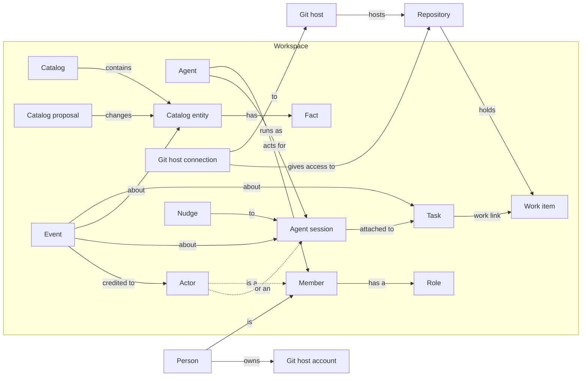

# Domain model and glossary

Status: **draft for review** ([issue #3](https://github.com/guneet-xyz/shinan/issues/3)).

This document defines the words Shinan's documents use and the core objects
behind them. Every other document uses these terms exactly. It stays
conceptual: it says what each thing is and how things relate, not how they are
stored, which API exposes them or which technology builds them. The owning
documents decide those details.

## How to read this document

Each main term has:

- **Definition:** what it is, in plain words.
- **Attributes:** the key information it carries. This is not a schema.
- **Relationships:** how it connects to other terms.
- **Owner:** the document that owns the details.
- **Status:** one of
  - **Decided**: follows from an accepted decision in the
    [plan](plan.md#6-decisions-so-far), which is cited and gives the reason.
  - **Proposed**: suggested here, with a reason. The owning document confirms
    or changes it.
  - **Open**: not settled. Listed under [open questions](#open-questions).

When an owning document changes a proposed term, it updates this glossary in the
same pull request (proposed; reason: one vocabulary only works if it has one
home).

### Owning documents

None of these exist yet. Until they do, links go to their issues.

| Document | Issue |
|---|---|
| Product overview | [#4](https://github.com/guneet-xyz/shinan/issues/4) |
| Catalog | [#5](https://github.com/guneet-xyz/shinan/issues/5) |
| Tasks and work | [#6](https://github.com/guneet-xyz/shinan/issues/6) |
| Identity, agents and permissions | [#7](https://github.com/guneet-xyz/shinan/issues/7) |
| Git host integrations | [#8](https://github.com/guneet-xyz/shinan/issues/8) |
| Agent integrations | [#9](https://github.com/guneet-xyz/shinan/issues/9) |
| Human experience | [#10](https://github.com/guneet-xyz/shinan/issues/10) |
| Architecture and operations | [#11](https://github.com/guneet-xyz/shinan/issues/11) |
| Roadmap and migration | [#12](https://github.com/guneet-xyz/shinan/issues/12) |
| Decision log | [#13](https://github.com/guneet-xyz/shinan/issues/13) |

## Two meanings of "workspace"

Shinan grew out of an existing Git repository named `workspace`, which holds a
hand-made catalog and cross-project coordination practices. Shinan also has an
object called a workspace. They must never be confused.

| Write | Meaning |
|---|---|
| **workspace** (plain word) | A Shinan workspace, as defined [below](#workspace). |
| **the `workspace` repository** | The existing Git repository. Always use code formatting and the word "repository". |
| **the `workspace` repository's catalog** | The Markdown catalog inside that repository. Never "the workspace catalog". |
| **a workspace's catalog** | The catalog inside a Shinan workspace. |

Also avoid "workspace" for a local folder, a checkout or an editor window, even
though many coding tools use the word that way. Say [checkout](#supporting-terms)
or folder.

Status: **Proposed**. Reason: the plan requires the distinction, and the
`workspace` repository stays the source of truth until migration (D-018), so
both will be discussed side by side for a long time.

## Overview

A workspace is the boundary around everything else. It has members (people)
and agents that act for those people. It holds a catalog of entities whose
facts carry their state, source and last-checked time, and it holds tasks whose
work happens on git hosts and is attached through work links. Everything that
happens becomes an event credited to an actor, and events are shown as
timelines.

## Workspace and people

### Shinan installation

- **Definition:** one running copy of Shinan, such as `shinan.guneet.dev` or a
  self-hosted copy. It can hold many workspaces.
- **Attributes:** address, operator, settings that apply to every workspace.
- **Relationships:** contains workspaces and the people who can sign in to it.
- **Owner:** Architecture and operations.
- **Status:** **Proposed** term. Reason: Shinan is self-hostable (D-012), so
  documents need a word for "this copy of Shinan" that is not "workspace".

### Workspace

- **Definition:** the container for one team's work in Shinan: its catalog,
  tasks, git host connections, members and agents. People are invited to it.
- **Attributes:** name, members, invitations, agents, catalog, tasks, git host
  connections, workspace settings (for example which catalog proposals need
  approval).
- **Relationships:** everything below belongs to exactly one workspace, except
  a person, who can be a member of several.
- **Owner:** Identity, agents and permissions (membership and access); Human
  experience (management screens).
- **Status:** **Decided** that workspaces exist and use invitations (D-019:
  adding multi-user support later would mean reworking data, permissions and
  sign-in). **Proposed** that nothing is shared between workspaces except a
  person's sign-in. Reason: a workspace holds infrastructure details (D-015), so
  a single hard boundary is the simplest one to keep safe.

### Person

- **Definition:** a human who can sign in to a Shinan installation.
- **Attributes:** name, sign-in identity, linked git host accounts,
  memberships.
- **Relationships:** is a member of zero or more workspaces; agents act for a
  person; a catalog entity of type `person` can describe them (see
  [catalog entity](#catalog-entity)).
- **Owner:** Identity, agents and permissions.
- **Status:** **Proposed**. Reason: separating the human from their membership
  lets one person belong to several workspaces with different roles.

### Member and role

- **Definition:** a person's membership in one workspace. The role says what
  the member may do there.
- **Attributes:** person, workspace, role, date joined, who invited them.
- **Roles (high level):**
  - **Workspace owner:** everything a member can do, plus managing members,
    roles, git host connections, workspace settings, and deleting the
    workspace.
  - **Member:** works on tasks, comments, nudges, registers agents, makes and
    approves catalog proposals where allowed.
  - **Viewer:** reads the catalog, tasks and timelines.
- **Relationships:** links a person to a workspace; agents act for a member.
- **Owner:** Identity, agents and permissions.
- **Status:** **Decided** that members exist (D-019). **Proposed** role set.
  Reason: three roles cover one owner today and small teams later without
  committing to a full permission system. Finer rules, such as access to
  private repositories, are **open** (plan question 3).

### Invitation

- **Definition:** an offer for a person to join a workspace with a given role.
- **Attributes:** workspace, role, who invited, invitee address, state
  (pending, accepted, declined, expired, withdrawn).
- **Owner:** Identity, agents and permissions.
- **Status:** **Decided** (D-019). States **proposed**.

### Git host account

- **Definition:** a user account on a git host, such as a GitHub username.
- **Attributes:** git host, account name, the person it belongs to.
- **Relationships:** a person links their git host accounts in Shinan. Their
  agents use the same accounts (D-017), so an action on a git host by this
  account may have been done by the person or by one of their agents.
- **Owner:** Identity, agents and permissions.
- **Status:** **Decided** that agents share the person's account (D-017:
  separate bot accounts are a barrier to adoption). Linking accounts to a person
  is **proposed**; reason: it is how git host activity gets credited to anyone
  at all.

## Agents

### Coding tool

- **Definition:** the program that runs an agent conversation, such as
  OpenCode, Claude Code or Codex. Shinan does not run models (D-008); the
  coding tool does.
- **Attributes:** name, which connection levels it supports.
- **Owner:** Agent integrations.
- **Status:** **Proposed** term. Reason: "agent" alone was used for both the
  program and the identity; separating them removes that confusion.

### Agent

- **Definition:** a named, registered identity through which a coding tool
  works in a workspace for one member. Example: "Guneet's OpenCode".
- **Attributes:** name, the member it acts for, coding tool, tokens (scoped
  credentials it uses to reach Shinan), state (active or disabled).
- **Relationships:** belongs to one workspace; acts for one member; runs as
  many agent sessions; a catalog entity of type `agent` can describe it.
- **Owner:** Identity, agents and permissions (identity, tokens, rights);
  Agent integrations (how it connects).
- **Status:** **Decided** that agents connect from outside (D-008) and act for
  a person (D-017). **Proposed:**
  - An agent belongs to one workspace. A person using the same tool in two
    workspaces registers two agents. Reason: keeps tokens and permissions
    inside the workspace boundary.
  - An agent can never do more than the member it acts for. Reason: it already
    uses that member's git host account, so it cannot be trusted with more.
  - Machine is recorded per agent session, not per agent. Reason: the same
    agent may run on several machines.
  - How fine-grained an agent is (per person and tool, or per person, tool and
    machine) is **open**.

### Agent session

- **Definition:** one running conversation of a coding tool, working as an
  agent. Presence is tracked per agent session.
- **Attributes:** agent, coding tool, machine, current task, current
  repository, presence state, presence source (plugin-reported or
  self-reported), started, last seen, ended. The model in use may be recorded
  as information only.
- **Relationships:** belongs to an agent (and so to a member and workspace);
  attached to at most one task at a time; receives nudges; is the most specific
  actor for an agent's actions.
- **Owner:** Agent integrations.
- **Status:** **Decided** that sessions and presence exist (D-014). **Proposed**
  "at most one task at a time". Reason: nudges and the timeline need a clear
  answer to "who is working on this task"; a session that moves on is detached
  first, and the move is an event. Whether a session can work on several tasks
  at once is **open**.

### Connection level

- **Definition:** how deeply an agent session is connected to Shinan (D-014):
  1. **MCP and skill** (any agent): actions such as reading the catalog or
     updating a task. MCP (Model Context Protocol) is a standard way for coding
     tools to call outside tools. A skill is an instruction file that tells the
     agent how to use them. A CLI (command-line program) offers the same
     actions.
  2. **Plugin** (per coding tool, OpenCode first): reports presence from inside
     the tool and delivers nudges live.
  3. **Launcher** (phase 3): a small program on a machine that starts new agent
     sessions on request.
- **Owner:** Agent integrations.
- **Status:** **Decided** (D-014: MCP alone depends on the agent choosing to
  report and cannot reach an idle or crashed session).

### Presence

- **Definition:** what Shinan currently knows about an agent session: whether
  it is running, what it is doing, where, and when it was last seen.
- **Attributes:**
  - **Presence state:** `starting`, `busy`, `idle`, `waiting` (waiting for a
    person, for example on a question or permission prompt), `ended`. Shinan
    shows `unresponsive` when a session that has not ended has not been seen
    for a while.
  - **Presence source:** `plugin-reported` (from a tool plugin) or
    `self-reported` (only from the agent's own MCP calls, so less reliable).
  - Last seen, current task, repository, machine.
- **Owner:** Agent integrations (reporting); Human experience (display).
- **Status:** **Decided** that presence exists and "self-reported" is marked
  (plan, Agent presence pillar). **Proposed** state names, taken from the
  plugin reports listed in the plan, plus `unresponsive`. Reason: a crashed
  session reports nothing, so silence needs its own state. The time before a
  session counts as unresponsive is **open**.

## Actors and attribution

### Actor

- **Definition:** whoever is credited with an action. One of:
  - a **person** (a member acting directly);
  - an **agent session** acting for a member (or the **agent**, when no session
    is known, for example a CLI call);
  - **Shinan** itself, for automatic actions such as creating a task from an
    outside issue;
  - an **outside actor**: a git host account not linked to any member, such as
    an outside contributor or a dependency bot.
- **Owner:** Identity, agents and permissions.
- **Status:** **Proposed**. Reason: the timeline must credit every event to
  someone, and git hosts produce events from people who are not members.

### Acting for

- **Definition:** the relationship between an agent (and its sessions) and the
  member it works for. Every action by an agent is shown as "agent, acting for
  person", for example "OpenCode session on Daedalus, acting for Guneet".
- **Status:** **Decided** (plan, Timeline pillar). The person stays accountable
  for what their agents do; proposed, with the reason that the agent uses their
  git host account and their permissions.

### Attribution

- **Definition:** how Shinan decides which actor did something, and how sure it
  is. Because agents share their person's git host account (D-017), Shinan
  cannot rely on the git host. It uses its own records: actions that came
  through an agent's token, agent sessions attached to the task, and markers in
  commits and pull requests.
- **Attributes:** the actor, and a **confidence**:
  - `recorded`: the action went through Shinan with a known token.
  - `marked`: the git host item carries a marker naming the agent session.
  - `inferred`: matched by timing or task links only.
  - `unknown`: the git host account is known but not who used it.
- **Owner:** Identity, agents and permissions; markers in Tasks and work and
  Agent integrations.
- **Status:** **Decided** that attribution comes from Shinan's own records
  (D-017). Confidence levels **proposed**; reason: showing how sure a credit is
  follows the same rule as facts in the catalog (D-007). How reliable this can
  be is **open** (plan question 2).

## Tasks and work

### Task

- **Definition:** the story of one piece of work, from intent to verified
  outcome, across any number of repositories and git hosts. The task is the
  core object (D-002).
- **Attributes:**
  - **Task ID:** stable and host-neutral, such as `T-123`. Used in branch names
    and pull request descriptions.
  - Title, intent (what and why), acceptance criteria, decisions made along the
    way.
  - Task status and human-set states (below).
  - Assignees (members), attached agent sessions.
  - Origin: where the intent started (in Shinan, an outside issue, or a
    conversation).
  - Work links, related catalog entities, related tasks, comments, timeline.
- **Relationships:** belongs to one workspace; links to work items through work
  links; can relate to catalog entities it touches and produce catalog
  proposals; can depend on other tasks.
- **Owner:** Tasks and work.
- **Status:**
  - **Decided:** host-neutral ID used in branch names and PR descriptions
    (D-002); a task starts where the intent starts and outside issues become
    tasks automatically (D-003); repository issues are created only when people
    need them (D-004).
  - **Proposed:** IDs are unique within a workspace and never reused. Reason: a
    reused ID would make old branch names and PRs point at the wrong story.
  - **Proposed:** lasting decisions recorded on a task are promoted to a
    `decision` catalog entity. Reason: the `workspace` repository already
    separates task narrative from durable decisions, and that works.
  - **Open:** ID format (fixed `T-` prefix or a prefix per workspace), and
    whether tasks can have subtasks.

### Task status, derived and human-set states

Task status is calculated from linked work (D-005: copied status goes stale).
A few states cannot be calculated and are set by hand. These are called
**human-set states**.

**Derived status** (one at a time, **proposed**):

| Status | Meaning |
|---|---|
| `triage` | Created automatically from an outside issue and not yet accepted. Leaving triage is a human-set decision (accept or cancel). |
| `open` | Accepted; no active linked work and no attached agent session. |
| `in progress` | An agent session is attached, or a linked branch or draft pull request exists. |
| `in review` | A linked pull request is open and ready for review. |
| `done` | The linked work that delivers the task is merged or completed, and the outcome is verified. |

**Human-set states** (**proposed**):

| State | Kind | Meaning |
|---|---|---|
| `cancelled` | Replaces status | A person decided the task will not be done. |
| `needs a person` | Shown beside status | The task cannot progress until a person does something an agent cannot or must not do. Replaces today's `human-effort` label and carries the same short summary of what is needed. |
| `on hold` | Shown beside status | A person paused the task. |

`blocked` is shown beside status when a task this one depends on is not done.
It is derived, not human-set.

- **Owner:** Tasks and work.
- **Status:** **Decided** that status is derived (D-005) and that some states
  are human-set, including "needs a person" (plan, Tasks pillar). The state
  names above are **proposed**. Reason: they map to the flow in the `workspace`
  repository's collaboration practice (draft PR early, review, merge, verify)
  while keeping overlays separate so a task can be both in progress and
  waiting for a person. **Open:** what counts as "verified" for `done`; whether
  agents may set and clear `needs a person` (today they add and remove the
  label, but the plan says only a person can set such states); whether waiting
  for deployment approval is its own state.

### Work item

- **Definition:** a thing on a git host that is part of a task's work. Kinds:
  **pull request** (PR), **issue**, **commit**, **branch**.
- **Attributes:** kind, git host, repository, host's own ID and URL, current
  state on the host (open, draft, merged, closed), last time Shinan read it.
- **Relationships:** lives in a repository; linked to tasks through work links.
  Comments, reviews, CI checks and merges on a work item are recorded as
  events, not as separate work items.
- **Owner:** Git host integrations (reading); Tasks and work (meaning for
  status).
- **Status:** **Decided** that the work itself stays on git hosts (D-001).
  **Proposed** list of kinds and the rule that sub-activity is events. Reason:
  these four are what the plan's integrations read; events keep comments and
  checks on the timeline without making them objects. Whether releases or
  deployments are work items is **open**.

### Work link

- **Definition:** the connection between a task and a work item.
- **Attributes:**
  - task, work item;
  - **role:** `origin` (the outside issue the task came from), `delivers` (work
    that implements the task), or `related`;
  - **how made:** task ID in a branch name, task ID in a PR description or
    commit message, an agent's call, by a person, or by Shinan automatically;
  - who made it and when.
- **Relationships:** a task has many work links; a work item can link to more
  than one task.
- **Owner:** Tasks and work (conventions); Git host integrations (detection).
- **Status:** **Decided** that work on git hosts links to tasks by task ID
  (D-002) and that agent-driven work links PRs directly (D-004). Roles and "how
  made" are **proposed**; reason: status is derived from `delivers` links only,
  so the role must be explicit.

### Outside issue

- **Definition:** an issue opened on a git host without going through Shinan,
  for example by a user of a public project. It becomes a task automatically,
  in `triage`, with a work link of role `origin`.
- **Owner:** Tasks and work.
- **Status:** **Decided** (D-003).

### Comment

- **Definition:** a message on a task in Shinan. Comments on work items stay on
  the git host and appear in the timeline as events.
- **Relationships:** a person's comment on a task can create a nudge.
- **Owner:** Tasks and work.
- **Status:** **Proposed**. Reason: Shinan must not copy git host discussions
  (plan, "What Shinan does not do").

### Nudge

- **Definition:** a message from a person to the agent session working on a
  task, usually created by their comment on the task.
- **Attributes:** from (person), task, target agent sessions, message, delivery
  state:
  - `delivered`: sent live into the running session through a plugin;
  - `pending`: waiting until the session next checks in;
  - `picked up`: read by the session at check-in;
  - `no session`: nothing is attached; the person can ask for a new agent
    session (started by a launcher in phase 3, by hand before then).
- **Relationships:** created from a comment; addressed to agent sessions
  attached to the task.
- **Owner:** Tasks and work (when nudges are created); Agent integrations
  (delivery).
- **Status:** **Decided** that nudges exist with live and check-in delivery
  (plan, Nudges pillar). Delivery state names **proposed**; reason: the person
  must see whether their message reached the agent.

## Git hosts

### Git host

- **Definition:** one service that hosts Git repositories, identified by its
  address, such as `github.com` or a Forgejo server like `git.guneet.dev`. Its
  **host type** is the software (GitHub, Forgejo, later GitLab).
- **Owner:** Git host integrations.
- **Status:** **Decided** that GitHub and Forgejo come first (D-009: they are
  the hosts we use). **Proposed** that a git host is an address, not a type.
  Reason: several Forgejo servers are separate hosts with separate accounts.

### Git host connection

- **Definition:** a workspace's authorized link to one git host. It lets
  Shinan receive webhooks (messages the host sends when something happens),
  call the host's API, and reconcile.
- **Attributes:** workspace, git host, which repositories it covers, who set it
  up, health (working, failing, last successful contact).
- **Relationships:** a workspace has many connections; a connection gives
  access to repositories.
- **Owner:** Git host integrations; Identity, agents and permissions (who may
  manage them, how credentials are held).
- **Status:** **Decided** that workspaces hold git host connections (plan,
  Workspaces pillar). Attributes **proposed**.

### Repository

- **Definition:** a Git repository on a git host that a workspace can see
  through a connection.
- **Attributes:** git host, owner and name on the host, URL, visibility.
- **Relationships:** holds work items; a `project` catalog entity points to one
  or more repositories. A repository is not a project: the project is the
  catalog's description, the repository is the thing on the git host.
- **Owner:** Git host integrations.
- **Status:** **Proposed**. Reason: the `workspace` repository's catalog keeps
  "project" and "repository" apart and that works.

## Catalog

### Catalog

- **Definition:** a workspace's trusted, current record of everything the team
  runs and works on. People read it as a wiki; agents read it through the agent
  index and keep it accurate as part of their work.
- **Attributes:** catalog entities and the links between them.
- **Relationships:** one per workspace.
- **Owner:** Catalog.
- **Status:** **Decided**: document-first, Markdown with structured fields at
  the top (frontmatter) is the source of truth, and the agent index is
  generated from it (D-006: people must be able to read it). Every fact records
  state, source and last-checked time (D-007: trust is the differentiator).

### Catalog entity

- **Definition:** one typed page in the catalog describing one thing.
- **Entity types:** `project`, `machine`, `service`, `runbook`, `decision`,
  `policy`, `person`, `agent`.
- **Attributes:** ID (stable, unique in the workspace), type, title, entity
  status, owner, facts, body text, links to other entities, links to owning
  sources.
- **Entity status:** `active`, `deprecated`, `retired`, describing the thing
  itself, not the page's accuracy. Retired entities keep their history and link
  their replacement.
- **Relationships:** contains facts; links to other entities; changed through
  catalog proposals; can relate to tasks.
- **`person` and `agent` entities** describe members and agents for readers
  (responsibilities, what they own). They link to the identity record and do
  not copy sign-in, role or token details.
- **Owner:** Catalog.
- **Status:** **Decided** entity type list (plan, Catalog pillar).
  **Proposed:** entity status values, stable IDs and the person/agent rule.
  Reason: they are the `workspace` repository's working practice, and keeping
  identity in one place avoids two sources of truth. **Open:** whether a
  `person` entity can describe someone who is not a member, and how
  relationships are expressed (plan question 5).

### Fact

- **Definition:** a single claim about a catalog entity that can be checked.
  Example: "Dockyard's deployment runs on Musashi."
- **Attributes:** the claim, fact state, source, last checked, who checked it,
  check scope (what exactly was checked).
- **Relationships:** belongs to one catalog entity; changed through catalog
  proposals; checks are events.
- **Owner:** Catalog.
- **Status:** **Decided** (D-007). **Open:** how fine-grained a fact is (one
  field, one section or one page). The `workspace` repository records checks
  per page with a narrow scope; D-007 asks for per fact.

### Fact state

- **Definition:** what kind of knowledge a fact is:
  - `intended`: what an owning source, such as a configuration repository or a
    decision, says should be true.
  - `observed`: what someone actually saw when they checked, at the
    last-checked time.
  - `proposed`: a planned change in the world that is not yet done and
    verified. Not to be confused with a [catalog proposal](#catalog-proposal-and-approval).
  - `unknown`: not known. Recorded on purpose instead of guessed.
- **Discrepancy:** when intended and observed facts disagree, both are kept
  with their evidence. Neither is declared right by default.
- **Owner:** Catalog.
- **Status:** **Decided** (plan, Catalog pillar). The discrepancy rule is
  **proposed**; reason: it is the `workspace` repository's practice and avoids
  hiding real drift.

### Source and last checked

- **Source:** where a fact came from: a link to the owning source (a file at a
  given revision, a URL), a described observation, or a person's statement.
- **Owning source:** the system or document that owns a fact. The catalog links
  to it and does not copy it ("link, don't copy").
- **Last checked:** when the fact was actually checked against its source. It
  is not the time the page was edited or merged. Checking one fact does not
  refresh the others.
- **Freshness:** how long ago a fact was last checked, used as a risk signal.
  There is no single interval after which a fact is wrong.
- **Owner:** Catalog (rules); Human experience (how freshness is shown).
- **Status:** **Decided** that source and last-checked time are recorded
  (D-007) and that facts owned elsewhere are linked, not copied (plan, "What
  Shinan does not do"). The meanings above are **proposed**; reason: they are
  the `workspace` repository's rules for `last_verified`, `verification_scope`
  and `verification_source`, which have worked.

### Catalog proposal and approval

- **Catalog proposal:** a suggested change to one or more catalog entities,
  with its evidence, made by an actor (often an agent). It is applied,
  rejected or withdrawn.
- **Approval:** a person's acceptance of a catalog proposal. Some proposals may
  apply without approval, depending on workspace settings.
- **Attributes:** author (actor), changes, evidence, related task, state
  (`open`, `applied`, `rejected`, `withdrawn`), approver.
- **Owner:** Catalog (flow); Identity, agents and permissions (who may
  approve).
- **Status:** **Decided** that agents propose and people approve where needed
  (plan, Catalog pillar). **Proposed:** only people approve; states as above.
  Reason: agents act for people, so an agent approving would be a person
  approving their own agent's change without looking. **Open:** which changes
  need approval.

### Wiki and agent index

- **Wiki:** the catalog shown to people as readable pages, including a **start
  here path** for a new person or agent.
- **Agent index:** a machine-readable form of the catalog generated for agents.
- **Owner:** Human experience (wiki); Catalog (agent index); Architecture and
  operations (how they stay in sync, plan question 1).
- **Status:** **Decided** (D-006).

## Events and timeline

### Event

- **Definition:** a record that something happened. Events are never edited
  afterwards; corrections are new events.
- **Attributes:** time, kind, actor and attribution confidence, subjects (task,
  work item, catalog entity, agent session), where it came from (Shinan action,
  git host webhook or reconciliation, plugin report, MCP call), a link to the
  original where one exists, and a short summary.
- **Relationships:** credited to an actor; about one or more subjects; shown
  on timelines.
- **Owner:** Tasks and work (task events); Git host integrations (git host
  events); Agent integrations (presence events); Human experience (display).
- **Status:** **Proposed**. Reason: one record type lets the timeline join
  activity from every host and tool; never editing events keeps the history
  trustworthy. Events link to git host content rather than copying it (D-001).

### Timeline

- **Definition:** events shown in time order for one subject: a task, a
  catalog entity, an agent session, or the whole workspace. Human activity
  stands out; agent activity is compact.
- **Owner:** Human experience.
- **Status:** **Decided** (plan, Timeline pillar). Timelines per subject are
  **proposed**; reason: the same events answer "what happened to this task"
  and "what happened today".

## Supporting terms

| Term | Definition | Owner | Status |
|---|---|---|---|
| Assignee | A member responsible for a task. Not a lock. | Tasks and work | Proposed |
| Check-in | An agent session contacting Shinan, which updates last seen and delivers pending nudges. | Agent integrations | Proposed |
| Checkout | A local copy of a repository on a machine. A worktree is an extra checkout of the same repository on its own branch. | Catalog | Proposed |
| Claim | An agent session attaching itself to a task to work on it. Not a lock; overlaps are coordinated. | Tasks and work | Proposed |
| CI check | A test or build result reported on a work item by the git host. Recorded as an event. | Git host integrations | Proposed |
| Machine | A computer. Described by a `machine` catalog entity; agent sessions record the machine they run on. | Catalog | Proposed |
| Marker | Text in a commit message, PR description or branch name that carries a task ID and, where possible, the agent session. | Tasks and work; Agent integrations | Proposed |
| Reconciliation | Periodically re-reading a git host to catch events missed by webhooks. | Git host integrations | Decided (plan, Integration points) |
| Triage inbox | The list of tasks in `triage`. | Tasks and work; Human experience | Decided (plan, phase 2) |
| Webhook | A message a git host sends to Shinan when something happens. | Git host integrations | Decided (plan, Integration points) |
| The owner | In planning documents, Guneet, the owner of this project. In product terms, write "workspace owner" or "entity owner" instead. | This document | Proposed |

## Words to avoid

| Avoid | Use instead | Why |
|---|---|---|
| "workspace" for the existing repository; "workspace repo"; "the workspace catalog" | the `workspace` repository; the `workspace` repository's catalog | Keeps the two apart. |
| "workspace" for a folder or editor window | checkout, folder | Same reason. |
| ticket, story, card, job; "issue" for a Shinan task | task | "Issue" means a git host issue only. |
| bot, AI, assistant | agent | One word for one thing. |
| "agent" for the program | coding tool | The agent is the identity, not the program. |
| session, run, conversation, chat, instance (alone) | agent session | "Session" alone could mean a sign-in session in the web app. |
| user (as an object) | person, member | "User" is fine in general prose about who Shinan is for. |
| "project" for a workspace or a repository | workspace, repository, `project` entity | Three different things. |
| merge request | pull request (PR), on every host | One word across hosts. |
| link (for a task connection) | work link | "Link" alone means a hyperlink. |
| sync (for git hosts) | reconciliation | "Sync" is reserved for the catalog Markdown and its index. |
| integration (for a configured link) | git host connection | An integration is a capability; a connection is one configured instance. |
| last updated, last modified, last verified (for facts) | last checked | Only real checks count; edits do not. |
| status (for facts) | fact state | Task status, entity status, fact state and presence state are different. |
| proposal (alone) | catalog proposal | Fact state `proposed` and document status "proposed" also exist. |
| approval (alone) | catalog approval, deployment approval, PR review approval | Three different things. |
| check (alone) | fact check / last checked, or CI check | Two different things. |
| decision (alone, in product terms) | `decision` entity, or decision on a task | This repository's decision records in `docs/decisions/` are also called decisions. |
| notification (for agents) | nudge | Notifications are for people and come later. |
| `human-effort` label (in Shinan) | `needs a person` | The label is the `workspace` repository's mechanism. |
| repo | repository | Plain words. |

## Proposed in this document

Each is explained with its reason in the section linked.

1. [Naming rule](#two-meanings-of-workspace) for "workspace" versus the
   `workspace` repository.
2. [Shinan installation](#shinan-installation) as a term; nothing shared between
   [workspaces](#workspace) except a person's sign-in.
3. [Person and member](#person) as separate objects; roles
   [workspace owner, member, viewer](#member-and-role).
4. [Coding tool](#coding-tool) versus [agent](#agent); an agent belongs to one
   workspace, acts for one member and can never do more than that member.
5. An [agent session](#agent-session) is attached to at most one task at a time.
6. [Presence states](#presence), including `unresponsive`.
7. [Actor](#actor) kinds, including Shinan and outside actors; [attribution
   confidence](#attribution) levels.
8. [Task](#task) IDs unique per workspace and never reused; lasting task
   decisions promoted to `decision` entities.
9. [Derived task status and human-set state names](#task-status-derived-and-human-set-states);
   `blocked` as derived.
10. [Work item](#work-item) kinds; [work link](#work-link) roles and "how made".
11. [Nudge](#nudge) delivery states.
12. [Git host](#git-host) identified by address; [repository](#repository)
    distinct from `project` entity.
13. [Entity status](#catalog-entity) values; `person` and `agent` entities link
    to identity records without copying them.
14. [Discrepancy rule](#fact-state) and the meanings of
    [source, owning source, last checked and freshness](#source-and-last-checked).
15. [Only people approve catalog proposals](#catalog-proposal-and-approval).
16. [Events](#event) are never edited; [timelines](#timeline) per subject.

## Open questions

1. **Fact state name.** The fact state `proposed` collides with "catalog
   proposal" and with the document status "proposed". Should it be renamed, for
   example to `planned`? (Catalog)
2. **Fact granularity.** Is a fact one field, one section or one page? (Catalog)
3. **Agent granularity.** Is an agent per person and coding tool, or per
   person, coding tool and machine? (Identity, agents and permissions)
4. **Multiple tasks per agent session.** Can one agent session work on several
   tasks at once, and can one conversation span two workspaces? (Agent
   integrations)
5. **Who sets "needs a person".** The plan says only a person can set such
   states, but today agents add and remove the `human-effort` label. (Tasks and
   work)
6. **"Done" and verification.** What counts as a verified outcome, and who
   records it? (Tasks and work)
7. **Deployment approval.** Is waiting for deployment approval a task state, a
   kind of `needs a person`, or something else? (Tasks and work)
8. **Task ID format.** Fixed `T-` prefix or one per workspace; subtasks or not.
   (Tasks and work)
9. **Releases and deployments.** Are they work items? (Git host integrations)
10. **Non-member people.** Can a `person` entity describe someone who is not a
    member? (Catalog)
11. **Unresponsive threshold.** How long before a silent agent session is shown
    as `unresponsive`? (Agent integrations)
12. **Which catalog proposals need approval.** (Catalog)
13. **Teams inside a workspace.** Are groups of members needed for entity
    ownership or access? (Identity, agents and permissions)
14. Plan questions 2 (attribution reliability), 3 (private repository
    visibility) and 5 (catalog schema) also affect terms here and are answered
    by their owning documents.
