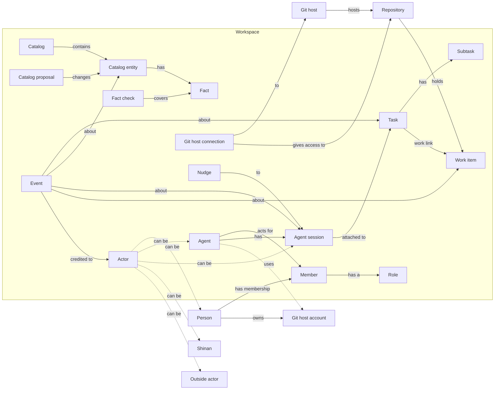

# Domain model and glossary

Status: **draft for review** ([issue #3](https://github.com/guneet-xyz/shinan/issues/3)).

This document defines the words Shinan's documents use and the core objects
behind them. Every other document uses these terms exactly. It stays
conceptual: it says what each thing is and how things relate, not how they are
stored, which API exposes them or which technology builds them. The owning
documents decide those details.

## How to read this document

Each main term has:

- **Definition:** what it is, in plain words.
- **Attributes:** the key information it carries. This is not a schema.
- **Relationships:** how it connects to other terms.
- **Owner:** the document that owns the details.
- **Status:** one of
  - **Decided**: follows from an accepted decision or approved plan content
    (pillars, integration points, phases, non-goals) in the [plan](plan.md),
    or from the owner's answers in [issue #25][o] and [issue #26][n]. Owner
    answers are cited as "owner, O-n" (first round), "owner, N-n" (follow-up
    round) or "owner, NO-n" (integration review).
  - **Proposed**: suggested here or in the owning document, with a reason. The
    owning document confirms or changes it.
  - **Open**: not settled. Listed under [open questions](#open-questions).

When an owning document changes a proposed term, it updates this glossary in the
same pull request (proposed; reason: one vocabulary only works if it has one
home). The [Decision log](decisions/README.md) turns the owner's answers into
decision records; this document cites the O-, N- and NO-numbers.

### Owning documents

- [Product overview](product-overview.md)
- [Catalog](catalog.md)
- [Tasks and work](tasks.md)
- [Identity, agents and permissions](identity.md)
- [Git host integrations](git-hosts.md)
- [Agent integrations](agent-integrations.md)
- [Human experience](human-experience.md)
- [Architecture and operations](architecture.md)
- [Roadmap and migration](roadmap.md)
- [Decision log](decisions/README.md)

## Two meanings of "workspace"

Shinan grew out of an existing Git repository named `workspace`, which holds a
hand-made catalog and cross-project coordination practices. Shinan also has an
object called a workspace. They must never be confused.

| Write | Meaning |
|---|---|
| **workspace** (plain word, any capitalization) | A Shinan workspace, as defined [below](#workspace). "Workspace" at the start of a sentence is still the Shinan object. |
| **Shinan workspace** | The same. Use it where both meanings appear in one passage, such as migration plans. |
| **the `workspace` repository** | The existing Git repository. Always use code formatting and the word "repository". |
| **the `workspace` repository's catalog** | The Markdown catalog inside that repository. Never "the workspace catalog". |
| **a checkout of the `workspace` repository** | A local copy such as `~/workspace`. |
| **issues in the `workspace` repository** | Its coordination issues. Never "workspace issues". |
| **the `workspace` `project` entity** | After migration, the catalog entity that describes the `workspace` repository as a project. |
| **a workspace's catalog** | The catalog inside a Shinan workspace. |

Also avoid "workspace" for a local folder, a checkout or an editor window, even
though many coding tools use the word that way. Say [checkout](#supporting-terms)
or folder.

Status: **Proposed**. Reason: the plan requires the distinction, and the
`workspace` repository stays the source of truth until migration (D-018), so
both will be discussed side by side for a long time.

## Overview

A workspace is the boundary around a team's records. It has members (people)
and agents that act for those members. It holds a catalog of entities whose
facts carry their state, source and last-checked time, and it holds tasks whose
work happens on git hosts and is attached through work links. Everything that
happens becomes an event credited to an actor, and events are shown as
timelines.

Status: summary only; statuses are given in each section.

## Workspace and people

### Shinan installation

- **Definition:** one running copy of Shinan, such as `shinan.guneet.dev` or a
  self-hosted copy. It can hold many workspaces.
- **Attributes:** address, installation operators, installation settings (for
  example the email allowlist).
- **Installation operator:** a person who runs the installation. Being an
  operator does not make someone a member of any workspace, and operators
  cannot purge.
- **Relationships:** contains workspaces and the people who can sign in to it.
- **Owner:** Architecture and operations.
- **Status:** **Proposed** term, confirmed by Architecture and operations.
  Reason: Shinan is self-hostable (D-012), so documents need a word for "this
  copy of Shinan" that is not "workspace". Operators cannot purge:
  **Decided** (owner, [O-50][o]).

### Workspace

- **Definition:** the container for one team's records in Shinan: its catalog,
  tasks, git host connections, members and agents. People are invited to it.
- **Attributes:** name, task ID prefix, members, invitations, agents, catalog,
  tasks, git host connections, workspace settings (for example its task flags
  and custom entity types).
- **Belongs to one workspace:** member, invitation, agent (with its tokens and
  agent sessions), task, work link, comment, nudge, catalog, catalog entity,
  fact, catalog proposal, git host connection, event.
- **Outside any one workspace:** Shinan installation, person, git host account,
  git host, repository, work item, coding tool. A workspace refers to these; it
  does not own them.
- **Visibility:** every member sees everything in the workspace, including work
  from private repositories. Links to private repositories stay protected by
  the git host's own access control.
- **Owner:** Identity, agents and permissions (membership and access); Human
  experience (management screens).
- **Status:**
  - **Decided** that workspaces exist and use invitations (D-019: adding
    multi-user support later would mean reworking data, permissions and
    sign-in).
  - **Decided:** every member sees everything (owner, [O-43][o]); there is no
    restricted catalog content (owner, [O-2][o]).
  - **Decided:** a repository is connected to only one workspace in an
    installation in the first version (owner, [O-59][o]).
  - **Proposed:** nothing is shared between workspaces except the person (their
    sign-in and linked git host accounts). Reason: a workspace holds
    infrastructure details (D-015), so a single hard boundary is the simplest
    one to keep safe.

### Person

- **Definition:** a human who can sign in to a Shinan installation.
- **Attributes:** name, email address, sign-in methods, linked git host
  accounts, memberships.
- **Relationships:** has a membership in zero or more workspaces; agents act
  for a person through their membership; a `person` catalog entity can describe
  them (see [catalog entity](#catalog-entity)).
- **Owner:** Identity, agents and permissions.
- **Status:** **Proposed**. Reason: separating the human from their membership
  lets one person belong to several workspaces with different roles.

Related terms (owner: Identity, agents and permissions):

| Term | Definition | Status |
|---|---|---|
| Sign-in method | A way a person proves who they are: an email magic link (a one-time sign-in link sent by email) or GitHub sign-in. There is no password and no Forgejo sign-in; Forgejo is used only to connect accounts and repositories. | **Decided** (owner, [O-41][o] as changed by [N-7][o]) |
| Email allowlist | The installation's list of email addresses allowed to have an account. Joining a workspace still needs an invitation. | **Decided** (owner, [O-48][o]) |
| Sign-in session | A person's signed-in session in the web app. Never just "session". | Proposed: keeps "session" for agent sessions. |
| Re-authentication | Signing in again, inside a sign-in session, before a sensitive action. | Proposed by Identity: sensitive actions should not rest on an old sign-in. |

### Member and role

- **Definition:** a member is a person's membership in one workspace. The role
  says what the member may do there.
- **Attributes:** person, workspace, role, date joined, who invited them.
- **Roles (high level):**
  - **Workspace owner:** everything a contributor can do, plus managing
    members, roles, git host connections, workspace settings, purging,
    workspace export and import, and deleting the workspace. A workspace has at least one and may have several.
  - **Contributor:** works on tasks, comments, nudges, registers agents, makes
    catalog proposals and gives catalog approval where allowed.
  - There is no read-only role.
- **Relationships:** links a person to a workspace; agents act for a member.
- **Owner:** Identity, agents and permissions.
- **Status:** **Decided** that members exist (D-019); the roles are workspace
  owner and contributor only (owner, [N-11][o]); only workspace owners purge
  (owner, [O-50][o]). **Proposed:** the duties listed for each role, and that a
  workspace may have several workspace owners. Reason: several owners avoid
  lock-out.

### Invitation

- **Definition:** an offer for a person to join a workspace with a given role.
- **Attributes:** workspace, role, who invited, invitee (an email address on
  the email allowlist), state (`pending`, `accepted`, `declined`, `expired`,
  `withdrawn`).
- **Owner:** Identity, agents and permissions.
- **Status:** **Decided** (D-019; owner, [O-48][o]). States **proposed**;
  reason: the inviter needs to see whether an invitation is still waiting.

### Git host account

- **Definition:** a user account on a git host, such as a GitHub username.
- **Attributes:** git host, account name, the host's stable account number, the
  person it belongs to.
- **Relationships:** a person links their git host accounts in Shinan. Their
  agents use the same accounts (D-017), so an action on a git host by this
  account may have been done by the person or by one of their agents.
- **Owner:** Identity, agents and permissions.
- **Status:** **Decided** that agents share the person's account (D-017:
  separate bot accounts are a barrier to adoption). **Decided:** Shinan stores
  no per-person GitHub tokens and never writes to a git host as a person; see
  [Shinan's own writes](#shinans-own-writes-and-backlinks) (owner, [O-1][o],
  [N-4][o]). **Proposed:** a person links their accounts, and the
  link is verified before it counts. Reason: linking is how git host activity
  gets credited at all, and an unverified link would let anyone claim someone
  else's activity.

## Agents

### Coding tool

- **Definition:** the program that runs an agent conversation, such as
  OpenCode, Claude Code or Codex. Shinan does not run models (D-008); the
  coding tool does.
- **Attributes:** name, which connection levels it supports.
- **Owner:** Agent integrations.
- **Status:** **Proposed** term. Reason: "agent" alone was used for both the
  program and the identity; separating them removes that confusion.

### Agent

- **Definition:** a named, registered identity through which one coding tool on
  one machine works in a workspace for one member. Example: "Guneet's OpenCode
  on Daedalus".
- **Attributes:** name, the member it acts for, coding tool, machine, tokens,
  state (`active` or `disabled`).
- **Relationships:** belongs to one workspace; acts for exactly one member; has
  many agent sessions; an `agent` catalog entity can describe it, and its
  machine can point to a `machine` catalog entity.
- **Owner:** Identity, agents and permissions (identity, tokens, rights);
  Agent integrations (how it connects).
- **Status:**
  - **Decided** that agents connect from outside (D-008) and act for a person
    (D-017).
  - **Decided:** an agent is per person, coding tool and machine (owner,
    [O-40][o]).
  - **Proposed:** an agent belongs to one workspace; a person using the same
    tool and machine in two workspaces registers two agents. Reason: keeps
    tokens and permissions inside the workspace boundary.
  - **Proposed:** an agent can never do more than the member it acts for.
    Reason: it already uses that member's git host account, so it cannot be
    trusted with more.

### Agent session

- **Definition:** the part of one coding tool conversation that works as one
  agent. Presence is tracked per agent session. A conversation that works in
  two workspaces is two agent sessions. Every subagent (a helper conversation
  that a coding tool starts inside another) is its own agent session.
- **Attributes:** agent, conversation ID, agent session ID, parent agent session
  (for subagents), current task, current repository and branch, presence state,
  presence source, started, last seen, ended. The model in use may be recorded
  as information only. The machine and coding tool come from the agent.
- **Relationships:** belongs to an agent (and so to a member and workspace);
  attached to at most one task at a time; receives nudges; is the most specific
  actor for an agent's actions.
- **Owner:** Agent integrations.
- **Status:** **Decided** that sessions and presence exist (D-014); subagents
  are their own agent sessions (owner, [O-37][o]); calls are matched to an
  agent session by the conversation ID first (owner, [O-29][o]). **Proposed**
  "at most one task at a time". Reason: nudges need one clear target; moving to
  another task is cheap because it is recorded as an event.

Related terms (owner: Agent integrations):

| Term | Definition | Status |
|---|---|---|
| Conversation ID | The ID the coding tool gives a conversation, reported by the tool itself. It identifies the agent session, never authorizes anything. | **Decided** (owner, [O-29][o]) |
| Agent session ID | Shinan's own ID for every agent session. It is written in markers (the `Shinan-Session` trailer) and given to the agent's shell commands, and an agent passes it on calls when its tool reports no conversation ID. If a passed ID and the tool's conversation ID disagree, Shinan refuses writes. Like a conversation ID, it never authorizes anything. | **Decided** as a fallback for matching calls (owner, [O-29][o]); its use in markers proposed by Agent integrations, reason: attribution (D-017) needs to name the session. |
| Claim | An agent session attaching itself to a task to work on it. Not a lock. A branch marker claims automatically for top-level agent sessions, for tasks that can be claimed; a subagent is attached to a task only by claiming one itself. | **Decided** (owner, [O-35][o], [N-2][o]). Not a lock proposed, reason: the `workspace` repository's practice says assignment is coordination, not a lock. |
| Release | An agent session detaching from its task, by choice or after 24 hours with no report or call, whatever its presence source. A session that resumes claims the task again. | **Decided** (owner, [O-32][o]: "release the task after 24 h of silence") |

### Connection level

- **Definition:** how deeply an agent session is connected to Shinan (D-014):
  1. **MCP and skill** (any agent): actions such as reading the catalog or
     updating a task. MCP (Model Context Protocol) is a standard way for coding
     tools to call outside tools. A skill is an instruction file that tells the
     agent how to use them. A CLI (command-line program) offers the same
     actions.
  2. **Plugin** (per coding tool, OpenCode first): reports presence from inside
     the tool and delivers nudges live. Installing the plugin also sets up MCP
     and the skill.
  3. **Launcher** (phase 3): a small program a person installs on their own
     machine (for example a VM or a laptop), which registers that machine and
     starts new agent sessions there on request. The **device setup guide**
     explains how to prepare such a machine. A **launcher token** is the
     credential a launcher uses on its machine.
- **Owner:** Agent integrations; Identity, agents and permissions (launcher
  token).
- **Status:** **Decided** (D-014: MCP alone depends on the agent choosing to
  report and cannot reach an idle or crashed session). Plugin sets up MCP and
  skill: **Decided** (owner, [O-36][o]). Launcher on the person's own hardware
  with a setup guide: **Decided** (owner, [O-1][o]). Launcher token
  **proposed** by Identity; reason: a launcher starts agents, so it needs its
  own credential that can be revoked separately.

### Presence

- **Definition:** what Shinan currently knows about an agent session: whether
  it is running, what it is doing, where, and when it was last seen.
- **Attributes:**
  - **Presence source:** `plugin-reported` (from a tool plugin) or
    `self-reported` (only from the agent's own MCP or CLI calls).
  - **Presence state:**

    | State | Meaning |
    |---|---|
    | `starting` | The agent session has just started. |
    | `busy` | Working. |
    | `idle` | Running, waiting for its next instruction. |
    | `waiting` | Waiting for a person, for example on a question or permission prompt. |
    | `offline` | The coding tool stopped, or the person switched away, but the conversation can be resumed. The agent session keeps its task until released. |
    | `unresponsive` | Calculated: an agent session that sends heartbeats has gone silent without saying why. |
    | `ended` | The conversation was deleted or archived, the agent session was ended on purpose, or it has been silent for 30 days. |

    Self-reported agent sessions cannot report `idle`, `waiting` or `offline`,
    so Shinan shows only their last-seen time between start and end.
  - Last seen, current task, repository.
- **Heartbeat:** a regular "still here" report from a plugin. Only agent
  sessions that send heartbeats can become `unresponsive`.
- **Owner:** Agent integrations (reporting and time limits); Human experience
  (display).
- **Status:** **Decided** that presence exists and "self-reported" is marked
  (plan, Agent presence pillar). **Decided:** `offline`, release after 24 hours
  of silence, and `ended` only on delete, archive, an explicit end or 30 days
  (owner, [O-32][o]). Other state names and heartbeats **proposed**; reason: a
  crashed session reports nothing, so silence needs its own state.

## Actors and attribution

### Actor

- **Definition:** whoever is credited with an action. One of:
  - a **person** (a member acting directly);
  - an **agent session** acting for a member, or the **agent** when no session
    is known (for example a CLI call);
  - **Shinan** itself, for automatic actions such as creating a task from an
    outside issue or posting a backlink;
  - an **outside actor**: a git host account not linked to any member, such as
    an outside contributor or a dependency bot.
- When an action came from a linked git host account but Shinan cannot tell
  who used it (attribution `unknown`), the actor is the linked person, shown as
  "the person or one of their agents". This is not an outside actor.
- **Owner:** Identity, agents and permissions.
- **Status:** **Proposed**. Reason: the timeline must credit every event to
  someone, and git hosts produce events from people who are not members.

### Acting for

- **Definition:** the relationship between an agent (and its sessions) and the
  member it works for. Every action by an agent is shown as "agent, acting for
  person", for example "OpenCode session on Daedalus, acting for Guneet".
- **Status:** **Decided** (plan, Timeline pillar). **Proposed:** the person
  stays accountable for what their agents do. Reason: the agent uses their git
  host account and their permissions.

### Attribution

- **Definition:** how Shinan decides which actor did something, and how sure it
  is. Because agents share their person's git host account (D-017), Shinan
  cannot rely on the git host. It uses its own records: actions that came
  through an agent's token, agent sessions attached to the task, markers in
  commits and pull requests, and the IDs of items Shinan itself wrote.
- **Attributes:** the actor, and a **confidence**:
  - `recorded`: the action went through Shinan with a known token.
  - `marked`: the git host item carries a marker naming the agent session.
  - `inferred`: matched by timing or task links only.
  - `unknown`: the git host account is known but not who used it.
- **Owner:** Identity, agents and permissions; markers in Tasks and work and
  Agent integrations; display in Human experience (text events with `unknown`
  attribution are shown in full and labelled as unsure, owner, [O-91][o]).
- **Status:** **Decided** that attribution comes from Shinan's own records
  (D-017). Confidence levels **proposed**; reason: showing how sure a credit is
  follows the same rule as facts in the catalog (D-007).

## Tasks and work

### Task

- **Definition:** the story of one piece of work, from intent to verified
  outcome, across any number of repositories and git hosts. The task is the
  core object (D-002).
- **Attributes:**
  - **Task ID:** stable and host-neutral: the workspace's prefix and a number,
    such as `T-123`. Used in branch names and pull request descriptions. If a
    workspace changes its prefix, the old one stays as an alias.
  - **Task address:** the task's stable web address,
    `https://<installation address>/t/<task ID>` (for example
    `https://shinan.guneet.dev/t/T-124`), written next to its ID in PR
    descriptions and used in backlinks and emails. Because prefixes are unique
    within an installation, the ID alone identifies the workspace; an address
    with a former prefix redirects to the current ID.
  - Title, intent (what and why), acceptance criteria, decisions made along the
    way.
  - Task status and task flags (below).
  - Parent task and subtasks.
  - Assignees (members), attached agent sessions, rank (for `to do` tasks).
  - Origin: where the intent started (in Shinan, an outside issue or PR, a
    conversation, or split from a parent task).
  - Work links, verification records, related catalog entities, dependencies,
    comments, progress updates, timeline.
- **Subtask:** a task whose parent is another task. It is a full task with its
  own ID from the same sequence, status and work links. Large work is split
  into subtasks, and subtasks can have subtasks of their own, to any depth. A
  subtask can be moved, with its own subtasks, to another parent or made a
  top-level task.
- **Top-level task:** a task with no parent. **Tree:** a top-level task with
  all its subtasks at every depth. **Ancestors** of a task are its parent, the
  parent's parent and so on; its **descendants** are its subtasks, their
  subtasks and so on.
- **Rank:** the order of `to do` tasks, set by people, saying what comes next.
  There is one order of top-level tasks, and within each task an order of its
  subtasks, at every depth. There are no priority levels. Agents read the
  order but do not change it.
- **Relationships:** belongs to one workspace; links to work items through work
  links; can relate to catalog entities it touches and produce catalog
  proposals; can depend on other tasks.
- **Owner:** Tasks and work.
- **Status:**
  - **Decided:** host-neutral ID used in branch names and PR descriptions
    (D-002); a task starts where the intent starts and outside issues become
    tasks automatically (D-003); repository issues are created only when people
    need them (D-004).
  - **Decided:** each workspace has its own task ID prefix (owner, [O-6][o]);
    subtasks exist (owner, [O-21][o]) and nest to any depth (owner,
    [N-1][o]); people can rank `to do` tasks (owner, [O-28][o]).
  - **Proposed** by Tasks and work: subtask IDs from the same sequence, moving
    subtasks, "split from a parent" as an origin, prefix aliases, and one order
    per level. Reasons: branch names and markers keep one shape, a moved
    subtask keeps its ID, old branch names cannot be rewritten, and a task's
    place in its parent's order already says when its parts come up.
  - **Proposed** by Architecture and operations: the task address shape.
    Reason: it is short enough to write next to a task ID and stays stable
    whatever the page looks like, and a workspace name in it would break on
    rename.
  - **Proposed:** IDs are unique within a workspace and never reused, and so is
    the prefix. Reason: a reused ID would make old branch names and PRs point
    at the wrong story.
  - **Proposed:** lasting decisions recorded on a task are promoted to a
    `decision` catalog entity. Reason: the `workspace` repository already
    separates task narrative from durable decisions, and that works.

### Task status, task flags and manual states

Task status is calculated from linked work **plus recorded events**
(acceptance, agent session attachment, verification). Nobody types a status,
and no tool marks a task done; agents record verification instead. **Decided**
(D-005; owner, [O-4][o] and [O-10][o]).

A **manual state** is a status or flag set explicitly by an actor rather than
calculated. A **task flag** is shown beside the status and can combine with
any status.

**Task status** (one at a time). The rows below describe each status; the
exact rules, and the order in which they are checked, are in
[Tasks and work §7.3](tasks.md#73-rules). For example, an attached agent session
only lifts `to do` to `in progress`; it never pulls `in review` back.

| Status | Meaning | How it is set |
|---|---|---|
| `triage` | Created automatically from an outside issue or PR, not yet accepted. | Calculated on creation; leaving it is manual (accept or cancel). |
| `to do` | Accepted; no active `delivers` work and no attached agent session. | Calculated |
| `in progress` | An agent session is attached, or there is active `delivers` work that is not all ready for review. | Calculated |
| `in review` | There is active `delivers` work, and every active item is a PR ready for review. | Calculated |
| `verifying` | All `delivers` PRs are merged, but a criterion marked verify after merge has no passing verification yet. | Calculated |
| `done` | All subtasks are done (cancelled subtasks are ignored), every `delivers` PR is merged, and verification is recorded where needed. A task without code work is done when a passing verification covers every acceptance criterion. | Calculated |
| `cancelled` | A person decided the task will not be done. | Manual |

Related terms:

- **Verification record:** an event saying who verified, when, which
  acceptance criteria it covers, the result (`passed` or `failed`) and a link
  to evidence. Agents and people may record it. A `failed` verification moves
  the task back to `in progress`.
- **Verify after merge:** a marking on an acceptance criterion that can only be
  checked after merge, such as "the page loads on `shinan.guneet.dev`". It is
  off unless a criterion is marked. Not called "check after merge", because
  "check" is kept for fact checks and CI checks.

**Task flags.** Task flags are managed per workspace: a workspace can add and
remove flags. The built-in flags below are the defaults. Flags a workspace adds
are always manual and never change status; the special rules of the built-in
flags cannot be changed or given to other flags. Removing a flag removes only
its display; for example, deployment approval requests and answers are still
recorded without the `awaiting deployment approval` flag.

| Flag | Meaning | How it is set |
|---|---|---|
| `needs a person` | The task cannot progress until a person does something an agent cannot or must not do. Replaces today's `human-effort` label and carries the same short summary of what is needed. | Manual: agents and people may set and clear it; the summary is required, and who cleared it is recorded. |
| `awaiting deployment approval` | The work changes a running deployment and needs a person's deployment approval. | Manual: set by whoever asks; cleared by a recorded deployment approval or decline. |
| `on hold` | A person paused the task. | Manual, people only. |
| `blocked` | A task this one depends on is not done. | Calculated |

Accepting a task out of `triage` and setting `cancelled` are for people only
(proposed; reason: these are decisions about what the team works on).

- **Owner:** Tasks and work.
- **Status:**
  - **Decided:** the D-005 reading (owner, [O-4][o]); `verifying` (owner,
    [O-9][o]); agents record verification and nothing marks a task done (owner,
    [O-10][o]); the done rule with subtasks (owner, [O-21][o]); verify after
    merge off by default (owner, [O-22][o]); agents may set and clear `needs a
    person` (owner, [O-7][o]); the separate `awaiting deployment approval` flag
    and per-workspace task flags (owner, [O-8][o]).
  - **Proposed:** the remaining status and flag names, verification record
    contents, and the "least advanced work wins" rule for `in review`. Reason:
    they follow the `workspace` repository's flow (draft PR early, review,
    merge, verify) and let a task be in progress and need a person at once.
  - **Proposed** by Tasks and work: ignoring cancelled subtasks, and the rules
    for flags a workspace adds. Reasons: cancelling a part means it is no
    longer needed; the built-in flags encode policies that should not be
    weakened by accident.

### Deployment approval

- **Definition:** a person's approval for a change to a running deployment. It
  is given in Shinan, or in the conversation with an agent and recorded by that
  agent; never by a comment or a nudge. Every deployment approval request and
  answer is recorded as a task event, whether or not the workspace has the
  `awaiting deployment approval` flag. Where the flag exists, an approval or a
  decline clears it.
- **Owner:** Tasks and work; Identity, agents and permissions (who may give
  it).
- **Status:** **Decided** (owner, [O-8][o] and [O-20][o]); always recorded,
  and the flag can be removed like any other (owner, [NO-4][n]). D-016 applies
  it to every deployment of `shinan.guneet.dev`.

### Work item

- **Definition:** a thing on a git host that is part of a task's work. Kinds:
  **pull request** (PR), **issue**, **commit**, **branch**.
- **Attributes:** kind, git host, repository, the host's own ID and URL,
  current state as the host reports it, last time Shinan read it.
- **States used by status:**
  - **Merged:** a PR merged into the repository's default branch or into a
    counting branch; a commit counts as merged when it reaches such a branch by
    a direct push. A **counting branch** is a branch the git host connection
    marks as counting, such as a long-lived release branch.
  - **Merged elsewhere:** a PR merged into any other branch. It is neither
    active nor merged.
  - **Active:** a `delivers` branch with no PR and not merged, a draft PR, or a
    PR ready for review.
- **Relationships:** lives in a repository; linked to tasks through work links.
  Comments, reviews, CI checks and merges on a work item are recorded as
  events, not as separate work items.
- **Owner:** Git host integrations (reading); Tasks and work (meaning for
  status).
- **Status:** **Decided** that the work itself stays on git hosts (D-001).
  Shinan does not integrate with other trackers such as Multica, Linear or
  Plane (owner, [O-97][o], amending D-010). **Proposed:** the four kinds, the
  three states above, and the rule that sub-activity is events. Reason: these
  are what the integrations read, and "merged" must exclude stacked PRs merged
  into feature branches. **Proposed:** releases and deployments are not work
  items in the first version; releases are repository events and deployments
  are catalog facts or events. Reason: no need has been shown yet.

### Work link

- **Definition:** the connection between a task and a work item.
- **Attributes:**
  - task, work item;
  - **role:** `origin` (the outside issue or PR where the task's intent
    started; a task can have several), `delivers` (work that implements the
    task), or `related`. Issues are never `delivers` work items;
  - **how made:** task ID in a branch name, task ID in a PR description or
    commit message, a member's mention in a git host comment (`related` only),
    an agent's call, by a person, or by Shinan automatically;
  - **confirmed or unconfirmed**; who made it and when.
- **Unconfirmed link:** a work link shown on the task that does not count toward
  status until it is confirmed. Confirming or dismissing it is an event. Two
  sources:
  - a `delivers` marker from an outside actor, which only a person can
    confirm;
  - a member's host closing reference (such as `Closes #42`) to the task's
    `origin` issue, in a PR without a task marker, which a person or an agent
    session acting for a member can confirm.
- **Relationships:** a task has many work links; a work item can link to more
  than one task. Only confirmed `delivers` links count toward status.
- **Owner:** Tasks and work (conventions); Git host integrations (detection).
- **Status:**
  - **Decided** that work on git hosts links to tasks by task ID (D-002) and
    that agent-driven work links PRs directly (D-004).
  - **Decided:** markers from accounts not linked to a member make unconfirmed
    links (owner, [O-24][o]); members' mentions of a task ID in git host
    comments make `related` links that never affect status, and outsiders'
    mentions are ignored (owner, [O-25][o]).
  - **Proposed:** roles, "how made", and issues never being `delivers`. Reason:
    status counts `delivers` links only, so the role must be explicit; an
    issue's open or closed state is set by hand, which D-005 avoids.
  - **Proposed** by Tasks and work: closing references as a second source of
    unconfirmed links, and who confirms each. Reasons: the closing reference
    says the PR may be the delivering work but not for sure; text by an
    outsider could steer an agent, so only a person confirms those.

### Outside issue

- **Definition:** an issue opened on a git host without going through Shinan,
  for example by a user of a public project. It becomes a task automatically,
  in `triage`, with a work link of role `origin`. A PR from an outside actor
  that names no task is treated the same way.
- **"Turn new issues into tasks" setting:** a per-repository setting, on by
  default and turned off for shared repositories where most issues are
  unrelated. When it is off, new issues there make no task, but their markers
  and mentions are still read. Git host integrations holds the setting; Tasks
  and work defines it.
- **Owner:** Tasks and work.
- **Status:** **Decided** (D-003). Issues that existed before a repository was
  connected are imported only when a person asks: **Decided** (owner,
  [O-23][o]). The per-repository setting: **Decided** (owner, [NO-2][n],
  amending D-003). Outside PRs **proposed** by Tasks and work; reason: the PR
  is where that intent starts.

### Unlinked work

- **Definition:** a PR or branch by a member or their agent that carries no
  task ID. It is not turned into a task; it is listed so a person or agent can
  link or dismiss it.
- **Owner:** Tasks and work.
- **Status:** **Proposed**. Reason: members are expected to use markers;
  creating tasks for every missed marker would hide the slip.

### Comment and progress update

- **Comment:** a message on a task in Shinan. Comments on work items stay on the
  git host and appear in the timeline as events. A person's comment tells the
  agent sessions attached to the task (a nudge) unless the person marks it
  "note only".
- **Progress update:** a short note from an agent session on its task. It is an
  event, shown compactly, and does not create nudges.
- **Owner:** Tasks and work.
- **Status:** **Decided:** comments nudge by default with a "note only" opt-out
  (owner, [O-26][o]). Comment and progress update as terms **proposed**.
  Reasons: Shinan must not copy git host discussions (plan, "What Shinan does
  not do"); agent activity is shown compactly, so progress should not look like
  a person's comment.

### Nudge

- **Definition:** a message from a person to the agent sessions working on a
  task, usually created by their comment on the task.
- **Git host requests:** when a person asks for something to be done on a git
  host (for example, opening an issue for a task), Shinan does not do it. The
  request goes to that person's own agent sessions as a nudge in `queue` mode,
  and waits if none is running.
- **Attributes:** from (person), task, message, and one **delivery** per target
  agent session.
- **Targets:** every agent session attached to the task (or the one the person
  chose). If the task has no session of its own, the nudge goes to its nearest
  descendants that have one: on each path down the tree, the first task with a
  session. Only if no task in that part of the tree has a session does the
  nudge wait on the task, and the next agent session that claims the task
  receives it, if the nudge was never delivered to any session. The person can
  also ask for a new agent session (started by a launcher in phase 3, by hand
  before then). Git host requests never follow the descendant rule.
- **Delivery state** (per target): `pending`, then one outcome:
  - `delivered`: live through a plugin when the coding tool confirms the agent
    received it, or at check-in when the agent acknowledges it;
  - `undeliverable`: the agent session ended first;
  - `withdrawn`: the sender withdrew it before delivery;
  - `cancelled`: a person at the coding tool removed it from the tool's queue.
- **Delivery mode:** `steer` (the agent sees it at its next step) or `queue`
  (after its current work). Nudges from the agent's own member use `steer`,
  others use `queue`; the sender can override.
- **Route** and **holder:** each delivery records how it went (live `steer`,
  live `queue`, or check-in) and, while pending, who holds it (offered to the
  plugin, accepted by the coding tool, or available for check-in).
- **Owner:** Tasks and work (when nudges are created); Agent integrations
  (delivery).
- **Status:** **Decided** that nudges exist with live and check-in delivery
  (plan, Nudges pillar); waiting for the next claiming session, only for nudges
  never delivered to any session (owner, [O-27][o]); `delivered` at check-in
  means acknowledged (owner, [O-30][o]); default delivery modes (owner,
  [O-31][o]); git host requests as queued nudges (owner, [N-3][o]). The
  outcomes `withdrawn` and `cancelled`, route and holder are
  **proposed** by Agent integrations; reason: the person must see what happened
  to each delivery. The descendant rule is **proposed** by Tasks and work;
  reason: with subagents working on subtasks, a split task often has no
  session of its own, and stopping at the first session on each path reaches
  the coordinating session without flooding every helper.

### Task notice

- **Definition:** a message from Shinan, not from a person, telling the agent
  sessions attached to a task that something happened which no person did in
  Shinan. Examples: a `delivers` PR was closed without merging or merged, a
  task this one depends on finished, or an outside actor's marker made an
  unconfirmed link.
- **Delivery:** the same targets and delivery path as a [nudge](#nudge),
  always in `queue` mode, labelled as from Shinan, and batched with waiting
  nudges in time order. It has the same delivery outcomes. It never carries a
  person's authority, and a notice that reaches no session does not wait for
  the next claimant.
- **Owner:** Tasks and work (when notices are sent); Agent integrations
  (delivery).
- **Status:** **Proposed** by Tasks and work, adopting Agent integrations'
  delivery. Reasons: without notices an agent never hears that its PR was
  closed or that the task it waited for is done; making them nudges would blur
  the rule that a nudge carries a person's authority; and information can go
  stale, while the next session can read what happened on the task's
  timeline.

## Git hosts

### Git host

- **Definition:** one service that hosts Git repositories, identified by its
  address, such as `github.com` or a Forgejo server like `git.guneet.dev`. Its
  **host type** is the software (GitHub, Forgejo, later GitLab).
- **Owner:** Git host integrations.
- **Status:** **Decided** that GitHub and Forgejo come first (D-009: they are
  the hosts we use). **Proposed** that a git host is an address, not a type.
  Reason: several Forgejo servers are separate hosts with separate accounts.

### Git host connection

- **Definition:** a workspace's authorized link to one git host. It lets
  Shinan receive webhooks, call the host's API, and reconcile.
- **How it connects:** on GitHub, through a GitHub App installation, using only
  the app's installation token. On Forgejo, read-only: the connecting person
  enters any Forgejo address and a token from their own account. Any token is
  accepted and stored encrypted; a broad token from a site admin can read as
  any user, which is a stated, accepted risk. Addresses on private, loopback or
  link-local networks are refused unless an installation operator allows that
  host.
- **Attributes:** workspace, git host, method and account, covered
  repositories, and per repository: counting branches, automated accounts, the
  "turn new issues into tasks" setting and write-back settings (GitHub only);
  who set it up, health (`working`, `degraded`, `failing`).
- **Automated account:** a git host account, listed per repository, that
  belongs to a tool such as a dependency updater. Its issues and PRs skip
  triage or are ignored, as Tasks and work defines.
- **Relationships:** a workspace has many connections; a connection gives
  access to repositories.
- **Owner:** Git host integrations; Identity, agents and permissions (who may
  manage them, how credentials are held).
- **Status:** **Decided** that workspaces hold git host connections (plan,
  Workspaces pillar); the GitHub App with installation token only (owner,
  [O-51][o]); Forgejo through the connecting person's account and any token,
  for reading only, on any Forgejo address (owner, [O-53][o], [O-54][o],
  [N-4][o], [N-7][o]), except private network addresses by default (owner,
  [N-12][o]); the "turn new issues into tasks" setting (owner, [NO-2][n]).
  Other attributes and automated accounts **proposed** by Git host
  integrations; reasons: people need to see what a connection covers and
  whether it still works, and tools' issues should not fill triage.

### Repository

- **Definition:** a Git repository on a git host that a workspace can see
  through a connection.
- **Attributes:** git host, the host's stable repository ID, owner and name on
  the host, URL, visibility, default branch.
- **Relationships:** holds work items; a `project` catalog entity points to one
  or more repositories. A repository is not a project: the project is the
  catalog's description, the repository is the thing on the git host.
- **Owner:** Git host integrations.
- **Status:** **Decided:** one workspace per repository in the first version
  (owner, [O-59][o]). The rest **proposed**. Reason: the `workspace`
  repository's catalog keeps "project" and "repository" apart and that works.

### Shinan's own writes and backlinks

- **Shinan's own writes:** the few things Shinan itself posts on a git host,
  such as backlinks. On GitHub, Shinan writes only as its GitHub App. On
  Forgejo, Shinan writes nothing. Shinan never writes as a person; anything a
  person wants done on a git host goes to that person's own agent sessions as a
  [nudge](#nudge). Shinan recognizes its own writes by the GitHub App's own
  account and the item IDs it stored, and credits them to Shinan with
  attribution `recorded`.
- **Backlink:** a single comment Shinan posts on a GitHub PR linking to its
  task. Added only when the PR description lacks the task's address, and never
  in public repositories. There are no backlinks on issues or on Forgejo. It is
  a git host comment, not a [comment](#comment-and-progress-update) on a
  task.
- **Owner:** Git host integrations.
- **Status:** **Decided** (owner, [O-1][o], [O-56][o], [N-3][o], [N-4][o]).
  "Backlink" as a term **proposed** by Git host integrations; reason:
  "comment" alone means a message on a task.

## Catalog

### Catalog

- **Definition:** a workspace's trusted, current record of everything the team
  runs and works on. People read it as a wiki; agents read it through the agent
  index and keep it accurate as part of their work.
- **Attributes:** catalog documents (entities, the start-here document and type
  schema documents) and their catalog revisions.
- **Catalog revision:** the full Markdown text of the catalog documents one
  applied catalog proposal changed. Revisions are kept only inside Shinan and
  are never edited; a revert is a new proposal.
- **Relationships:** one per workspace.
- **Owner:** Catalog; Architecture and operations (storage).
- **Status:** **Decided**: document-first, Markdown with structured fields at
  the top (frontmatter) is the source of truth, and the agent index is
  generated from it (D-006: people must be able to read it). Every fact records
  state, source and last-checked time (D-007: trust is the differentiator).
  Each catalog revision's Markdown is the source of truth (owner, [O-11][o]);
  proposals and review happen in Shinan (owner, [O-12][o]); there is no Git
  mirror for now (owner, [N-5][o], changing O-11).

### Catalog entity

- **Definition:** one typed Markdown document in the catalog describing one
  thing.
- **Entity types:** eight built-in types, plus custom types a workspace
  defines.
  - `project`: a body of work, such as an application, and its repositories.
  - `machine`: a computer or server.
  - `service`: something running: a deployment of a project, or a shared
    service others depend on, such as DNS. Deployment facts live only here.
  - `runbook`: a checked procedure for an operation.
  - `decision`: a lasting decision with its reasons.
  - `policy`: a rule the team follows, such as an approval or access rule.
  - `person`: describes a person.
  - `agent`: describes an agent.
- **Type schema:** for each entity type, its fact keys, whether each is
  single-valued or multi-valued, which keys are relations, any recheck
  intervals, and its body sections. A **type schema document** (ID
  `schema/<type>`) defines a custom type, or extends a built-in type with extra
  keys. Built-in keys cannot be removed or changed, and any schema change is a
  gated change.
- **Attributes:** entity ID, type, title, summary, entity status, entity owner,
  aliases, facts, body text.
- **Entity ID:** written `<type>/<slug>`, such as `machine/musashi`; stable.
  Former IDs are kept as aliases so old links still resolve.
- **Entity status:** `active`, `deprecated`, `retired`, describing the thing
  itself, not the page's accuracy. Retired entities stay readable and link
  their replacement.
- **Entity owner:** the member responsible for the thing, or `unknown`.
- **`person` and `agent` entities** describe people and agents for readers.
  When the person is a member, or the agent is registered, the entity links to
  that record and does not copy sign-in, role or token details. A `person`
  entity can also describe someone who is not a member, such as a former member.
- **Start-here document:** one special catalog document per workspace with two
  paths through the catalog, one for people and one for agents. It is not an
  entity, holds no facts, and changes only with catalog approval.
- **Owner:** Catalog.
- **Status:**
  - **Decided:** the eight built-in types (plan, Catalog pillar); custom entity
    types in the first version (owner, [O-17][o]); `<type>/<slug>` IDs with
    aliases (owner, [O-15][o]); deployment facts only on `service` entities
    (owner, [O-16][o]); the start-here document (owner, [O-18][o]).
  - **Proposed:** type descriptions, entity status values, entity owner rule,
    and the person/agent rule. Reasons: they are the `workspace` repository's
    working practice; keeping identity in one place avoids two sources of
    truth; former members must stay describable.
  - **Proposed** by Catalog: type schema documents, and schema changes as
    gated changes. Reason: Shinan's own features rely on built-in keys, and a
    schema change affects every entity of the type.

### Fact

- **Definition:** one structured field or relation of a catalog entity that can
  be checked. Example: "Dockyard's deployment runs on Musashi." It is the
  smallest unit that carries its own state, source and last-checked time. The
  body text is not made of facts.
- **Attributes:** key, value, fact state, fact check (or none).
- **Relation:** a fact whose value is another entity, such as `runs-on`
  `machine/musashi`. It is written on one side; its inverse is generated.
- **Cardinality:** whether a key holds one value (single-valued) or many
  (multi-valued), set by the type schema.
- **Fact identity:** the rule for which written facts are "the same fact", so a
  new one replaces an old one or is added beside it. For a single-valued key it
  includes the fact state and **`via`**, a short label for how the fact was
  observed (such as `filesystem`).
- **Relationships:** belongs to one catalog entity; changed through catalog
  proposals; covered by a fact check. The intended and observed versions of the
  same property are separate facts.
- **Owner:** Catalog.
- **Status:** **Decided** (D-007); unit, cardinality and identity rules (owner,
  [O-13][o]). Relations as facts and `via` **proposed** by Catalog; reason:
  relations go stale like any claim.

### Fact state

- **Definition:** what kind of knowledge a fact is:
  - `intended`: what the owning source, such as a configuration repository or
    a decision, currently declares should be true.
  - `observed`: what someone actually saw when they checked.
  - `planned`: an accepted change that the owning source does not yet declare.
  - `unknown`: not known. Recorded on purpose instead of guessed.
- **Test:** if the owning source declares it now, it is `intended`, even if not
  yet applied; a merged infrastructure change that has not been applied is
  `intended`, and its absence from reality shows as a discrepancy with an
  `observed` fact. If it is agreed but not yet in the owning source, it is
  `planned`.
- **Discrepancy:** a single-valued key with two or more current facts whose
  values differ (not counting `planned` or `unknown`). Both are kept with their
  evidence; neither is declared right by default.
- **Owner:** Catalog.
- **Status:** **Decided:** the four states (plan, Catalog pillar), with
  `proposed` renamed `planned` (owner, [O-5][o]). Meanings, test and
  discrepancy rule **proposed**; reason: they follow the `workspace`
  repository's practice and avoid hiding real drift.

### Fact check, source and freshness

- **Fact check:** the record of one act of checking: when it happened (the
  last-checked time), who checked (an actor), what exactly was checked (scope),
  where the evidence is (source), and what was not checked (limits). Several
  facts checked together share one fact check. Rechecking an unchanged fact
  records a new fact check; checking one fact never refreshes others.
- **Source:** where a fact came from: a link to the owning source (a file at a
  given revision, a URL), a described observation, or a person's statement.
- **Owning source:** the system or document that owns a fact. The catalog links
  to it and does not copy it ("link, don't copy").
- **Last checked:** when the fact was actually checked. Not when the page was
  edited or a proposal applied.
- **Not checked:** shown for a fact whose origin is known but that was never
  checked, such as an imported fact whose old check date does not cover it.
- **Freshness:** how long ago a fact was last checked; always shown, as a risk
  signal.
- **Recheck interval** and **due for recheck:** a type schema may set how often
  a fact key should be rechecked; a fact past it is shown as due for recheck.
  There is no single interval after which a fact is wrong.
- **Owner:** Catalog (rules); Human experience (display).
- **Status:** **Decided** that source and last-checked time are recorded
  (D-007) and that facts owned elsewhere are linked, not copied (plan, "What
  Shinan does not do"). **Decided:** provenance of imported facts (owner,
  [O-14][o]); always show age, and "due for recheck" only where an interval is
  set (owner, [O-19][o]). Fact check fields **proposed**; reason: they are the
  `workspace` repository's `last_verified`, `verification_scope` and
  `verification_source`, moved to the facts they cover.

### Catalog proposal and approval

- **Catalog proposal:** a suggested change to one or more catalog entities,
  with its fact checks, made by an actor. People's own edits are catalog
  proposals too. A proposal applies all or nothing.
- **Gated change:** a high-risk change that needs catalog approval: changes to
  rules (policies, a decision's status, the start-here document), lifecycle
  (deprecate, retire, change ID or owner), `person` and `agent` entities, type
  schema documents, and doubtful changes (for example a fact check older than
  the current one). Catalog owns the exact list.
- **Recent changes feed:** the list of catalog proposals that applied on their
  own, grouped per proposal, where people review them after the fact and can
  revert each with one action.
- **Strict setting:** a workspace setting that makes most non-gated changes
  need catalog approval too, switched on when catalog accuracy slips. Rechecks
  still apply on their own.
- **Catalog approval:** a person's acceptance of a gated change, or of any
  change that needs approval under the strict setting.
- **Attributes:** author (actor), changes, fact checks, related task, state
  (`pending`, `applied`, `rejected`, `withdrawn`), approver.
- **Owner:** Catalog (flow); Identity, agents and permissions (who may
  approve).
- **Status:**
  - **Decided** that agents propose and people approve where needed (plan,
    Catalog pillar).
  - **Decided:** only gated changes need approval, from the start; switch to
    the strict setting if accuracy slips (owner, [O-3][o]). A person may
    approve their own agent's proposals while one person uses Shinan (owner,
    [O-46][o]).
  - **Proposed:** only people approve; the states above. Reason: agents act
    for people, so approval must come from the person who is accountable.
  - **Proposed** by Catalog: the recent changes feed and the strict setting's
    exact scope. Reason: review after the fact keeps people informed without
    blocking agents.

### Secrets and the catalog

- Secrets (passwords, keys, tokens) never go in the catalog. The catalog may
  record where a secret lives, such as which secrets manager holds it.
- **Status:** **Decided** (owner, [O-2][o]).

### Wiki and agent index

- **Wiki:** the catalog shown to people as readable pages, including the
  start-here document's path for people.
- **Agent index:** a machine-readable form of the catalog generated for agents.
- **Owner:** Human experience (wiki); Catalog (agent index); Architecture and
  operations (how they stay in sync).
- **Status:** **Decided** (D-006).

## Events and timeline

### Event

- **Definition:** a record that something happened. Events are not edited
  afterwards; corrections are new events. The only exception is purge.
- **Attributes:** time, kind, actor and attribution confidence, subjects, where
  it came from (Shinan action, git host webhook or reconciliation, plugin
  report, MCP call), a link to the original where one exists, and a short
  summary.
- **Subjects** can be: task, work item, catalog entity, fact, catalog proposal,
  agent session, nudge, member.
- **Purge:** replacing the content of a record (an event, catalog revision,
  comment, progress update, or an operational record such as a raw webhook
  delivery) with a marker, for example to remove a leaked secret or honor a
  deletion request. The record keeps its time, kind, actor and subjects, and
  the purge itself is a new event. Only workspace owners can purge, and no
  security log entry can be purged by anyone.
- **Owner:** Tasks and work (task events); Git host integrations (git host
  events); Agent integrations (presence events); Catalog (fact checks, catalog
  proposals); Identity, agents and permissions (membership, invitations,
  tokens); Architecture and operations (purge); Human experience (display).
- **Status:** **Decided:** only workspace owners purge, including operational
  records about their workspace (owner, [O-50][o]); no security log entry can
  be purged by anyone (owner, [N-8][o], [N-13][o]). The rest **proposed**.
  Reason: one record type lets the timeline join activity from every host and
  tool; not editing events keeps the history trustworthy; a visible purge keeps
  that trust while still removing what must not survive. Events link to git
  host content rather than copying it (D-001).

### Timeline

- **Definition:** events shown in time order for one subject: a task, a
  catalog entity, an agent session, or the whole workspace. Human activity
  stands out; agent activity is compact.
- **Owner:** Human experience.
- **Status:** **Decided** (plan, Timeline pillar). Timelines per subject are
  **proposed**; reason: the same events answer "what happened to this task"
  and "what happened today".

### Security log

- **Definition:** the record of security-relevant events in a workspace or
  installation, such as sign-ins, token changes and membership changes. Kept
  forever. No security log entry can be purged by anyone, including workspace
  entries.
- **Owner:** Identity, agents and permissions.
- **Status:** **Decided** (owner, [O-47][o], [N-8][o], [N-13][o]). Term
  **proposed** by Identity.

## Supporting terms

| Term | Definition | Owner | Status and reason |
|---|---|---|---|
| Assignee | A member responsible for a task. Not a lock. | Tasks and work | Proposed: the `workspace` repository's practice is that assignment is coordination, not a lock. |
| Board | A view of tasks grouped by status (phase 2). | Human experience | Decided (plan, phase 2). |
| Check-in | An agent session contacting Shinan, which updates last seen and hands over pending messages (nudges and task notices). | Agent integrations | Proposed: sessions without a plugin need a defined moment to receive nudges. |
| Checkout | A local copy of a repository on a machine. A worktree is an extra checkout on its own branch. Long-lived checkout locations are facts on `project` entities; task worktree paths are not catalog facts. | Catalog | Proposed: the `workspace` repository's rule; task worktrees are short-lived. |
| CI check | A test or build result reported on a work item by the git host. Recorded as an event. | Git host integrations | Proposed: keeps "check" free for fact checks. |
| Handle | A person's or agent's short name that never changes, used whenever an actor is written in text. A person's handle is chosen when their account is created; an agent's is `<coding tool>-<machine>`. An agent session acting for a person is written `<person handle> via <agent handle>`, for example `guneet via opencode-daedalus`; Shinan is written `shinan`. Shinan writes these forms itself; nobody types them. | Identity, agents and permissions | Proposed by Identity: a typed name could credit someone else, and past records are not rewritten. |
| Decision record | A file in this repository's `docs/decisions/` recording a decision about Shinan itself, with statuses `proposed`, `accepted`, `rejected`, `withdrawn`, `superseded`. Not a `decision` entity. | Decision log | Decided (owner, [O-93][o]). |
| Machine | A computer. Described by a `machine` entity; each agent is tied to one. | Catalog | Decided that agents are per machine (owner, [O-40][o]). |
| Marker | Text in a commit message, PR description or branch name that carries a task ID and, where possible, the agent session. In PR descriptions and commits it is written as Git trailers: `Shinan-Task: <task ID> <task address>` and `Shinan-Session: <agent session ID>`. | Tasks and work (task part); Agent integrations (session part) | Proposed: needed for attribution (D-017) and linking (D-002); a namespaced key avoids clashing with other tools' trailers. |
| Notification | A message to a person outside the web app, email first (phase 2). Not a nudge or a task notice, which go to agent sessions. | Architecture and operations (sending: channels, delivery, retries, failures); Human experience (what is sent and personal settings) | Decided (owner, [NO-3][n]). |
| Migration | Moving the `workspace` repository's catalog and coordination into a Shinan workspace once Shinan is judged ready. | Roadmap and migration | Decided (D-018). |
| Reconciliation | Periodically re-reading a git host to catch events missed by webhooks. | Git host integrations | Decided (plan, Integration points). |
| Revocation | Making a token, agent, sign-in session or membership stop working at once. | Identity, agents and permissions | Proposed by Identity: long-lived tokens make revocation the main control. |
| Source of truth | The place whose version wins when copies disagree, used for whole bodies of records. The `workspace` repository is the source of truth until migration, except that cross-project coordination for trial projects moves into Shinan during the trial. For a single fact, say owning source. | This document | Decided (D-018; owner, [O-73][o]). |
| Token | A credential an agent uses to reach Shinan. There is one per agent; it lasts until revoked, cannot exceed its member's rights, and is accepted at every agent endpoint (MCP, the REST API and the plugin stream). A person gets it by approving in the browser a request started from the plugin or the CLI (with a short code for machines without a browser), or makes one by hand as a fallback. There is no MCP-specific OAuth sign-in in the first version. Its **scopes** are the kinds of action it allows. A **read-only token** has only the two `read` scopes; it is a choice of scopes, not a role. In git host documents, "token" may mean a git host credential; say which. | Identity, agents and permissions | Decided: scoped tokens for agents (plan, Integration points); long-lived (owner, [O-44][o]); how it is obtained and where it is accepted (owner, [NO-1][n]). |
| Trust label | A machine-readable label on each text field Shinan returns to an agent, saying who wrote it (member, agent, outside actor or Shinan) and whether it may be treated as an instruction. | Agent integrations (fields and skill wording); Architecture and operations (where it is applied) | Proposed: text from outsiders reaches agents (D-003), so agents must be able to tell instructions from data. |
| Trial | Phase 1b: using the first version on the proof-of-concept projects while the `workspace` repository stays the source of truth. | Roadmap and migration | Decided (plan, phases; owner, [O-70][o]). |
| Triage inbox | The list of tasks in `triage`. | Tasks and work; Human experience | Decided (plan, phase 2). |
| Workspace export | A full copy of a workspace (catalog with its history, catalog proposals, tasks and their records), downloaded by a workspace owner; it can be imported into an empty workspace. Credentials are not included. | Architecture and operations; Identity, agents and permissions (who may run it) | Decided (owner, [O-75][o]); with no Git mirror and no backups, it is the only copy a person can take off the machine. |
| Webhook | A message a git host sends to Shinan when something happens. | Git host integrations | Decided (plan, Integration points). |
| The owner | In planning documents, Guneet, the owner of this project. In product terms, write "workspace owner" or "entity owner". | This document | Proposed: three meanings of "owner" otherwise collide. |

## Words to avoid

Status: **Proposed**. Reason: each row is a collision found while writing this
glossary; one word for one thing keeps the documents consistent.

| Avoid | Use instead | Why |
|---|---|---|
| "workspace" for the existing repository; "workspace repo"; "the workspace catalog"; "workspace issues" | the `workspace` repository; its catalog; issues in the `workspace` repository | Keeps the two apart. |
| "workspace" for a folder or editor window | checkout, folder | Same reason. |
| ticket, story, card, job; "issue" for a Shinan task | task | "Issue" means a git host issue only. |
| child task, sub-issue | subtask | One word for one thing. |
| bot, AI, assistant (meaning an agent) | agent | "Dependency bot" for an outside actor is fine. |
| "agent" for the program | coding tool | The agent is the identity, not the program. |
| session, run, conversation, chat, instance (alone) | agent session or sign-in session | "Conversation" is fine for the coding tool's own conversation, as in conversation ID. |
| user (as an object) | person, member | "User" is fine in general prose about who Shinan is for. |
| "member" for the role | contributor | The member is the membership; the role is separate. |
| "project" for a workspace or a repository | workspace, repository, `project` entity | Three different things. |
| merge request | pull request (PR), on every host | One word across hosts. |
| link (for a task connection) | work link | "Link" alone means a hyperlink. |
| sync (for git hosts) | reconciliation | "Sync" is kept for the catalog Markdown and what is built from it. |
| integration (for a configured link) | git host connection | An integration is a capability; a connection is one configured instance. |
| last updated, last modified, last verified (for facts) | last checked | Only real checks count; edits do not. |
| status (for facts) | fact state | Task status, entity status, fact state and presence state are different. |
| `proposed` (as a fact state) | `planned` | Renamed (owner, [O-5][o]). |
| "open" for a task or a catalog proposal | `to do`, `pending` | "Open" is also a host's PR state and a statement status here. |
| proposal (alone) | catalog proposal | Document status "proposed" also exists. |
| approval (alone) | catalog approval, deployment approval, PR review approval | Three different things. |
| check (alone); "check after merge" | fact check, CI check; verify after merge | Two kinds of check, and verification is a third thing. |
| redact, delete (for records) | purge | One operation, one word. |
| decision (alone, in product terms) | `decision` entity, decision on a task, or decision record | Three different things. |
| notification (for agents) | nudge (from a person) or task notice (from Shinan) | Notifications are for people (phase 2). |
| account allowlist; allowlist (alone) | email allowlist | The owner's words (O-48). |
| email sign-in link; sign-in link | email magic link | The owner's words (N-7). |
| approval mode | strict setting | One name for the catalog's switch. |
| `human-effort` label (in Shinan) | `needs a person` | The label is the `workspace` repository's mechanism. |
| repo | repository | Plain words. |

## Main proposals

Every section marks its own proposals; these are the main ones that still
stand.

1. The [naming rule](#two-meanings-of-workspace) for "workspace" versus the
   `workspace` repository.
2. The [workspace boundary](#workspace): nothing shared except the person.
3. [Person and member](#person) as separate objects; a workspace may have
   several [workspace owners](#member-and-role).
4. [Coding tool](#coding-tool) versus [agent](#agent); an agent belongs to one
   workspace and can never do more than its member.
5. An [agent session](#agent-session) is part of one conversation, in one
   workspace, attached to at most one task.
6. [Actor](#actor) kinds and [attribution confidence](#attribution); verified
   [git host account](#git-host-account) links.
7. Status and flag names not fixed by the owner, and verification records
   ([task status](#task-status-task-flags-and-manual-states)).
8. [Work item](#work-item) kinds and states; [work link](#work-link) roles;
   issues never `delivers`.
9. [Entity status and owner](#catalog-entity); the [fact state test](#fact-state)
   and discrepancy rule.
10. Only people give [catalog approval](#catalog-proposal-and-approval).
11. [Events](#event) are not edited except by purge; [timelines](#timeline) per
    subject.

## Decisions needed from the owner

None. Every earlier item was answered in [issue #25][o] (O-1 to O-98, N-1 to
N-13) and [issue #26][n] (NO-1 to NO-4).

## Open questions

1. **Attribution reliability** (plan question 2): how reliable crediting can
   be when agents share their person's git host account. (Identity, agents
   and permissions)

## Dependencies

None. This document needs nothing further from other documents. When an
owning document adds or changes a term, it updates this glossary in the same
pull request.

[o]: https://github.com/guneet-xyz/shinan/issues/25
[n]: https://github.com/guneet-xyz/shinan/issues/26
