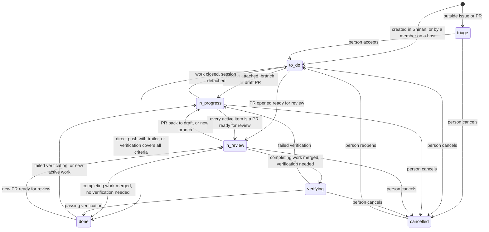

# Tasks and work

Status: **draft for review** ([issue #6](https://github.com/guneet-xyz/shinan/issues/6)).

This document says how a task lives in Shinan: how it is created and
identified, how work on GitHub and Forgejo is linked to it, how its status is
calculated, which manual states and task flags exist, how outside issues are
triaged, how tasks depend on each other, and when a person's comment becomes a
nudge. It uses the terms of the [domain model and glossary](domain-model.md)
exactly.

It stays at the level of rules and meanings. How Shinan reads git hosts is in
[git host integrations](git-hosts.md); how agents call Shinan and receive nudges
is in [agent integrations](agent-integrations.md); how tasks look on screen is
in [human experience](human-experience.md).

## How to read this document

Every rule is marked:

- **Decided**: follows from an accepted decision or from approved plan content
  in the [plan](plan.md), which is cited and gives the reason.
- **Proposed**: suggested here, with a reason. The owner confirms or changes it.
  Proposals that change or reinterpret the plan or current `workspace`
  repository policy are also listed under
  [decisions needed from the owner](#decisions-needed-from-the-owner).
- **Open**: not settled. Listed under [open questions](#open-questions).

Examples use `T-123` as a task ID. `T` stands for whatever the workspace's
prefix turns out to be (see [task IDs](#3-task-ids)).

### Words used in this document

These refine glossary terms and are listed under
[glossary changes](#changes-this-document-needs-in-the-glossary). All are
**proposed**.

| Word | Meaning | Reason |
|---|---|---|
| **Merged** | A PR merged into the repository's default branch, or into a branch the git host connection marks as counting (for example a long-lived release branch). A commit counts as merged when it reaches such a branch by a direct push. | GitHub draws the same line for closing keywords (checked 2026-11-16, [GitHub docs](https://docs.github.com/en/issues/tracking-your-work-with-issues/using-issues/linking-a-pull-request-to-an-issue)). Without it, a stacked PR merged into another feature branch would count as finished work. |
| **Merged elsewhere** | A PR merged into any other branch. It is neither active nor merged. The PR from the branch it merged into carries the work on, and should carry the marker too. | The work has not reached the code people use yet. |
| **Active** | A `delivers` branch with no PR and not merged, a draft PR, or a PR ready for review. A PR stops being active when it is merged, merged elsewhere or closed without merging. | Status needs one word for "work still in flight"; the glossary asks to avoid "open" for tasks. |
| **Confirmed link** | A work link that counts toward status. Links made by members' markers, agents' calls and people are confirmed when made; some are made **unconfirmed** ([6.4](#64-unconfirmed-links)). | Outsiders can write markers on public repositories. |

Issues are never `delivers` work items; they are `origin` or `related`.
**Proposed.** Reason: an issue describes intent, not a change to the code, and
its open or closed state is set by hand, which D-005 avoids copying into
status.

## Contents

1. [From today's practice to Shinan](#1-from-todays-practice-to-shinan)
2. [What a task holds](#2-what-a-task-holds)
3. [Task IDs](#3-task-ids)
4. [Creating tasks](#4-creating-tasks)
5. [Triage of outside issues](#5-triage-of-outside-issues)
6. [Linking work](#6-linking-work)
7. [Calculated status](#7-calculated-status)
8. [Manual states and task flags](#8-manual-states-and-task-flags)
9. [Dependencies](#9-dependencies)
10. [Claims, assignees and agent sessions](#10-claims-assignees-and-agent-sessions)
11. [Nudges](#11-nudges)
12. [Task events](#12-task-events)
13. [Conventions agents follow](#13-conventions-agents-follow)
14. [Worked examples](#14-worked-examples)

## 1. From today's practice to Shinan

Shinan grew out of the hand-made practice in the `workspace` repository's
[collaboration guide](https://git.guneet.dev/guneet/workspace/src/branch/main/docs/collaboration.md)
and [access and safety policy](https://git.guneet.dev/guneet/workspace/src/branch/main/docs/access-and-safety.md).
That practice works; Shinan keeps its rules and removes the manual parts. Until
migration, the `workspace` repository stays the source of truth (D-018).

| Today (issues in the `workspace` repository) | In Shinan | Status |
|---|---|---|
| A coordinating issue in the `workspace` repository links project issues and PRs and does not copy their progress. | A [task](#2-what-a-task-holds). Work on any git host links to it through work links. | Decided (D-001, D-004) |
| Issue numbers are repository-scoped, so cross-repository work needs qualified references or full URLs. | A host-neutral task ID used in branch names and PR descriptions. | Decided (D-002) |
| Branch `task/42-update-locations-agent-a`. | Branch `task/T-123-update-locations-agent-a`. | Proposed ([6.2](#62-markers)) |
| `Closes #42` only in the PR that completes the issue; intermediate PRs merely reference it. | `Completes T-123` in the completing PR; `Part of T-123` in intermediate PRs. | Proposed ([6.3](#63-several-prs-for-one-task)) |
| Project board columns moved by hand; no Markdown status mirror. | Status calculated from linked work. | Decided (D-005) |
| "Merely opening a PR or marking it ready is not task completion"; verify the outcome after merge. | `done` needs merged work, plus a recorded verification where the acceptance criteria need more than the merge. | Proposed ([7.4](#74-verification-and-done)) |
| `human-effort` label plus a TL;DR comment. | The `needs a person` task flag with the same TL;DR as structured fields. | Decided that it exists (plan, Tasks pillar); details proposed ([8.3](#83-needs-a-person)) |
| Deployment approval asked for in the conversation, never through `human-effort`; scope and revision recorded in the issue or PR. | A separate task flag, `awaiting deployment approval`, cleared by a recorded decision. | Proposed; where approval is given is an owner decision ([8.4](#84-awaiting-deployment-approval)) |
| "Waiting on another issue or PR: link the dependency instead." | A dependency between tasks; the `blocked` flag is calculated from it. | Proposed ([section 9](#9-dependencies)) |
| "Announce the agent/session identity in a comment if agents share an account." | The agent session claims the task through Shinan, so its identity is recorded. | Proposed ([section 10](#10-claims-assignees-and-agent-sessions)) |
| "Assignment is not an atomic lock; recheck and coordinate overlaps." | Neither an assignee nor a claim is a lock. | Proposed ([section 10](#10-claims-assignees-and-agent-sessions)) |
| Close a cross-repository coordinating issue by hand if the host cannot. | The task's status is calculated across hosts, so the task itself is never closed by hand. Origin issues on the hosts may still need closing ([5.3](#53-after-triage)). | Decided (D-005) for the task; issue closing proposed |

## 2. What a task holds

A task is the story of one piece of work, from intent to verified outcome
([glossary](domain-model.md#task)).

| Field | Meaning | Status |
|---|---|---|
| Task ID | Stable, host-neutral, never reused ([section 3](#3-task-ids)). | Decided (D-002) |
| Title | Short name for people. | Proposed |
| Intent | What and why, in plain words. | Decided (plan, Tasks pillar) |
| Acceptance criteria | A checklist. A criterion can be marked as a person's step (as today's `**Owner (human effort):**` lines are) or as **verify after merge** ([7.4](#74-verification-and-done)). | Decided that criteria exist (plan, Tasks pillar); markings proposed, reason: they keep today's practice and drive verification |
| Decisions | Decisions made along the way. Lasting ones are promoted to a `decision` catalog entity ([catalog](catalog.md)). | Decided that decisions are held (plan, Tasks pillar); promotion proposed by the glossary |
| Origin | Where the intent started: Shinan, an outside issue or PR, or a conversation (with a short summary). | Decided (D-003) |
| Task status | Calculated ([section 7](#7-calculated-status)). | Decided (D-005) |
| Task flags | `needs a person`, `awaiting deployment approval`, `on hold`, `blocked` ([section 8](#8-manual-states-and-task-flags)). | Proposed (glossary) |
| Verification records | How `done` is reached where the merge is not enough ([7.4](#74-verification-and-done)). | Proposed |
| Assignees | Members responsible. | Proposed (glossary) |
| Attached agent sessions | Sessions that have claimed the task. | Decided (plan, Integration points: the plugin will "attach the session to its task") |
| Work links | Links to PRs, issues, branches and commits ([section 6](#6-linking-work)). | Decided (D-002, D-004) |
| Dependencies | Tasks this one waits for ([section 9](#9-dependencies)). | Proposed |
| Related catalog entities | What the task touches. | Proposed (glossary) |
| Comments, progress updates and timeline | Discussion in Shinan; events from every host. | Decided (plan, Timeline pillar); comment and progress update proposed (glossary) |

Agents and people may both edit title, intent, acceptance criteria and
decisions; every edit is an [event](#12-task-events). **Proposed.** Reason:
today agents write scope and criteria into issues as part of their work, and
the timeline keeps every change visible.

There are no subtasks in the first version. A large piece of work becomes
several tasks joined by [dependencies](#9-dependencies), or one task delivered
by [several PRs](#63-several-prs-for-one-task). **Proposed** (glossary).
Reason: subtasks invite a hand-kept tree whose parent status is copied from its
children, which D-005 avoids; dependencies already express order.

## 3. Task IDs

| Rule | Status | Reason |
|---|---|---|
| Every task has an ID, used in branch names and PR descriptions. | Decided (D-002) | Issue numbers mean something only inside one repository. |
| An ID is `<PREFIX>-<number>`, for example `T-123`. | Proposed | Short, readable, and the shape people already know from other trackers. |
| IDs are unique within the workspace and never reused, even after a task is cancelled. | Proposed (glossary) | A reused ID would make old branches and PRs point at the wrong story. |
| The number counts up from 1 within the workspace. | Proposed | Short numbers are easy to say and type; counting per workspace keeps them short. |
| Each workspace chooses its own prefix of 1 to 5 letters when it is created. The prefix is unique within the Shinan installation. Two or more letters are recommended. | Proposed (glossary; owner decision) | [Git host integrations](git-hosts.md#one-workspace-per-repository-at-first) proposes one workspace per repository at first, but if that is ever relaxed, a fixed `T-` would make `T-12` ambiguous. A per-workspace prefix keeps every marker pointing at one task either way. Longer prefixes make accidental matches rarer. |
| `GH`, `CVE` and `GHSA` are not allowed as prefixes. | Proposed | GitHub already turns `GH-26` into a link to issue 26 of the same repository (checked 2026-11-16, [GitHub docs](https://docs.github.com/en/get-started/writing-on-github/working-with-advanced-formatting/autolinked-references-and-urls)); `CVE-` and `GHSA-` identifiers of security advisories appear often in branch names and descriptions of dependency updates. |
| If a workspace changes its prefix, the old prefix keeps working as an alias forever and is never given to another workspace. | Proposed | Old branch names and PR descriptions cannot be rewritten. |
| IDs are shown in upper case. Branch names are matched without regard to case; everything else needs upper case ([6.2](#62-markers)). | Proposed | Many people write branch names in lower case (`task/t-123-...`), but in prose a lower-case `t-2` or `ui-2` is usually something else. |
| A task cannot move to another workspace. A new task is created there and linked as related. | Proposed | Its ID belongs to its workspace; moving it would break markers. |

## 4. Creating tasks

A task starts where the intent starts, not where the code lands (D-003: every
story needs one home, even when its first chapter was written elsewhere).
**Decided.**

| Where the intent starts | How the task is created | Starting status | Status |
|---|---|---|---|
| A person in Shinan | Created in the web app. | `to do` | Proposed |
| A conversation between a person and an agent | The agent creates the task through MCP or the CLI, with origin "conversation" and a short summary of the request (not the transcript). | `to do` | Proposed. Reason: the request is the intent; the transcript stays in the coding tool, as tool transcripts stay out of the `workspace` repository today. |
| An outside issue on a git host | Shinan creates it automatically ([section 5](#5-triage-of-outside-issues)). | `triage`, or `to do` if a member opened it | Decided (D-003); starting status proposed |
| A PR from an outside actor with no task ID | Shinan creates it automatically, like an outside issue. The PR is the task's `origin`; when a person accepts the task, the PR also becomes a confirmed `delivers` link with scope `completes`. | `triage` | Proposed. Reason: the PR is where that intent starts (D-003), and accepting the task is the person's confirmation that this PR is the work. |
| An item in an outside tool such as Linear or Plane | Not in the first version. Later, through the tool's API, the same way as an outside issue. | `triage` | Proposed. Reason: GitHub and Forgejo come first (D-009); D-010 says outside tools are integrated through their APIs, and treating their items as origins keeps one rule (D-003). Whether outside-tool items can also be `delivers` work is **open**. |

Before creating a task, an agent searches existing tasks and reuses one that
fits. **Proposed.** Reason: today's practice says "search related open issues
… reuse an issue when appropriate"; duplicate tasks split one story.

Routine lookups and questions need no task. **Proposed.** Reason: today's
practice says the same, and tasks for trivial reads would bury real work.

A PR or branch by a member or their agent that carries no task ID is not turned
into a task automatically. It appears in a list of **unlinked work** in
connected repositories, where a person or agent links it or dismisses it.
**Proposed.** Reason: members are expected to use markers; creating tasks for
every forgotten marker would hide the slip and fill the workspace with tasks
nobody asked for. Whether some repositories (for example personal scratch
repositories) are left out of this list is **open**.

## 5. Triage of outside issues

An **outside issue** is an issue opened on a git host without going through
Shinan ([glossary](domain-model.md#outside-issue)). It becomes a task
automatically with a work link of role `origin` (D-003). **Decided.**

### 5.1 Which issues become tasks

Checked in this order; the first row that matches applies. All **proposed**
except where marked.

| Issue | Result | Reason |
|---|---|---|
| Carries Shinan's own marker (an issue created from a task, see [git host integrations](git-hosts.md#9-what-shinan-writes-back)) or a known task ID in its description | No new task. It links to that task as `related`. | Decided for issues made for people (D-004: avoids duplicate issues). Because agents share their member's git host account (D-017), an issue an agent opens for an existing task arrives from the member's account; without this rule it would become a second task for the same story. |
| Opened by an outside actor (an account not linked to a member) | New task in `triage` | Someone in the team must decide whether to take it on. Proposed (glossary). |
| Opened by a member or one of their agents, directly on the host | New task in `to do`, assigned to that member | The member already decided; triage would ask them to approve their own request. Shinan cannot tell the member from their agent here (D-017), and does not need to. |

Issues that already exist when a repository is first connected are **not**
imported automatically. A person can import them explicitly, in a batch, into
`triage`. **Proposed.** Reason: Shinan starts empty and is tried on a few
projects first (D-018); importing years of old issues would flood triage on day
one.

Accounts such as dependency bots can be listed per repository so their issues
and PRs skip triage and go straight to `to do`, or are ignored; their branch
names are not searched for markers. **Proposed.** Reason: automatic update PRs
are frequent and predictable, and their branch names (for example ones naming
`CVE-` advisories or package versions) are where accidental matches happen.
Where this setting lives is for [git host integrations](git-hosts.md).

### 5.2 Triage actions

The [triage inbox](domain-model.md#supporting-terms) lists tasks in `triage`
(Decided: plan, phase 2). A person can:

| Action | Effect | Status |
|---|---|---|
| Accept | Status becomes `to do`. The person can set assignees, intent and acceptance criteria. An outside PR that is the origin becomes a confirmed `delivers` link. | Proposed |
| Merge into an existing task | The outside issue or PR is linked to the existing task as another `origin`. The triage task is cancelled with a pointer to the surviving task. Its ID is never reused. | Proposed. Reason: each reporter's item should be updated when the work is done, so each stays an origin. |
| Cancel | Manual status `cancelled`, with a reason. | Proposed |

Leaving triage is a manual state change made by people only
([glossary](domain-model.md#task-status-task-flags-and-manual-states)).
**Proposed** (glossary). Reason: accepting outside intent commits the team's
effort, which is a person's call.

**Before the inbox exists.** The plan puts the triage inbox in phase 2, while
automatic creation of tasks from outside issues (D-003) may start earlier
([roadmap](roadmap.md)). Until the inbox exists, `triage` tasks appear in the
ordinary task list, filtered by status. **Proposed.** Reason: nothing new needs
building, and the tasks are not lost.

**Keeping the load low.** In the single-owner phase every outside item waits on
the owner. Agents can read `triage` tasks and post a suggested action (accept,
merge into a named task, or cancel) with its reason as a progress update, so
the owner only confirms. **Proposed.** Reason: this is the main way to keep
triage from becoming the owner's bottleneck without letting agents commit the
team's effort. Whether a workspace can let agents accept some kinds of outside
issues is **open**.

### 5.3 After triage

- The reporter should hear the outcome on the host where they reported it.
  **Proposed.** Reason: outside actors do not use Shinan.
  - If the completing PR is in the same repository as the origin issue, it
    carries the host's closing reference (`Closes #42`), so the host closes the
    issue at merge ([6.2](#62-markers)).
  - Otherwise the agent or person who finishes the task closes or comments on
    the origin issue with their own git host tools. A `done` or `cancelled`
    task shows any origin issues still open on the host as a reminder.
  - Shinan itself does not close issues; [git host integrations](git-hosts.md#9-what-shinan-writes-back)
    proposes that it never does, and that its backlink comment on outside issues
    is off by default. This document follows that.
- The origin issue's own state never drives task status. If its author closes
  it while the task is in `triage`, the task shows "origin closed" and offers
  cancel; Shinan does not cancel on its own. **Proposed.** Reason: an outside
  actor should not be able to cancel a team's task, and a closed report can
  still describe a real problem.
- If the origin issue is deleted or moved, the work link is marked gone, an
  event is recorded, and the task is otherwise unchanged. **Proposed.**
- The text of an outside issue is never sent to an agent session as a nudge
  ([section 11](#11-nudges)). Agents read it as data when they work on the
  task. **Proposed.** Reason: anyone on the internet can write an outside
  issue; delivering it as an instruction would let them steer an agent.

## 6. Linking work

The work itself (branches, PRs, reviews, CI) stays on the git hosts; Shinan
links to it (D-001: work spans GitHub and Forgejo, neither can manage the
other, and copying issues creates two sources of truth). **Decided.**

Where Shinan looks for markers, and how it reads them, is owned by
[git host integrations](git-hosts.md#6-detecting-task-markers). This section
settles the syntax and the meaning: which link each marker makes, with which
role, and when it counts.

### 6.1 Work links

A [work link](domain-model.md#work-link) joins a task to a work item. Its role
is `origin`, `delivers` or `related` (glossary, proposed).

This document adds one attribute to `delivers` links: **scope**, either
`completes` (merging this work finishes the code part of the task) or `part`
(this work is one step; the task is not finished when it merges).
**Proposed.** Reason: today's practice already separates the completing PR
(`Closes #42`) from intermediate PRs (references only); without that
distinction Shinan would call a task done when the first of several PRs
merges. The default is `completes`, because most tasks are delivered by one
PR.

| How a link is made ("how made") | Role and scope | Status |
|---|---|---|
| Task ID in a branch name | `delivers`, `completes`, unless the PR on that branch says `Part of` | Proposed |
| `Completes T-123` in a PR description | `delivers`, `completes` | Proposed |
| `Part of T-123` in a PR description | `delivers`, `part` | Proposed |
| Any other mention of a task ID or task address in a PR title or description | `related` | Proposed |
| `Shinan-Task: T-123` trailer in a commit pushed straight to a counting branch | `delivers`, `completes` | Proposed |
| `Shinan-Task-Part: T-123` trailer in such a commit | `delivers`, `part` | Proposed |
| A PR whose host closing reference (`Closes #42`) names a task's `origin` issue, without a task marker | `delivers`, `completes`, **unconfirmed** ([6.4](#64-unconfirmed-links)) | Proposed |
| An agent's call through MCP or the CLI | As the agent says | Decided that agents link PRs directly (D-004) |
| A person in Shinan | As the person says | Proposed |
| Shinan, for an outside issue or PR | `origin` | Decided (D-003) |

Comments on the git host never create links, even when they mention a task
ID. **Proposed.** Reason: people mention task IDs in passing ("like T-12"), and
on public repositories anyone can write a comment. This follows
[git host integrations](git-hosts.md#where-shinan-looks).

A PR or branch that names several task IDs gets one link per task.
**Proposed.** Reason: small fixes sometimes finish two tasks at once, a work
item can link to more than one task (glossary), and one rule for every place a
marker appears is easier to follow. This follows git host integrations rule 4.

**When marker-made links change.** While a work item is active, links made from
markers follow the markers: editing a marker out removes the link, as an event.
Once a PR is merged, merged elsewhere or closed, its marker-made links are
fixed; later edits to its description or title produce a warning event and
change nothing. Links made by an agent's call or by a person stay until someone
removes them. **Proposed.** Reason: while work is in flight, the visible text
on the host and the link in Shinan should agree; after the work is finished, an
edit to an old PR's description must not quietly change the status of a
finished task. This narrows git host integrations rule 5.

### 6.2 Markers

A [marker](domain-model.md#supporting-terms) is text on the git host that
carries a task ID. This section defines the task part. The part that names the
agent session, used for [attribution](domain-model.md#attribution), is defined
by [agent integrations](agent-integrations.md) and [identity](identity.md).

**Branch names (proposed):**

```text
task/T-123-short-description
task/T-123-short-description-agent-a   # when several sessions work on one task
fix/t-123                               # also matches; case does not matter here
```

- The task ID must start a path segment (right after the start of the name or
  a `/`) and be followed by the end of the name, `-`, `_` or `/`. Case does not
  matter. Reason: people and other tools name branches their own way, and many
  use lower case, but requiring the ID to start a segment avoids matching
  inside words.
- The recommended form keeps today's `task/<number>-<slug>` shape with the task
  ID in place of the issue number. Reason: agents and people already know it.
- A bare number never matches (git host integrations rule 1), so today's
  `task/42-...` branches do not link by accident.
- Branches from listed bot accounts are not searched ([5.1](#51-which-issues-become-tasks)).

**PR descriptions (proposed):**

```text
Completes T-123 (https://shinan.guneet.dev/t/T-123)
```

```text
Part of T-123 (https://shinan.guneet.dev/t/T-123)
```

- One line per task. The keyword can be followed by the task ID or the task
  address. Task IDs in descriptions and titles must be written in upper case.
  Reason: lower-case look-alikes are common in prose.
- The keywords are `Completes` and `Part of`, not the hosts' `Closes` or
  `Fixes`. Reason: both GitHub and Forgejo give `close`, `fix` and `resolve`
  (and their variants) a meaning for host issues, and Forgejo also acts on
  `reopen`, `reopens` and `reopened` (checked 2026-11-16,
  [GitHub](https://docs.github.com/en/issues/tracking-your-work-with-issues/using-issues/linking-a-pull-request-to-an-issue),
  [Forgejo](https://forgejo.org/docs/latest/user/collaboration/linked-references/));
  reusing them for tasks would confuse readers about which tracker acts.
- The full link is written next to the ID. Reason: people reading the PR on
  the host can click it without any host setup. GitHub can turn a prefix such
  as `T-` into a link through custom autolinks configured per repository
  (checked 2026-11-16,
  [GitHub docs](https://docs.github.com/en/repositories/managing-your-repositorys-settings-and-features/managing-repository-settings/configuring-autolinks-to-reference-external-resources)).
  Forgejo's equivalent for letter-and-number IDs is part of its external issue
  tracker setting (checked 2026-11-16,
  [Forgejo docs](https://forgejo.org/docs/latest/user/collaboration/linked-references/#external-trackers)),
  which also changes what `#` references mean in that repository. So the
  written link is the only form that works everywhere. Whether Shinan sets up
  GitHub autolinks is for [git host integrations](git-hosts.md). The URL shape
  shown here is illustrative; [architecture](architecture.md) and
  [human experience](human-experience.md) own it.
- Host closing references are still used for host issues. If the task's origin
  issue is in the same repository as the completing PR, the PR also says
  `Closes #42`, so the host closes it at merge without needing Shinan. Limits,
  checked 2026-11-16: GitHub acts on it only when the PR targets the default
  branch ([GitHub docs](https://docs.github.com/en/issues/tracking-your-work-with-issues/using-issues/linking-a-pull-request-to-an-issue));
  Forgejo closes the issue only if the person merging has permission to close
  it ([Forgejo docs](https://forgejo.org/docs/latest/user/collaboration/linked-references/#actionable-references-in-pull-requests-and-commit-messages));
  and neither reaches across hosts. Origin issues the host cannot close are
  handled as in [5.3](#53-after-triage).

**PR titles (proposed):** titles stay plain language. A task ID in a title is
treated like any other mention (`related`). Reason: titles are for people, and
most PRs already carry the ID in their branch name.

**Commit trailers (proposed):**

```text
Shinan-Task: T-123
Shinan-Task-Part: T-124
```

- Written as [Git trailers](https://git-scm.com/docs/git-interpret-trailers)
  at the end of a commit message. Reason: a standard format that tools read
  reliably.
- The key is namespaced (`Shinan-Task`, not `Task`). Reason: other tools use
  plain words as trailer keys, and a namespaced key is unlikely to clash. This
  follows git host integrations.
- Trailers count only on commits that reach a counting branch by a direct
  push. Commits that belong to a PR, including ones copied into the default
  branch by a squash or rebase merge, are ignored; the PR's own markers decide.
  Reason: squash merges copy PR commit messages, trailers included, into the
  default branch, where they would otherwise look like direct pushes and link
  the same work twice. This differs from git host integrations, where "the
  commit's PR inherits the link".
- They are only needed for direct pushes. The `workspace` repository forbids
  those, but personal repositories may allow them, and that work would
  otherwise go unlinked.

**Unknown IDs (proposed):** a marker that names an ID which does not exist in
the workspace that owns the repository's connection makes no link. It is
recorded as unresolved so someone can fix the typo, as git host integrations
proposes. Reason: guessing would link work to the wrong story.

### 6.3 Several PRs for one task

A task is often delivered by more than one PR: a change in a Forgejo
infrastructure repository and another in a GitHub application repository, or a
large change split into steps. This answers part of glossary open question 3.

| Situation | What to write | Status |
|---|---|---|
| One PR finishes the task | `Completes T-123` (or just the branch name) | Proposed |
| Several PRs in different repositories must all merge | `Part of T-123` on each PR until every one of them exists; then change each to `Completes T-123`. The code part is finished when all `completes` links have merged. | Proposed |
| Steps in sequence, the last one finishes | Earlier PRs say `Part of T-123`; the last says `Completes T-123`. | Proposed |
| Not sure yet which PR will be last | `Part of T-123` everywhere; after the last merge, a person or agent [records a verification](#74-verification-and-done) that covers every acceptance criterion. | Proposed |

Reasons:

- "All `completes` links": the cross-repository case is why D-002 exists; a
  task that needs two repositories changed is not done when one has merged.
- "`Part of` until every completing PR exists": Shinan cannot know that a
  second PR is still to come. If the first `Completes` PR merges before the
  second is opened, every `completes` link has merged and the task would move
  to `verifying` or `done` too early. An attached agent session does not hold
  this back.

### 6.4 Unconfirmed links

Some links are made **unconfirmed**. An unconfirmed link is shown on the task
but does not count toward status until it is confirmed. **Proposed** (owner
decision). Reason: on public repositories anyone can open a PR from a fork
that says `Completes T-123`; if that counted, an outsider could move a task to
`in review` or reopen a `done` one. This settles git host integrations rule 6.

| Made by | Who can confirm | Reason |
|---|---|---|
| A marker from a git host account not linked to any member (an outside actor) | A person (workspace owner or contributor), in Shinan | The text was written by an outsider; an agent reading it could be steered by it. |
| A host closing reference to a task's `origin` issue, from a member's PR without a task marker | A person, or an agent session acting for a member | The PR comes from the team; the only question is whether it is the delivering work, which an agent working on the task can judge. |

- Confirming makes the link count, as an event credited to whoever confirmed
  it. Dismissing removes the link, as an event. Confirmation is recorded per
  link; a later marker on the same PR does not need a second confirmation.
- Accepting a `triage` task confirms its outside PR origin as `delivers`
  ([section 4](#4-creating-tasks)).
- If a member later adds a marker to the PR (for example by editing the
  description from their own account), the link counts at once, because the
  marker now comes from a member.

### 6.5 When a PR closes without merging

This answers the rest of glossary open question 3. A `delivers` PR closed
without merging stops being active and stops counting towards status. Its link
stays, marked closed, and an event is recorded. **Proposed.** Reason: status is
calculated from linked work (D-005); a closed PR is no longer work in flight,
but the history of a rejected approach is part of the story.

- If other active work remains, status follows it.
- If nothing is left, status falls back to `to do` (or `in progress` if an
  agent session is still attached).
- The task is never cancelled automatically. Reason: a PR is often closed
  because it is replaced by a better one or the approach was wrong; the intent
  is still there. Only a person cancels.
- If the closed PR was the only `completes` link and other `part` PRs have
  merged, the task shows "no completing work" so someone decides what is
  next.
- If the PR is reopened, it is active again.
- Attached sessions are told when a PR is closed by any actor other than an
  attached session acting through Shinan. Because agents share their person's
  git host account (D-017), a closure on the host often has attribution
  `unknown`; the message then says the PR was closed and by which account,
  without claiming it was someone else. **Proposed.** Whether this message is a
  nudge or a separate kind of message is **open**
  ([open question 4](#open-questions)).

### 6.6 Repository issues for people

Agent-driven work links PRs directly; repository issues are created only when
people need them there (D-004: avoids duplicate issues). **Decided.** Examples
of need: a public project whose users follow issues, or a collaborator who
works only on the host. Git host integrations proposes how such an issue is
created on request.

Such an issue links to the task as `related` and carries the task ID and link in
its description ([5.1](#51-which-issues-become-tasks)). Its state on the host
does not drive task status. **Proposed.** Reason: it is a window onto the task
for people on the host, not a second place where the work is tracked.

## 7. Calculated status

Task status is calculated from linked work, not copied by hand (D-005: copied
status goes stale; this matches the current workspace rule). **Decided.**

The glossary reads D-005 as "calculated from linked work **plus recorded
events**" (acceptance, agent session attachment, verification), and lists this
as an owner decision. This document uses that reading. Nobody types a status
except the manual ones the glossary allows (`cancelled`, and leaving
`triage`).

Several rules below depend on that reading. If the owner chose "linked work
only" instead:

- `triage` would disappear (accepting is an event, not linked work), so
  outside issues would start in `to do`;
- an attached agent session alone could not make a task `in progress`;
- `verifying` and every `done` that rests on a verification record would
  disappear, including `done` for tasks that have no code at all.

### 7.1 Inputs

| Input | Used for | Status |
|---|---|---|
| State of each **confirmed** `delivers` work item: active (branch without PR, draft PR, PR ready for review), merged, merged elsewhere, closed without merging | Main status | Decided that linked work drives status (D-005); the states are proposed |
| Scope of each `delivers` link (`completes` or `part`) | When the code part is finished | Proposed |
| Attached agent sessions | `to do` versus `in progress` | Proposed (glossary) |
| Acceptance criteria marked verify after merge, and verification records | `verifying` versus `done` | Proposed |
| An outside origin not yet accepted | `triage` | Decided (D-003) |
| Manual `cancelled` | Replaces status | Proposed (glossary) |

Unconfirmed links, `related` links, issues, CI checks, reviews, comments and
task flags do not change status. They appear beside it or on the timeline.
**Proposed.** Reason: status answers "where is the work"; mixing in review
comments or CI results would make it flicker without the work moving. A failing
check or a requested change is visible beside the PR on the task page
([human experience](human-experience.md)).

### 7.2 Statuses

The glossary proposes `triage`, `to do`, `in progress`, `in review`, `done` and
`cancelled`. This document proposes one more, **`verifying`**: all completing
work has merged, but an acceptance criterion marked verify after merge has not
yet been covered by a passing verification.

Reason: some outcomes can only be checked after merge. Examples are projects
that deploy as a separate step after merge, scheduled jobs whose first run is
the real test, and changes whose effect shows only in production. Without this
status such a task would look either finished or still in review, both wrong.
Where a merge itself deploys, today's policy requires approval **before** the
merge, so that wait happens in `in review` with the
[`awaiting deployment approval`](#84-awaiting-deployment-approval) flag set,
not in `verifying`.

The alternatives are listed under [owner decisions](#decisions-needed-from-the-owner):
(a) add `verifying`; (b) no new status, so the task stays `in review` until
`done`; (c) no new status, but a calculated flag "awaiting verification" shown
beside `in review`. This document recommends (a), because the PRs are no
longer in review, and a status that says so is clearer than a flag that
contradicts the status beside it.

The diagram shows the usual paths. It is illustrative; [the rules](#73-rules)
decide.



`to_do`, `in_progress` and `in_review` stand for `to do`, `in progress` and
`in review`.

### 7.3 Rules

Only confirmed links count. The **current verification** is the latest
verification record made after the most recent merge of the task's `delivers`
work (or the latest record at all, if nothing has merged). Status is the first
row that matches. **Proposed.**

| # | Condition | Status |
|---|---|---|
| 1 | A person has set `cancelled` | `cancelled` |
| 2 | The task came from an outside issue or PR and has not been accepted | `triage` |
| 3 | There is active `delivers` work, and every active item is a PR ready for review | `in review` |
| 4 | There is active `delivers` work | `in progress` |
| 5 | The current verification is `failed` | `in progress` |
| 6 | At least one `completes` link exists, all of them have merged, and no acceptance criterion is marked verify after merge | `done` |
| 7 | At least one `completes` link exists, all of them have merged, and the current verification is `passed` and covers every criterion marked verify after merge | `done` |
| 8 | No `completes` link exists, the task has at least one acceptance criterion, and the current verification is `passed` and covers every acceptance criterion | `done` |
| 9 | At least one `completes` link exists and all of them have merged | `verifying` |
| 10 | An agent session is attached | `in progress` |
| 11 | Otherwise | `to do` |

Rules 2, 5, 7, 8, 9 and 10 depend on the glossary's reading of D-005
([above](#7-calculated-status)).

Notes on the rules:

- **Least advanced work wins (rule 3).** With one PR ready and another still a
  draft, the task is `in progress`. Reason: status should say what has to
  happen next, and more code still has to be written. The task page still shows
  that one PR is waiting for review. This narrows the glossary's wording ("a
  `delivers` PR is open and ready for review") for the case of several PRs.
- **An attached session does not pull status back.** A session addressing
  review feedback leaves the task `in review`. Rule 10 only lifts `to do` to
  `in progress`. Reason: "someone is working on it" is weaker information than
  the state of the PRs.
- **A failed verification reopens (rule 5).** It applies whether the task was
  `verifying` or `done`, and whether or not any criterion was marked verify
  after merge. A later merge starts a new round, so an old failure does not
  linger. Reason: a person must be able to say "this did not work" and see the
  task move.
- **A verification must cover the criteria (rules 7 and 8).** A passing record
  finishes a task only if it names every criterion that needs checking: every
  verify-after-merge criterion when there is completing work, and every
  acceptance criterion when there is none. Reason: otherwise any agent could
  move any task to `done` by recording one vague "verified", which is a typed
  status in all but name. A task with no criteria and no completing work cannot
  be finished by verification; someone adds criteria first.
- **Tasks without code (rule 8).** Some tasks are a console step, a decision or
  an investigation. A verification covering every acceptance criterion
  finishes them. Reason: otherwise such tasks could never reach `done` without
  a typed status. This widens the glossary's list of recorded events, and is
  part of [owner decision 5](#decisions-needed-from-the-owner).
- **New work reopens a finished task.** A new confirmed, active `delivers` link
  on a `done` task moves it back by rules 3 and 4, with an event that names the
  work. Agents are told to create a follow-up task instead (linked as related
  or as a dependency) unless the original outcome was wrong. Reason: status
  stays calculated from linked work, while the convention keeps finished
  stories finished. Outsiders cannot do this, because their links are
  unconfirmed ([6.4](#64-unconfirmed-links)).
- **Reverts.** A revert PR that carries the task ID is ordinary `delivers`
  work and reopens the task by the rule above. Detecting reverts that carry no
  marker is **open** ([git host integrations](git-hosts.md)).

### 7.4 Verification and done

`done` means the outcome is verified, not only that code merged (plan: tasks
run "from intent to verified outcome"). **Decided** that verification is part
of done. The mechanism below is **proposed** and follows the glossary: where no
check beyond the merge applies, merging is enough.

- An acceptance criterion can be marked **verify after merge**, for example
  "the first scheduled backup succeeds" or "the page loads on
  `shinan.guneet.dev`". If any criterion is so marked, the task passes through
  `verifying`. Reason: this ties verification to what the task promised,
  instead of a blanket rule that would add a step to documentation-only
  changes.
- A **verification record** says who verified, when, which criteria were
  covered, the result (`passed` or `failed`) and a link to evidence where one
  exists (a deployment log, a URL, the merged commit). It is an event on the
  task.
- Agents and people may record verification. A person can record a `failed`
  verification at any time, which moves the task back to `in progress`
  ([rule 5](#73-rules)). **Proposed** (glossary). Reason: today agents verify
  the outcome as part of finishing work, and a person must be able to say it
  did not work.
- Whether a criterion is marked verify after merge when nobody says either way
  is an [owner decision](#decisions-needed-from-the-owner). This document
  recommends "no" (merge is enough by default), with agents asked to mark
  deployment-related criteria when they write them. Reason: it matches the
  glossary and today's "applicable verification", and keeps simple tasks
  simple.
- **Handing off at "ready for review".** Today's practice allows an agent to
  stop at "ready for review" when the person asked for that handoff. In
  Shinan the task simply stays `in review`; nothing extra is recorded. Reason:
  that is the true state of the work, and the person picks it up from there.

### 7.5 How fresh the status is

Status is only as fresh as Shinan's last reading of each linked work item. If
any active work item has not been read for longer than a threshold, the task
shows when it was last confirmed. **Proposed.** Reason: catalog facts show how
fresh they are (D-007); a status calculated from stale readings deserves the
same honesty. Reading, reconciliation and the threshold belong to
[git host integrations](git-hosts.md); display belongs to
[human experience](human-experience.md).

Every status change is recorded as an event that names its cause (for example
"PR guneet/infra!12 on git.guneet.dev merged"). **Proposed.** Reason: a
calculated status is only trusted if people can see why it changed.

## 8. Manual states and task flags

Some states cannot be calculated. The plan names "needs a person" as one only a
person can set (plan, Tasks pillar). **Decided** that such states exist. The
glossary calls a status or flag set explicitly by an actor a **manual state**,
and a marker shown beside the status a **task flag**.

| State | Kind | Who sets it | Who clears it | Status |
|---|---|---|---|---|
| `cancelled` | Manual status | A person | A person (reopen) | Proposed (glossary) |
| `on hold` | Manual flag | A person | A person | Proposed (glossary) |
| `needs a person` | Manual flag | An agent or a person, with the TL;DR fields | A person, or the agent after it confirms the step is done | Proposed (glossary); owner decision |
| `awaiting deployment approval` | Manual flag | Whoever asks for approval | A recorded approval or decline | Proposed (glossary); owner decisions |
| `blocked` | Calculated flag | Never set by hand | Calculated | Proposed (glossary) |

### 8.1 Cancelled

A person cancels with a reason. Linked PRs that are still active are **not**
closed by Shinan; the task shows a warning that active work is linked to a
cancelled task. **Proposed.** Reason: Shinan does not manage git host work
(D-001); the person decides on the host. A cancelled task can be reopened by a
person; status is then calculated again.

### 8.2 On hold

A person pauses a task. Agents do not claim a task on hold without a person's
go-ahead, and attached sessions are told through a nudge from that person
([11.1](#111-when-a-nudge-is-created)). **Proposed.** Reason: a pause the agent
does not hear about is not a pause.

### 8.3 Needs a person

This replaces today's `human-effort` label and keeps its rules:

- **Use it** when the task cannot progress until a person does something an
  agent cannot or must not do: access agents lack, entering or rotating
  secrets, physical or out-of-band steps, checks only a person can make, and
  decisions that belong to the owner.
- **Do not use it** for deployment approval (see
  [8.4](#84-awaiting-deployment-approval)), routine work, waiting on another
  task (use a [dependency](#9-dependencies)), blockers an agent can still fix,
  or questions a quick answer in the conversation would settle.
- **Setting it requires the TL;DR fields**, the same as today's comment:
  summary (one sentence), action (steps with where to do them), why a person,
  and then (what this unblocks and how to say it is done). The matching
  acceptance criterion is marked as a person's step.
- **Secrets never pass through Shinan.** The fields say where the person types
  a secret, never the value. Reason: the same rule as today; Shinan holds
  infrastructure details on a public sign-in site (D-015) and must not also
  hold secrets.
- If the needed action changes, the fields are replaced and the change is an
  event. When the step is done, the flag is cleared with a short result, and
  who cleared it is recorded.
- Setting it sends no nudge; a person clearing it nudges attached sessions with
  the result. Reason: the agent set it and already knows; it needs to hear when
  it can continue.

All of the above is **proposed** and taken from today's practice, which works.

**Who sets it is in tension with the plan.** The plan's Tasks pillar reads as
if only a person can set `needs a person`. Today agents add the label, because
they are the ones who find the step they cannot do. The glossary and this
document propose that agents may set it with the TL;DR fields, and that people
and agents may clear it. This document adds that an agent clears it only after
confirming the step is done (for example by checking that the access now
works). Reason: if only people could set it, the flag would arrive late or
never, because the person learns of the need from the agent. This is an
[owner decision](#decisions-needed-from-the-owner).

### 8.4 Awaiting deployment approval

Today, the only approval gate in routine work is a change to an actual
deployment, and it is deliberately kept apart from `human-effort`
([access and safety](https://git.guneet.dev/guneet/workspace/src/branch/main/docs/access-and-safety.md)).
Shinan keeps it apart. **Proposed** (owner decision). Reason: deployment
approval has its own required scope and its own renewal rule, and mixing it
into `needs a person` would hide both.

**What is asked and what an approval covers** (taken from today's policy;
**proposed** for Shinan):

- An agent sets `awaiting deployment approval` when it asks for approval,
  before the action that would trigger the deployment (including an
  auto-deploying merge). The request carries today's required contents: target
  and environment, operation and relevant revision, expected impact and risks,
  verification, rollback, and any coordination or lock.
- An approval can cover a defined deployment sequence, so the agent does not
  ask again for unchanged approved steps.
- A material change to the operation, target, impact or revision makes the
  approval stale; the agent must ask again and the flag returns.
- A decline also clears the flag and is recorded. Reason: a declined request
  should not look as if it is still waiting. (The glossary says the flag is
  cleared only by an approval.)
- Shinan records the request and the answer and shows them on the task and
  timeline. It does not run deployments or enforce the gate on the host.
  Reason: Shinan sits above git hosts and does not replace them (D-001), and
  agents do the work from outside (D-008); enforcing belongs to the host's
  protections and the agent's rules.
- D-016 applies this same approval to Shinan's own deployments at
  `shinan.guneet.dev`; those are ordinary tasks under these rules.

**Where approval is given** changes current policy, so it is an
[owner decision](#decisions-needed-from-the-owner). Today the owner approves in
the agent conversation and the agent records the scope and revision in the
issue or PR. The options:

- **(a) Only in Shinan.** A signed-in person approves or declines the request
  in the web app.
- **(b) In Shinan, or in the conversation.** As (a), or the agent records an
  approval the person gave in its conversation, with the scope and revision.
  That record is shown as reported by the agent session, not as the person's
  own action, so people can see it has lower attribution confidence.

This document recommends **(b) for the single-owner phase**. Reason: it keeps
today's policy, which works, and the owner is usually in the conversation with
the agent that asks. Approval in Shinan is still offered and is the stronger
record. The choice should be revisited when other people join a workspace,
because an agent's report of an approval is weaker evidence than a person's
own action.

What does **not** count as approval, under either option (**proposed**):

- A comment or review on the git host saying "approved". Reason: agents use
  the same git host account as their person (D-017), so Shinan cannot tell who
  wrote it.
- A task comment or nudge saying "approved". Reason: the approve action is one
  step away and binds the answer to the exact request (operation, target,
  revision); free text could be read as approving a different revision.

The person's answer, given in Shinan, nudges the waiting session. **Proposed.**
Reason: the agent is waiting for exactly this answer. How approvals are
attributed and protected is owned by [identity](identity.md).

## 9. Dependencies

A task can **depend on** other tasks in the same workspace. **Proposed.**

| Rule | Status | Reason |
|---|---|---|
| `blocked` is shown while any dependency is not `done`. It is calculated, never set by hand. | Proposed (glossary) | Today's practice: "waiting on another issue or PR: link the dependency instead", and waiting is not `human-effort`. |
| A dependency that is `cancelled` does not unblock the task. It shows "dependency cancelled" until a person removes or replaces the dependency. | Proposed | Cancelling a prerequisite rarely means the dependent work can go ahead unchanged; a person should decide. |
| Dependencies that would form a loop are refused. | Proposed | A loop can never be unblocked. |
| Dependencies stay inside one workspace. | Proposed | Nothing is shared between workspaces except the person (glossary). |
| `blocked` does not stop work. Agents may prepare work on a blocked task but should not merge work that relies on the unfinished dependency. | Proposed | Today agents continue work that the blocker does not affect. |
| When a dependency becomes `done`, sessions attached to dependent tasks are told. | Proposed; delivery form **open** ([open question 4](#open-questions)) | The waiting agent should not have to poll. |

Waiting on something outside the workspace (for example an upstream project's
issue in a repository no git host connection covers) is shown as a `related`
link with a note. It does not produce `blocked`. **Open.** Reason it stays
open: Shinan cannot read the state of work it has no connection to, so it
cannot calculate the flag.

## 10. Claims, assignees and agent sessions

- An agent session **claims** a task to work on it; the session is then
  attached (glossary: at most one task per session, proposed). The claim is
  recorded with the session's identity. **Proposed.** Reason: today agents
  sharing an account must announce their identity in a comment; a claim through
  Shinan records it reliably (D-017).
- **Neither a claim nor an assignee is a lock.** Several sessions may claim one
  task. The claiming session is told who else is attached, and sessions agree
  how to divide the work in progress updates, each on its own branch.
  **Proposed** (glossary). Reason: today's practice says "assignment is not an
  atomic lock; recheck and coordinate overlaps", and one task can legitimately
  need two repositories worked in parallel.
- Exclusive operations (deployments, database migrations, shared-checkout
  refreshes) need their own coordination and locks. Whether Shinan provides
  such locks is **open**; today they are coordinated by hand.
- If a task has no assignee when a session claims it, the member the agent acts
  for becomes the assignee. **Proposed.** Reason: the person stays accountable
  for their agents' work (glossary, acting for).
- A session detaches when it ends or moves to another task. Detaching is an
  event. Status is recalculated ([rule 10](#73-rules)).
- A claim is not needed for an agent to read a task. **Proposed.** Reason:
  reading for context should not change status or presence.

## 11. Nudges

When a person comments, the agent session working on the task is told. Sessions
with a tool plugin get the message live; others pick it up the next time they
check in. If no session is active, the person can ask for a new one (plan,
Nudges pillar). **Decided.**

This section owns **when a nudge is created and to whom**. Delivery (how the
message reaches a running session, check-ins, presence, delivery states) is
owned by [agent integrations](agent-integrations.md). Screens are owned by
[human experience](human-experience.md).

### 11.1 When a nudge is created

| Source | Creates a nudge? | Status | Reason |
|---|---|---|---|
| A comment on the task by a workspace owner or contributor | Yes, unless the person marks it "note only" | Decided that comments nudge (plan); the opt-out is proposed | People sometimes write notes for other people; interrupting the agent for those wastes its work. |
| An explicit nudge (a message to a chosen session) | Yes | Proposed | A person may want to reach one of several attached sessions. |
| A person's action that the agent must hear about: answering a deployment approval request, clearing `needs a person`, setting `on hold` | Yes. The nudge is **from that person**; Shinan writes the message text for them. | Proposed | The agent is waiting for, or must react to, exactly these, and they come from a person, as the glossary's definition of a nudge requires. |
| Something that happens without a person's action in Shinan: a PR closed on the host, a dependency becoming `done`, a linked PR merged | Not a nudge; how the session hears is **open** ([open question 4](#open-questions)) | Open | The glossary defines a nudge as a message from a person. |
| A progress update or comment by an agent | No | Proposed (glossary for progress updates) | Agents nudging agents can loop; agents coordinate through progress updates they read when they check in. |
| A viewer | Viewers cannot comment or nudge | Proposed | The glossary's viewer role only reads. |
| A comment or review on a linked PR or issue on the git host | No, in the first version | Proposed; **open** for later | Agents share their person's git host account (D-017), so Shinan often cannot tell whether a host comment came from the person or from the agent itself. Nudging on it would make agents nudge themselves. This answers git host integrations open question 8 for now. |
| An outside issue's text, or comments by outside actors | Never | Proposed | Anyone can write them; delivering them as instructions would let strangers steer agents. |

### 11.2 To whom

- A nudge goes to every agent session attached to the task, or to the one the
  person chose, with one delivery per session (glossary). **Proposed.** Reason:
  normally there is one; when there are several, all should hear about a change
  of direction.
- If no session is attached, the nudge records "no active session". It stays on
  the task, and the next session that claims the task gets a delivery for it.
  **Proposed.** Reason: the person's instruction should not be lost because the
  agent was not running.
- If a target session ends before its delivery completes, that delivery is
  `undeliverable` (glossary), the person sees this, and the nudge is handed to
  the next session that claims the task in the same way. **Proposed.** Reason:
  the person must know whether their message reached an agent.
- The person can ask for a new agent session from the task. Before phase 3 this
  records a request that a person acts on by hand; in phase 3 a launcher can
  start the session (D-014). **Decided** that the person can ask (plan, Nudges
  pillar); how is owned by [agent integrations](agent-integrations.md).

### 11.3 What a nudge means

- A nudge carries the message, the person it is from, the task ID and a link.
  It is an instruction from a signed-in member, with that member's authority.
  **Proposed.** Reason: only workspace owners and contributors can nudge, so
  the agent can treat it as it would treat the same words typed by that person
  in its conversation. The one exception is deployment approval, which a nudge
  never grants ([8.4](#84-awaiting-deployment-approval)).
- `delivered` means the session received the message, not that it agreed or
  acted. The agent answers with a progress update. **Proposed.** Reason: a
  delivery receipt that claimed action would mislead.
- Several nudges waiting for one session are delivered together, in order.
  **Proposed.**
- A person may withdraw a nudge before it is delivered. Editing a comment after
  its nudge was delivered does not send a new nudge unless the person asks for
  one. **Proposed.** Reason: avoids surprise repeats; the edit is still on the
  timeline.
- Nudges on a `done` or `cancelled` task are created the same way; usually
  there is no active session, so the person can ask for one. Work that follows
  is linked as usual and moves status by [the rules](#73-rules). **Proposed.**

## 12. Task events

Everything that happens to a task is an [event](domain-model.md#event) credited
to an actor. The task produces these kinds (**proposed**); git host events and
presence events are listed by their owning documents.

| Event | Typical actor |
|---|---|
| Task created (with origin) | Person, agent session, or Shinan |
| Accepted, merged into another task, cancelled, reopened | Person |
| Title, intent, acceptance criteria or decisions changed | Person or agent session |
| Work link added, removed, confirmed or dismissed (with "how made") | Person, agent session, or Shinan |
| Marker edited on a finished PR (warning; no change) | Shinan |
| Status changed (with the cause) | Shinan |
| Task flag set, changed or cleared | Person, agent session, or Shinan (`blocked`) |
| Deployment approval requested, approved, declined, made stale | Agent session; person; agent session reporting a conversation approval |
| Verification recorded | Person or agent session |
| Dependency added or removed | Person or agent session |
| Session claimed or detached; assignee changed | Agent session; person; Shinan |
| Comment or progress update added | Person; agent session |
| Nudge created, delivered, undeliverable, withdrawn | Person; Shinan |

## 13. Conventions agents follow

These are the task-side rules that the skill and MCP tools will teach. How they
are taught and enforced is owned by [agent integrations](agent-integrations.md).
All are **proposed**, following the sections above.

1. Search for an existing task before creating one; reuse it when it fits.
2. Claim the task before working on it. Read others' claims and coordinate in
   progress updates.
3. Name the branch `task/<task ID>-<short description>[-<suffix>]`.
4. Open a draft PR early. In its description write `Completes <task ID>` or
   `Part of <task ID>`, with the task link, and the task ID in upper case.
5. When a task needs PRs in several repositories, write `Part of` on each until
   all of them exist, then switch them to `Completes`.
6. If the task came from an issue in the same repository, also write the host's
   closing reference (`Closes #42`) in the completing PR. Otherwise, when the
   task is done, close or comment on the origin issue with your own git host
   tools.
7. Mark acceptance criteria that need verifying after merge when writing them.
8. Set `needs a person` with all TL;DR fields when blocked on a person; set
   `awaiting deployment approval` with the full request before any action that
   triggers a deployment. Never put secrets in either. Never treat a comment or
   nudge as deployment approval.
9. Record dependencies instead of waiting silently.
10. After the completing work merges, verify what the criteria require and
    record the verification, naming the criteria covered and the evidence.
11. Answer nudges with a progress update.
12. Prefer a follow-up task over linking new work to a `done` task.
13. When the person asked for a handoff at "ready for review", stop there; the
    task stays `in review`.

## 14. Worked examples

### A change across GitHub and Forgejo

1. The owner asks an agent for a new backup schedule. The agent finds no
   existing task and creates `T-123` (origin: conversation). One acceptance
   criterion, "the first scheduled backup succeeds", is marked verify after
   merge. Status `to do`.
2. The agent claims it: status `in progress`. It opens branch
   `task/T-123-backup-schedule` in a Forgejo infrastructure repository and a
   draft PR with `Part of T-123`, because a second PR is still to come. A
   second session claims the same task for the GitHub application change; the
   two agree the split in progress updates.
3. The second session opens its GitHub PR. Both PRs now exist, so both are
   changed to `Completes T-123`. Had the first PR said `Completes` and merged
   before the second PR existed, the task would have moved to `verifying` too
   early.
4. Both PRs are marked ready: status `in review`.
5. The Forgejo PR merges. The GitHub PR is still active: still `in review`.
6. The GitHub PR merges. Both `completes` links merged and a criterion needs
   verifying: status `verifying`.
7. Rolling out the schedule is a separate step that changes a deployment. The
   agent sets `awaiting deployment approval` with the full request. The owner
   approves (in Shinan, or in the conversation, depending on the
   [owner decision](#decisions-needed-from-the-owner)). The session rolls out,
   checks the first backup and records a passing verification that covers the
   criterion, with a link to its log. Status `done`.

### A PR closed without merging

1. `T-130` has one PR, `Completes T-130`, in review.
2. The owner comments on the task: "Wrong approach, use the existing queue."
   The attached session gets a nudge, closes the PR itself and opens a new
   branch.
3. When the PR closes, its link is marked closed. Status drops to
   `in progress` (a new branch exists). The closed PR stays on the timeline.
   The session is not told about the closure as if someone else did it: the
   closure has attribution `unknown` (D-017), so any message only states that
   the PR was closed and by which account.

### An outside issue

1. A stranger opens issue #57 in a public GitHub repository. Shinan creates
   `T-140` in `triage` with #57 as `origin`.
2. An agent posts a suggestion as a progress update: "Duplicate of T-121."
   The owner merges it into `T-121`; #57 becomes a second `origin` of `T-121`,
   and `T-140` is cancelled with a pointer.
3. The stranger then opens a fork PR that says `Completes T-121`. Its link is
   unconfirmed and does not change status until the owner confirms it.
4. The owner's own PR that completes `T-121` is in the same repository and
   targets the default branch, so it also says `Closes #57`; GitHub closes the
   issue at merge.

## Changes this document needs in the glossary

The [domain model and glossary](domain-model.md) is in review. This document
depends on these changes, which should be made there (or that document's
choice adopted here):

1. Add the `delivers` link attribute **scope** (`completes` or `part`)
   ([6.1](#61-work-links)).
2. Add **unconfirmed link** (and confirm, dismiss) ([6.4](#64-unconfirmed-links)).
3. Add **merged**, **merged elsewhere** and **active**
   ([words used](#words-used-in-this-document)), and state that issues are
   never `delivers` work items.
4. Widen `origin` from "the outside issue the task came from" to "the outside
   issue or PR where the task's intent started; a task can have several".
5. Add the calculated status **`verifying`** ([7.2](#72-statuses)), if the
   owner chooses it.
6. Add **verification record** and the acceptance-criterion marking **verify
   after merge** ([7.4](#74-verification-and-done)). It is not called "check
   after merge" because the glossary keeps "check" for fact checks and CI
   checks.
7. Add **unlinked work** ([section 4](#4-creating-tasks)).
8. Add verification covering every criterion as a way to reach `done` without
   merged work, to the list of recorded events in the glossary's reading of
   D-005 ([7.3](#73-rules)).
9. Note that a decline also clears `awaiting deployment approval`, and that a
   conversation approval recorded by an agent may count
   ([8.4](#84-awaiting-deployment-approval)), depending on the owner decision.
10. Narrow `in review` to "every active `delivers` item is a PR ready for
    review" ([7.3](#73-rules)).
11. Mark glossary open question 3 (several `delivers` links, PR closed without
    merging) as answered here, and question 1 as answered for origins
    ([section 4](#4-creating-tasks)).

## Dependencies on other documents

| Document | What this document needs from it |
|---|---|
| [Domain model and glossary](domain-model.md) | The terms used here, and the changes listed above. |
| [Git host integrations](git-hosts.md) (PR #21) | Reading markers, PR states and merges, reconciliation and freshness thresholds, per-repository bot account lists, revert detection, GitHub autolink setup, and recognising issues that carry Shinan's marker. This document settles the following points where the current draft differs, and asks that draft to follow them: |
| | 1. **Comments create no links**: agreed (follows the draft). |
| | 2. **Several IDs in one place** make one link per task: agreed, including branch names (follows rule 4). |
| | 3. **Trailer keys** are `Shinan-Task:` and `Shinan-Task-Part:` (the second is new). |
| | 4. **Trailers on commits that belong to a PR are ignored**, including commits copied by squash or rebase merges; the draft's "the commit's PR inherits the link" should be dropped, and the draft needs a way to tell direct pushes from PR merges. |
| | 5. **Marker-made links are fixed once a PR is merged, merged elsewhere or closed**; later edits produce a warning event. This narrows rule 5 ("edits are re-read"). |
| | 6. **A closing reference to an `origin` issue** makes an unconfirmed `delivers` link with scope `completes`, which a person or an agent acting for a member can confirm. |
| | 7. **Outside actors' markers** make unconfirmed links that only a person can confirm (rule 6 and its decision 8). |
| | 8. **Branch name matching**: the ID must start a path segment and match without regard to case; elsewhere upper case only; branches of listed bot accounts are skipped; `GH`, `CVE` and `GHSA` are reserved. |
| | 9. **"Merged"** means merged into the default branch or a counting branch configured on the connection; the draft needs a place for that setting. |
| | 10. **Closing origin issues**: this document relies on the draft's rule that Shinan never closes issues; origin issues are closed by the host's closing references or by agents and people with their own tools. |
| | 11. **Comments as nudges** (its open question 8): not in the first version ([11.1](#111-when-a-nudge-is-created)). |
| [Agent integrations](agent-integrations.md) | Claim and detach calls; nudge delivery, check-ins and delivery states; how sessions hear about events that are not nudges (open question 4); the session part of markers; recording a conversation approval; teaching the conventions in [section 13](#13-conventions-agents-follow); requesting a new agent session. |
| [Identity, agents and permissions](identity.md) | Who may comment, nudge, triage, cancel, confirm links and approve; how a deployment approval given in Shinan is protected and how an agent-reported approval is shown; visibility of tasks that link to private repositories. |
| [Human experience](human-experience.md) | Task page, triage inbox, unlinked work list, unconfirmed links and how to confirm them, origin issues still open on `done` tasks, board, display of status freshness, nudge delivery states and the "ask for a session" action. |
| [Catalog](catalog.md) | Promoting task decisions to `decision` entities; linking tasks to catalog entities. |
| [Architecture and operations](architecture.md) | Task URL shape; how status is recalculated and stored. |
| [Roadmap and migration](roadmap.md) | Which of these rules are in phase 1 versus phase 2: the plan puts nudges and the triage inbox in phase 2, while automatic tasks from outside issues (D-003) may start in phase 1, which leaves the single owner triaging from the task list; how active coordinating issues in the `workspace` repository become tasks at migration. |
| [Decision log](decisions/) | Records for the owner decisions below once made. |

## Open questions

1. **Unlinked work exclusions.** Should some repositories (scratch, personal)
   be left out of the unlinked work list? ([section 4](#4-creating-tasks))
2. **Agents in triage.** Can a workspace let agents accept some kinds of
   outside issues, for example from listed bot accounts? ([5.2](#52-triage-actions))
3. **Git host comments as nudges.** Once attribution is reliable enough, should
   a person's review comment on a linked PR nudge the session? Depends on how
   reliable attribution can be (plan question 2). ([11.1](#111-when-a-nudge-is-created))
4. **Messages that are not from a person.** When a PR is closed on the host, a
   dependency finishes or a linked PR merges, the attached session should hear.
   The glossary defines a nudge as a message from a person. Is this a separate
   kind of message, or a nudge from Shinan? ([6.5](#65-when-a-pr-closes-without-merging), [section 9](#9-dependencies), [11.1](#111-when-a-nudge-is-created))
5. **Outside waiting.** How to show that a task waits on work in a repository
   no git host connection covers. ([section 9](#9-dependencies))
6. **Exclusive operations.** Should Shinan offer locks for deployments and
   migrations, or stay out of it? ([section 10](#10-claims-assignees-and-agent-sessions))
7. **Stale work.** Should a branch or draft PR with no activity for a long time
   still count as active, or be flagged? ([7.3](#73-rules))
8. **Reverts without markers.** Can Shinan detect them, and should they reopen
   the task? ([7.3](#73-rules))
9. **Outside tools as delivering work.** Can items in Linear, Plane or Multica
   be `delivers` work, or only origins? ([section 4](#4-creating-tasks))
10. **Same prefix in two installations.** Two self-hosted copies of Shinan
    connected to one repository could both use `T-`. Is that worth guarding
    against? ([section 3](#3-task-ids))

## Decisions needed from the owner

| # | Decision | Recommended | Reason |
|---|---|---|---|
| 1 | Task ID prefix ([3](#3-task-ids)) | One prefix per workspace, not a fixed `T-` | Markers stay unambiguous if a repository is ever connected to two workspaces. |
| 2 | Who may set `needs a person` ([8.3](#83-needs-a-person)) | Agents too, with the TL;DR fields | Agents discover these steps; today they add the `human-effort` label themselves. |
| 3 | Deployment approval as its own flag ([8.4](#84-awaiting-deployment-approval)) | Yes, separate from `needs a person` | Today's policy keeps them apart; approval has its own scope and renewal rules. |
| 4 | Where deployment approval is given ([8.4](#84-awaiting-deployment-approval)) | In Shinan, or in the conversation as recorded by the agent; never by comment or nudge | Keeps today's policy for the single owner; revisit when others join. |
| 5 | Reading of D-005 ([7](#7-calculated-status)) | Linked work plus recorded events, including verification covering every criterion as a way to reach `done` | Without it, `triage`, `verifying`, session-based `in progress` and `done` for tasks without code disappear. |
| 6 | Several PRs for one task ([6.3](#63-several-prs-for-one-task)) | `Completes` / `Part of` scope on links, with `Part of` until every completing PR exists | Otherwise the first merged PR can mark the task done. |
| 7 | Status between merge and verified outcome ([7.2](#72-statuses)) | Add `verifying` (rather than staying `in review`, or a flag beside `in review`) | The PRs are no longer in review; a status that says so is clearest. |
| 8 | Default for "verify after merge" ([7.4](#74-verification-and-done)) | Off unless a criterion is marked | Matches today's "applicable verification"; keeps simple tasks simple. |
| 9 | Existing issues when a repository is connected ([5.1](#51-which-issues-become-tasks)) | Import nothing unless a person asks | Shinan starts small (D-018); a flood on day one would make triage useless. |
| 10 | Markers from outside actors ([6.4](#64-unconfirmed-links)) | Unconfirmed until a person confirms | Stops outsiders' fork PRs from changing task status; matches git host integrations decision 8. |
| 11 | Links from git host comments ([6.1](#61-work-links)) | None | Passing mentions are noisy, and anyone can comment on public repositories. |
