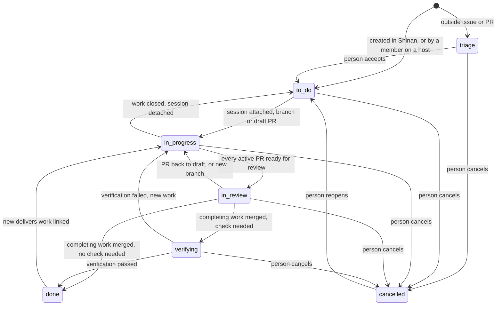

# Tasks and work

Status: **draft for review** ([issue #6](https://github.com/guneet-xyz/shinan/issues/6)).

This document says how a task lives in Shinan: how it is created and
identified, how work on GitHub and Forgejo is linked to it, how its status is
calculated, which manual states and task flags exist, how outside issues are
triaged, how tasks depend on each other, and when a person's comment becomes a
nudge. It uses the terms of the [domain model and glossary](domain-model.md)
exactly.

It stays at the level of rules and meanings. How Shinan reads git hosts is in
[git host integrations](git-hosts.md); how agents call Shinan and receive nudges
is in [agent integrations](agent-integrations.md); how tasks look on screen is
in [human experience](human-experience.md).

## How to read this document

Every rule is marked:

- **Decided**: follows from an accepted decision or from approved plan content
  in the [plan](plan.md), which is cited and gives the reason.
- **Proposed**: suggested here, with a reason. The owner confirms or changes it.
  Proposals that change or reinterpret the plan are also listed under
  [decisions needed from the owner](#decisions-needed-from-the-owner).
- **Open**: not settled. Listed under [open questions](#open-questions).

Examples use `T-123` as a task ID. `T` stands for whatever the workspace's
prefix turns out to be (see [task IDs](#3-task-ids)).

A `delivers` work item is **active** while it is a branch without a PR, a draft
PR or a PR ready for review; it stops being active when it merges or is closed
without merging. This document uses "active" in that sense, and avoids "open"
for tasks, as the glossary asks.

## Contents

1. [From today's practice to Shinan](#1-from-todays-practice-to-shinan)
2. [What a task holds](#2-what-a-task-holds)
3. [Task IDs](#3-task-ids)
4. [Creating tasks](#4-creating-tasks)
5. [Triage of outside issues](#5-triage-of-outside-issues)
6. [Linking work](#6-linking-work)
7. [Calculated status](#7-calculated-status)
8. [Manual states and task flags](#8-manual-states-and-task-flags)
9. [Dependencies](#9-dependencies)
10. [Claims, assignees and agent sessions](#10-claims-assignees-and-agent-sessions)
11. [Nudges](#11-nudges)
12. [Task events](#12-task-events)
13. [Conventions agents follow](#13-conventions-agents-follow)
14. [Worked examples](#14-worked-examples)

## 1. From today's practice to Shinan

Shinan grew out of the hand-made practice in the `workspace` repository's
[collaboration guide](https://git.guneet.dev/guneet/workspace/src/branch/main/docs/collaboration.md).
That practice works; Shinan keeps its rules and removes the manual parts. Until
migration, the `workspace` repository stays the source of truth (D-018).

| Today (issues in the `workspace` repository) | In Shinan | Status |
|---|---|---|
| A coordinating issue in the `workspace` repository links project issues and PRs and does not copy their progress. | A [task](#2-what-a-task-holds). Work on any git host links to it through work links. | Decided (D-001, D-004) |
| Issue numbers are repository-scoped, so cross-repository work needs qualified references or full URLs. | A host-neutral task ID used in branch names and PR descriptions. | Decided (D-002) |
| Branch `task/42-update-locations-agent-a`. | Branch `task/T-123-update-locations-agent-a`. | Proposed ([6.2](#62-markers)) |
| `Closes #42` only in the PR that completes the issue; intermediate PRs merely reference it. | `Completes T-123` in the completing PR; `Part of T-123` in intermediate PRs. | Proposed ([6.3](#63-several-prs-for-one-task)) |
| Project board columns moved by hand; no Markdown status mirror. | Status calculated from linked work. | Decided (D-005) |
| "Merely opening a PR or marking it ready is not task completion"; verify the outcome after merge. | `done` needs merged work, plus a recorded verification where the acceptance criteria need more than the merge. | Proposed ([7.4](#74-verification-and-done)) |
| `human-effort` label plus a TL;DR comment. | The `needs a person` task flag with the same TL;DR as structured fields. | Decided that it exists (plan, Tasks pillar); details proposed ([8.3](#83-needs-a-person)) |
| Deployment approval asked for separately and never through `human-effort`. | A separate task flag, `awaiting deployment approval`, cleared by a recorded deployment approval. | Proposed ([8.4](#84-awaiting-deployment-approval)) |
| "Waiting on another issue or PR: link the dependency instead." | A dependency between tasks; the `blocked` flag is calculated from it. | Proposed ([section 9](#9-dependencies)) |
| "Announce the agent/session identity in a comment if agents share an account." | The agent session claims the task through Shinan, so its identity is recorded. | Proposed ([section 10](#10-claims-assignees-and-agent-sessions)) |
| "Assignment is not an atomic lock; recheck and coordinate overlaps." | Neither an assignee nor a claim is a lock. | Proposed ([section 10](#10-claims-assignees-and-agent-sessions)) |
| Close a cross-repository coordinating issue by hand if the host cannot. | Shinan calculates completion across hosts; nothing is closed by hand. | Decided (D-005) |

## 2. What a task holds

A task is the story of one piece of work, from intent to verified outcome
([glossary](domain-model.md#task)).

| Field | Meaning | Status |
|---|---|---|
| Task ID | Stable, host-neutral, never reused ([section 3](#3-task-ids)). | Decided (D-002) |
| Title | Short name for people. | Proposed |
| Intent | What and why, in plain words. | Decided (plan, Tasks pillar) |
| Acceptance criteria | A checklist. A criterion can be marked as a person's step (as today's `**Owner (human effort):**` lines are) or as needing a check after merge ([7.4](#74-verification-and-done)). | Decided that criteria exist (plan, Tasks pillar); markings proposed, reason: they keep today's practice and drive verification |
| Decisions | Decisions made along the way. Lasting ones are promoted to a `decision` catalog entity ([catalog](catalog.md)). | Decided that decisions are held (plan, Tasks pillar); promotion proposed by the glossary |
| Origin | Where the intent started: Shinan, an outside issue, or a conversation (with a short summary). | Decided (D-003) |
| Task status | Calculated ([section 7](#7-calculated-status)). | Decided (D-005) |
| Task flags | `needs a person`, `awaiting deployment approval`, `on hold`, `blocked` ([section 8](#8-manual-states-and-task-flags)). | Proposed (glossary) |
| Verification records | How `done` is reached where the merge is not enough ([7.4](#74-verification-and-done)). | Proposed |
| Assignees | Members responsible. | Proposed (glossary) |
| Attached agent sessions | Sessions that have claimed the task. | Decided (D-014) |
| Work links | Links to PRs, issues, branches and commits ([section 6](#6-linking-work)). | Decided (D-002, D-004) |
| Dependencies | Tasks this one waits for ([section 9](#9-dependencies)). | Proposed |
| Related catalog entities | What the task touches. | Proposed (glossary) |
| Comments, progress updates and timeline | Discussion in Shinan; events from every host. | Decided (plan, Timeline pillar); comment and progress update proposed (glossary) |

Agents and people may both edit title, intent, acceptance criteria and
decisions; every edit is an [event](#12-task-events). **Proposed.** Reason:
today agents write scope and criteria into issues as part of their work, and
the timeline keeps every change visible.

There are no subtasks in the first version. A large piece of work becomes
several tasks joined by [dependencies](#9-dependencies), or one task delivered
by [several PRs](#63-several-prs-for-one-task). **Proposed** (glossary).
Reason: subtasks invite a hand-kept tree whose parent status is copied from its
children, which D-005 avoids; dependencies already express order.

## 3. Task IDs

| Rule | Status | Reason |
|---|---|---|
| Every task has an ID, used in branch names and PR descriptions. | Decided (D-002) | Issue numbers mean something only inside one repository. |
| An ID is `<PREFIX>-<number>`, for example `T-123`. | Proposed | Short, readable, and the shape people already know from other trackers. |
| The number counts up from 1 within the workspace and is never reused, even after a task is cancelled. | Proposed (glossary) | A reused ID would make old branches and PRs point at the wrong story. |
| Each workspace chooses its own prefix of 1 to 5 letters when it is created. The prefix is unique within the Shinan installation. | Proposed (glossary; owner decision) | Whether a repository can be connected to more than one workspace is open ([git host integrations](git-hosts.md)). If it can, a fixed `T-` prefix would make `T-12` in that repository ambiguous. A per-workspace prefix keeps every marker pointing at one task either way. |
| `GH` is not allowed as a prefix. | Proposed | GitHub already turns `GH-26` into a link to issue 26 of the same repository (checked 2026-11-16, [GitHub docs](https://docs.github.com/en/get-started/writing-on-github/working-with-advanced-formatting/autolinked-references-and-urls)). |
| If a workspace changes its prefix, the old prefix keeps working as an alias forever and is never given to another workspace. | Proposed | Old branch names and PR descriptions cannot be rewritten. |
| IDs are shown in upper case but matched without regard to case. | Proposed | Many people write branch names in lower case (`task/t-123-...`). |
| A task cannot move to another workspace. A new task is created there and linked as related. | Proposed | Its ID belongs to its workspace; moving it would break markers. |

## 4. Creating tasks

A task starts where the intent starts, not where the code lands (D-003: every
story needs one home, even when its first chapter was written elsewhere).
**Decided.**

| Where the intent starts | How the task is created | Starting status | Status |
|---|---|---|---|
| A person in Shinan | Created in the web app. | `to do` | Proposed |
| A conversation between a person and an agent | The agent creates the task through MCP or the CLI, with origin "conversation" and a short summary of the request (not the transcript). | `to do` | Proposed. Reason: the request is the intent; the transcript stays in the coding tool, as tool transcripts stay out of the `workspace` repository today. |
| An outside issue on a git host | Shinan creates it automatically ([section 5](#5-triage-of-outside-issues)). | `triage`, or `to do` if a member opened it | Decided (D-003); starting status proposed |
| A PR from an outside actor with no task ID | Shinan creates it automatically, like an outside issue. | `triage` | Proposed. Reason: the PR is where that intent starts (D-003). |
| An item in an outside tool such as Linear or Plane | Not in the first version. Later, through the tool's API, the same way as an outside issue. | `triage` | Proposed. Reason: GitHub and Forgejo come first (D-009); D-010 says outside tools are integrated through their APIs, and treating their items as origins keeps one rule (D-003). This answers glossary open question 1 for origins; whether outside-tool items can also be `delivers` work is **open**. |

Before creating a task, an agent searches existing tasks and reuses one that
fits. **Proposed.** Reason: today's practice says "search related open issues
… reuse an issue when appropriate"; duplicate tasks split one story.

Routine lookups and questions need no task. **Proposed.** Reason: today's
practice says the same, and tasks for trivial reads would bury real work.

A PR or branch by a member or their agent that carries no task ID is not turned
into a task automatically. It appears in a list of **unlinked work** in
connected repositories, where a person or agent links it or dismisses it.
**Proposed.** Reason: members are expected to use markers; creating tasks for
every forgotten marker would hide the slip and fill the workspace with tasks
nobody asked for. Whether some repositories (for example personal scratch
repositories) are left out of this list is **open**.

## 5. Triage of outside issues

An **outside issue** is an issue opened on a git host without going through
Shinan ([glossary](domain-model.md#outside-issue)). It becomes a task
automatically with a work link of role `origin` (D-003). **Decided.**

### 5.1 Which issues go to triage

| Who opened the issue | Task starts in | Status | Reason |
|---|---|---|---|
| An outside actor (an account not linked to a member) | `triage` | Proposed (glossary) | Someone in the team must decide whether to take it on. |
| A member or one of their agents, directly on the host | `to do`, assigned to that member | Proposed | The member already decided; triage would ask them to approve their own request. Because agents share their member's git host account (D-017), Shinan cannot tell the member from their agent here, and it does not need to. |
| Shinan, on a task's behalf (D-004) | No new task; the issue links to the existing task | Decided (D-004) | It is not new intent. |

Issues that already exist when a repository is first connected are **not**
imported automatically. A person can import them explicitly, in a batch, into
`triage`. **Proposed.** Reason: Shinan starts empty and is tried on a few
projects first (D-018); importing years of old issues would flood the triage
inbox on day one.

Accounts such as dependency bots can be listed per repository so their issues
and PRs skip triage and go straight to `to do`, or are ignored. **Proposed.**
Reason: automatic update PRs are frequent and predictable; triaging each one by
hand would make the inbox useless. Where this setting lives is for
[git host integrations](git-hosts.md).

### 5.2 Triage actions

The [triage inbox](domain-model.md#supporting-terms) lists tasks in `triage`
(Decided: plan, phase 2). From it a person can:

| Action | Effect | Status |
|---|---|---|
| Accept | Status becomes `to do`. The person can set assignees, intent and acceptance criteria. | Proposed |
| Merge into an existing task | The outside issue is linked to the existing task as another `origin`. The triage task is cancelled with a pointer to the surviving task. Its ID is never reused. | Proposed. Reason: each reporter's issue should be updated when the work is done, so each stays an origin. |
| Cancel | Manual status `cancelled`, with a reason. | Proposed |

Leaving triage is a manual state change made by people only
([glossary](domain-model.md#task-status-task-flags-and-manual-states)).
Agents may suggest an action and its reason in a progress update, but only a
person accepts, merges or cancels. **Proposed** (glossary). Reason: accepting
outside intent commits the team's effort, which is a person's call. Whether a
workspace can let agents accept some kinds of outside issues is **open**.

### 5.3 After triage

- What Shinan writes back to the outside issue (for example a comment with the
  task link, or closing it when the task is done or cancelled) is owned by
  [git host integrations](git-hosts.md). From the task side: the reporter
  should hear the outcome on the host where they reported it. **Proposed.**
  Reason: outside actors do not use Shinan.
- The origin issue's own state never drives task status. If its author closes
  it while the task is in `triage`, the inbox shows "origin closed" and offers
  cancel; Shinan does not cancel on its own. **Proposed.** Reason: an outside
  actor should not be able to cancel a team's task, and a closed report can
  still describe a real problem.
- If the origin issue is deleted or moved, the work link is marked gone, an
  event is recorded, and the task is otherwise unchanged. **Proposed.**
- The text of an outside issue is never sent to an agent session as a nudge
  ([section 11](#11-nudges)). Agents read it as data when they work on the
  task. **Proposed.** Reason: anyone on the internet can write an outside
  issue; delivering it as an instruction would let them steer an agent.

## 6. Linking work

The work itself (branches, PRs, reviews, CI) stays on the git hosts; Shinan
links to it (D-001: work spans GitHub and Forgejo, neither can manage the
other, and copying issues creates two sources of truth). **Decided.**

### 6.1 Work links

A [work link](domain-model.md#work-link) joins a task to a work item. Its role
is `origin`, `delivers` or `related` (glossary, proposed).

This document adds one attribute to `delivers` links: **scope**, either
`completes` (merging this work finishes the code part of the task) or `part`
(this work is one step; the task is not finished when it merges).
**Proposed.** Reason: today's practice already separates the completing PR
(`Closes #42`) from intermediate PRs (references only); without that
distinction Shinan would call a task done when the first of several PRs
merges. The default is `completes`, because most tasks are delivered by one
PR. This needs a glossary update ([glossary changes](#changes-this-document-needs-in-the-glossary)).

| How a link is made ("how made") | Role it gets | Removed when | Status |
|---|---|---|---|
| Task ID in a branch name | `delivers`, scope `completes`, unless the PR on that branch says `Part of` | The branch is deleted without ever having a PR | Proposed |
| `Completes T-123` in a PR description | `delivers`, scope `completes` | The line is edited out | Proposed |
| `Part of T-123` in a PR description | `delivers`, scope `part` | The line is edited out | Proposed |
| Any other mention of a task ID in a PR title or description, an issue or a comment on the host | `related` | The mention is edited out | Proposed |
| `Task: T-123` trailer in a commit pushed straight to a default branch | `delivers`, scope `completes` | Never (commits are permanent) | Proposed |
| An agent's call through MCP or the CLI | As the agent says | An agent or person removes it | Decided that agents link PRs directly (D-004) |
| A person in Shinan | As the person says | A person removes it | Proposed |
| Shinan, for an outside issue | `origin` | Never | Decided (D-003) |

Links made from markers follow the markers: editing the marker out removes the
link (as an event). Links made by an agent's call or by a person stay until
someone removes them. **Proposed.** Reason: this matches how GitHub treats
keyword links, which disappear only when the keyword is edited out (checked
2026-11-16, [GitHub docs](https://docs.github.com/en/issues/tracking-your-work-with-issues/using-issues/linking-a-pull-request-to-an-issue)),
and it means the visible text on the host and the link in Shinan never
disagree.

Commits inside a linked PR are not linked one by one; they are events of the
PR. **Proposed.** Reason: the PR is the unit of review and merge; linking every
commit would add noise without changing status.

Detection of markers (webhooks and reconciliation) is owned by
[git host integrations](git-hosts.md).

### 6.2 Markers

A [marker](domain-model.md#supporting-terms) is text on the git host that
carries a task ID. This section defines the task part. The part that names the
agent session, used for [attribution](domain-model.md#attribution), is defined
by [agent integrations](agent-integrations.md) and [identity](identity.md).

**Branch names (proposed):**

```text
task/T-123-short-description
task/T-123-short-description-agent-a   # when several sessions work on one task
```

- Shinan finds the task ID anywhere in the branch name, as long as it stands
  between separators (`/`, `-`, `_`, or the start or end of the name). So
  `fix/T-123` also links. Reason: people and other tools name branches their
  own way; requiring one exact pattern would silently miss links.
- The recommended form keeps today's `task/<number>-<slug>` shape with the task
  ID in place of the issue number. Reason: agents and people already know it.
- A branch name links to one task. A branch that names two IDs links the first
  and records the second as a warning. Reason: one branch is one line of work;
  two IDs is almost always a typo.

**PR descriptions (proposed):**

```text
Completes T-123 (https://shinan.guneet.dev/t/T-123)
```

```text
Part of T-123 (https://shinan.guneet.dev/t/T-123)
```

- One line per task. A PR may deliver more than one task. Reason: small fixes
  sometimes finish two tasks at once, and a work item can link to more than one
  task (glossary).
- The keywords are `Completes` and `Part of`, not the hosts' `Closes` or
  `Fixes`. Reason: both GitHub and Forgejo give `close`, `fix` and `resolve`
  (and their variants) a meaning for host issues (checked 2026-11-16,
  [GitHub](https://docs.github.com/en/issues/tracking-your-work-with-issues/using-issues/linking-a-pull-request-to-an-issue),
  [Forgejo](https://forgejo.org/docs/latest/user/collaboration/linked-references/));
  reusing them for tasks would confuse readers about which tracker acts.
- The full link is written next to the ID. Reason: people reading the PR on
  the host can click it without any host setup. GitHub can turn a prefix such
  as `T-` into a link through custom autolinks configured per repository
  (checked 2026-11-16,
  [GitHub docs](https://docs.github.com/en/repositories/managing-your-repositorys-settings-and-features/managing-repository-settings/configuring-autolinks-to-reference-external-resources)).
  Forgejo's equivalent for letter-and-number IDs is part of its external issue
  tracker setting (checked 2026-11-16,
  [Forgejo docs](https://forgejo.org/docs/latest/user/collaboration/linked-references/#external-trackers)),
  which also changes what `#` references mean in that repository. So the
  written link is the only form that works everywhere. Whether Shinan sets up
  GitHub autolinks is for [git host integrations](git-hosts.md). The URL shape
  shown here is illustrative; [architecture](architecture.md) and
  [human experience](human-experience.md) own it.
- Host closing references are still used for host issues. If the task's origin
  issue is in the same repository as the completing PR, the PR also says
  `Closes #42`, so the host closes it at merge without needing Shinan. Reason:
  it keeps working even when Shinan cannot write to the host. Origin issues in
  another repository or on another host are closed by Shinan
  ([git host integrations](git-hosts.md)), because a closing keyword cannot
  reach across hosts, and on GitHub it only acts when the PR targets the default
  branch (checked 2026-11-16,
  [GitHub docs](https://docs.github.com/en/issues/tracking-your-work-with-issues/using-issues/linking-a-pull-request-to-an-issue)).

**PR titles (proposed):** titles stay plain language. A task ID in a title is
treated like any other mention (`related`). Reason: titles are for people, and
most PRs already carry the ID in their branch name.

**Commit trailers (proposed):** `Task: T-123` as a
[Git trailer](https://git-scm.com/docs/git-interpret-trailers) is only needed
for commits pushed straight to a default branch without a PR. Reason: the
`workspace` repository forbids direct pushes, but personal repositories may
allow them, and that work would otherwise go unlinked.

**Unknown IDs (proposed):** a marker that names an ID which does not exist in
any workspace connected to that repository makes no link. It is listed with the
repository's unlinked work so someone can fix the typo. Reason: guessing would
link work to the wrong story.

### 6.3 Several PRs for one task

A task is often delivered by more than one PR: a change in a Forgejo
infrastructure repository and another in a GitHub application repository, or a
large change split into steps. This answers part of glossary open question 3.

| Situation | What to write | Status |
|---|---|---|
| One PR finishes the task | `Completes T-123` (or just the branch name) | Proposed |
| Several PRs in different repositories must all merge | Each says `Completes T-123`. The code part is finished when all of them have merged. | Proposed |
| Steps in sequence, the last one finishes | Earlier PRs say `Part of T-123`; the last says `Completes T-123`. | Proposed |
| Not sure yet which PR will be last | `Part of T-123` everywhere; a person or agent finishes the task by [recording verification](#74-verification-and-done) after the last merge. | Proposed |

Reason for "all `completes` links": the cross-repository case is why D-002
exists; a task that needs two repositories changed is not done when one has
merged.

### 6.4 When a PR closes without merging

This answers the rest of glossary open question 3. A `delivers` PR closed
without merging stops being active and stops counting towards status. Its link
stays, marked closed, and an event is recorded. **Proposed.** Reason: status is
calculated from linked work (D-005); a closed PR is no longer work in flight,
but the history of a rejected approach is part of the story.

- If other active work remains, status follows it.
- If nothing is left, status falls back to `to do` (or `in progress` if an
  agent session is still attached).
- The task is never cancelled automatically. Reason: a PR is often closed
  because it is replaced by a better one or the approach was wrong; the intent
  is still there. Only a person cancels.
- If the closed PR was the only `completes` link and other `part` PRs have
  merged, the task shows "no completing work" so someone decides what is
  next.
- If the PR is reopened, it is active again.
- An agent attached to the task is told when its PR is closed by someone else.
  Whether this is a nudge or a separate kind of message is **open**
  ([open question 4](#open-questions)).

### 6.5 Repository issues for people

Agent-driven work links PRs directly; repository issues are created only when
people need them there (D-004: avoids duplicate issues). **Decided.** Examples
of need: a public project whose users follow issues, or a collaborator who
works only on the host.

Such an issue links to the task as `related` and carries the task ID and link in
its description. Its state on the host does not drive task status.
**Proposed.** Reason: it is a window onto the task for people on the host, not
a second place where the work is tracked. Closing it when the task finishes is
for [git host integrations](git-hosts.md).

## 7. Calculated status

Task status is calculated from linked work, not copied by hand (D-005: copied
status goes stale; this matches the current workspace rule). **Decided.**

The glossary reads D-005 as "calculated from linked work **plus recorded
events**" (acceptance, agent session attachment, verification), and lists this
as an owner decision. This document uses that reading. Nobody types a status
except the manual ones the glossary allows (`cancelled`, and leaving
`triage`).

### 7.1 Inputs

| Input | Used for | Status |
|---|---|---|
| State of each `delivers` work item: branch without PR, draft PR, PR ready for review, merged, closed without merging | Main status | Decided that linked work drives status (D-005) |
| Scope of each `delivers` link (`completes` or `part`) | When the code part is finished | Proposed |
| Attached agent sessions | `to do` versus `in progress` | Proposed (glossary) |
| Acceptance criteria marked as needing a check after merge, and verification records | `verifying` versus `done` | Proposed |
| An outside origin not yet accepted | `triage` | Decided (D-003) |
| Manual `cancelled` | Replaces status | Proposed (glossary) |

`related` links, issues linked for people, CI checks, reviews, comments and
task flags do not change status. They appear beside it or on the timeline.
**Proposed.** Reason: status answers "where is the work"; mixing in review
comments or CI results would make it flicker without the work moving. A failing
check or a requested change is visible beside the PR on the task page
([human experience](human-experience.md)).

### 7.2 Statuses

The glossary proposes `triage`, `to do`, `in progress`, `in review`, `done` and
`cancelled`. This document proposes one more, **`verifying`**: all completing
work has merged, but an acceptance criterion needs a check after merge that has
not yet been recorded as passed. Reason: today's practice says work is complete
only after implementation and applicable verification, and deploying projects
often sit between merge and a checked outcome (commonly while waiting for
deployment approval). Without this status such a task would look either
finished or still in review, both wrong. This needs a glossary update and is an
[owner decision](#decisions-needed-from-the-owner).



`to_do`, `in_progress` and `in_review` stand for `to do`, `in progress` and
`in review`.

### 7.3 Rules

Status is the first row that matches. **Proposed.**

| # | Condition | Status |
|---|---|---|
| 1 | A person has set `cancelled` | `cancelled` |
| 2 | The task came from an outside issue or PR and has not been accepted | `triage` |
| 3 | No `delivers` work is active, and a passing verification has been recorded since the last merge | `done` |
| 4 | At least one `completes` link exists, every `completes` link has merged, no `delivers` work is active, and no acceptance criterion needs a check after merge | `done` |
| 5 | At least one `completes` link exists, every `completes` link has merged, and no `delivers` work is active | `verifying` |
| 6 | There is active `delivers` work and every active item is a PR ready for review (no drafts, no branches without a PR) | `in review` |
| 7 | There is active `delivers` work, or an agent session is attached | `in progress` |
| 8 | Otherwise | `to do` |

Notes on the rules:

- **Least advanced work wins (rule 6).** With one PR ready and another still a
  draft, the task is `in progress`. Reason: status should say what has to
  happen next, and more code still has to be written. The task page still shows
  that one PR is waiting for review. **Proposed.** This narrows the glossary's
  wording ("a `delivers` PR is open and ready for review") for the case of
  several PRs.
- **An attached session does not pull status back.** A session addressing
  review feedback leaves the task `in review`. Rule 7 only lifts `to do` to
  `in progress`. **Proposed.** Reason: "someone is working on it" is weaker
  information than the state of the PRs.
- **Rule 3 covers tasks without code.** Some tasks are a console step, a
  decision or an investigation. Recording a passing verification with evidence
  finishes them. **Proposed.** Reason: otherwise such tasks could never reach
  `done` without typing a status, which D-005 rules out; a verification record
  is evidence, not a copied status.
- **New work reopens a finished task.** A new active `delivers` link on a
  `done` task moves it back to `in progress`, with an event that names the
  work. Agents are told to create a follow-up task instead (linked as related or
  as a dependency) unless the original outcome was wrong. **Proposed.** Reason:
  status stays calculated from linked work, while the convention keeps finished
  stories finished.
- **Reverts.** A revert PR that carries the task ID is ordinary `delivers`
  work and reopens the task by the rule above. Detecting reverts that carry no
  marker is **open** ([git host integrations](git-hosts.md)).

### 7.4 Verification and done

`done` means the outcome is verified, not only that code merged (plan: tasks
run "from intent to verified outcome"). **Decided** that verification is part
of done. The mechanism below is **proposed** and follows the glossary: where no
check beyond the merge applies, merging is enough.

- An acceptance criterion can be marked **check after merge**, for example
  "the first scheduled backup succeeds" or "the page loads on
  `shinan.guneet.dev`". If any criterion is so marked, the task passes through
  `verifying`. Reason: this ties verification to what the task promised,
  instead of a blanket rule that would add a step to documentation-only
  changes.
- A **verification record** says who checked, when, which criteria were
  checked, the result (`passed` or `failed`) and a link to evidence where one
  exists (a deployment log, a URL, the merged commit). It is an event on the
  task.
- Agents and people may record verification. A person can record a `failed`
  verification at any time, which moves the task back out of `done`.
  **Proposed** (glossary). Reason: today agents verify the outcome as part of
  finishing work, and a person must be able to say it did not work.
- Whether a criterion is marked "check after merge" when nobody says either
  way is an [owner decision](#decisions-needed-from-the-owner). This document
  recommends "no" (merge is enough by default), with agents asked to mark
  deployment-related criteria when they write them. Reason: it matches the
  glossary and today's "applicable verification", and keeps simple tasks
  simple.

### 7.5 How fresh the status is

Status is only as fresh as Shinan's last reading of each linked work item. If
any active work item has not been read for longer than a threshold, the task
shows when it was last confirmed. **Proposed.** Reason: catalog facts show how
fresh they are (D-007); a status calculated from stale readings deserves the
same honesty. Reading, reconciliation and the threshold belong to
[git host integrations](git-hosts.md); display belongs to
[human experience](human-experience.md).

Every status change is recorded as an event that names its cause (for example
"PR guneet/infra!12 on git.guneet.dev merged"). **Proposed.** Reason: a
calculated status is only trusted if people can see why it changed.

## 8. Manual states and task flags

Some states cannot be calculated. The plan names "needs a person" as one only a
person can set (plan, Tasks pillar). **Decided** that such states exist. The
glossary calls a status or flag set explicitly by an actor a **manual state**,
and a marker shown beside the status a **task flag**.

| State | Kind | Who sets it | Who clears it | Status |
|---|---|---|---|---|
| `cancelled` | Manual status | A person | A person (reopen) | Proposed (glossary) |
| `on hold` | Manual flag | A person | A person | Proposed (glossary) |
| `needs a person` | Manual flag | An agent or a person, with the TL;DR fields | A person, or the agent after it confirms the step is done | Proposed (glossary); owner decision |
| `awaiting deployment approval` | Manual flag | Whoever asks for approval | A person's recorded decision | Proposed (glossary); owner decision |
| `blocked` | Calculated flag | Never set by hand | Calculated | Proposed (glossary) |

### 8.1 Cancelled

A person cancels with a reason. Linked PRs that are still active are **not**
closed by Shinan; the task shows a warning that active work is linked to a
cancelled task. **Proposed.** Reason: Shinan does not manage git host work
(D-001); the person decides on the host. A cancelled task can be reopened by a
person; status is then calculated again.

### 8.2 On hold

A person pauses a task. Agents do not claim a task on hold without a person's
go-ahead, and attached sessions are told through a nudge. **Proposed.** Reason:
a pause the agent does not hear about is not a pause.

### 8.3 Needs a person

This replaces today's `human-effort` label and keeps its rules:

- **Use it** when the task cannot progress until a person does something an
  agent cannot or must not do: access agents lack, entering or rotating
  secrets, physical or out-of-band steps, checks only a person can make, and
  decisions that belong to the owner.
- **Do not use it** for deployment approval (see
  [8.4](#84-awaiting-deployment-approval)), routine work, waiting on another
  task (use a [dependency](#9-dependencies)), blockers an agent can still fix,
  or questions a quick answer in the conversation would settle.
- **Setting it requires the TL;DR fields**, the same as today's comment:
  summary (one sentence), action (steps with where to do them), why a person,
  and then (what this unblocks and how to say it is done). The matching
  acceptance criterion is marked as a person's step.
- **Secrets never pass through Shinan.** The fields say where the person types
  a secret, never the value. Reason: the same rule as today; Shinan holds
  infrastructure details on a public sign-in site (D-015) and must not also
  hold secrets.
- If the needed action changes, the fields are replaced and the change is an
  event. When the step is done, the flag is cleared with a short result, and
  who cleared it is recorded.
- Setting it sends no nudge; clearing it nudges attached sessions with the
  result. Reason: the agent set it and already knows; it needs to hear when it
  can continue.

All of the above is **proposed** and taken from today's practice, which works.

**Who sets it is in tension with the plan.** The plan's Tasks pillar reads as
if only a person can set `needs a person`. Today agents add the label, because
they are the ones who find the step they cannot do. The glossary and this
document propose that agents may set it with the TL;DR fields, and that people
and agents may clear it. This document adds that an agent clears it only after
confirming the step is done (for example by checking that the access now
works). Reason: if only people could set it, the flag would arrive late or
never, because the person learns of the need from the agent. This is an
[owner decision](#decisions-needed-from-the-owner) (glossary owner decision 2).

### 8.4 Awaiting deployment approval

Today, the only approval gate in routine work is a change to an actual
deployment, and it is deliberately kept apart from `human-effort`. Shinan keeps
it apart. **Proposed** (glossary owner decision 5). Reason: deployment approval
has its own required scope and its own renewal rule, and mixing it into
`needs a person` would hide both.

- An agent sets `awaiting deployment approval` when it asks for approval. The
  request carries today's required contents: target and environment, operation
  and revision, expected impact and risks, verification, rollback, and any
  coordination or lock.
- A person approves or declines **in Shinan, while signed in**. Either answer
  clears the flag and is recorded. An approval covers the stated operation and
  revision; a material change to either makes it stale, and the agent must ask
  again. **Proposed.** Reason: agents use the same git host account as their
  person (D-017), so an "approved" comment on a PR cannot prove a person wrote
  it. A signed-in action in Shinan can. How approvals are attributed and
  protected is owned by [identity](identity.md). The glossary says the flag is
  cleared only by an approval; this document adds that a decline also clears
  it, so a declined request does not look as if it is still waiting.
- The person's answer nudges the waiting session. **Proposed.** Reason: the
  agent is waiting for exactly this answer.
- Shinan records the approval and shows it on the task and timeline. It does
  not run deployments or enforce the gate on the host. **Proposed.** Reason:
  Shinan sits above git hosts and does not replace them (D-001), and agents do
  the work from outside (D-008); enforcing belongs to the host's protections
  and the agent's rules.
- D-016 applies this same approval to Shinan's own deployments at
  `shinan.guneet.dev`; those are ordinary tasks under these rules.

## 9. Dependencies

A task can **depend on** other tasks in the same workspace. **Proposed.**

| Rule | Status | Reason |
|---|---|---|
| `blocked` is shown while any dependency is not `done`. It is calculated, never set by hand. | Proposed (glossary) | Today's practice: "waiting on another issue or PR: link the dependency instead", and waiting is not `human-effort`. |
| A dependency that is `cancelled` does not unblock the task. It shows "dependency cancelled" until a person removes or replaces the dependency. | Proposed | Cancelling a prerequisite rarely means the dependent work can go ahead unchanged; a person should decide. |
| Dependencies that would form a loop are refused. | Proposed | A loop can never be unblocked. |
| Dependencies stay inside one workspace. | Proposed | Nothing is shared between workspaces except the person (glossary). |
| `blocked` does not stop work. Agents may prepare work on a blocked task but should not merge work that relies on the unfinished dependency. | Proposed | Today agents continue work that the blocker does not affect. |
| When a dependency becomes `done`, sessions attached to dependent tasks are told. | Proposed; delivery form **open** ([open question 4](#open-questions)) | The waiting agent should not have to poll. |

Waiting on something outside the workspace (for example an upstream project's
issue in a repository no git host connection covers) is shown as a `related`
link with a note. It does not produce `blocked`. **Open.** Reason it stays
open: Shinan cannot read the state of work it has no connection to, so it
cannot calculate the flag.

## 10. Claims, assignees and agent sessions

- An agent session **claims** a task to work on it; the session is then
  attached (glossary: at most one task per session, proposed). The claim is
  recorded with the session's identity. **Proposed.** Reason: today agents
  sharing an account must announce their identity in a comment; a claim through
  Shinan records it reliably (D-017).
- **Neither a claim nor an assignee is a lock.** Several sessions may claim one
  task. The claiming session is told who else is attached, and sessions agree
  how to divide the work in progress updates, each on its own branch.
  **Proposed** (glossary). Reason: today's practice says "assignment is not an
  atomic lock; recheck and coordinate overlaps", and one task can legitimately
  need two repositories worked in parallel.
- Exclusive operations (deployments, database migrations, shared-checkout
  refreshes) need their own coordination and locks. Whether Shinan provides
  such locks is **open**; today they are coordinated by hand.
- If a task has no assignee when a session claims it, the member the agent acts
  for becomes the assignee. **Proposed.** Reason: the person stays accountable
  for their agents' work (glossary, acting for).
- A session detaches when it ends or moves to another task. Detaching is an
  event. Status is recalculated ([rule 7](#73-rules)).
- A claim is not needed for an agent to read a task. **Proposed.** Reason:
  reading for context should not change status or presence.

## 11. Nudges

When a person comments, the agent session working on the task is told. Sessions
with a tool plugin get the message live; others pick it up the next time they
check in. If no session is active, the person can ask for a new one (plan,
Nudges pillar). **Decided.**

This section owns **when a nudge is created and to whom**. Delivery (how the
message reaches a running session, check-ins, presence, delivery states) is
owned by [agent integrations](agent-integrations.md). Screens are owned by
[human experience](human-experience.md).

### 11.1 When a nudge is created

| Source | Creates a nudge? | Status | Reason |
|---|---|---|---|
| A comment on the task by a workspace owner or contributor | Yes, unless the person marks it "note only" | Decided that comments nudge (plan); the opt-out is proposed | People sometimes write notes for other people; interrupting the agent for those wastes its work. |
| An explicit nudge (a message to a chosen session) | Yes | Proposed | A person may want to reach one of several attached sessions. |
| A person's answer to a deployment approval request, clearing `needs a person`, setting `on hold` | Yes, with a short message written by Shinan for that person | Proposed | The agent is waiting for, or must react to, exactly these. |
| A progress update or comment by an agent | No | Proposed (glossary for progress updates) | Agents nudging agents can loop; agents coordinate through progress updates they read when they check in. |
| A viewer | Viewers cannot comment or nudge | Proposed | The glossary's viewer role only reads. |
| A comment or review on a linked PR or issue on the git host | No, in the first version | Proposed; **open** for later | Agents share their person's git host account (D-017), so Shinan often cannot tell whether a host comment came from the person or from the agent itself. Nudging on it would make agents nudge themselves. |
| An outside issue's text, or comments by outside actors | Never | Proposed | Anyone can write them; delivering them as instructions would let strangers steer agents. |

### 11.2 To whom

- A nudge goes to every agent session attached to the task, or to the one the
  person chose, with one delivery per session (glossary). **Proposed.** Reason:
  normally there is one; when there are several, all should hear about a change
  of direction.
- If no session is attached, the nudge records "no active session". It stays on
  the task, and the next session that claims the task gets a delivery for it.
  **Proposed.** Reason: the person's instruction should not be lost because the
  agent was not running.
- If a target session ends before its delivery completes, that delivery is
  `undeliverable` (glossary), the person sees this, and the nudge is handed to
  the next session that claims the task in the same way. **Proposed.** Reason:
  the person must know whether their message reached an agent.
- The person can ask for a new agent session from the task. Before phase 3 this
  records a request that a person acts on by hand; in phase 3 a launcher can
  start the session (D-014). **Decided** that the person can ask (plan, Nudges
  pillar); how is owned by [agent integrations](agent-integrations.md).

### 11.3 What a nudge means

- A nudge carries the message, the person who wrote it, the task ID and a link.
  It is an instruction from a signed-in member, with that member's authority.
  **Proposed.** Reason: only workspace owners and contributors can nudge, so
  the agent can treat it as it would treat the same words typed by that person
  in its conversation.
- `delivered` means the session received the message, not that it agreed or
  acted. The agent answers with a progress update. **Proposed.** Reason: a
  delivery receipt that claimed action would mislead.
- Several nudges waiting for one session are delivered together, in order.
  **Proposed.**
- A person may withdraw a nudge before it is delivered. Editing a comment after
  its nudge was delivered does not send a new nudge unless the person asks for
  one. **Proposed.** Reason: avoids surprise repeats; the edit is still on the
  timeline.
- Nudges on a `done` or `cancelled` task are created the same way; usually
  there is no active session, so the person can ask for one. Work that follows
  is linked as usual and moves status by [the rules](#73-rules). **Proposed.**

## 12. Task events

Everything that happens to a task is an [event](domain-model.md#event) credited
to an actor. The task produces these kinds (**proposed**); git host events and
presence events are listed by their owning documents.

| Event | Typical actor |
|---|---|
| Task created (with origin) | Person, agent session, or Shinan |
| Accepted, merged into another task, cancelled, reopened | Person |
| Title, intent, acceptance criteria or decisions changed | Person or agent session |
| Work link added or removed (with "how made") | Person, agent session, or Shinan |
| Status changed (with the cause) | Shinan |
| Task flag set, changed or cleared | Person, agent session, or Shinan (`blocked`) |
| Deployment approval requested, approved, declined | Agent session; person |
| Verification recorded | Person or agent session |
| Dependency added or removed | Person or agent session |
| Session claimed or detached; assignee changed | Agent session; person; Shinan |
| Comment or progress update added | Person; agent session |
| Nudge created, delivered, undeliverable, withdrawn | Person; Shinan |

## 13. Conventions agents follow

These are the task-side rules that the skill and MCP tools will teach. How they
are taught and enforced is owned by [agent integrations](agent-integrations.md).
All are **proposed**, following the sections above.

1. Search for an existing task before creating one; reuse it when it fits.
2. Claim the task before working on it. Read others' claims and coordinate in
   progress updates.
3. Name the branch `task/<task ID>-<short description>[-<suffix>]`.
4. Open a draft PR early. In its description write `Completes <task ID>` or
   `Part of <task ID>`, with the task link.
5. If the task came from an issue in the same repository, also write the host's
   closing reference (`Closes #42`) in the completing PR.
6. Mark acceptance criteria that need a check after merge when writing them.
7. Set `needs a person` with all TL;DR fields when blocked on a person; set
   `awaiting deployment approval` with the full request before any deploying
   step. Never put secrets in either.
8. Record dependencies instead of waiting silently.
9. After the completing work merges, check what the criteria require and record
   the verification with evidence.
10. Answer nudges with a progress update.
11. Prefer a follow-up task over linking new work to a `done` task.

## 14. Worked examples

### A change across GitHub and Forgejo

1. The owner asks an agent for a new backup schedule. The agent finds no
   existing task and creates `T-123` (origin: conversation). One acceptance
   criterion, "the first scheduled backup succeeds", is marked check after
   merge. Status `to do`.
2. The agent claims it: status `in progress`. It opens branch
   `task/T-123-backup-schedule` in a Forgejo infrastructure repository and a
   draft PR with `Completes T-123`. A second session claims the same task for
   the GitHub application change; the two agree the split in progress updates.
3. The second session's GitHub PR says `Completes T-123`. Both PRs are marked
   ready: status `in review`.
4. The Forgejo PR merges. The GitHub PR is still active: still `in review`.
5. The GitHub PR merges. Both `completes` links merged and a check is needed:
   status `verifying`.
6. Rolling out the schedule changes a deployment. The agent sets `awaiting
   deployment approval` with the full request. The owner approves in Shinan;
   the session gets a nudge, rolls out, checks the first backup and records a
   passing verification with a link to its log. Status `done`.

### A PR closed without merging

1. `T-130` has one PR, `Completes T-130`, in review.
2. The owner comments on the task: "Wrong approach, use the existing queue."
   The attached session gets a nudge, closes the PR and opens a new branch.
3. When the PR closes, its link is marked closed. Status drops to
   `in progress` (the session is still attached and a new branch exists). The
   closed PR stays on the timeline.

### An outside issue

1. A stranger opens issue #57 in a public GitHub repository. Shinan creates
   `T-140` in `triage` with #57 as `origin`.
2. An agent posts a suggestion: "Duplicate of T-121." The owner merges it into
   `T-121`; #57 becomes a second `origin` of `T-121`, and `T-140` is cancelled
   with a pointer.
3. The PR that completes `T-121` is in the same repository and targets the
   default branch, so it also says `Closes #57`; GitHub closes the issue at
   merge.

## Changes this document needs in the glossary

The [domain model and glossary](domain-model.md) is in review. This document
depends on these changes, which should be made there (or that document's
choice adopted here):

1. Add the `delivers` link attribute **scope** (`completes` or `part`)
   ([6.1](#61-work-links)).
2. Add the calculated status **`verifying`** ([7.2](#72-statuses)).
3. Add **verification record**, the acceptance-criterion marking **check after
   merge** ([7.4](#74-verification-and-done)), and **unlinked work**
   ([section 4](#4-creating-tasks)).
4. Note that a decline also clears `awaiting deployment approval`
   ([8.4](#84-awaiting-deployment-approval)).
5. Narrow `in review` to "every active `delivers` item is a PR ready for
   review" ([7.3](#73-rules)).
6. Mark glossary open question 3 (several `delivers` links, PR closed without
   merging) as answered here, and question 1 as answered for origins
   ([section 4](#4-creating-tasks)).

## Dependencies on other documents

| Document | What this document needs from it |
|---|---|
| [Domain model and glossary](domain-model.md) | The terms used here, and the changes listed above. |
| [Git host integrations](git-hosts.md) | Detecting markers in branches, PR descriptions and commits; reading PR states; reconciliation and freshness thresholds; whether a repository can be connected to several workspaces; writing back to origin issues (task link, closing on done or cancel); per-repository lists of bot accounts; revert detection; GitHub autolink setup. |
| [Agent integrations](agent-integrations.md) | Claim and detach calls; nudge delivery, check-ins and delivery states; whether automatic messages (PR closed, dependency done) are nudges or a separate kind; the session part of markers; teaching the conventions in [section 13](#13-conventions-agents-follow); requesting a new agent session. |
| [Identity, agents and permissions](identity.md) | Who may comment, nudge, triage, cancel and approve; how a deployment approval is proven to come from a person; visibility of tasks that link to private repositories. |
| [Human experience](human-experience.md) | Task page, triage inbox, unlinked work list, board, display of status freshness, nudge delivery states and the "ask for a session" action. |
| [Catalog](catalog.md) | Promoting task decisions to `decision` entities; linking tasks to catalog entities. |
| [Architecture and operations](architecture.md) | Task URL shape; how status is recalculated and stored. |
| [Roadmap and migration](roadmap.md) | Which of these rules are in phase 1 versus phase 2 (the plan puts nudges and the triage inbox in phase 2); how active coordinating issues in the `workspace` repository become tasks at migration. |
| [Decision log](decisions/) | Records for the owner decisions below once made. |

## Open questions

1. **Unlinked work exclusions.** Should some repositories (scratch, personal)
   be left out of the unlinked work list? ([section 4](#4-creating-tasks))
2. **Agents in triage.** Can a workspace let agents accept some kinds of
   outside issues, for example from listed bot accounts? ([5.2](#52-triage-actions))
3. **Git host comments as nudges.** Once attribution is reliable enough, should
   a person's review comment on a linked PR nudge the session? Depends on how
   reliable attribution can be (plan question 2). ([11.1](#111-when-a-nudge-is-created))
4. **Automatic messages to sessions.** When a PR is closed by someone else, a
   dependency finishes or a task is cancelled, the attached session should
   hear. Is that a nudge (which the glossary defines as a message from a
   person) or a separate kind of message? ([6.4](#64-when-a-pr-closes-without-merging), [section 9](#9-dependencies))
5. **Outside waiting.** How to show that a task waits on work in a repository
   no git host connection covers. ([section 9](#9-dependencies))
6. **Exclusive operations.** Should Shinan offer locks for deployments and
   migrations, or stay out of it? ([section 10](#10-claims-assignees-and-agent-sessions))
7. **Stale work.** Should a branch or draft PR with no activity for a long time
   still count as active, or be flagged? ([7.3](#73-rules))
8. **Reverts without markers.** Can Shinan detect them, and should they reopen
   the task? ([7.3](#73-rules))
9. **Outside tools as delivering work.** Can items in Linear, Plane or Multica
   be `delivers` work, or only origins? ([section 4](#4-creating-tasks))
10. **Same prefix in two installations.** Two self-hosted copies of Shinan
    connected to one repository could both use `T-`. Is that worth guarding
    against? ([section 3](#3-task-ids))

## Decisions needed from the owner

Decisions 1 to 4 are also listed in the glossary; they are repeated here
because this document owns their details.

| # | Decision | Options | Recommended | Why |
|---|---|---|---|---|
| 1 | Task ID prefix (glossary decision 4) | (a) fixed `T-` for all workspaces; (b) each workspace picks a prefix | (b) | Markers stay unambiguous if a repository is ever connected to two workspaces. |
| 2 | Who may set `needs a person` (glossary decision 2) | (a) only people, as the plan reads; (b) agents too, with the TL;DR fields | (b) | Agents discover these steps; today they add the `human-effort` label themselves. |
| 3 | Deployment approval (glossary decision 5) | (a) its own flag `awaiting deployment approval`; (b) a kind of `needs a person` | (a) | Today's practice keeps them apart, and approval has its own scope and renewal rules. |
| 4 | Reading of D-005 (glossary decision 1) | (a) linked work plus recorded events; (b) linked work only | (a) | `triage`, `in progress` and `done` cannot be told from links alone. |
| 5 | Several PRs for one task | (a) `Completes` / `Part of` scope on links; (b) done when every linked PR has merged | (a) | (b) would mark a task done when the first of several sequential PRs merges. |
| 6 | New `verifying` status | (a) add it; (b) stay in `in review` until done | (a) | Merged but unchecked work is a distinct, common place to wait, especially for deployment approval. |
| 7 | Default for "check after merge" | (a) off unless a criterion is marked; (b) on for every task | (a) | Matches today's "applicable verification" and keeps documentation-only tasks simple. |
| 8 | Existing issues when connecting a repository | (a) import nothing unless asked; (b) import all open issues into triage | (a) | Shinan starts small (D-018); a flood on day one would make triage useless. |
